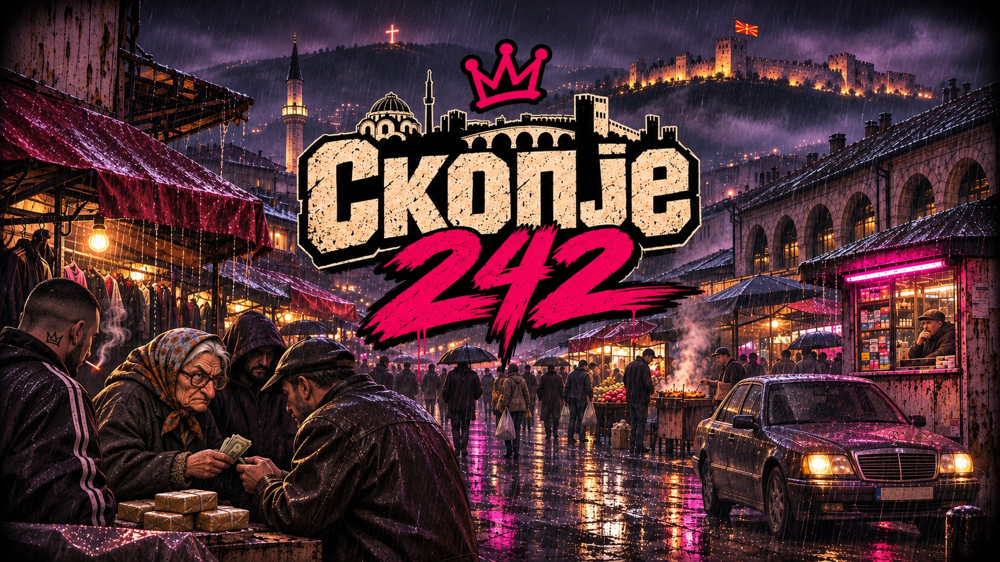

# СКОПЈЕ · 242

*„Тој што противправно ќе одземе туѓо моторно возило со намера да го употреби за возење, ќе се казни…“*\
(Кривичен законик, член 242)

Тргни покрај Вардар, сврти на првата раскрсница што ја препознаваш и види каде ќе те однесе патот. **Скопје · 242** е 3D игра со отворен свет за Windows. Низ градот можеш да се движиш пеш или со возило, да запознаваш луѓе и да го менуваш ликот додека играш.

## Прво возење

1. На GitHub избери **Code → Download ZIP** и отпакувај ја целата архива во една папка. Ако веќе го имаш репозиториумот, отвори ја неговата папка.
2. Стартувај го [`run.bat`](run.bat). При првото пуштање, стартувачот ја подготвува Python околината и ги презема потребните библиотеки.
3. Ако градот сè уште не е подготвен, во главното мени избери **ИЗГРАДИ ГО СВЕТОТ**. За преземање на податоците и изградба на градот ќе ти требаат интернет-врска и слободен простор на дискот.

За кратка проба, отвори Command Prompt во папката на играта и внеси `run.bat demo`. Тоа отвора измислен пробен град без преземање на скопската мапа. Првичното поставување на библиотеките и понатаму може да бара интернет.

Ако стартувањето заглави, провери ги `logs\install.log` за поставувањето и `logs\crash.log` ако играта се затворила со грешка.

## На улица

Возењето е само еден начин да го запознаеш градот. Застани на бензинска, побарај киоск или продолжи пеш и одговори му на минувач што ќе ти се обрати. Ликовите имаат свои приказни и реплики на македонски. На патот ќе сретнеш сообраќај, пешаци и јавен превоз, а со стемнувањето се менува и изгледот на градот.

| Копче | Дејство |
| --- | --- |
| **W A S D** или стрелките | Движење пеш или управување со возилото |
| **F** или **Enter** | Влегување, излегување или дејство кога е понудено |
| **Space** | Скок пеш, рачна сопирачка во автомобил |
| **Shift** | Трчање пеш |
| **M** | Карта |
| **L** | Избор на лик |
| **Esc** | Мени |

За игра со друштво, отвори соба во мултиплеер и сподели го кодот за приклучување. Во една соба собира вкупно четворица играчи.

## Како настанува градот

Улиците и контурите на зградите доаѓаат од OpenStreetMap, а висините на теренот од плочките Terrarium. Алатките во [`tools/`](tools/) ги претвораат овие податоци во 3D геометрија и патна мрежа што играта може да ги вчита. Во [`src/`](src/) се возењето, луѓето, сообраќајот и приказот со Python и raylib. Репликите и текстот од менијата се во [`text/`](text/).

За работа на проектот, почни од [техничкиот водич](technicalContext/README.md). Ако пријавуваш проблем, наведи каде се случил, дали си бил пеш или во возило и како може да се повтори.

Картографски податоци © [OpenStreetMap contributors](https://www.openstreetmap.org/copyright), под лиценцата ODbL.
