# СКОПЈЕ · 242

*„Тој што противправно ќе одземе туѓо моторно возило со намера да го употреби за возење, ќе се казни…“*\
(Кривичен законик, член 242)

**Отворен 3D свет низ улиците на Скопје, со македонски ликови, гласови и реплики.** Почни со кола, продолжи пеш низ ГТЦ или собери друштво и договорете си каде ќе се најдете. Со стемнувањето, истите улици ги осветлуваат фарови, излози и улични светилки.

[Како да ја стартуваш играта](#прво-стартување) · [Контроли](#контроли) · [Техничка документација](docs/README-architecture.md)

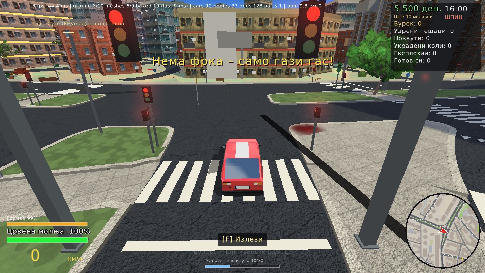

*Камера зад автомобилот. На екранот се гледаат брзината, горивото, состојбата на возилото и минимапата.*

## Еден град, неколку начини да го видиш

| Од улица | Детали на раскрсницата |
| --- | --- |
| 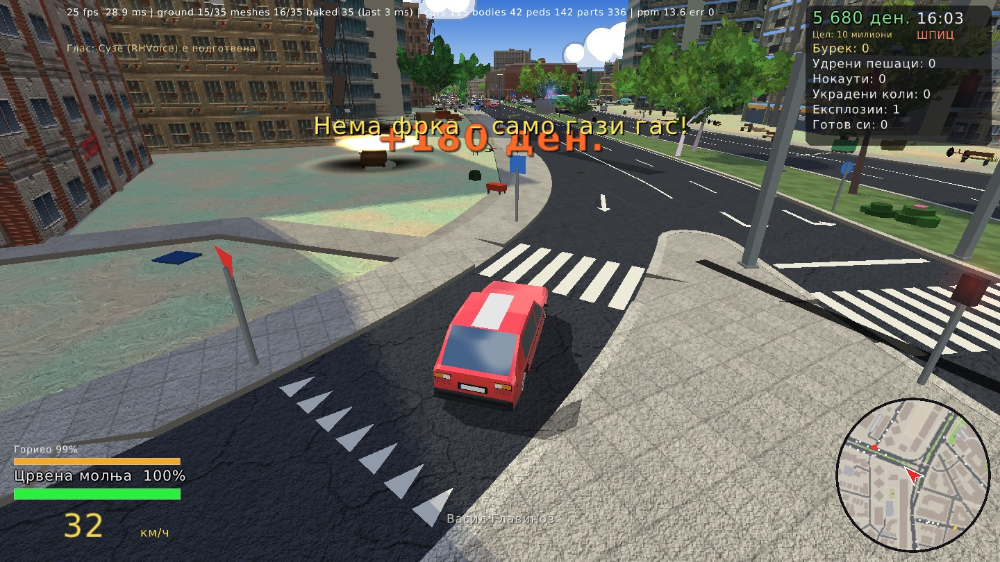 | 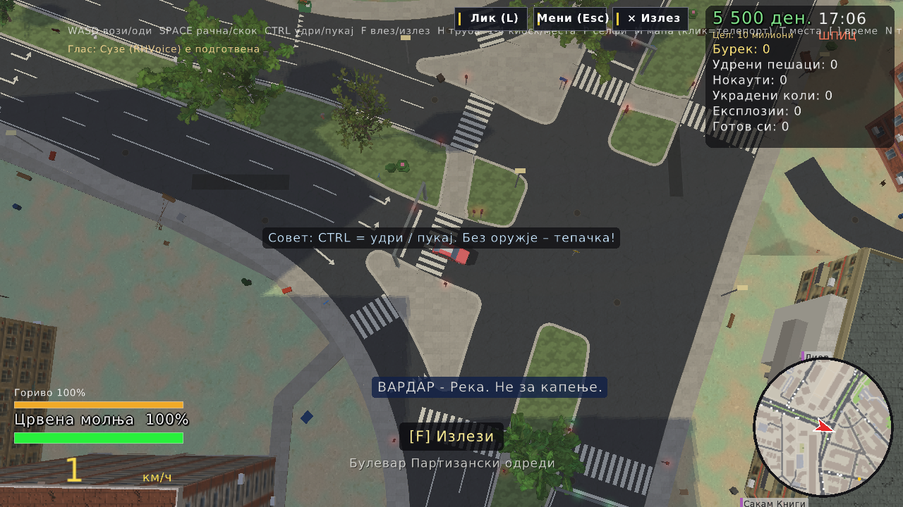 |
| Следи го патот зад воланот, со раскрсници и тротоари на висина на улицата. | Види како се спојуваат сообраќајните ленти, пешачките премини и островите. |
| 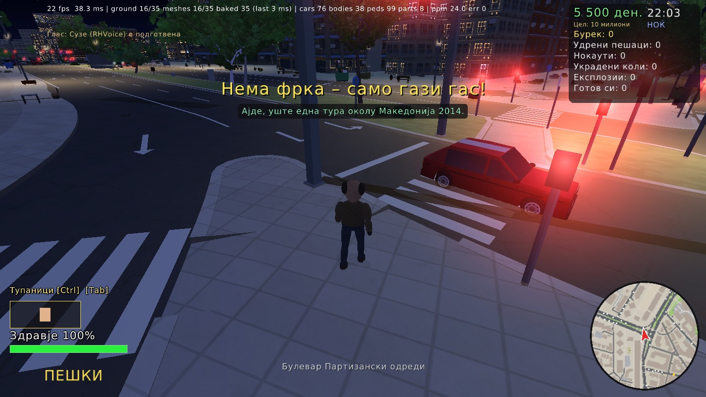 | 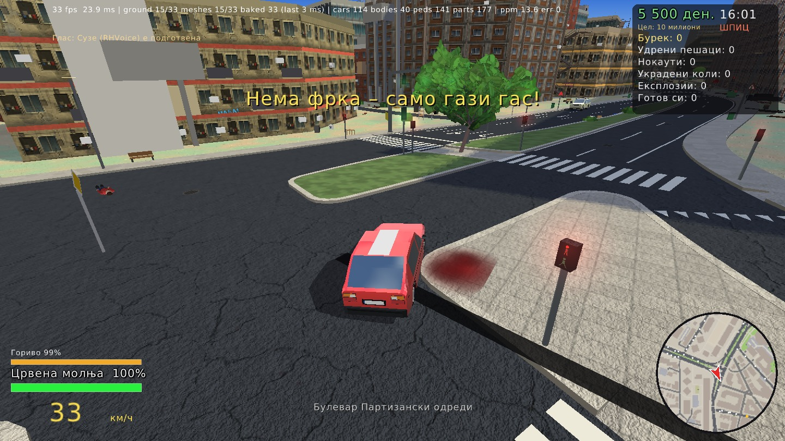 |
| Навечер, светлото од возилата и улицата ги издвојува патот и фасадите. | На приодот до раскрсницата се гледаат стоп линијата, зебрата и семафорите над коловозот. |

Улиците и основите на зградите се градат од податоци на OpenStreetMap и се поставуваат врз висинска карта. На самите улици се гледаат рабници и тротоари, стрелки по ленти, семафори, автобуски постојки, дрвореди и паркирани возила.

| Без DOF | Со DOF |
| --- | --- |
| 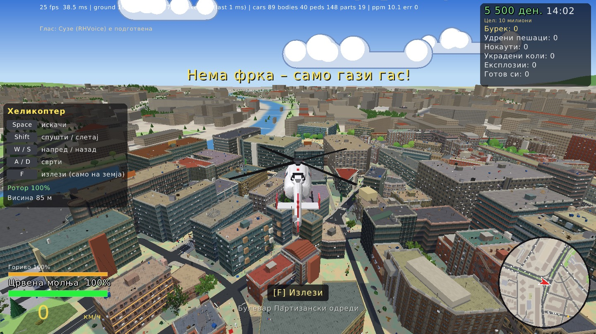 |  |

*Два кадра од ист лет. Со длабочинска острина (DOF), хеликоптерот останува во фокус додека градот под него е помек.* Со **Space** се искачуваш, со **Shift** се спушташ, а **F** служи за излегување откако ќе слеташ.

### Истата раскрсница, слој по слој

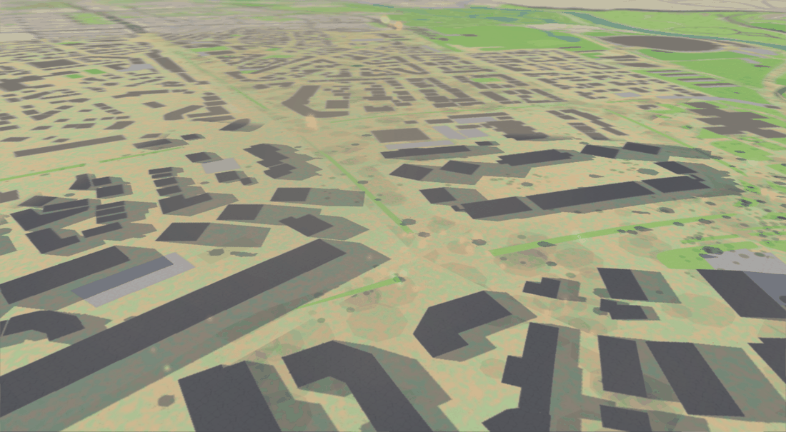

Камерата останува на истото место. Прво се гледа подлогата, потоа се додаваат коловозот и ознаките, зградите и фасадите, возилата и пешаците. Последниот кадар ја покажува истата сцена ноќе.

## Што се случува кога ќе излезеш од колата

| На киоск | Во ГТЦ |
| --- | --- |
| 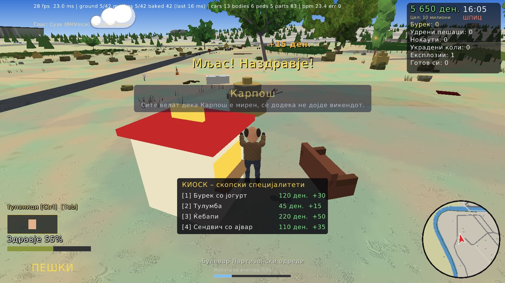 | 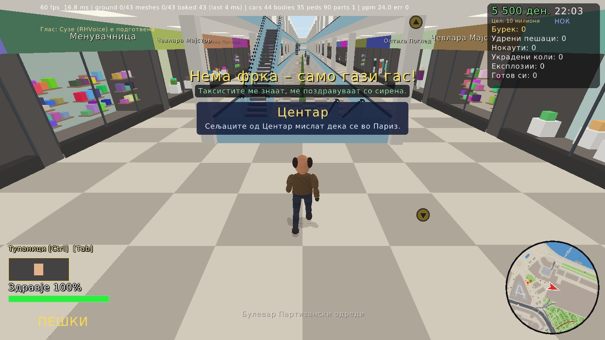 |
| Приближи се, прочитај што се нуди и избери со нумеричките копчиња. | Влези пеш и разгледај ги ходниците и излозите. |
| 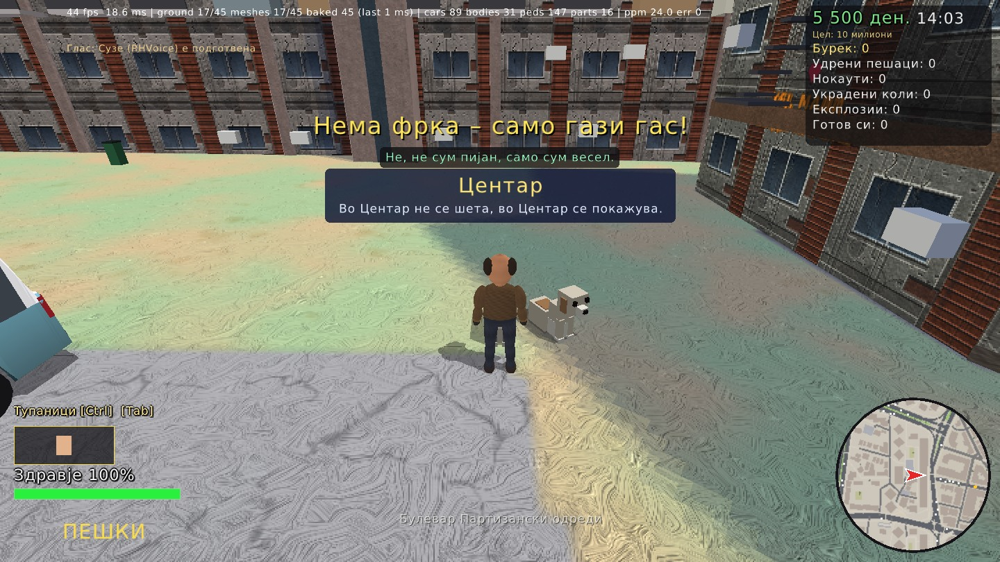 | 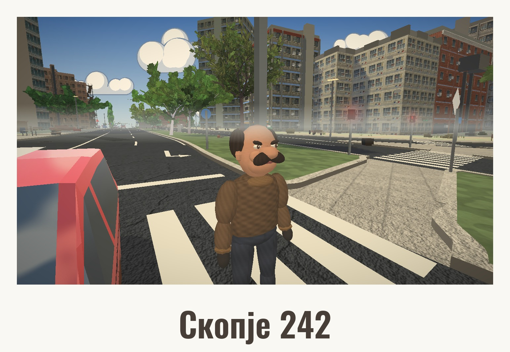 |
| Низ градот има и кучиња скитници. | Пеш, со **P** можеш да ја вклучиш камерата за селфи. |

Минувач може да ти се обрати. Кога ќе се појави избор, одговори со нумеричките копчиња или продолжи по својот пат. Снабди се на киоск, застани кај бензинска за гориво или разгледај ги услугите што се појавуваат кога си во близина. На улиците се движат и автобуси, а пешаците чекаат на постојките.

### Луѓето што ги играш

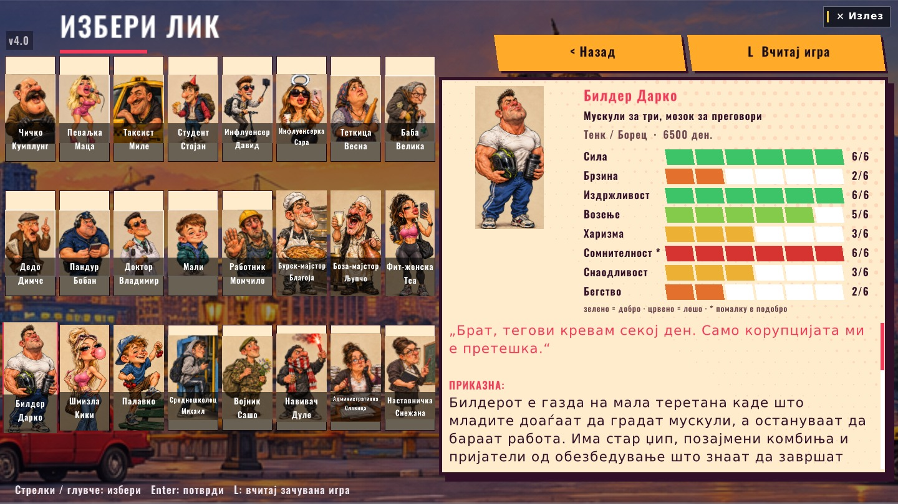

Смени лик со **L**. Изборот на лик ти дава различна почетна приказна, реплики и почетна сума во денари. Во соло играта можеш да го зачуваш напредокот во слот. По вчитувањето, градскиот сообраќај и минувачите повторно се создаваат.

### Возила и улици со свој ритам

| Во сообраќај | Пеш покрај возило |
| --- | --- |
| 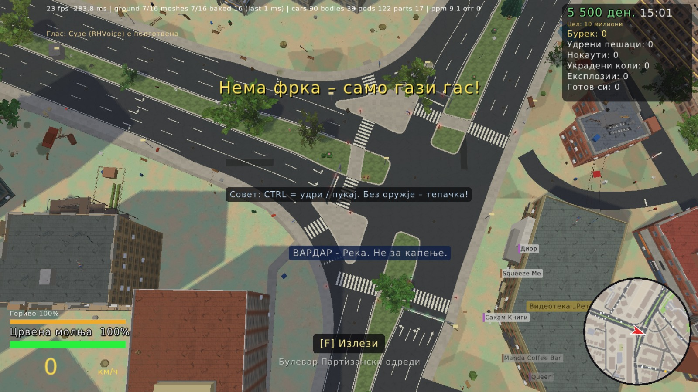 | 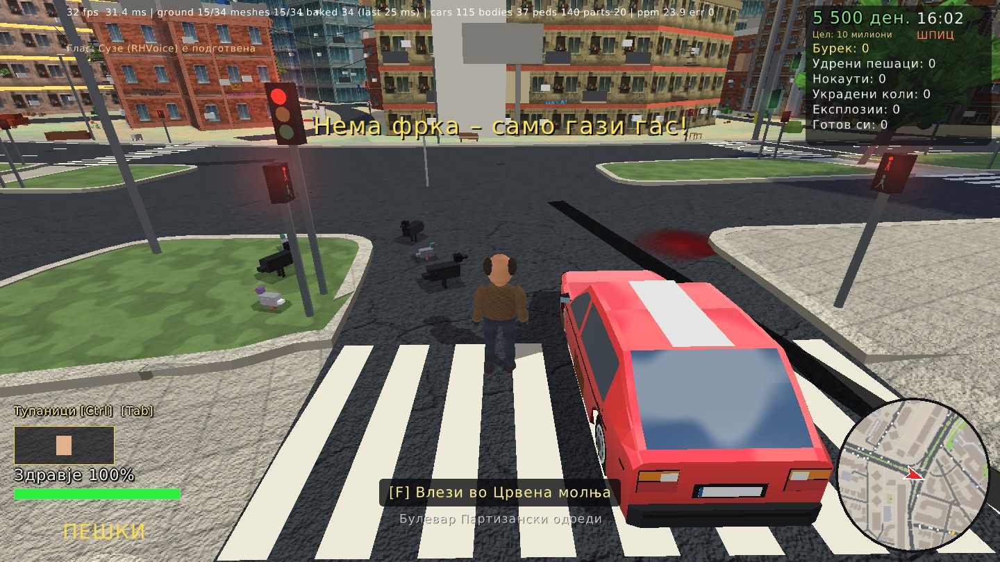 |
| Возилата се движат по ленти, застануваат на семафори и вртат низ раскрсници. | Приближи се до автомобил и употреби **F** кога ќе се појави понудата за влегување. |

Кога возиш, следи ја состојбата на колата и горивото. Со **Space** се користи рачната сопирачка, со **H** сирената, а со **Q** и **E** се менува радио станицата. Можеш и да ја напуштиш колата и да продолжиш пеш.

### Погледни ги деталите

| Места и ориентација | Акција пеш |
| --- | --- |
| 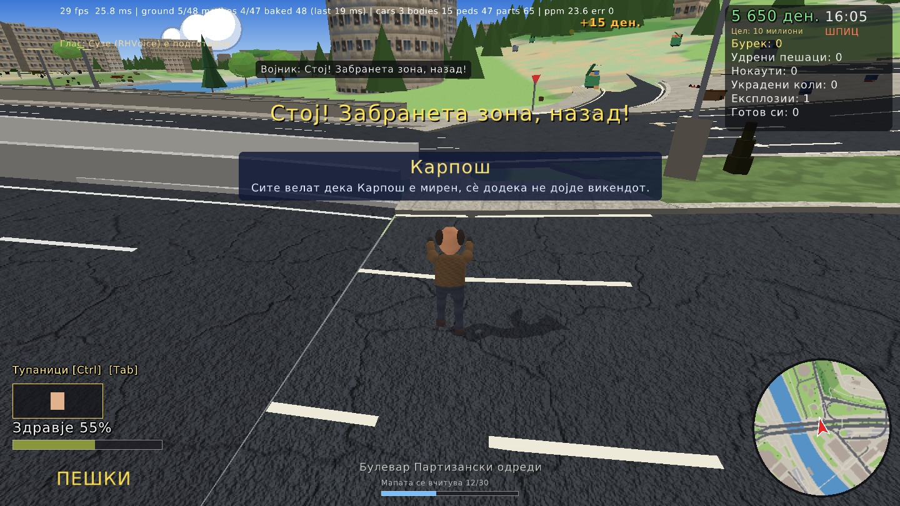 | 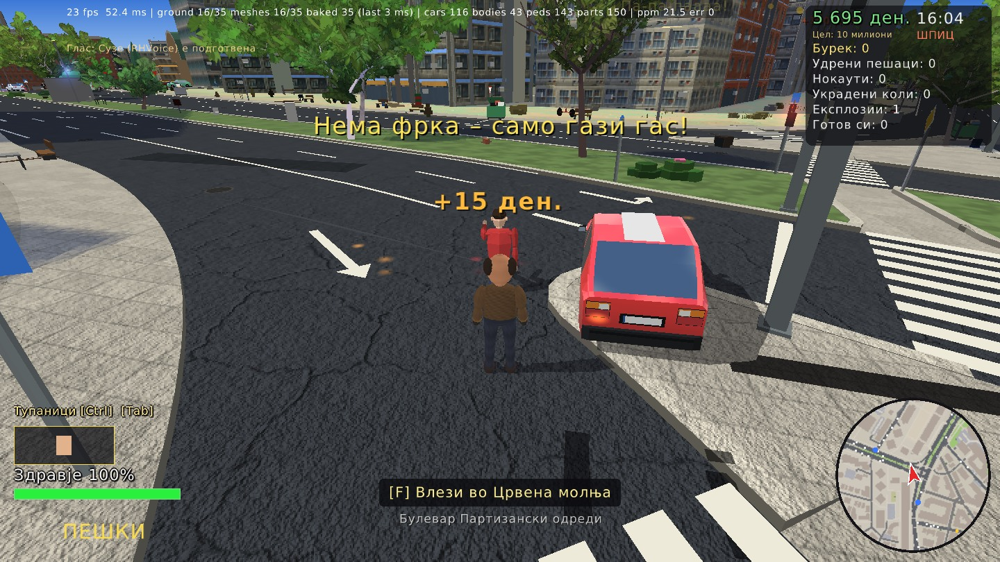 |
| Името на населбата и репликата се појавуваат додека се движиш, а минимапата покажува каде си. | Пеш, **Ctrl** е удар или употреба на избраното оружје. **Tab** го менува изборот. |

### Со друштво низ Скопје

Отвори мултиплеер соба за **до четворица играчи**, со домаќинот вклучен во бројката. Сподели го кодот за приклучување и договорете каде ќе се најдете во градот.

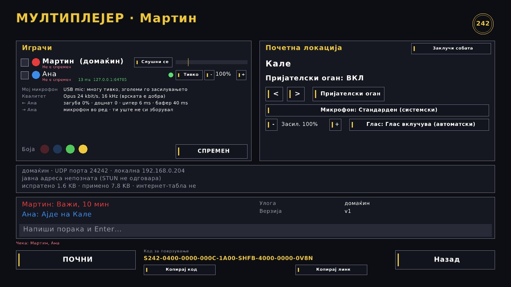

## Прво стартување

1. На GitHub избери **Code → Download ZIP** и отпакувај ја целата архива во една папка.
2. На Windows стартувај го [`run.bat`](run.bat). При првото пуштање, стартувачот ја подготвува Python околината и ги инсталира библиотеките.
3. Ако градот сè уште не е подготвен, избери **ИЗГРАДИ ГО СВЕТОТ** во главното мени. За преземањето и изградбата се потребни интернет и слободен простор на дискот.

За кратка проба отвори Command Prompt во папката на играта и внеси `run.bat demo`. Командата отвора измислен пробен град без преземање на скопската мапа. Првата инсталација на библиотеките може да бара интернет и во овој режим. Ако поставувањето заглави, провери го `logs\install.log`. Ако играта се затвори со грешка, провери го `logs\crash.log`.

## Контроли

| Копче | Дејство |
| --- | --- |
| **W A S D** или стрелките | Движење пеш или управување со возило |
| **F** или **Enter** | Влегување, излегување или понудено дејство |
| **Space** / **Shift** | Скок / трчање пеш |
| **Ctrl** / **Tab** | Удар или употреба на оружјето / следно оружје пеш |
| **M** / **L** / **P** | Карта / избор на лик / селфи пеш |
| **Q** и **E** / **,** и **.** | Радио станица / песна |
| **Esc** / **F11** | Мени / режим на прозорецот |

Картографски податоци © [OpenStreetMap contributors](https://www.openstreetmap.org/copyright), под лиценцата ODbL.
