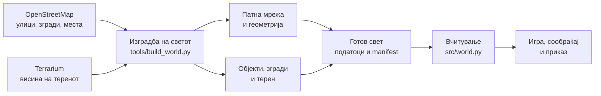
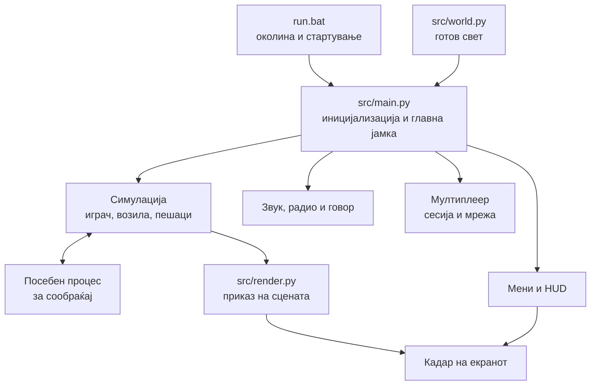

# СКОПЈЕ · 242


*„Тој што противправно ќе одземе туѓо моторно возило со намера да го употреби за возење, ќе се казни…“*\
(Кривичен законик, член 242)

Тргни покрај Вардар, сврти на првата раскрсница што ја препознаваш и види каде ќе те однесе патот. **Скопје · 242** е 3D игра со отворен свет за Windows. Низ градот можеш да се движиш пеш или со возило, да запознаваш луѓе и да го менуваш ликот додека играш.

## Прво возење

1. На GitHub избери **Code → Download ZIP** и отпакувај ја целата архива во една папка. Ако веќе го имаш репозиториумот, отвори ја неговата папка.
2. Стартувај го [`run.bat`](run.bat). При првото пуштање, стартувачот ја подготвува Python околината и ги презема потребните библиотеки.
3. Ако градот сè уште не е подготвен, во главното мени избери **ИЗГРАДИ ГО СВЕТОТ**. За преземање на податоците и изградба на градот ќе ти требаат интернет-врска и слободен простор на дискот.

За кратка проба, отвори Command Prompt во папката на играта и внеси `run.bat demo`. Тоа отвора измислен пробен град без преземање на скопската мапа. Првичното поставување на библиотеките и понатаму може да бара интернет.

Ако стартувањето заглави, провери ги `logs\install.log` за поставувањето и `logs\crash.log` ако играта се затворила со грешка.

## На улица

Возењето е само еден начин да го запознаеш градот. Застани на бензинска, побарај киоск или продолжи пеш и одговори му на минувач што ќе ти се обрати. Ликовите имаат свои приказни и реплики на македонски. На патот ќе сретнеш сообраќај, пешаци и јавен превоз, а со стемнувањето се менува и изгледот на градот.

| Копче | Дејство |
| --- | --- |
| **W A S D** или стрелките | Движење пеш или управување со возилото |
| **F** или **Enter** | Влегување, излегување или дејство кога е понудено |
| **Space** | Скок пеш, рачна сопирачка во автомобил |
| **Shift** | Трчање пеш |
| **M** | Карта |
| **L** | Избор на лик |
| **Esc** | Мени |

За игра со друштво, отвори соба во мултиплеер и сподели го кодот за приклучување. Во една соба собира вкупно четворица играчи.


## Како настанува градот

Улиците и контурите на зградите доаѓаат од OpenStreetMap, а висините на теренот од плочките Terrarium. Алатките во [`tools/`](tools/) ги претвораат овие податоци во 3D геометрија и патна мрежа што играта може да ги вчита. Во [`src/`](src/) се возењето, луѓето, сообраќајот и приказот со Python и raylib. Репликите и текстот од менијата се во [`text/`](text/).

За работа на проектот, почни од [техничкиот водич](technicalContext/README.md). Ако пријавуваш проблем, наведи каде се случил, дали си бил пеш или во возило и како може да се повтори.


## Што можеш да правиш

- **Истражувај** пеш и зад волан. Картата со **M** помага да се ориентираш, а имињата на места се појавуваат додека се движиш.
- **Разговарај** со луѓето што ќе ти пријдат. Кога играта нуди разговор, избери одговор со нумеричките копчиња.
- **Користи услуги** низ градот, посети продажни места и наполни гориво на бензинска станица. Достапните дејства се прикажуваат на екранот кога си во близина.
- **Смени лик** со **L**. Секој лик има сопствен идентитет и реплики.
- **Играј со пријатели** преку соба за најмногу четири играчи. Домаќинот создава соба, а другите се приклучуваат со споделен код.

### Уште контроли

| Копче | Дејство |
| --- | --- |
| **Ctrl** | Удар или употреба на оружје |
| **Tab** | Следно оружје пеш |
| **H** | Сирена |
| **Q / E** | Претходна / следна радио станица |
| **, / .** | Претходна / следна песна |
| **N** | Исклучување или вклучување на звукот |
| **F11** | Промена на режимот на прозорецот |

### Стартување од командна линија

Отвори Command Prompt во папката на играта и избери команда:

```bat
run.bat
run.bat demo
run.bat setup
run.bat refresh
run.bat aivoice
```

Првата команда ја стартува играта. `demo` го отвора пробниот град, `setup` повторно ја проверува инсталацијата, а `refresh` повторно ги презема податоците за мапата и го изградува светот. `aivoice` ја инсталира опционалната невронска гласовна поддршка. За прозорец со одредена големина може да се употреби `run.bat --size 1280x720`.

## Од карта до град

Градот се подготвува однапред. Изворните податоци минуваат низ повеќе фази што создаваат геометрија и податоци за движење, а играта го вчитува готовиот свет. Градбата користи зачувани резултати од фазите за повторна употреба кога соодветните влезови и код остануваат исти.



| Дел од светот | Што се подготвува | Како се користи |
| --- | --- | --- |
| Патишта | Површини, ленти, раскрсници и граф на патишта | Приказ, движење и насочување на сообраќајот |
| Терен | Висинска мрежа и површини | Висина на градот и поставување објекти |
| Згради | Основи, геометрија и просторни податоци | Приказ, судири и просторни пребарувања |
| Објекти | Улична опрема, вегетација и други детали | Изглед и интеракции во градот |

На сликата погоре се гледа готова раскрсница во играта, со ленти, пешачки премини, семафори, возила и минимапа.

## Како работи играта



Главната јамка ги поврзува влезот од играчот, симулацијата и приказот. Сообраќајот работи во посебен процес, додека мрежните модули се грижат за сесијата и размената на состојбата меѓу играчите. Зачуваната игра враќа дел од состојбата, а сообраќајот и пешаците повторно се создаваат при вчитување.

### Каде да почнеш во кодот

| Задача | Почетна точка |
| --- | --- |
| Стартување и главна јамка | [`src/main.py`](src/main.py) |
| Возење и возила | [`src/driving.py`](src/driving.py), [`src/vehicles.py`](src/vehicles.py) |
| Свет и просторни пребарувања | [`src/world.py`](src/world.py) |
| Градба на градот | [`tools/build_world.py`](tools/build_world.py) и [`tools/stages.py`](tools/stages.py) |
| Приказ и графика | [`src/render.py`](src/render.py), [`src/gl3d.py`](src/gl3d.py) |
| Мултиплеер | [`src/mp.py`](src/mp.py), [`src/mpnet.py`](src/mpnet.py) |
| Текст и превод | [`text/README.md`](text/README.md) |
| Детална техничка карта | [`technicalContext/README.md`](technicalContext/README.md) |

Поставките се чуваат во `settings.json`, зачуваните игри во `saves/`, а генерираниот свет во `data/cache/world/`. Овие локални податоци можат да бидат големи и се одвоени од изворниот код.
Картографски податоци © [OpenStreetMap contributors](https://www.openstreetmap.org/copyright), под лиценцата ODbL.
