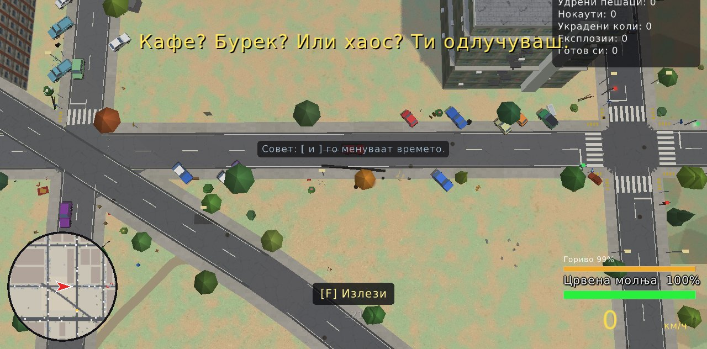
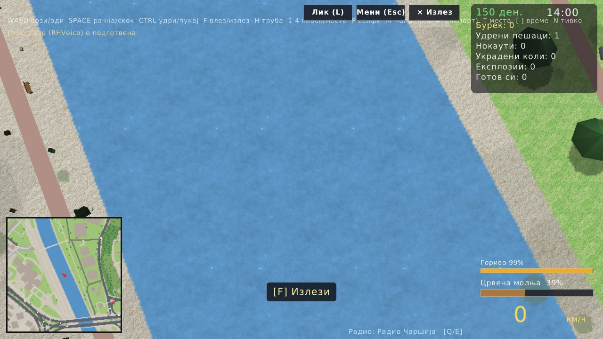
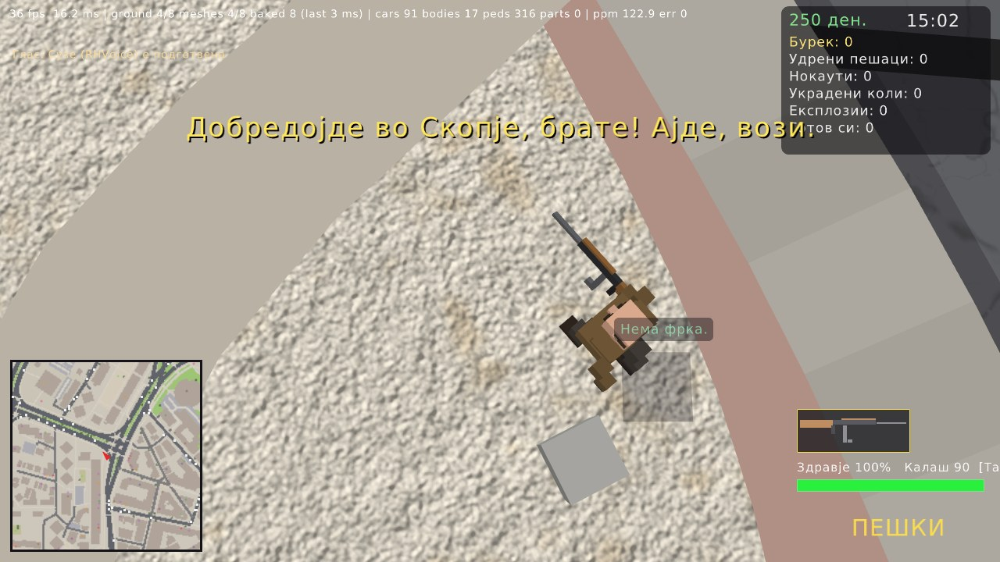
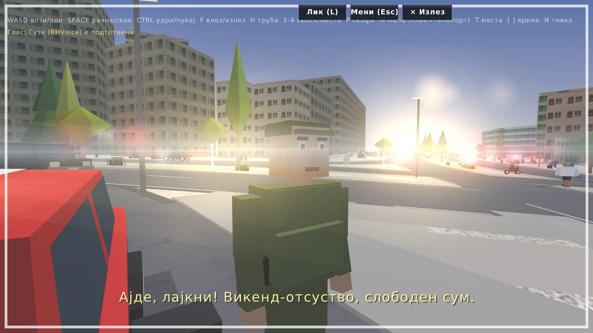
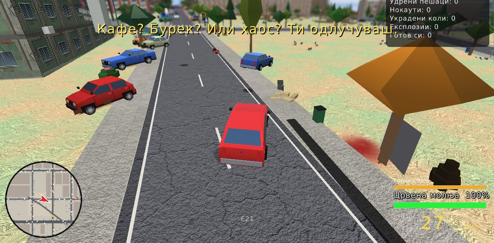
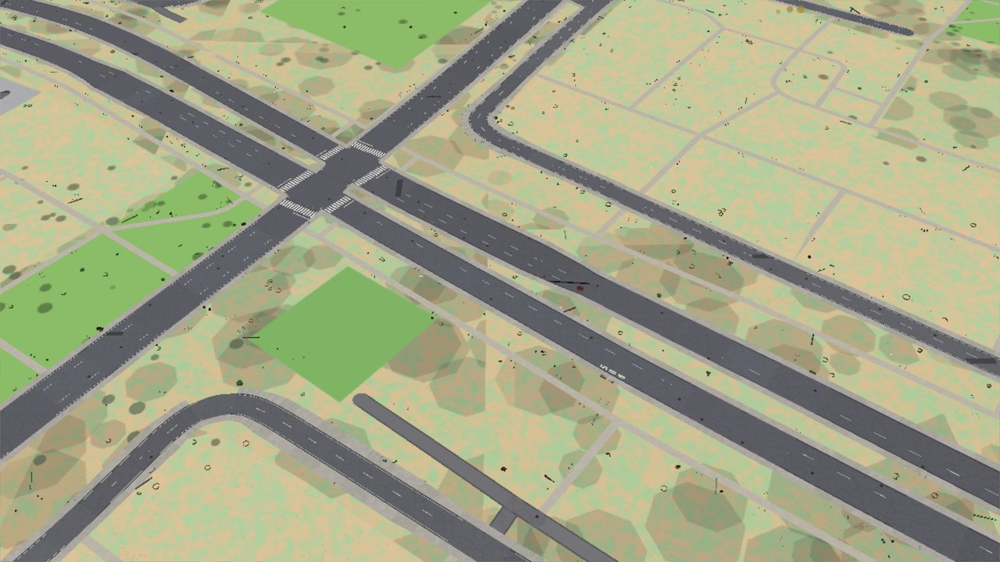

<h1 align="center">СКОПЈЕ · 242</h1>

<b>Член 242: одземање на моторно возило.</b> 
<i>„Тој што противправно ќе одземе туѓо моторно возило со намера да го употреби за возење, ќе се казни…“</i>

<b>Песочна игра со криминална комедија во вистинското Скопје, во 3D.</b> 
Вистински улици, ридови, Вардар и Камен мост. По нив возат автобуси, возови и полиција, а шетаат тетки, пензионери и еден таксист со став за сè.

<a href="#брз-почеток"><b>▶ Брз почеток</b></a> ·
<a href="#содржина">Содржина</a> ·
<a href="CHANGELOG.md">Историја на изданија</a> ·
<a href="docs/README.en.md">README in English</a>

---

## Содржина

1. [За играта](#за-играта)
2. [Брз почеток](#брз-почеток)
3. [Што има во играта](#што-има-во-играта)
4. [Градот и податоците](#градот-и-податоците)
5. [Сообраќај и лабораторија за сообраќај](#сообраќај-и-лабораторија-за-сообраќај)
6. [Мултиплеер и гласовен разговор](#мултиплеер-и-гласовен-разговор)
7. [Команди](#команди)
8. [Поставки и опции за пуштање](#поставки-и-опции-за-пуштање)
9. [Алатки и мерење на брзината](#алатки-и-мерење-на-брзината)
10. [Структура на проектот](#структура-на-проектот)
11. [Верзии и ажурирање](#верзии-и-ажурирање)
12. [Придонес](#придонес)
13. [Заслуги и лиценци](#заслуги-и-лиценци)

## За играта

**Скопје · 242** е отворен свет во 3D, изграден врз вистинската мапа на Скопје. Играта сама ги симнува отворените податоци (улици, згради, реки, паркови, терен), ги претвора во град и те пушта да се шеташ, возиш, тепаш и јадеш бурек. Сè што се гледа и слуша на екранот е на македонска кирилица, со улично скопски зборови.

| | |
|---|---|
|  |  |
|  |  |

Дел од сликите се од малата тест-мапа што играта ја гради за проба, не од вистинското Скопје.

## Брз почеток

**Барања:** Windows и интернет при првото пуштање. Сè друго го става `run.bat`.

1. Симни го или клонирај го репото.
2. Кликни двапати на **`run.bat`**.
3. Првиот пат ги подготвува Python и библиотеките, ја симнува мапата од OpenStreetMap и теренот и го гради градот (неколку минути, додека трае екранот за вчитување). Потоа играта се пушта за секунди.
4. Избери лик, приближи се до која било кола и притисни **`F`**.

| наредба | што прави |
|---|---|
| `run.bat` | нормално пуштање на вистинското Скопје |
| `run.bat demo` | мал синтетички град, без интернет (за проба) |
| `run.bat setup` | пак ја проверува целата подготовка |
| `run.bat refresh` | пак ја симнува мапата и го гради градот |
| `run.bat aivoice` | еднократна инсталација на изборниот неврален глас |
| `trafficSimulator.bat` | [лабораторија за сообраќај](#лабораторија-за-сообраќај) |
| `make_exe.bat` | незадолжително: самостоен exe со PyInstaller (експериментално) |

Другите аргументи одат директно во играта, на пример `run.bat --size 1280x720`.

Библиотеките се во [`requirements.txt`](requirements.txt): `raylib`, `numpy`, `pillow`, `mapbox-earcut`, `sounddevice` (и `PyOgg` на Windows).

## Што има во играта

### Возила

Околу сто модели возила, сите нацртани со код: југо, фичо, лади нива, трабант, голф двојка, пасат, комби, такси, полиција, брза помош, пожарна, двокатен ЈСП автобус, автобус за далечни линии, свадбарска лимузина, трактор ИМТ, цистерни, полуприколки, велосипеди, мопеди и е-тротинети. Предните тркала вртат со воланот, задниот дел се лизга (има дрифт), а ударите, пожарот и експлозиите се вистински. Извори за изгледот: [docs/VEHICLE_REFERENCES.md](docs/VEHICLE_REFERENCES.md).

- **Мотори:** синтетизиран звук со слоеви за празен од, гас и високи вртежи, квачило и менување на брзини, а дизелите и тракторот звучат по свое.
- **Брзина:** колите ја достигнуваат својата вистинска максимална брзина; на трева и земја губат повеќе, теренските помалку; угорнините ги забавуваат.
- **Полуприколки:** камионите со влекач и приколка вртат со вистински зглоб.
- **Хеликоптер:** на болничките хелиодроми стојат медицински хеликоптери што можеш да ги леташ.
- **БТР-80:** во секоја касарна стои оклопен транспортер со топ од 30 мм што можеш да го земеш.

### Јавен превоз

- **ЈСП автобуси** по вистински линии, застануваат на вистински постојки и се влечат до рабникот. Качување со `F` (40 денари).
- **Возови** по вистинската пруга, со застанување на станиците и рампи на премините.
- **Е-тротинети** кај автобуските станици (30 денари).
- **Трговски центар ГТЦ** во кој се шета: сала, подвижни скали, излози и врати.

### Луѓе и ликови

- **24 лика за играње** (Таксист Миле, Доктор Владимир, Инфлуенсер Давид, Теткица Весна, Баба Велика, Дедо Димче, Пандур Бобан, Бурек-мајстор Благоја и други), секој со свои реплики и свој глас.
- Пешаците зборуваат на три нивоа на јазик (чисто, улица, без цензура), се лутат, те псуват и на крајот се тепаат.
- Говорот е синтетизиран со македонскиот глас **Сузе** (RHVoice); лабораторијата за гласови (`src/voicelab.py`) им дава на ликовите различна боја на гласот.
- Кучиња скитници, гулаби, патки и врани.

### Борба и свет што се руши

- Тупаници, ланец, палка, мачета, пиштол, револвер, узи, ингрем, пумпарица, калаш и зоља, со вистински проектили што погодуваат луѓе, коли, ѕидови и дрвја. Менување на оружје со `Tab`.
- Предметите во светот (дрвја, огради, улична опрема) се кршат; експлозиите се ланчани.
- За секој удар, смачкување и експлозија добиваш денари.
- Брзата помош оживува, пожарната гаси, полицијата те бара.

### Места

- **Полициски станици и касарни** со порти, будки и стражари; може и тивко да се пресече оградата.
- **Покриви** со цик-цак скали за бегство и рампи за скок.
- **Киосци, кафулиња, банки, цркви, училишта, пумпи и маркети** со свое мени, и **станици за радио** во секоја кола (`Q`/`E`), со твоја музика од папката `music/`.
- **Селфи** (`P`): JPEG во стил на полароид.

### Изглед и звук

- **Ден и ноќ** со часовник што го вртиш сам, сенки од сонцето, смог со лизгач.
- **Три погледи:** одозгора, од трето лице зад колата и од улица, со длабочинска острина (заматување на далечината).
- **Дрвја** од 19 видови, со различно детално цртање според оддалеченоста и лесен ветер.
- **Графити** со кирилични зборови, **изабени фасади**, постери, 3D обележја и верски објекти (цркви, џамии, турбиња).
- **Звук:** синтетизирани ефекти за сè без снимка, звучна библиотека (`library/`) и еден заеднички систем на гласност ([docs/SOUND_LEVELS.md](docs/SOUND_LEVELS.md), [docs/SOUND_LIBRARY.md](docs/SOUND_LIBRARY.md)).
- **Минимапа** во аголот и **голема мапа** (`M`) на која со клик се телепортираш.

| | |
|---|---|
|  |  |
|  |  |

## Градот и податоците

Целиот град се гради на твојот компјутер од отворени податоци. Нема готов свет во репото.

| 1 · Терен | 2 · OSM | 3 · Голи патишта | 4 · Инфраструктура | 5 · Згради | 6 · Луѓе и коли | 7 · Светла |
|---|---|---|---|---|---|---|
|  |  |  |  |  |  |  |

- **Мапа:** OpenStreetMap (улици, згради, води, паркови, места, пруга, семафори). Каде што реалноста бара, патиштата се дотеруваат: двојни мостови со разделни појаси, пешачки мостови, подвозници (Гоце Делчев), Камен мост со десет лаци, кеј по Вардар.
- **Терен:** висински плочки (AWS Terrarium), па колите и пешаците ги чувствуваат угорнините.
- **Згради:** процедурални фасади, покриви и детали според типот на зградата.
- **Фотограметрија (незадолжително):** алатка што од улични фотографии со позиција и насока ги вклопува височините и обликот на зградите (`src/photogram.py`, прегледот во играта и `tools/photogram_full.py`). Фотографиите и резултатите остануваат локално и не се во репото.
- Градењето е на делови и може да продолжи, па `run.bat refresh` ја освежува мапата.

Опис на целиот тек: [docs/ARCHITECTURE.md](docs/ARCHITECTURE.md).

## Сообраќај и лабораторија за сообраќај

Вештачкиот сообраќај вози во свој процес (`src/trafficproc.py`) и го опфаќа градот околу играчот: коли, автобуси, брза помош и пожарна, возови и пешаци, со семафори, предност, избор на лента, престројување и самоодврзување на заглавени редици. Семафорите се земени од мапата, а според потреба се додаваат на поголемите раскрсници (`src/signals.py`).

### Лабораторија за сообраќај

Двоен клик на **`trafficSimulator.bat`** отвора 2D лабораторија на изградениот свет. Ја користи **истата симулација како играта** и само мери.

- Мапа со бои (брзина, густина, чекање, конфликти, ниво на услуга по раскрсница, ленти).
- Уредување во живо: затворени улици, пречки, повици за брза помош, пожари и дефекти.
- **Серии** со повеќе семиња на сите јадра и HTML извештај (ефикасност, безбедност, брзина, интервали на доверба, Welch t-тест).
- **Истражување** на правила и константи со случаен и еволуциски пребарувач.
- **Примени во играта** го запишува `traffic_tuning.json`, што играта го вчитува при пуштање. Избриши го за да се вратат стандардните вредности.

Опис: најновите записи во [CHANGELOG.md](CHANGELOG.md).

## Мултиплеер и гласовен разговор

До **4 играчи** без наш сервер: еден е домаќин, другите се приклучуваат. Подетално: [docs/MULTIPLAYER.md](docs/MULTIPLAYER.md).

- **Приклучување:** од списокот на локалната мрежа, со **краток код од збор и број** (на пример „ШМЕКЕР 42“) или со долг код `S242-…` што се праќа по Viber или WhatsApp. Прифаќа и обичен `IP:порта`.
- **Низа на поврзување:** директно по UDP, па „дупчење“ низ NAT, па реле преку јавен MQTT брокер кога ништо директно не успева. Лобито го покажува видот на NAT и причината ако не успее.
- **Светот:** секој црта своја камера, а сообраќајот и пешаците околу играчите ги води власта на групата; кршењето, одземените и оставените коли се споделени.
- **Гласовен разговор** (`src/voice.py`): свој кодек, три нивоа на квалитет што се менуваат според загубата и доцнењето, тампон за треперење, притисни-за-зборување (`V` по основно, или Alt, Caps Lock, средно копче) или автоматско откривање, јачина по играч, самотест и дијагностика со причина во лобито.
- **Безбедност и издржливост:** потпишани пакети, повторно приклучување по пад и селидба на домаќинството во игра.
- Повеќето од ова е проверено само во лабораторија за NAT (`tools/natlab/`), не на вистински јавни мрежи.

## Команди

| тастер | во кола | пешки |
|---|---|---|
| `W A S D` / стрелки | вози | оди / врти |
| `Shift` | – | трча |
| `Space` | рачна (дрифт) | скока |
| `Ctrl` | – | удар, клоца или пука |
| `Tab` | – | следно оружје |
| `F` / `Enter` | излез | влез / одземање на возило, автобус, воз, врати |
| `R` | враќање на колата на патот | – |
| `H` | клаксон / сирена | кажи нешто |
| `1`–`4` | – | киоск: бурек, тулумба, кебапи, сендвич |
| `Q` / `E` | радио станица | – |
| `P` | селфи | селфи |
| `M` / `Tab`*| голема мапа, клик за телепорт | исто |
| `T` / `Shift+T` | следна / претходна населба | исто |
| `[` / `]` | време на денот −1 ч / +1 ч | исто |
| `L` | смени лик | исто |
| `V` | притисни-за-зборување (мултиплеер) | исто |
| `N` · `F3` · `F11` · `Esc` | тивко · статистика · цел екран · мени / зачувај / вчитај | исто |

* Командите за хеликоптерот и БТР-80 ти се покажуваат на екранот кога ќе влезеш. Копчето за зборување се менува во Поставки → Звук.

## Поставки и опции за пуштање

Менито (`Esc`) има табови: **Игра, Градот, Луѓето, Графика, Контроли, Звук, Дебаг** (камера, длабочинска острина, детали на ликовите, мултиплеер, гласовни поставки, теми на менито). Поставките се чуваат во `settings.json` и не се во репото.

| опција | значење |
|---|---|
| `--size 1280x720` · `--fullscreen` | големина на прозорецот |
| `--cars N` · `--peds N` | колку коли и пешаци |
| `--hour H` | почетен час (0–24) |
| `--mute` | без звук |
| `--demo` | синтетичкиот град |
| `--refresh` · `--rebuild` | симни пак и изгради / само изгради |
| `--nomenu` · `--car` · `--foot` | прескокни го менито · почни во кола · почни пешки |
| `--world <папка>` | друг изграден свет |

## Алатки и мерење на брзината

Во `tools/` има алатки за подготовка и проверка. Некои:

| алатка | за што |
|---|---|
| `fetch_osm.py`, `fetch_terrain.py`, `fetch_pois.py`, `fetch_world.py` | симнување на мапа, терен и места |
| `build_world.py`, `stages.py`, `par.py` | градење на светот (по чекори, паралелно) |
| `make_synthetic_osm.py` | мал град за проба без интернет |
| `traffic_lab.py`, `traffic_audit.py`, `traffic_study.py` | сообраќај: лабораторија и анализа |
| `road_audit.py`, `ride_audit.py`, `z_audit.py`, `sidewalk_audit.py` | проверки на патишта, висини, треперење и тротоари |
| `perf.py`, `perf_gl.py`, `perf_report.py` | мерење на брзината и извештај |
| `test_*.py` | автоматски тестови (мрежа, мултиплеер, глас, сообраќај…) |
| `tools/natlab/` | лабораторија за NAT (бара root и Linux) |
| `check_text.py` | проверка на `text/` |

Тест без екран: `python src/main.py --demo --test 300 --mute` (на Linux со `xvfb-run`).

## Структура на проектот

| патека | содржина |
|---|---|
| `run.bat`, `trafficSimulator.bat`, `make_exe.bat` | пуштање, лабораторија, exe |
| `src/` | играта: симулација (`actors.py`), цртање (`render.py`, `gl3d.py`), сообраќај, мултиплеер (`mp*.py`, `voice.py`), звук, мени, ажурирање |
| `tools/` | градење на светот, анализа, тестови |
| `text/` | **сите** македонски текстови на играта, по теми; кодот нема кирилица, бара текст по клуч (види [text/README.md](text/README.md)) |
| `assets/` | почетни слики, икона, фонтови, ликови, постери, текстури |
| `library/`, `music/` | звучна библиотека и твоја музика за радиото |
| `docs/` | [архитектура](docs/ARCHITECTURE.md), [мултиплеер](docs/MULTIPLAYER.md), [звук](docs/SOUND_LEVELS.md), [извори на текст](docs/TEXT_SOURCES.md), [возила](docs/VEHICLE_REFERENCES.md), слики |
| `data/`, `saves/`, `logs/` | се создаваат при работа и не се во репото |

## Верзии и ажурирање

- Верзија: **v`<MAJOR>`.`<број на кумит на main>`** (сега MAJOR е 3). По секое поставување на `main` GitHub Action го запишува бројот во `src/build.txt` и додава кумит „Build N“; затоа секогаш прво `git pull --rebase`.
- При пуштање играта проверува на GitHub и ти нуди понова верзија; симнува само променети датотеки и сама се рестартира. Зачуваните игри, поставките, музиката и изграденот свет не се допираат.
- Историја на изданија: [CHANGELOG.md](CHANGELOG.md).

## Придонес

- Прочитај го [CLAUDE.md](CLAUDE.md) (правила за работа): мали, хируршки промени, секоја линија да следи од барањето, и проверка пред да се каже дека е готово.
- Македонските текстови се во `text/`, ги уредува јазичен уредник; не ги менувај од код. По уредување пушти `python tools/check_text.py`.
- Работата оди директно на `main` (без пул-реквести); пред поставување `git pull --rebase`. Не се качуваат `settings.json`, `saves/`, `output/`, `tmp/` и изграден свет.
- Пријави грешка или предлог како Issue на GitHub.

## Добро е да знаеш

- Само Windows. Првиот пат треба интернет за мапата и гласот.
- Македонскиот текст не го прегледал јазичен уредник ([docs/TEXT_SOURCES.md](docs/TEXT_SOURCES.md)).
- Измислено е. Не одземај туѓи возила во живот: токму за тоа е Член 242.

## Заслуги и лиценци

- Мапа © соработници на OpenStreetMap, лиценца ODbL. Терен: плочки AWS Terrarium (отворени SRTM податоци).
- **Глас: Сузе**, македонски женски глас за RHVoice, © УНИЦЕФ, од говорната група на ФЕИТ УКИМ ([suze-mkd](https://github.com/RHVoice/suze-mkd)), лиценца **CC BY-NC-ND 4.0**; `run.bat` го симнува, не е во пакетот. Моторот RHVoice: LGPL-2.1+.
- Фонтови: DejaVu Sans (`assets/fonts/LICENSE_DEJAVU`) и Oswald (SIL OFL).
- Радио: се пушта само музика што ти сам ќе ја ставиш во `music/`.
- Мултиплеер: јавни STUN и MQTT сервери (без наш сервер).
- Лиценца на кодот на играта: во репото сега нема датотека `LICENSE`, па не е одредена.
