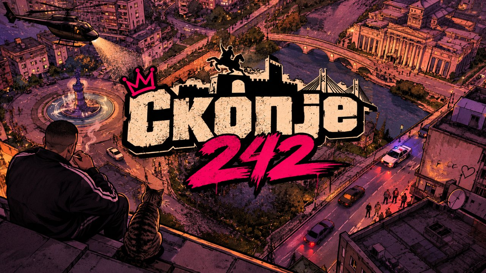
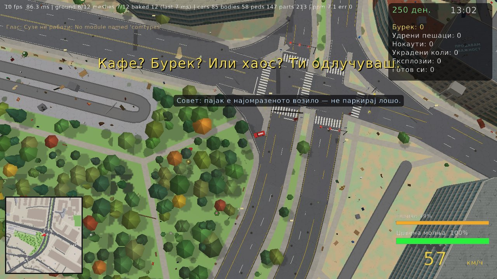

<h1 align="center">СКОПЈЕ · 242</h1>

<b>Одземање на моторно возило</b> 
<i>„Тој што противправно ќе одземе туѓо моторно возило со намера да го употреби за возење, ќе се казни…“ 
— Кривичен законик, Член 242</i>

изд. 3 · само Windows · Python + raylib

<b>Целото Скопје во 3D. Земи кола. Земи бурек. Земи го ЈСП. Не земај шамар.</b>

Песочна игра во вистинско 3D по Скопје: мапа од **OpenStreetMap** и отворени висински податоци, 11 × 7 км околу Камениот мост.
Сè што мапата го нема (згради, дрвја, лампи, паркирани коли, сообраќај, пешаци) се генерира само.
Кубурај по Партизанска во југо, фати ЈСП, земи бурек на киоск и слушај ги тетките и пензионерите како те кастрат на чист скопски.

| | |
|---|---|
|  |  |
|  |  |
|  |  |

## Содржина

[Пуштање](#пуштање) · [Ново](#ново) · [Команди](#команди) · [Што има](#што-има) · [Што каде е](#што-каде-е) · [Ограничувања](#ограничувања) · [Заслуги](#заслуги-и-лиценци)

## Пуштање

1. Симни го или клонирај го репото.
2. Кликни двапати на **`run.bat`**. Првиот пат прави кратенка **„Skopje 242“** со иконата на играта во папката и на работната површина, па потоа може да пуштиш и од неа.

Првпат ќе му треба некоја минута: го става Python и библиотеките, ја симнува мапата (Geofabrik / Overpass) со теренот, железницата (`rail.json`) и семафорите (`signals.json`) и го гради светот (верзија 54). Ако некоја од двете датотеки недостасува, играта пак го пушта симнувањето. Потоа се пушта за секунди.

| наредба | што прави |
|---|---|
| `run.bat` | игра на вистинската скопска мапа |
| `run.bat refresh` | пак ја симнува мапата и го гради светот |

Дополнителни опции: `--size 1280x720`, `--fullscreen`, `--cars N`, `--peds N`, `--hour H`, `--mute`.
Тури своја музика во `music/` за радиото во колата (потпапките стануваат станици).

**Автоматско ажурирање:** при секое пуштање играта ја споредува својата верзија (`.version`) со најновата на GitHub. Ако има понова, бира: симни и ажурирај (играта сама се рестартира) или остани на старата. Зачуваните игри, поставките, изградениот свет, музиката и `.bat` датотеките не се допираат. Без интернет проверката тивко се прескокнува.

## Ново

### Побрзо (најново)
Играта сега лета: во тест на вистинската мапа сликата од птичја перспектива од 220 ms падна на околу 17 ms по рамка.
- **Брз raylib пат:** повиците за цртање одат директно низ cffi, без Python-ов оптоварувач (`src/fastrl.py`, исклучување: `SK242_FASTRL=0`).
- **Базен од модели:** моделите на коли и луѓе ги прават до 4 работни процеси (`src/modelpool.py`, исклучување: `SK242_MODELPOOL=0`).
- **Отсекување:** актери, терен и сигнални ламби надвор од погледот не се цртаат; далечните обични коли се еден модел; сенките од сонцето се цртаат одново само за нови делови близу; паркирани и олупини „спијат“ додека ништо не ги допре.
- **Профилер:** `tools/perf.py` мери по подсистем (мс, повици за цртање, GC, застој) за пеш, кола и камера од горе.

### Мени и почетен екран
- Нов почетен екран: распоредот е средено, а музиката почнува порано.
- Нов таб **Дебаг** во менито (гледна точка од улица, телепортирање на мапата, глувче).
- **Резолуции** подредени по големина, со однос на страните (16:9, 16:10...).
- **Зумот е во метри** (на пр. „60×34 м“ што ги покажува екранот), одделно за пеш и за кола.

### Глувче во трето лице
Во Дебаг табот: **Следење** (камерата оди зад ликот или колата, глувчето не прави ништо), **Управување** или **Слободно гледање**, плус осетливост.

### Пешаци, автобуси и камиони
- **Туркање на пешаци:** пешакот е цврсто тело: се судираш, одбиваш и можеш да го одгурнеш.
- **Двокатен автобус** со два реда прозорци и лента на подот.
- **Зглобни камиони:** влекач и закачена приколка што ги следи свиоците.
- Чекалниците на автобуските постојки се отворени кон патот од двата рабника.

### Ново во изд. 3
**Вчитување и мени.** Додека се вчитува или гради градот, на целиот екран стои сликата „Skopje 242: Rooftop Noir“. Долу десно мапата на градот се полни со сè што пристигнува, најдолу е лента за вкупниот напредок, а над неа лента за чекорот што трае сега (мебел, терен, раскрсници, делови од светот...) со објаснување на македонски. Долу лево е дневник со брзина на преземање. Главното мени има **Нова игра · Продолжи · Поставки · Излез** (фонт Oswald, розова лента). **Продолжи** отвора избор на зачувана игра.

**Радио и звук во кола.** Музиката при вчитување свири како старо радио што пушта плоча (тесен опсег, малку шум, пукање на винил), со копчиња ◀ ▶ (и `←` / `→`) за следна песна, и на екранот за лик и во поставките. Радиото сече песна од кое било место. Во кола светот и говорот на другите се приглушени и потивки, а твоето радио останува чисто. Секоја четврта кола во сообраќајот пушта музика, до три одеднаш додека пешачиш.

**Изабено Скопје.** Фасадите се изабени: траги од дожд, влага, паднат малтер, пукнатини, поматни бои и различна нијанса и абење за секоја зграда. Фасади од фотографии (црвена тула, бетонски солитери, кремави блокови со лоѓии). Секоја зграда има свој стил: балкони во колони, редови или наизменично, затворени тераси, шахти за лифт, пожарни скали, столбови, доградени катови и бруталистички блокови. На балконите сателитски антени и алишта, на покривите отпадоци, а меѓу блоковите кабли. Повеќе графити на попрометните згради.

**Сообраќај.** Колите застануваат кај столбот и влегуваат во раскрсница само ако целата кола ќе собере зад неа. Две коли што се чекаат една со друга се одврзуваат (тргнува таа што е подалеку напред). Побавен циклус на семафорите (50 с), пешачки на секој крак со семафор, а влезовите на сервисни патишта и споредни улици на еднопосочен коловоз немаат семафор. Автобуските линии се изградени одново од патната мрежа, со поголеми чекалници и повеќе патници во шпиц. Алатката `tools/traffic_audit.py` брои судири, поминување на црвено и заглавувања на вистинската мапа.

## Команди

| тастер | во кола | пешки |
|---|---|---|
| `W A S D` / стрелки | вози | оди / врти |
| `Shift` | – | трча |
| `Space` | рачна (дрифт) | скока |
| `Ctrl` | – | удар, удар, клоца или пука |
| `F` / `Enter` | излез | влез / одземање на возило, качување на автобус (40 ден.), качување и слегување од воз на станица |
| `H` | клаксон / сирена | кажи нешто |
| `1`–`4` | – | киоск: бурек, тулумба, кебапи, сендвич со ајвар |
| `Q` / `E` | радио станица (последно = исклучено) | – |
| `P` | – | селфи |
| `M` / `Tab` | мапа, клик за телепорт | мапа |
| `T` / `Shift+T` | следна / претходна населба | исто |
| `[` / `]` | време од денот −1 ч / +1 ч | исто |
| `L` | смени лик | исто |
| `N` · `F3` · `F11` · `Esc` | тивко · статистика · цел екран · мени / зачувај / вчитај | |

Менито (Esc) има табови: **Игра** (продолжи, зачувај, вчитај), **Градот** (време, сообраќај, смог до 300% и загадување од возила), **Луѓето** (пешаци, агресивност), **Графика** (приказ, камера, резолуција, зум), **Звук** и **Дебаг** (гледна точка од улица, телепортирање, глувче).

## Што има

### Градот
- Вистински улици, згради, води, паркови, знаменитости и населби од OSM врз вистински терен. Угорнините им пречат на колите и на пешаците, а коритото на Вардар е вдлабнато.
- Мазни 3D улици со тротоари, одводи, ознаки и пешачки. Мостови со вистинска патека: возиш под нив или паѓаш во реката.
- Киосци, чекалници, вистински автобуски постојки, игралишта, училишни дворови, улична опрема и работи што се кршат.
- Вистински семафори од OSM (401) на секој прилаз, плус семафори со рачка над лентите на поголемите главни раскрсници (181 столб), со зелено за поголемиот пат и пред сирена. Железница како надвозник со пружни премини, рампи и станици со имиња. Ден и ноќ со улични лампи и фарови, скопски смог, дупки од куршуми и црни дамки.

### Луѓе и возила
- **24 лика за играње** со по десетици сопствени реплики и 39+ учесници во сообраќајот со свои.
- Пешаците газат со жив чекор, навалуваат кога трчаат и стојат со раце долу.
- **Удри во некого** и ќе мрмори, ќе те псуе, ќе ти се заканува („ќе ти врзам шамар“, „фаќај магла“) и на крај ќе се тепа, секој со свој глас.
- 59 именувани возила (југо, фиќо, лада нива, трабант, пасат на дијаспора, такси, полиција, брза помош, пожарна, ЈСП, свадбарска лимузина) со удрени места, пожар и експлозии.
- Вистински ЈСП автобуси на вистински линии: возат во средината на десната лента, застануваат на секоја вистинска постојка покрај трасата и се влечат до рабникот. Качи се или одземи го.
- Изнајмливи е-тротинети покрај секоја втора автобуска станица: `F` плаќа 30 ден. и возиш. Автобуските станици се на надворешниот рабник, а патниците се обични пешаци. Паркинзите се полнат 62–85%, а паркирањето е дијагонално на тротоар или трева каде што има место.
- Деца на игралиштата ги играат истите деца што и на улица, трчаат и клоцаат топка.
- Црвени возови со три вагони по најдолгите линии, застануваат на станиците (качи се со `F`; на крајот од линијата се враќаш на најблиската станица), а рампите на премините се спуштаат.
- Ознаки „BUS“ на коловозот кај станиците и жолта лента само за автобуси на улици со 3+ ленти по насока. Предните тркала на возилата се вртат со воланот. Семафорите се со европски изглед (ротирани глави, штитници, рачка). Знаци за еднопосочни улици, забрана за влез и автобуски ленти. Паметен сообраќај: предност на раскрсници, не се влегува во затнат излез, ленти и ограничувања од OSM, паркирање од двата рабника на тесни станбени улици, заобиколување и бекање без заглавување, итна помош по најкраток пат.
- Брзата помош ги враќа паднатите, а пожарникарите ги гасат запалените олупини.

### Акција
- Тупаници, палки, пиштоли, узи, пумпарици, калашњикови и зоља, со вистински проектили што погодуваат луѓе, коли, ѕидови и дрвја.
- Реалистични експлозии и пожар (блесок, ударен бран, боја на пламен, чад и жар). Судири на кутии, верижни експлозии, ударни бранови и работи што летаат и се кршат.
- Пари (денари) за секој удар, смачкување и експлозија, со скокачки бројки.
- Продавници и места: влези во кафуле, банка, црква, училиште, пумпа или маркет и избери од менито.
- Селфи, храна од киоск, зачувување и вчитување во слотови.

### Јазик и звук
- Сè е на македонска кирилица, пишувано според [скопскиот сленг алманах](docs/Skopje_slang_bible.txt). Три нивоа: чисто, улица и без цензура.
- Говорот е со гласот Суџе, со висина и брзина по лик, а во менито се определува колку често зборуваат пешаците.
- Радиото пушта твоја музика, со шум меѓу станиците. Една од четири коли во сообраќајот пушта приглушена музика.
- Ефектите, моторите, сирените и амбиентот се синтетизираат со numpy, а ако во `library/` има звуци направени со вештачка интелигенција (барањата ги пишува играта во `sound_requests/`, види [docs/SOUND_LIBRARY.md](docs/SOUND_LIBRARY.md)), се користат тие: со проверка на квалитет, просторен звук, Доплер и птици по предел. Звуците се вчитуваат на помошна нишка, па нема засекувања.
- Брзина: замрзнат GC, поедноставена симулација на далечни ентитети, загревање при вчитување, брз raylib пат, базен од модели и отсекување (види „Побрзо“). Рамки подолги од 100 ms се запишуваат во `logs/game.log`.

## Што каде е

| патека | содржина |
|---|---|
| `run.bat`, `make_exe.bat` | пушти ја играта (и направи кратенка), направи самостоен exe |
| `src/` | играта: симулација, цртање, звук, радио, говор |
| `text/` | сите македонски текстови (по теми, со коментари за уредникот, види `text/README.md`) |
| `tools/` | симнување мапа, терен, пруга и семафори, градење свет, анализа на сообраќајот (`network_audit.py`, `traffic_study.py`), проверки |
| `assets/` | почетна слика, икона, фонтови, ликови, постери |
| `docs/` | [архитектура](docs/ARCHITECTURE.md), [извори на текст](docs/TEXT_SOURCES.md), сленг алманах, слики |

Историја на изданија: [CHANGELOG.md](CHANGELOG.md).

## Ограничувања

- Само Windows. Гласот и скриптата за подготовка бараат Windows.
- Македонскиот текст не го прегледал јазичен уредник (види [docs/TEXT_SOURCES.md](docs/TEXT_SOURCES.md)).
- Првиот пат треба интернет за мапата и гласот. Генерираните податоци (`data/`, дневници) не се во репото.

## Заслуги и лиценци

- Мапа © соработници на OpenStreetMap, ODbL. Терен: плочки AWS Terrarium (отворени SRTM податоци).
- **Глас: Суџе**, македонски женски глас за RHVoice, © УНИЦЕФ, од говорната група на ФЕИТ УКИМ ([suze-mkd](https://github.com/RHVoice/suze-mkd)), лиценца **CC BY-NC-ND 4.0**. `run.bat` го симнува, не е во пакетот. Моторот RHVoice: LGPL-2.1+.
- Фонтови: DejaVu Sans (`assets/fonts/LICENSE_DEJAVU`) и Oswald (SIL OFL).
- Радио: се пушта само музика што ти сам ќе ја ставиш во `music/`.
