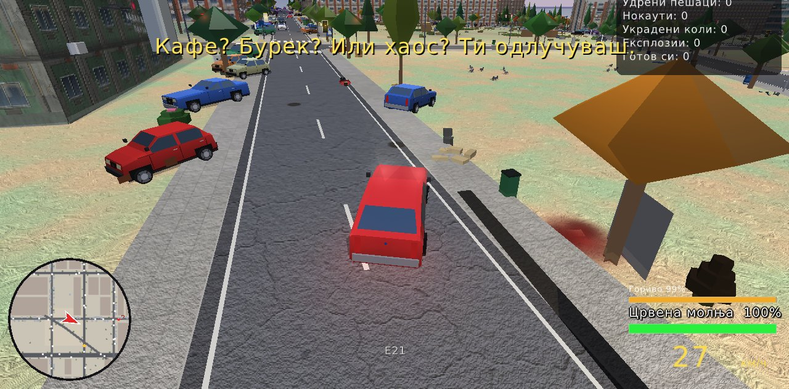
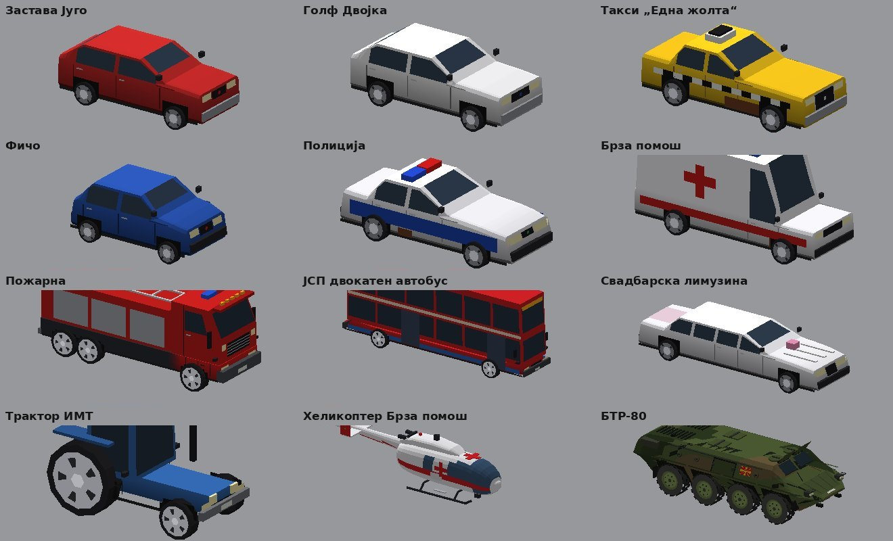
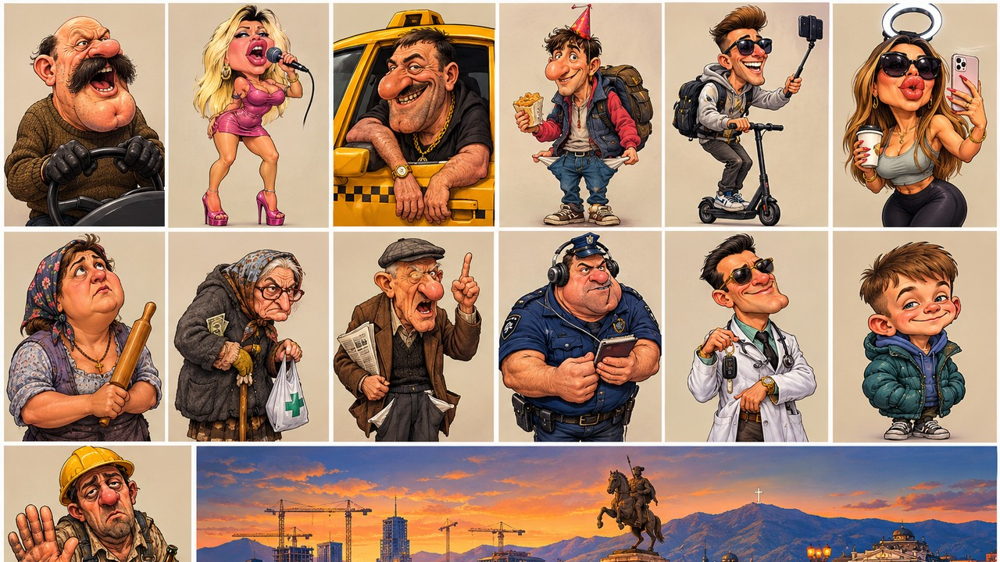
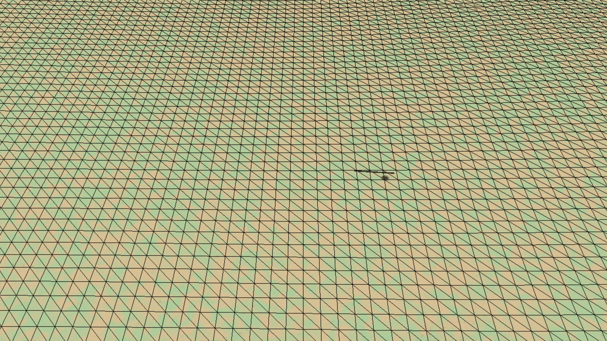
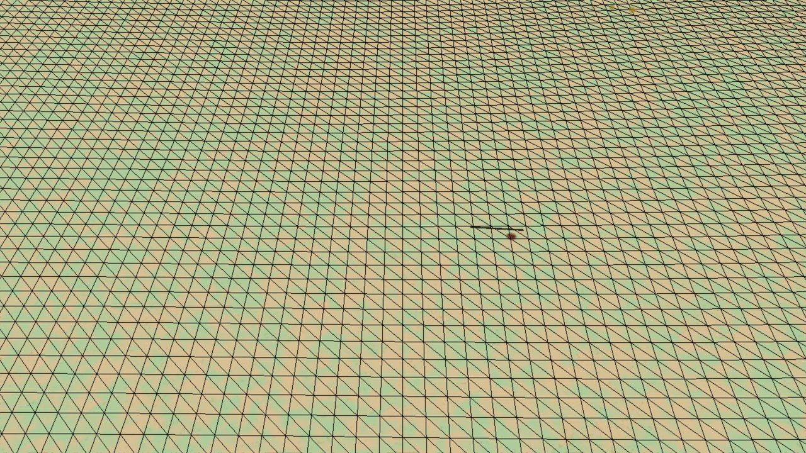
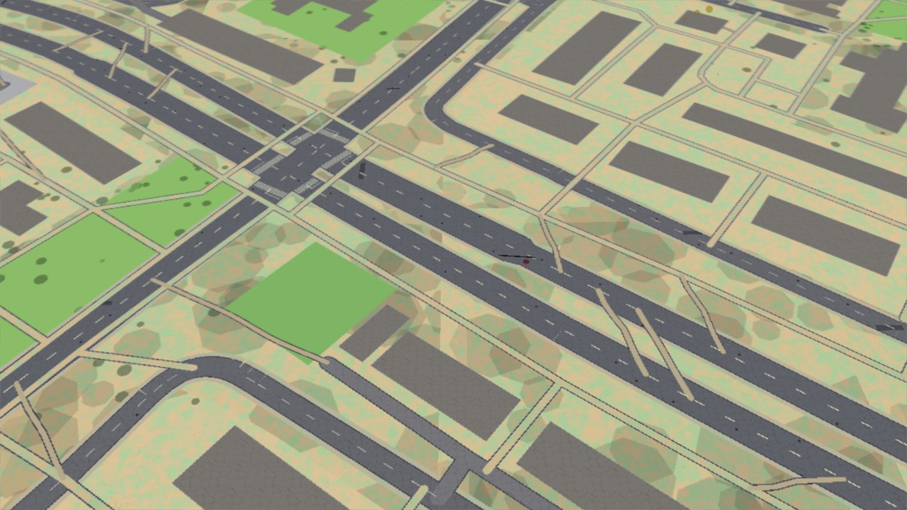
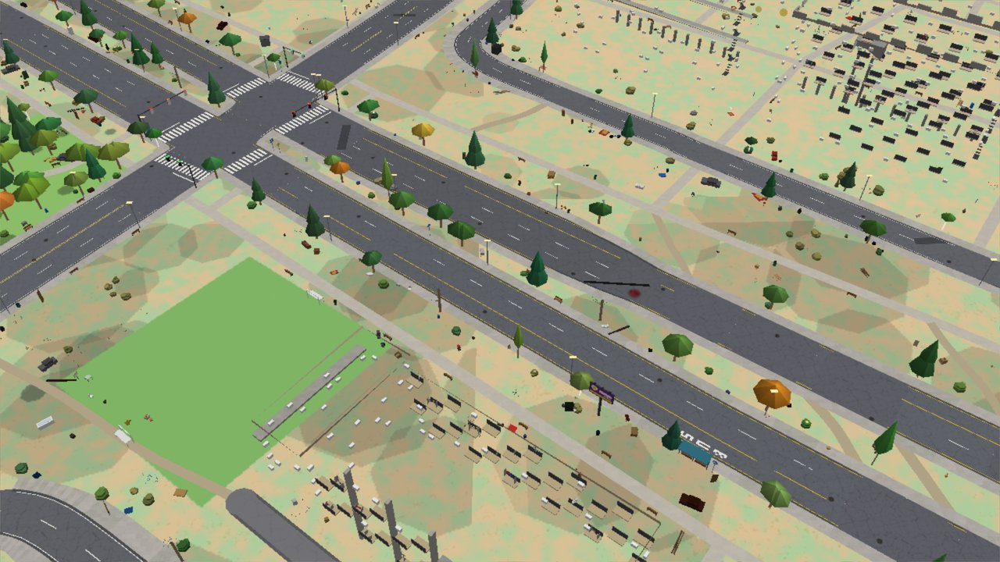
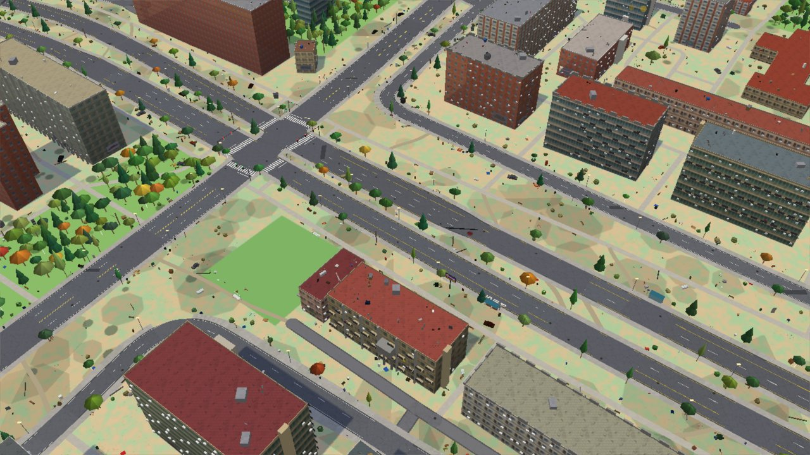
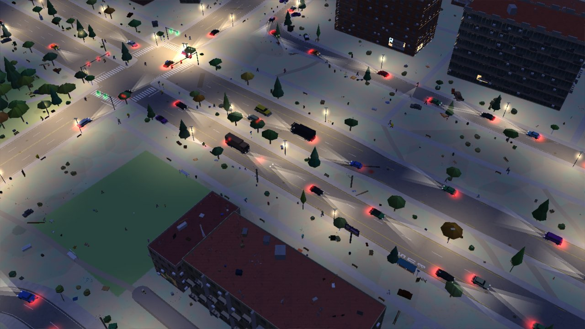

<h1 align="center">СКОПЈЕ · 242</h1>

<b>Член 242: одземање на моторно возило.</b> 
<i>„Тој што противправно ќе одземе туѓо моторно возило со намера да го употреби за возење, ќе се казни…“</i>

<b>Целото Скопје во 3D. Земи кола. Земи бурек. Качи се на ЈСП. Не земај шамар.</b> 
Песочна игра со криминална комедија во <i>вистинското</i> Скопје: вистински улици, ридови, река и Камен мост, а по нив шетаат тетки, пензионери и еден таксист што има став за сè. 
Windows · Python + raylib · бесплатна · цела на македонска кирилица, со улично скопски збор.

<a href="#пушти-ја-за-две-минути"><b>▶ Пушти ја за 2 минути</b></a> ·
<a href="#ново">Ново</a> ·
<a href="#што-можеш-да-правиш">Што можеш да правиш</a> ·
<a href="#ликовите">Ликовите</a> ·
<a href="#команди">Команди</a> ·
<a href="#како-никнува-градот">Како никнува градот</a> ·
<a href="docs/README.en.md">README in English</a>

---

## Пушти ја за две минути

1. Симни го или клонирај го репото.
2. Кликни двапати на **`run.bat`**.
3. Првиот пат ги става Python и библиотеките, ја симнува мапата од OpenStreetMap со теренот и го гради градот. Потоа се пушта за секунди.
4. Избери лик, приближи се до која било кола и притисни **`F`**.

Ажурирањето е безболно: при пуштање играта проверува на GitHub, ти нуди понова верзија и сама се рестартира. Зачуваните игри, поставките и музиката не се допираат.

| наредба | што прави |
|---|---|
| `run.bat` | играш на вистинското Скопје |
| `run.bat refresh` | пак ја симнува мапата и го гради градот |

Дополнително: `--size 1280x720`, `--fullscreen`, `--cars N`, `--peds N`, `--hour H`, `--mute`.

## Ново

### Камера од трето лице и заматување во далечината

Покрај класичниот поглед одозгора, градот сега се гледа и од улица: камерата оди зад ликот или зад колата, ниско, како во вистинска GTA. Се вклучува во **Мени → Дебаг → Гледна точка од улица**, а погледот одозгора меко се спушта во широк поглед од трето лице.

Во погледот од третото лице има и **длабочинска острина**: она што е далеку (или многу блиску) се заматува, а ликот и малку простор околу него остануваат остри. Натписите, маркерите и пораките во светот никогаш не се матат. Во **Мени → Графика** се вклучува и се штима со два лизгачи:

- **Јачина на заматувањето**, од 0 до 300% (100% е нормално);
- **Гама на длабочината**, од 0 до 3: под 1 се заматува и поблиску, над 1 само далечината, 0 го исклучува.

| Од улица | Со заматување | Одозгора |
|---|---|---|
|  |  |  |

Сликите се од малата тест-мапа што играта ја гради за проба, не од вистинското Скопје.

### Мотори што звучат како мотори

- Нов звук на моторите: чист, без шуштење, со посебни слоеви за празен од, гас и високи вртежи. Дизелите, камионите и автобусите кркорат пониско, тракторот ИМТ има свој трицилиндрашки чук.
- **Квачило и брзини:** при тргнување вртежите скокаат, квачилото фаќа и колата влече сè посилно додека вртежите не се израмнат со брзината. Брзините се менуваат според вистинската брзина на патот, со пауза и пад на вртежите при секое менување.
- Моторот е погласен од зборувањето дури и на празен од.

### Вистински максимални брзини

Колите ја постигнуваат својата вистинска максимална брзина (нема веќе вештачки плафон), тргнуваат реално, а последната брзина полека се качува кон максимумот. Во рикверц се вози до половина од брзината напред. На трева, земја и тротоар колата губи помалку брзина, теренските возила уште помалку. Скршен мотор после судир повеќе не вози побрзо од што смее.

### Патна мрежа и мостови

- Двојните мостови добија разделни појаси, а пешачките мостови скали.
- Петлите се градат како еден план на висини, без скалила; мостовите над долови стигнуваат до брегот, а надвозниците имаат доволно простор под себе.
- Еднонасочни „стапици“ од кои колите не можеле да излезат се поправени.
- Подвозникот на Гоце Делчев е ископан, тротоарите стигнуваат до краевите на мостовите, а Камен мост ги има своите десет лаци.

## Што можеш да правиш

### Земи сè што има тркала (и неколку работи без)

Околу сто модели возила, сите од чесни коцки: југо и фичо, лади нива, трабанти, голф двојки, пасат „Дијаспорец“, такси, полиција, брза помош, пожарна, двокатен ЈСП автобус, автобус Скопје-Охрид, свадбарска лимузина, трактор ИМТ, цистерни, велосипеди, мопеди и е-тротинети. Удрени места, пожар и експлозии се вклучени. Предните тркала вртат со воланот, задниот дел се лизга. Да, може дрифт.

Неколку од нив, право од цртачот на модели во играта (натписите се имињата од играта). Да, последниот е оклопен транспортер. Ќе стигнеме и до него.

### Земи го хеликоптерот

На болничките хелиодроми има медицински хеликоптери што можеш да ги леташ. Додека леташ, градот не завршува пред носот: блиските блокови се целосно со текстури, а подалеку играта префрла на замаглени силуети на градот до околу 2,6 км.

### Влези во касарна (учтиво, со макази)

Полициските станици и касарните се оградени и чувани места со порти, контролни пунктови, будки и натписи. Влези и стражарот те опоменува; остани и те врзуваат (ти го земаат оружјето и половина од парите, па те ставаат на улица). Војниците пукаат во секој што ќе упадне со кола или трчајќи.

Има и друг начин. Кај секое такво место лежат **макази**. Пресечи тивко дупка од 1,6 м во оградата и влези. Во секоја касарна стои **БТР-80**, и можеш да го земеш: топ од 30 мм, празни гилзи што летаат од кулата, трасирни куршуми.

### Јавен превоз, на чесен начин

- **ЈСП автобусите** возат по вистински линии, застануваат на секоја вистинска постојка и се влечат до рабникот. Качи се за 40 денари.
- **Црвените возови** возат по вистинската пруга и застануваат на станиците. `F` за качување и `F` за слегување. Рампите на премините се спуштаат.
- **Е-тротинети** чекаат кај секоја втора автобуска станица. `F`, плати 30 денари и вози.

### Прошетај низ вистински трговски центар

**ГТЦ** (Градскиот трговски центар) се шета: долга сала, подвижни скали, излози и четири врати на вистинскиот контур на зградата. Влези на врата со `F`, излези пак со `F`.

### Качи се на покриви

Рамните покриви добиваат цик-цак скали за бегство што можеш да ги искачиш. Горе те чекаат погледи, рампи за скок меѓу соседни покриви (донеси велосипед) и скали назад долу. Работ на покривот има ограда, па преку него се оди само со скок.

### Пушти радио, земи полароид

- **Радио:** `Q` / `E` ги менуваат станиците во секоја кола. Станиците се папките во `music/`, со логоа на станиците, вистинско мешање на песните и шум меѓу станиците. Стави своја музика и таа влегува во радиото.
- **Селфи:** притисни `P`. Играта зачувува JPEG во стил на полароид, со тебе и градот зад тебе.

### Тепај се

Тупаници, боксирач, ланец, палка, мачета, пиштол, револвер, узи, ингрем, пумпарица, калаш и **зоља** (плус макази за огради), со вистински проектили што погодуваат луѓе, коли, ѕидови и дрвја. Удри пешак и тој ќе мрмори, ќе те псуе, ќе ти вети шамар и на крајот ќе се тепа, секој со свој глас. За секој удар, смачкување и експлозија добиваш денари. Кучињата скитници те сакаат ако ги „нападнеш“ со тупаница: ги милуваш.

### Јади

Киосците продаваат бурек со јогурт, тулумби, кебапи и сендвич со ајвар. Влези во кафуле, банка, црква, училиште, пумпа или маркет и избери од менито.

## Ликовите

24 лика за играње, секој со десетици свои реплики. Избери Таксист Миле, Доктор Владимир, Инфлуенсер Давид на тротинет, Теткица Весна, Баба Велика, Дедо Димче, Пандур Бобан, Работник Момчило, Бурек-мајстор Благоја... па запознај ги и другите на улица. Сите зборуваат со глас со своја висина и брзина и на три нивоа на јазик: чисто, улица и без цензура.

## Градот одблизу

| | |
|---|---|
|  |  |
|  |  |
|  |  |

- Вистински OSM улици, згради, реки, паркови и населби врз вистински терен. Угорнините ги забавуваат колите, Вардар си лежи во коритото, а мостовите ги возиш одозгора или паѓаш под нив.
- 401 вистински семафор, плус семафори со рачка над поголемите раскрсници. Предност, раскрсници и избор на лента. Сообраќај што ќе се заглави, на крајот сам се одврзува.
- Кучиња, гулаби, патки и врани, графити со кирилични зборови, изабени фасади со траги од дожд и лизгач за смог (вистинското Скопје има став и за тоа).
- Ден и ноќ, со часовник што го вртиш сам (`[` и `]`).

## Како никнува градот

Истото место, од гола земја до ноќен град, во седум чекори. Играта го гради целиот град од отворени податоци на твојот компјутер.

| 1 · Терен | 2 · OSM мапа | 3 · Голи патишта | 4 · Патишта и инфраструктура | 5 · Згради | 6 · Луѓе и коли | 7 · Светла |
|---|---|---|---|---|---|---|
|  |  |  |  |  |  |  |

## Команди

| тастер | во кола | пешки |
|---|---|---|
| `W A S D` / стрелки | вози | оди / врти |
| `Shift` | – | трча |
| `Space` | рачна (дрифт) | скока |
| `Ctrl` | – | удар, клоца или пука |
| `F` / `Enter` | излез | влез / одземање на возило, качување на автобус (40 ден.), качување и слегување од воз, врати и порти |
| `H` | клаксон / сирена | кажи нешто |
| `1`–`4` | – | киоск: бурек, тулумба, кебапи, сендвич |
| `Q` / `E` | радио станица | – |
| `P` | – | селфи |
| `M` / `Tab` | мапа, клик за телепорт | мапа |
| `T` / `Shift+T` | следна / претходна населба | исто |
| `[` / `]` | време од денот −1 ч / +1 ч | исто |
| `L` | смени лик | исто |
| `N` · `F3` · `F11` · `Esc` | тивко · статистика · цел екран · мени / зачувај / вчитај | |

Менито (`Esc`) има табови за играта, градот (време, сообраќај, смог), луѓето (број, агресивност), графиката и камерата, и Дебаг. Командите за хеликоптерот и БТР-80 ти се покажуваат на екранот кога ќе влезеш.

## Што каде е

| патека | содржина |
|---|---|
| `run.bat`, `make_exe.bat` | пушти ја играта (и направи кратенка), направи самостоен exe |
| `src/` | играта: симулација, цртање, звук, радио, говор |
| `text/` | сите македонски текстови (по теми, со коментари за уредникот, види `text/README.md`) |
| `tools/` | симнување мапа, терен, пруга и семафори, градење свет, анализа на сообраќајот, проверки |
| `assets/` | почетна слика, икона, фонтови, ликови, постери |
| `docs/` | [архитектура](docs/ARCHITECTURE.md), [извори на текст](docs/TEXT_SOURCES.md), сленг алманах, слики |

Историја на изданија: [CHANGELOG.md](CHANGELOG.md).

## Добро е да знаеш

- Само Windows. Гласот и скриптата за подготовка бараат Windows.
- Македонскиот текст не го прегледал јазичен уредник (види [docs/TEXT_SOURCES.md](docs/TEXT_SOURCES.md)).
- Првиот пат треба интернет за мапата и гласот. Генерираните податоци (`data/`, дневници) не се во репото.
- Измислено е. Не одземај туѓи возила во живот: токму за тоа е Член 242.

## Заслуги и лиценци

- Мапа © соработници на OpenStreetMap, ODbL. Терен: плочки AWS Terrarium (отворени SRTM податоци).
- **Глас: Сузе**, македонски женски глас за RHVoice, © УНИЦЕФ, од говорната група на ФЕИТ УКИМ ([suze-mkd](https://github.com/RHVoice/suze-mkd)), лиценца **CC BY-NC-ND 4.0**. `run.bat` го симнува, не е во пакетот. Моторот RHVoice: LGPL-2.1+.
- Фонтови: DejaVu Sans (`assets/fonts/LICENSE_DEJAVU`) и Oswald (SIL OFL).
- Радио: се пушта само музика што ти сам ќе ја ставиш во `music/`.
