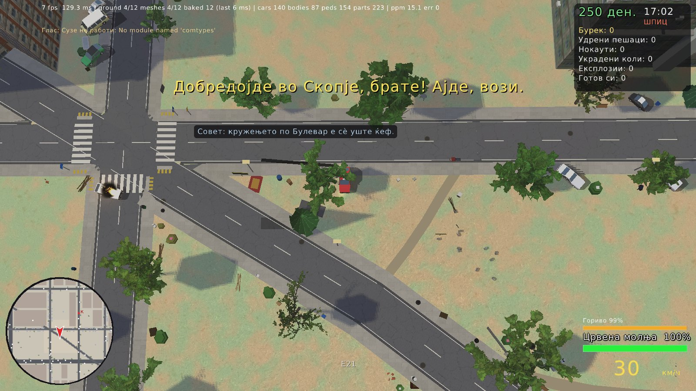
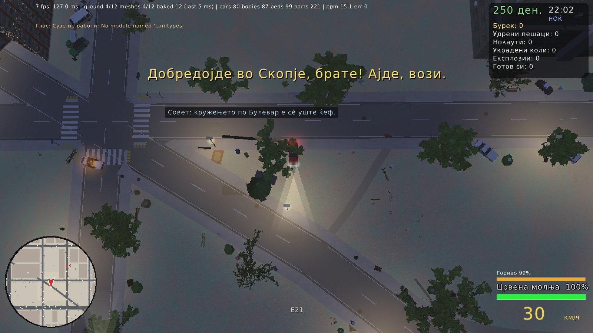
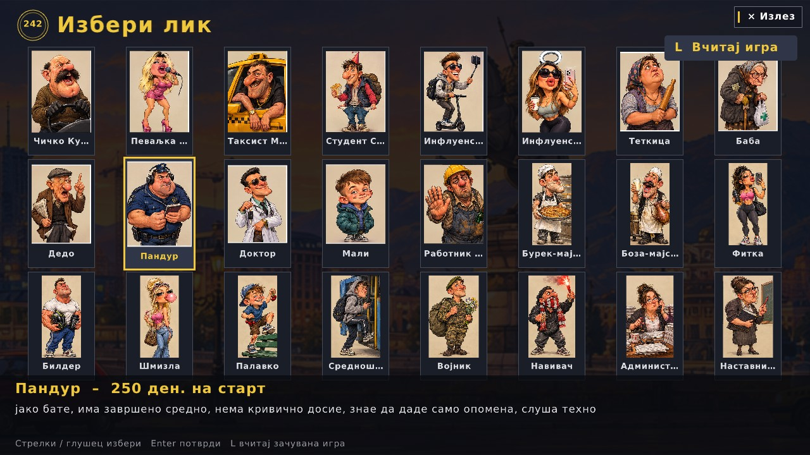
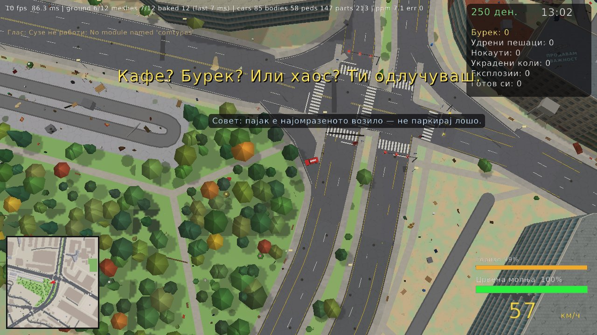

<div align="center">


# СКОПЈЕ · 242

**Отворен свет во 3D на вистинското Скопје, со криминална комедија и многу бурек.**

*„Тој што противправно ќе одземе туѓо моторно возило со намера да го употреби за возење, ќе се казни…“*  
(Кривичен законик, член 242)


[**Играј**](#-играј) · [Што е ова](#-што-е-ова) · [Команди](#-команди) · [Мултиплеер](#-мултиплеер) · [Сообраќајна лабораторија](#-сообраќајна-лабораторија) · [За програмери](#-за-програмери) · [English](docs/README.en.md)

</div>

---

## 🎮 Играј

> Потребно: Windows и интернет само првиот пат.

```text
1. Симни го репото (Code → Download ZIP) или: git clone https://github.com/mdimitri/Skopje-242
2. Двоен клик на run.bat
3. Почекај да се изгради градот (само првиот пат), избери лик, притисни F до некоја кола
```

`run.bat` сам го подготвува Python и библиотеките, ја симнува мапата и теренот и го гради светот. Подоцна играта се пушта за секунди и при секое пуштање проверува дали има понова верзија.

| наредба | ефект |
|---|---|
| `run.bat` | игра на вистинското Скопје |
| `run.bat demo` | мал измислен град, без интернет |
| `run.bat refresh` | пак симни мапа и изгради свет |
| `run.bat setup` | повтори ја подготовката |
| `run.bat aivoice` | инсталирај го изборниот неврален глас |
| `trafficSimulator.bat` | [сообраќајна лабораторија](#-сообраќајна-лабораторија) |
| `make_exe.bat` | самостоен exe (експериментално) |

Аргументи за играта: `--size 1280x720`, `--fullscreen`, `--cars N`, `--peds N`, `--hour 0–24`, `--mute`, `--nomenu`, `--world <папка>`.

## 🏙️ Што е ова

Играта го гради **целото Скопје** од отворени податоци директно на твојот компјутер: улици, згради, Вардар, паркови, пруга, семафори и висински терен. Врз него се вртат возила, јавен превоз, луѓе со карактер и свет што се крши. Кодот е Python со raylib, а секој текст е на македонска кирилица.

<div align="center">

| Ден | Ноќ |
|---|---|
|  |  |

<sub>Снимки од самата игра на малиот измислен град за проба (<code>run.bat demo</code>); вистинското Скопје изгледа како на другите слики подолу.</sub>

</div>

### Накратко

| | |
|---|---|
| **Свет** | вистинска OSM мапа + висински терен, ден/ноќ, смог, минимапа и голема мапа со телепорт |
| **Возила** | околу 100 модели: од југо до двокатен автобус, полуприколки, хеликоптер, БТР-80 |
| **Јавен превоз** | автобуси по линии и постојки, возови на пругата, е-тротинети, трговски центар ГТЦ |
| **Луѓе** | 24 лика со свои гласови, пешаци што се лутат и тепаат, кучиња, гулаби, патки, врани |
| **Борба** | тупаници до зоља, вистински проектили, ланчани експлозии, свет што се крши |
| **Сообраќај** | вештачки сообраќај со семафори, предност и престројување, плус сопствена лабораторија |
| **Мултиплеер** | до 4 играчи, без наш сервер, со гласовен разговор и кодови од збор и број |
| **Алатки** | градење на светот, ревизии на мрежата, мерење на брзината, фотограметрија на згради |

### Возила

<div align="center"></div>

Југо, фичо, лади нива, трабант, голф двојка, пасат, комби, такси, полиција, брза помош, пожарна, двокатен ЈСП, автобус за далечни линии, свадбарска лимузина, трактор ИМТ, цистерни, полуприколки, велосипеди, мопеди и е-тротинети. Сите модели се нацртани со код (референци: [VEHICLE_REFERENCES](docs/VEHICLE_REFERENCES.md)).

- Моторите се синтетизирани: празен од, гас, високи вртежи, квачило и менување на брзини.
- Максималната брзина е реална и зависи од подлогата; угорнините забавуваат.
- Предните тркала вртат со воланот, задниот дел се лизга: дрифт.
- Полуприколките вртат на зглоб; хеликоптерите (на болничките хелиодроми) се лета.
- Во секоја касарна стои **БТР-80** што може да се земе.

### Јавен превоз и места

- **ЈСП автобуси** возат по вистински линии, застануваат на постојки, се качува со `F`.
- **Возови** по вистинската пруга, со станици и рампи на премините.
- **Е-тротинети** кај автобуските станици.
- **ГТЦ** се шета: сала, подвижни скали, излози, врати.
- **Полициски станици и касарни** со порти, будки и стражари (или пресечи ја оградата).
- **Покриви** со скали за бегство и рампи за скок.
- **Киосци, кафулиња, банки, цркви, училишта, пумпи, маркети** со мени.
- **Радио** во колата (`Q`/`E`) од папките во `music/`; **селфи** со `P`.

### Луѓе

<div align="center"></div>

24 лика за играње (Таксист Миле, Доктор Владимир, Теткица Весна, Баба Велика, Дедо Димче, Пандур Бобан, Бурек-мајстор Благоја…) со лични реплики и глас. Пешаците зборуваат на три нивоа: чисто, улица и без цензура. Говорот го синтетизира македонскиот глас **Сузе** (RHVoice), а `voicelab` му дава на секој лик своја боја на гласот.

### Изглед

- Погледи: одозгора, од трето лице, од улица, со длабочинска острина.
- 19 видови дрвја со нивоа на детали и лесен ветер; графити со кирилица; изабени фасади; процедурални цркви, џамии и турбиња.
- Сенки од сонцето, ноќно осветлување, смог со лизгач.

<div align="center">

| | | |
|:-:|:-:|:-:|
|  |  |  |
|  |  |  |

</div>

### Како се гради градот

<div align="center"></div>

Терен → OSM → голи патишта → инфраструктура → згради → луѓе и коли → светла. Каде што OSM не е доволен, патиштата се дотеруваат (двојни мостови, пешачки мостови, подвозникот на Гоце Делчев, Камен мост со десет лаци, кеј по Вардар). Градењето е на делови и може да продолжи.

Незадолжителна **фотограметрија** ги вклопува височините и формата на зградите од улични фотографии. Фотографиите остануваат локално.

## ⌨️ Команди

| тастер | кола | пешки |
|---|---|---|
| `W A S D` / стрелки | вози | оди |
| `Shift` | | трча |
| `Space` | рачна кочница (дрифт) | скок |
| `Ctrl` | | удар / пукање |
| `Tab` | | следно оружје |
| `F` или `Enter` | излез | влез, автобус, воз, врати |
| `R` | врати на пат | |
| `H` | клаксон / сирена | кажи нешто |
| `1`–`4` | | киоск: бурек, тулумба, кебапи, сендвич |
| `Q` / `E` | радио | |
| `P` | селфи | селфи |
| `M` | голема мапа, клик = телепорт | исто |
| `T` / `Shift+T` | следна / претходна населба | исто |
| `[` / `]` | час −1 / +1 | исто |
| `L` | смени лик | исто |
| `V` | зборувај (мултиплеер) | исто |
| `N` · `F3` · `F11` · `Esc` | тивко · статистика · цел екран · мени | исто |

Менито (`Esc`) има табови Игра, Градот, Луѓето, Графика, Контроли, Звук и Дебаг. Командите за хеликоптерот и БТР-80 ти ги покажува самата игра.

## 🌐 Мултиплеер

До 4 играчи, **без сервер од нас**: еден игра домаќин, другите се приклучуваат.

- **Како се приклучуваш:** од списокот на локалната мрежа, со **код од збор и број** („ШМЕКЕР 42“), со долг код `S242-…` или со `IP:порта`.
- **Поврзување:** директно по UDP → пробивање низ NAT → реле преку јавен MQTT брокер. Лобито го покажува видот на NAT и причина ако не успее.
- **Глас:** вграден гласовен разговор со адаптивен квалитет, притисни-за-зборување (`V`, Alt, Caps Lock, средно копче) или автоматско откривање, јачина по играч, самотест.
- **Отпорност:** потпишани пакети, повторно приклучување, селидба на домаќинот.

Подетално: [docs/MULTIPLAYER.md](docs/MULTIPLAYER.md). Проверено во NAT лабораторија (`tools/natlab/`), не на вистински јавни мрежи.

## 🚦 Сообраќајна лабораторија

`trafficSimulator.bat` отвора 2D лабораторија што ја врти **истата симулација како играта** и само мери.

- Мапа во бои: брзина, густина, чекање, конфликти, ниво на услуга.
- Уредување во живо: затворени улици, пречки, повици за брза помош, пожари.
- Серии на сите јадра со HTML извештај (интервали на доверба, t-тест) и пребарување на најдобри правила.
- „Примени во играта“ пишува `traffic_tuning.json`; избриши го за стандардни вредности.

## 🛠️ За програмери

```text
src/      играта: симулација, цртање, сообраќај, мултиплеер, звук, мени, ажурирање
tools/    градење на светот, ревизии, мерење, тестови, natlab
text/     сите македонски текстови (кодот бара текст по клуч)
assets/   слики, фонтови, икона, ликови, текстури
docs/     архитектура, мултиплеер, звук, извори, слики
library/  звучна библиотека      music/  твоја музика за радиото
```

- **Архитектура:** [docs/ARCHITECTURE.md](docs/ARCHITECTURE.md); текстови: [text/README.md](text/README.md).
- **Тест без екран:** `python src/main.py --demo --test 300 --mute` (на Linux со `xvfb-run`).
- **Брзина:** `tools/perf.py`, `perf_gl.py`, `perf_report.py`.
- **Ревизии:** `road_audit.py`, `ride_audit.py`, `z_audit.py`, `sidewalk_audit.py`, `traffic_audit.py`.
- **Верзија:** Играта ја прикажува верзијата од `GAME_VERSION` во `src/updater.py`. GitHub Action го запишува бројот на изработка во `src/build.txt` и додава кумит „Build N“. Пред push изврши `git pull --rebase`.
- **Ажурирање:** играта ги симнува само променетите датотеки; сејвовите, поставките, музиката и светот не се допираат.
- **Придонес:** работа директно на `main`, мали и целни измени ([CLAUDE.md](CLAUDE.md)). Текстовите ги уредува јазичен уредник, па `text/` не се менува од код; по уредување: `python tools/check_text.py`. Грешки и идеи: GitHub Issues.
- **Историја:** [CHANGELOG.md](CHANGELOG.md).

## ❓ Често прашања

**Работи ли на Linux или Mac?** Подготовката (`run.bat`) е за Windows. Самата игра е Python и може да се пушти и на друго место, но тоа не е тестирано како поддржано.

**Дали треба интернет?** Првиот пат за мапата и гласот, и за мултиплеер. Потоа не, освен ако не играш со други.

**Каде е светот?** Не е во репото. Се гради во `data/` на твојот компјутер.

**Македонскиот текст?** Не го прегледал јазичен уредник ([docs/TEXT_SOURCES.md](docs/TEXT_SOURCES.md)).

Измислено е. Не одземај туѓи возила во живот: токму за тоа е член 242.

## 📜 Заслуги и лиценци

| | |
|---|---|
| Мапа | © соработници на OpenStreetMap, ODbL |
| Терен | плочки AWS Terrarium (отворени SRTM податоци) |
| Глас | **Сузе**, македонски RHVoice глас, © УНИЦЕФ / ФЕИТ УКИМ ([suze-mkd](https://github.com/RHVoice/suze-mkd)), CC BY-NC-ND 4.0; се симнува при подготовка, не е во пакетот. RHVoice: LGPL-2.1+ |
| Фонтови | DejaVu Sans (`assets/fonts/LICENSE_DEJAVU`), Oswald (SIL OFL) |
| Музика | само онаа што ти ја ставаш во `music/` |
| Мрежа | јавни STUN и MQTT сервери |
| Код | во репото нема датотека `LICENSE`, па лиценцата не е одредена |
