<h1 align="center">СКОПЈЕ · 242</h1>

<b>Одземање на моторно возило</b> 
<i>„Тој што противправно ќе одземе туѓо моторно возило со намера да го употреби за возење, ќе се казни…“ 
— Кривичен законик, Член 242</i>

изд. 2.0 · само Windows · Python + raylib

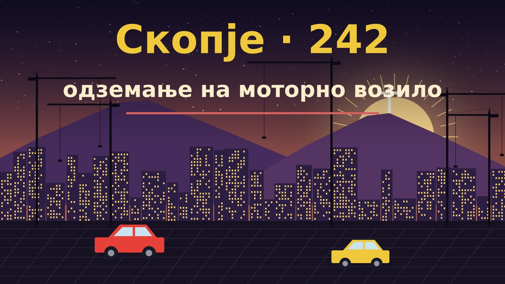

Песочна игра во вистинско 3D по Скопје. Мапа од **OpenStreetMap** и отворени висински податоци, 11 × 7 км околу Камениот мост.
Сè што мапата го нема (згради, дрвја, лампи, паркирани коли, сообраќај, пешаци) се генерира само.
Кубурај по Партизанска во југо, фати ЈСП, земи бурек на киоск и слушај ги тетките и пензионерите како те кастрат на чист скопски.

| | |
|---|---|
| 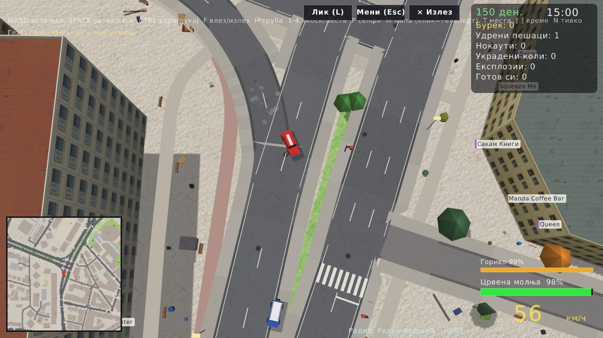 | 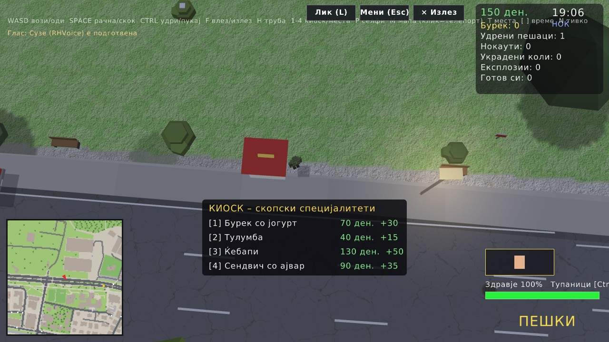 |
| 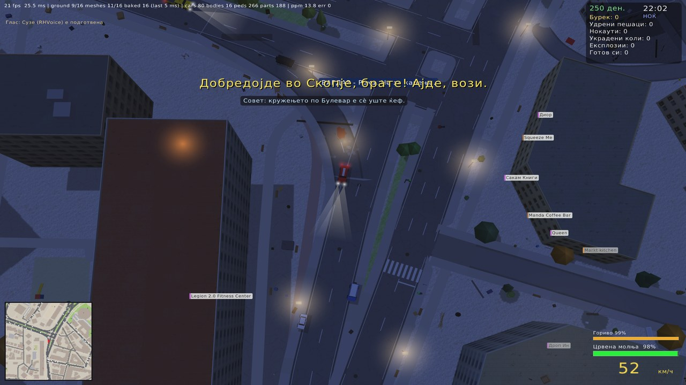 | 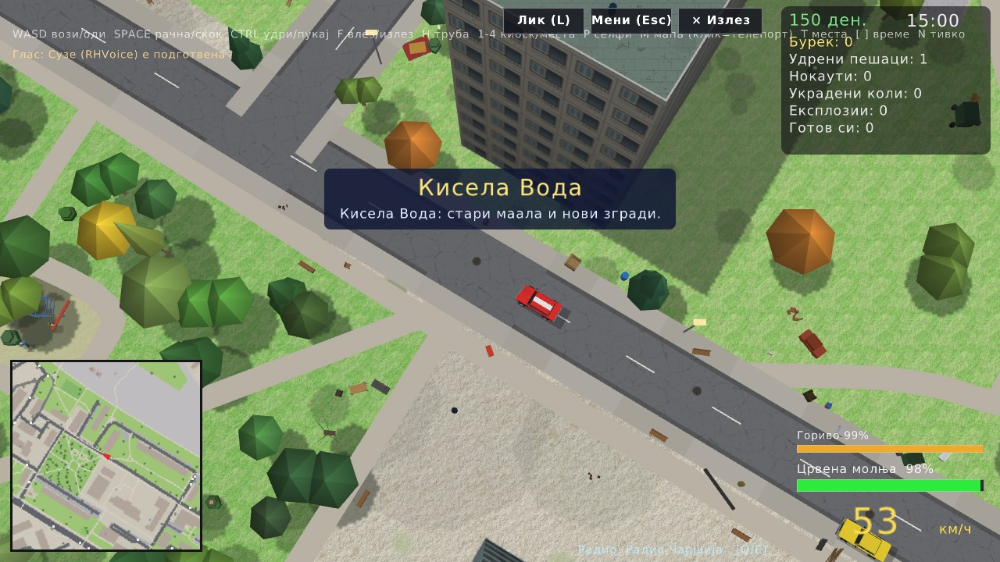 |

## Содржина

[Пуштање](#пуштање) · [Команди](#команди) · [Што има](#што-има) · [Галерија](#галерија) · [Што каде е](#што-каде-е) · [Ограничувања](#ограничувања) · [Заслуги](#заслуги-и-лиценци)

## Пуштање

1. Симни го или клонирај го репото.
2. Кликни двапати на **`run.bat`**.

Првпат ќе му треба некоја минута: го става Python и библиотеките, ја симнува мапата (Geofabrik / Overpass) и теренот и го гради светот. Потоа се пушта за секунди.

| наредба | што прави |
|---|---|
| `run.bat` | игра на вистинската скопска мапа |
| `run.bat demo` | демо град, без интернет |
| `run.bat refresh` | пак ја симнува мапата и го гради светот |

Дополнителни опции: `--size 1280x720`, `--fullscreen`, `--cars N`, `--peds N`, `--hour H`, `--mute`.
Тури своја музика во `music/` за радиото во колата (потпапките стануваат станици).

## Команди

| тастер | во кола | пешки |
|---|---|---|
| `W A S D` / стрелки | вози | оди / врти |
| `Shift` | – | трча |
| `Space` | рачна (дрифт) | скока |
| `Ctrl` | – | удар, удар, клоца или пука |
| `F` / `Enter` | излез | влез / одземање на возило, качување на автобус (40 ден.) |
| `H` | клаксон / сирена | кажи нешто |
| `1`–`4` | – | киоск: бурек, тулумба, кебапи, сендвич со ајвар |
| `Q` / `E` | радио станица (последно = исклучено) | – |
| `P` | – | селфи |
| `M` / `Tab` | мапа, клик за телепорт | мапа |
| `T` / `Shift+T` | следна / претходна населба | исто |
| `[` / `]` | време од денот −1 ч / +1 ч | исто |
| `L` | смени лик | исто |
| `N` · `F3` · `F11` · `Esc` | тивко · статистика · цел екран · мени / зачувај / вчитај | |

Менито (Esc) е наредено по ред: **Игра** (продолжи, зачувај, вчитај), **Свет** (време, сообраќај, пешаци, агресивност), **Приказ и камера**, **Звук**, **Мапа**.

## Што има

### Градот
- Вистински улици, згради, води, паркови, знаменитости и населби од OSM врз вистински терен. Угорнините им пречат на колите и на пешаците, а коритото на Вардар е вдлабнато.
- Мазни 3D улици со тротоари, одводи, ознаки и пешачки. Мостови со вистинска патека: возиш под нив или паѓаш во реката.
- Киосци, чекалници, вистински автобуски постојки, игралишта, училишни дворови, улична опрема и работи што се кршат.
- Зелен бран на семафорите, ден и ноќ со улични лампи и фарови, скопски смог, дупки од куршуми и црни дамки.

### Луѓе и возила
- **24 лика за играње** со по десетици сопствени реплики и 39+ учесници во сообраќајот со свои.
- Пешаците газат со жив чекор, навалуваат кога трчаат и стојат со раце долу.
- **Удри во некого** и ќе мрмори, ќе те псуе, ќе ти се заканува („ќе ти врзам шамар“, „фаќај магла“) и на крај ќе се тепа, секој со свој глас.
- 59 именувани возила (југо, фиќо, лада нива, трабант, пасат на дијаспора, такси, полиција, брза помош, пожарна, ЈСП, свадбарска лимузина) со удрени места, пожар и експлозии.
- Вистински ЈСП автобуси на вистински линии што застануваат на вистински постојки: качи се или одземи го.
- Брзата помош ги враќа паднатите, а пожарникарите ги гасат запалените олупини.

### Акција
- Тупаници, палки, пиштоли, узи, пумпарици, калашњикови и зоља, со вистински проектили што погодуваат луѓе, коли, ѕидови и дрвја.
- Судири на кутии, верижни експлозии, ударни бранови и работи што летаат и се кршат.
- Пари (денари) за секој удар, смачкување и експлозија, со скокачки бројки.
- Продавници и места: влези во кафуле, банка, црква, училиште, пумпа или маркет и избери од менито.
- Селфи, храна од киоск, зачувување и вчитување во слотови.

### Јазик и звук
- Сè е на македонска кирилица, пишувано според [скопскиот сленг алманах](docs/Skopje_slang_bible.txt). Три нивоа: чисто, улица и без цензура.
- Говорот е со гласот Суџе, со висина и брзина по лик, а во менито се определува колку често зборуваат пешаците.
- Радиото пушта твоја музика, со шум меѓу станиците. Една од десет коли што поминуваат пушта приглушена музика.
- Сите ефекти, мотори, сирени и амбиент се синтетизирани со numpy.

## Галерија

| | |
|---|---|
| 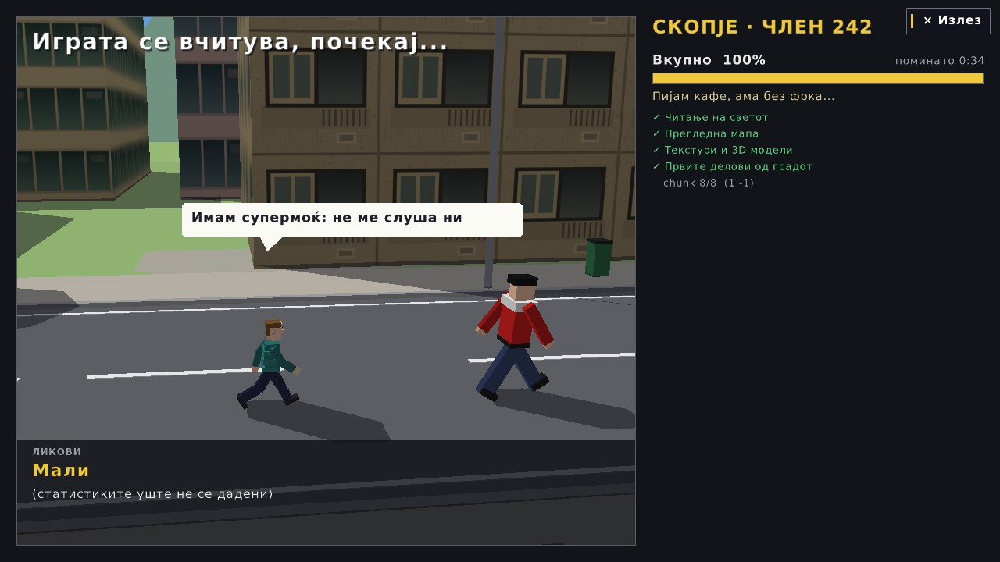 | 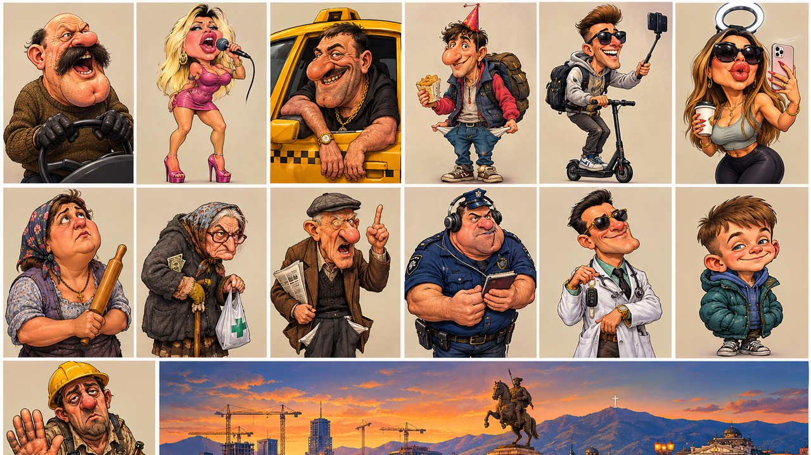 |
| 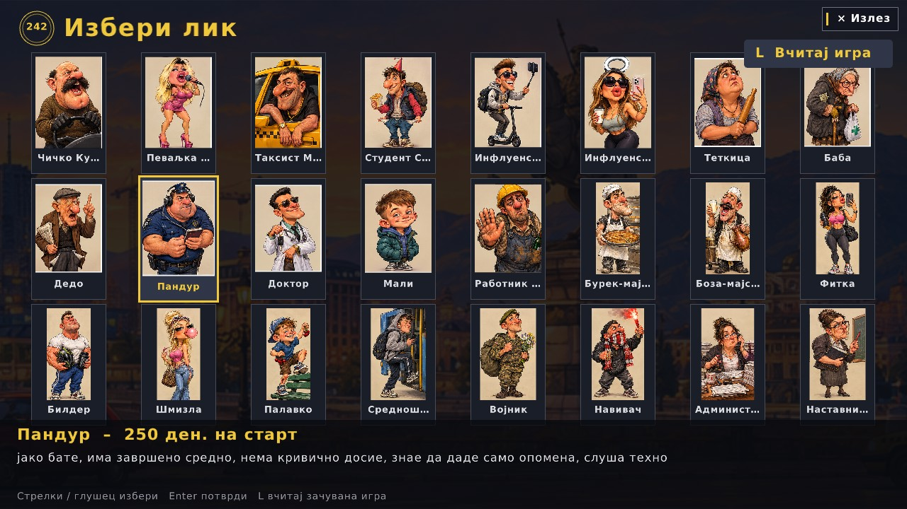 | 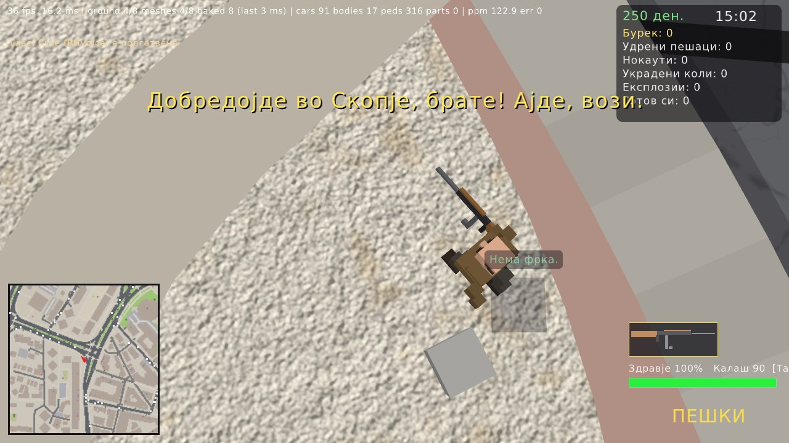 |
| 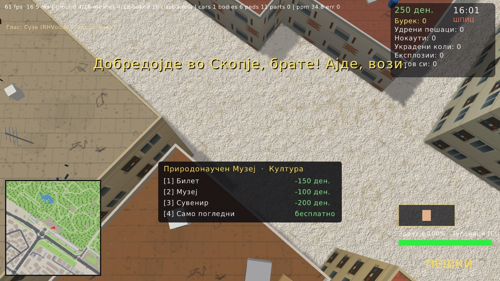 | 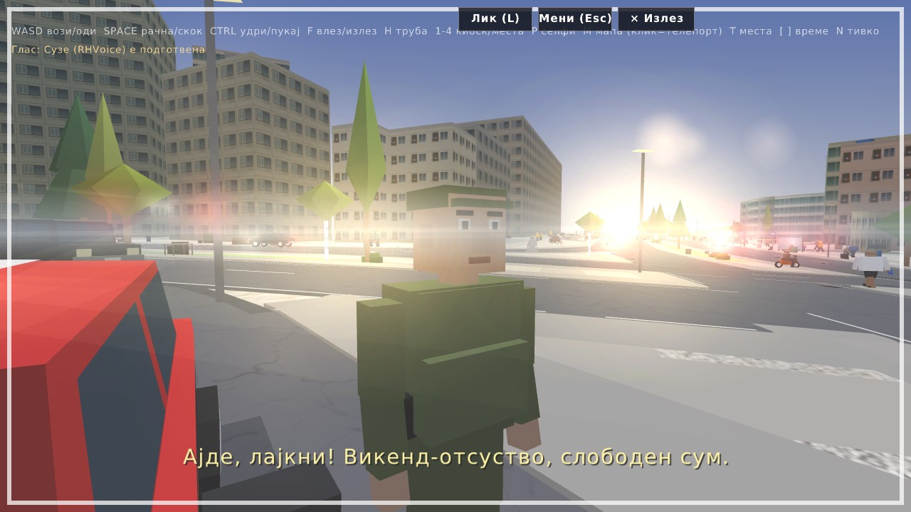 |
| 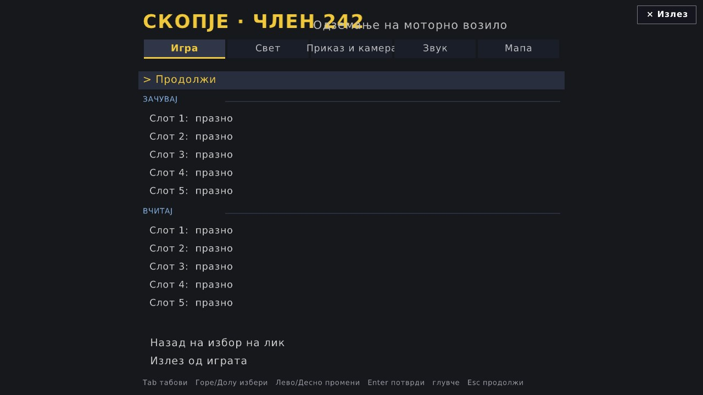 | 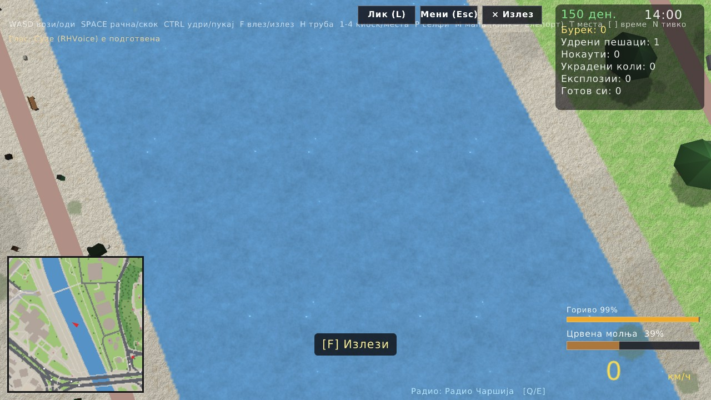 |
| 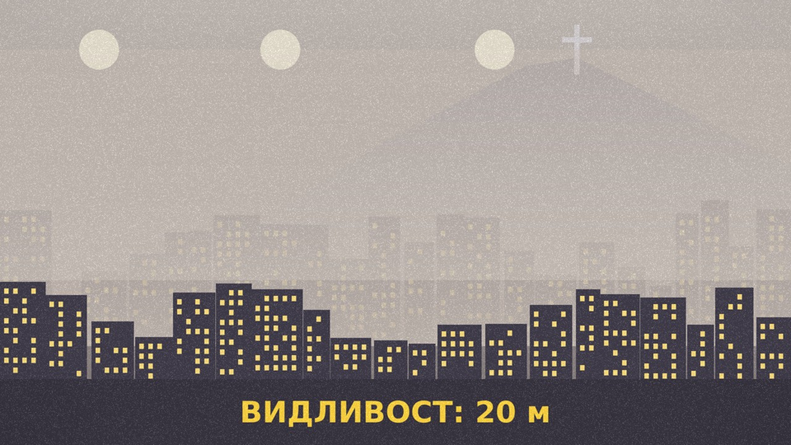 | 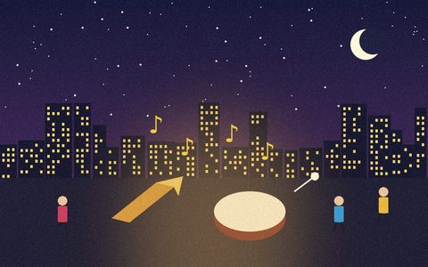 |

## Што каде е

| патека | содржина |
|---|---|
| `run.bat`, `make_exe.bat` | пушти ја играта, направи самостоен exe |
| `src/` | играта: симулација, цртање, звук, радио, говор |
| `text/` | сите македонски текстови (по теми, со коментари за уредникот, види `text/README.md`) |
| `tools/` | симнување мапа и терен, градење свет, проверки |
| `assets/` | фонтови, ликови, постери |
| `docs/` | [архитектура](docs/ARCHITECTURE.md), [извори на текст](docs/TEXT_SOURCES.md), сленг алманах, слики |

Историја на изданија: [CHANGELOG.md](CHANGELOG.md).

## Ограничувања

- Само Windows. Гласот и скриптата за подготовка бараат Windows.
- Македонскиот текст не го прегледал јазичен уредник (види [docs/TEXT_SOURCES.md](docs/TEXT_SOURCES.md)).
- Првиот пат треба интернет за мапата и гласот. Генерираните податоци (`data/`, дневници) не се во репото.

## Заслуги и лиценци

- Мапа © соработници на OpenStreetMap, ODbL. Терен: плочки AWS Terrarium (отворени SRTM податоци).
- **Глас: Суџе**, македонски женски глас за RHVoice, © УНИЦЕФ, од говорната група на ФЕИТ УКИМ ([suze-mkd](https://github.com/RHVoice/suze-mkd)), лиценца **CC BY-NC-ND 4.0**. `run.bat` го симнува, не е во пакетот. Моторот RHVoice: LGPL-2.1+.
- Фонт: DejaVu Sans (`assets/fonts/LICENSE_DEJAVU`).
- Радио: се пушта само музика што ти сам ќе ја ставиш во `music/`.
