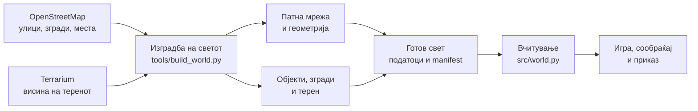
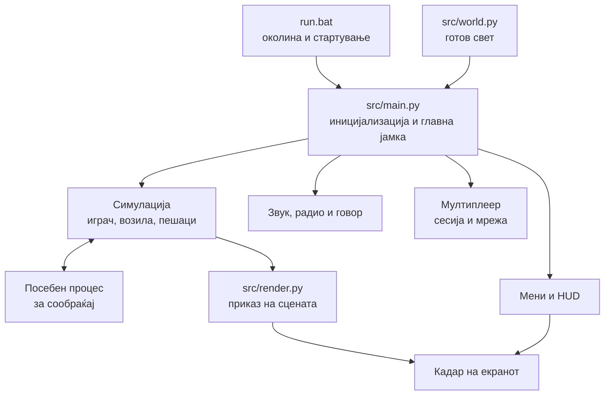

# Како е изградена Скопје · 242

[Назад кон играта](../README.md) · [Детален технички контекст](../technicalContext/README.md)

## Од карта до град

OpenStreetMap ги дава улиците и контурите на зградите, а Terrarium ги дава висините. Фазите на изградба создаваат геометрија, граф за движење и просторни индекси. Играта го вчитува готовиот свет преку верзиониран манифест.

## Од команда до кадар

Главната јамка ги поврзува влезот, симулацијата и приказот. Посебен процес ја пресметува состојбата на сообраќајот и ја разменува со играта.

