<h1 align="center">СКОПЈЕ · 242</h1>

<b>Section 242: unlawfully taking someone else's motor vehicle.</b> 
<i>You are about to commit it about four hundred times.</i>

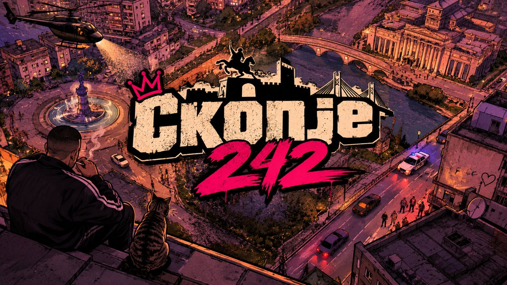

<b>All of Skopje in 3D. Grab a car. Grab a burek. Grab a ride on the city bus. Try not to grab a slap.</b> 
A sandbox crime comedy set in the <i>real</i> Skopje: real streets, real hills, real river, real Stone Bridge, populated by aunties, pensioners and a taxi driver who has opinions. 
Windows · Python + raylib · free · the whole game talks in Macedonian Cyrillic, street slang included.

<a href="#play-in-two-minutes"><b>▶ Play in 2 minutes</b></a> ·
<a href="#what-you-can-do">What you can do</a> ·
<a href="#the-cast">The cast</a> ·
<a href="#controls">Controls</a> ·
<a href="#how-the-city-grows">How the city grows</a> ·
<a href="docs/README.mk.md">README на македонски</a>

---

## Play in two minutes

1. Download or clone this repo.
2. Double-click **`run.bat`**.
3. Go and get a coffee. The first launch installs Python and the libraries, downloads the OpenStreetMap data and terrain, and builds the city. After that it starts in seconds.
4. Pick a character, walk up to any car, press **`F`**. Congratulations, you are now violating Article 242.

Updates are painless: on launch the game checks GitHub, offers the newer version and restarts itself. Your saves, settings and music stay where they are.

| command | what it does |
|---|---|
| `run.bat` | play the real Skopje |
| `run.bat refresh` | re-download the map and rebuild the city |

Extras: `--size 1280x720`, `--fullscreen`, `--cars N`, `--peds N`, `--hour H`, `--mute`.

## What you can do

### Steal anything with wheels (and a few things without)

About a hundred vehicle models, all made of honest boxes: Yugos and Ficos, Lada Nivas, Trabants, Golf Dvojkas, the diaspora Passat loaded to the roof, taxis, police cars, ambulances, fire trucks, a double-decker city bus, the Skopje-Ohrid coach, a wedding limousine, a Belarus tractor, tankers, bikes, mopeds and e-scooters. Dents, fires and explosions are included. The tyres steer. The back end swings out. Yes, you can drift.

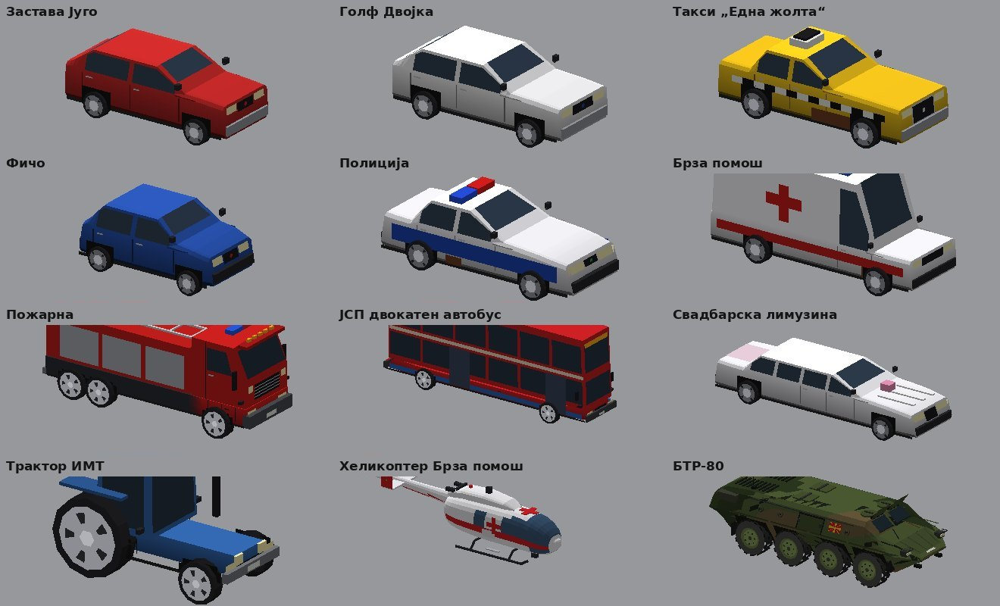

A few of them, straight from the game's model renderer (labels are the internal names). Yes, the last one is an armoured personnel carrier. We'll get to that.

### Take the helicopter

There are flyable medical helicopters on the hospital helipads. Fly one and the city keeps going all the way to the skyline: the near blocks are fully textured, and further out the game switches to hazed skyline tiles up to about 2.6 km away.

### Break into the army (politely, with wire cutters)

Police stations and army barracks are fenced, guarded compounds with gates, checkpoints, booths and signs. Walk in and a guard warns you; stay and they cuff you (weapons gone, half your cash, you are put back on the street). Soldiers shoot anyone who barges in by car or at a run.

You do have an option. A pair of **Макази** (wire cutters) lies by every compound. Snip a quiet 1.6 m hole in the fence and walk in. A **БТР-80** is parked inside each barracks, and you can take it: 30 mm cannon, spent cases flying out of the turret, tracers, and a bad attitude toward lampposts.

### Public transport, the honest way

- **City buses (ЈСП)** follow real routes, stop at every real stop and pull in to the kerb. Hop on for 40 денари.
- **Red trains** run on the real rail line and stop at the stations. Press `F` to board and `F` to get off. Rail crossings have barriers that come down.
- **E-scooters** wait by every second bus station. `F`, pay 30 денари, ride.

### Walk through a real shopping mall

The **ГТЦ** (the city trading centre by the square) is walkable: one long hall, escalators, shop windows and four doors on the real building outline. Step in at a door with `F`, step out with `F`.

### Climb the roofs

Flat-roofed buildings get zig-zag fire escapes you can walk up. Up there you will find rooftop views, launch ramps between neighbouring roofs (bring a bike) and the stairs back down. The roof edge has a barrier, so only a jump takes you over.

### Tune the radio, take a polaroid

- **Radio:** `Q` / `E` flip stations in any car. Stations are the folders in `music/`, with station logos, a real shuffle and hiss between stations. Drop your own tracks in and they become part of the dial.
- **Selfie:** press `P`. The game saves a polaroid-style JPEG of you and the city behind you.

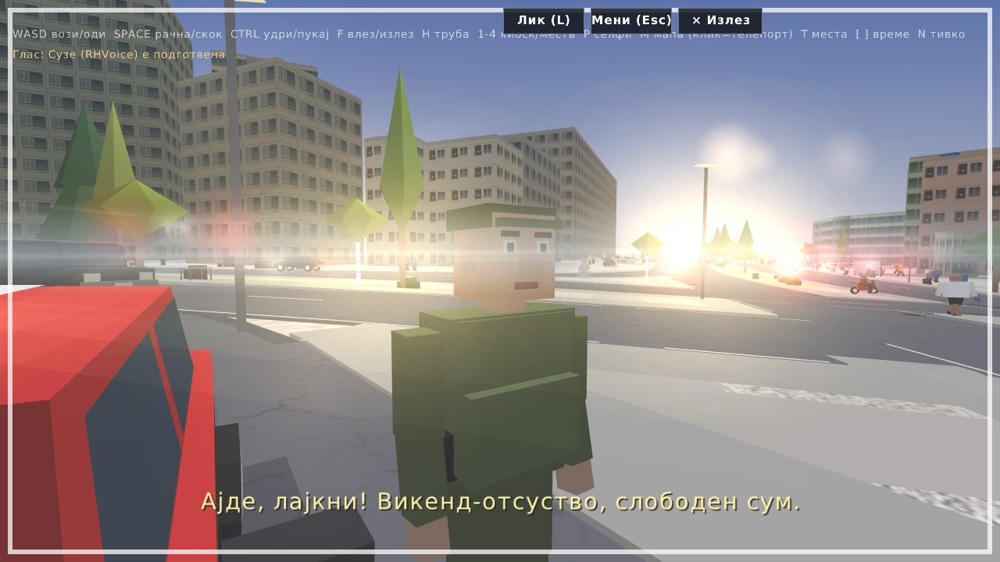

### Fight

Fists, brass knuckles, a chain, a bat, a machete, a pistol, a revolver, an uzi, an Ingram, a shotgun, a Kalashnikov and a **Зоља** rocket launcher, with real projectiles that hit people, cars, walls and trees. Punch a pedestrian and he'll mutter, curse you, promise you a slap and then actually fight you, each in his own voice. You earn денари for every hit, run-over and explosion. Strays love you if you punch toward them. It pets them.

### Eat

Kiosks sell burek with yoghurt, tulumba, kebapi and a sandwich with ajvar. Walk into a café, bank, church, school, petrol station or market and pick from the menu.

## The cast

24 playable characters, each with dozens of their own lines. Pick a taxi driver, a doctor, an e-scooter kid, a selfie queen... then meet the rest of the street: aunties with a rolling pin, an old man who knows how it was before, builders, cops, the bad-tempered neighbour. Everyone speaks in a distinct synthetic voice and in three levels of language: clean, street and uncensored.

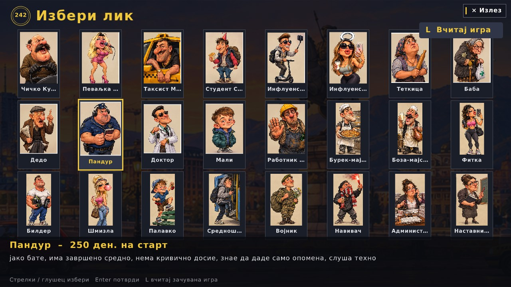

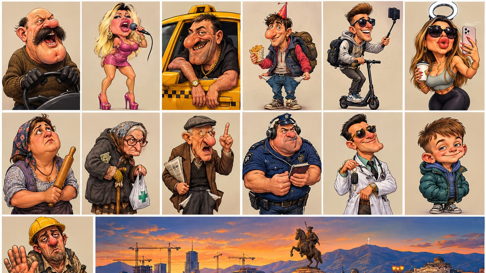

## The city, up close

| | |
|---|---|
|  | 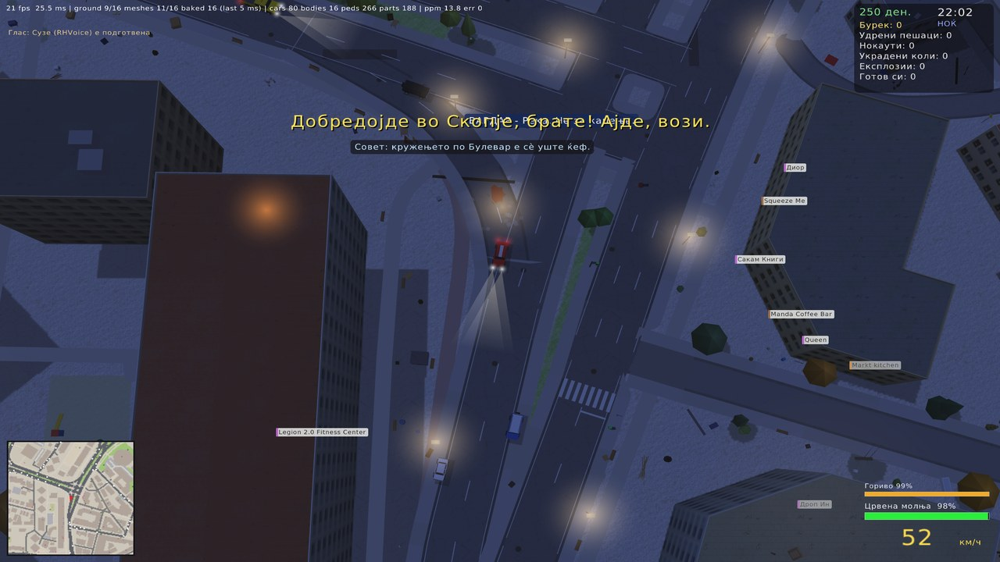 |
| 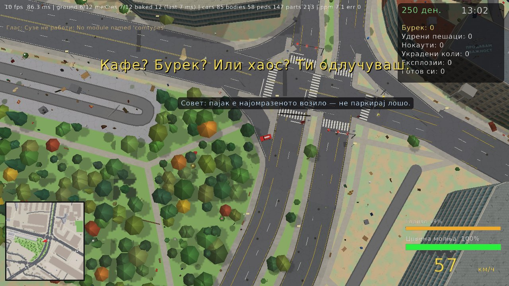 | 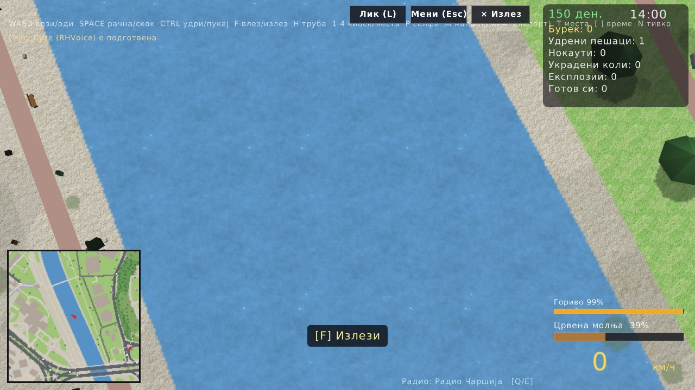 |
| 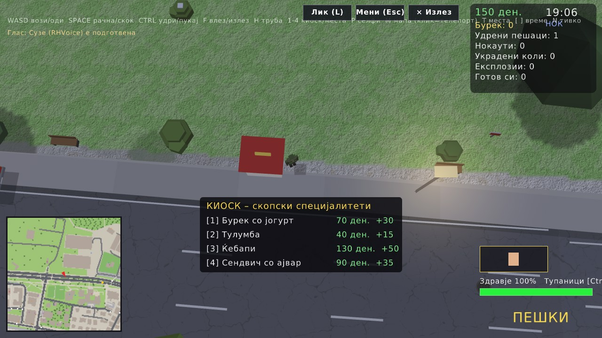 | 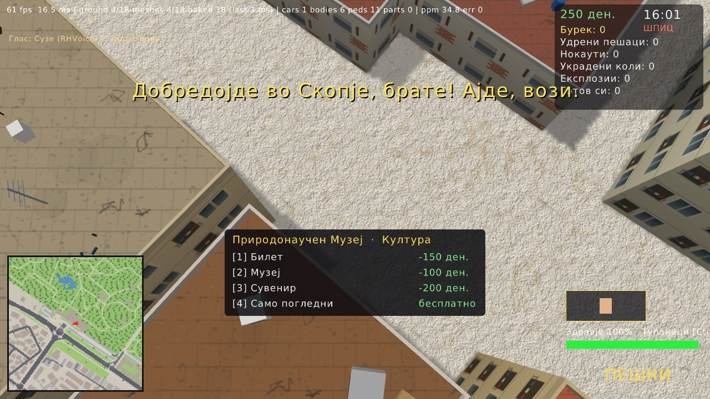 |

- Real OSM streets, buildings, rivers, parks and neighbourhoods on real terrain. Hills slow cars down, the Vardar sits in its bed, bridges let you drive over or fall under.
- 401 real traffic lights, plus overhead signal arms on the big junctions. Priority rules, junction etiquette and lane choice. Traffic that gets stuck eventually works itself out.
- Dogs, pigeons, ducks and crows, graffiti in Cyrillic slang, rain-streaked and crumbling facades, and a smog slider (the real Skopje has some opinions on this one).
- Day and night, with a clock you control (`[` and `]`).

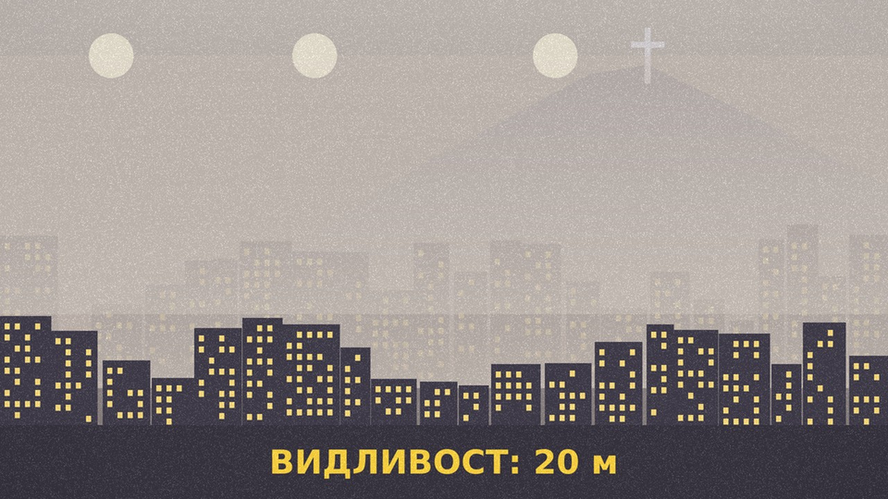

## How the city grows

The same place, from bare ground to a lit night, in seven steps. The game builds this whole city from open data on your machine.

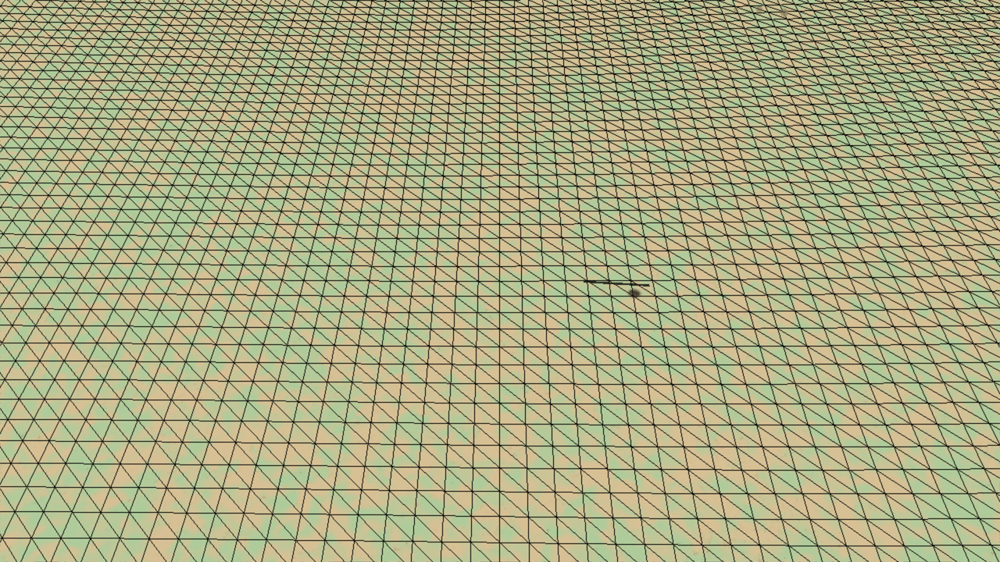

| 1 · Terrain | 2 · OSM map | 3 · Bare roads | 4 · Roads and infrastructure | 5 · Buildings | 6 · People and cars | 7 · Lights |
|---|---|---|---|---|---|---|
| 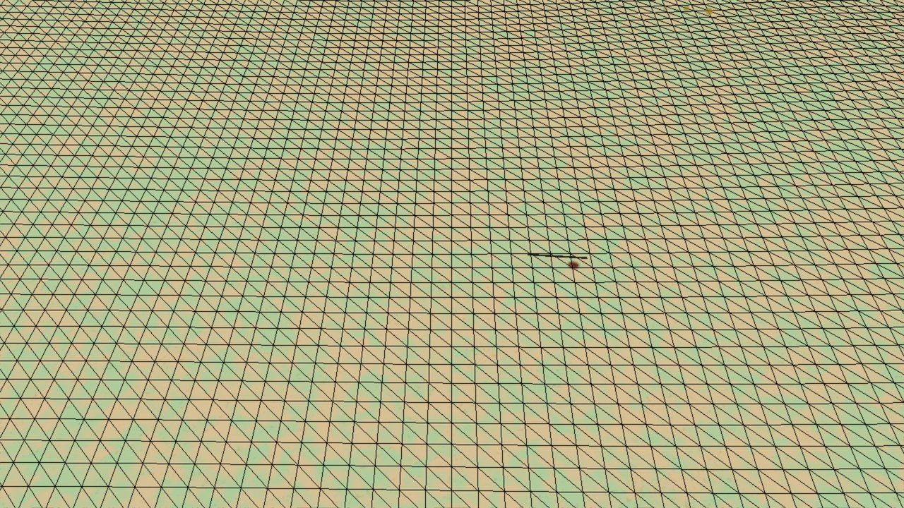 | 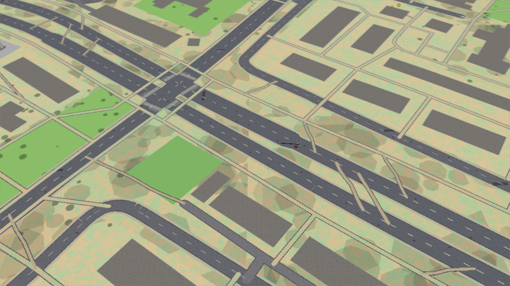 | 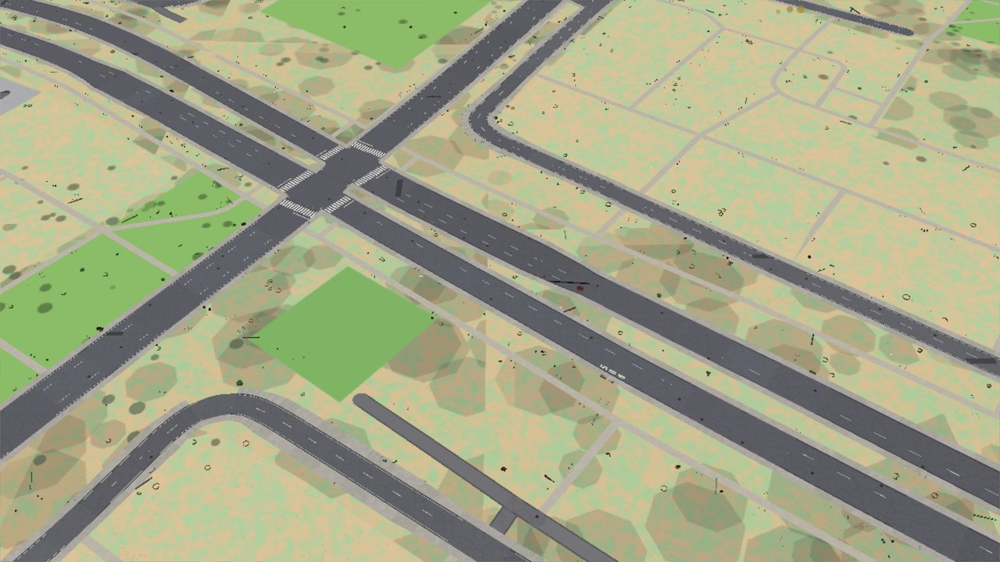 | 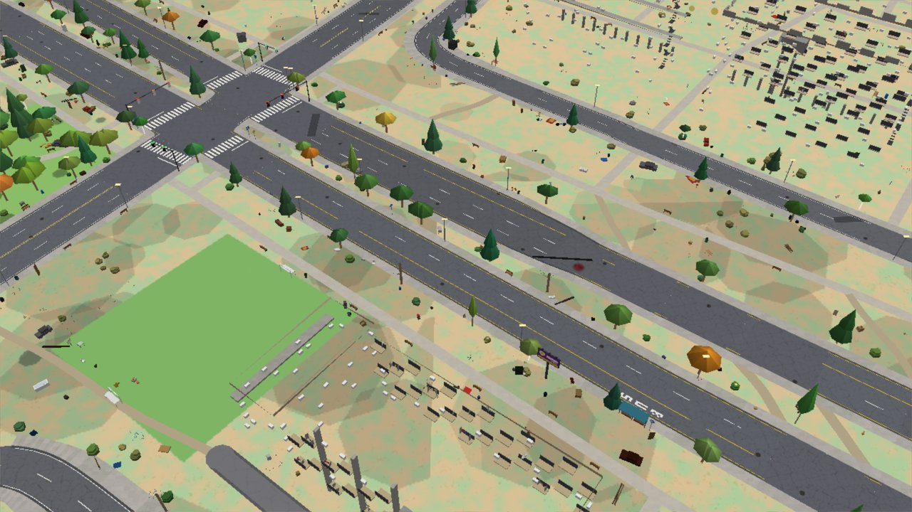 | 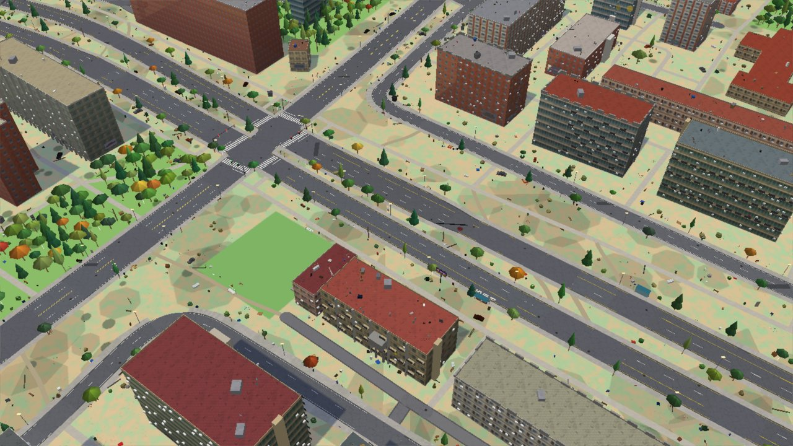 | 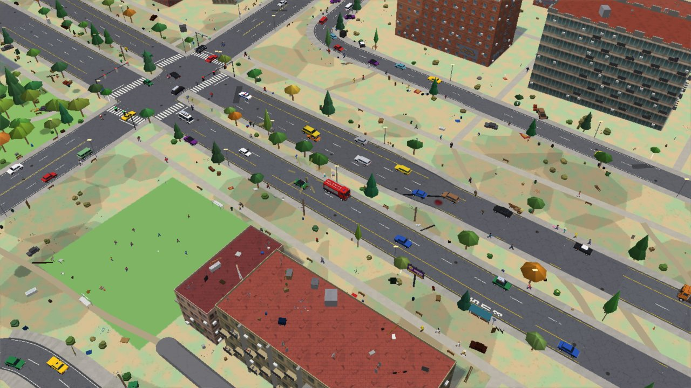 | 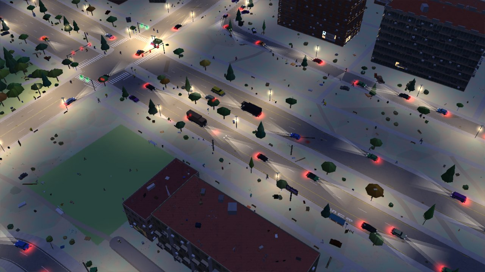 |

## Controls

| key | in a car | on foot |
|---|---|---|
| `W A S D` / arrows | drive | walk / turn |
| `Shift` | – | run |
| `Space` | handbrake (drift) | jump |
| `Ctrl` | – | punch, kick or shoot |
| `F` / `Enter` | get out | get in / take the vehicle, board a bus (40 ден.), board or leave a train, use doors and gates |
| `H` | horn / siren | say something |
| `1`–`4` | – | kiosk: burek, tulumba, kebapi, sandwich |
| `Q` / `E` | radio station | – |
| `P` | – | selfie |
| `M` / `Tab` | map, click to teleport | map |
| `T` / `Shift+T` | next / previous neighbourhood | same |
| `[` / `]` | time of day −1 h / +1 h | same |
| `L` | change character | same |
| `N` · `F3` · `F11` · `Esc` | mute · stats · fullscreen · menu / save / load | |

The menu (`Esc`) has tabs for the game, the city (time, traffic, smog), the people (count, aggression), graphics and camera, and a Debug tab. The controls for the helicopter and the БТР-80 are shown on screen when you get in.

## Under the bonnet

| path | what is there |
|---|---|
| `run.bat`, `make_exe.bat` | start the game (and make a shortcut), build a standalone exe |
| `src/` | the game: simulation, rendering, sound, radio, speech |
| `text/` | all Macedonian text, by topic, with editor notes (see `text/README.md`) |
| `tools/` | map, terrain, rail and signal download, world building, traffic analysis, checks |
| `assets/` | splash art, icon, fonts, characters, posters |
| `docs/` | [architecture](ARCHITECTURE.md), [text sources](TEXT_SOURCES.md), the slang almanac, screenshots |

Release history: [CHANGELOG.md](../CHANGELOG.md).

## Good to know

- Windows only. The voice and the setup script need Windows.
- The Macedonian text has not been reviewed by a language editor (see [docs/TEXT_SOURCES.md](TEXT_SOURCES.md)).
- The first run needs internet for the map and the voice. Generated data (`data/`, logs) is not in the repo.
- Fictional. Do not take other people's vehicles in real life: that is the point of Article 242.

## Credits and licences

- Map © OpenStreetMap contributors, ODbL. Terrain: AWS Terrarium tiles (open SRTM data).
- **Voice: Suze**, a Macedonian female RHVoice voice, © UNICEF, from the speech group of FEIT UKIM ([suze-mkd](https://github.com/RHVoice/suze-mkd)), licence **CC BY-NC-ND 4.0**. `run.bat` downloads it; it is not bundled. The RHVoice engine is LGPL-2.1+.
- Fonts: DejaVu Sans (`assets/fonts/LICENSE_DEJAVU`) and Oswald (SIL OFL).
- Radio: plays only the music found in `music/`.
