# Алманах на Скопје 242

Маалото не е на продажба · Издание „Десет милиони“, ноември 2026.

## 02 · Како почнува мисијата

Оваа книга е предлог за нови кампањи во „Скопје 242“. Ликовите, нивните вештини и градот се преземени од играта; системите за мисии, досиеја, доверба и множители се предлози за понатамошен развој.

Мисијата почнува со три поврзани ситуации. На Рекорд, еден човек ти покажува известување од катастарот: според имотниот лист, неговиот стан сега е запишан на фирмата „Печат Инвест“. Промената е заведена врз основа на согласност на која стои неговиот потпис. На неа има датум од ден кога тој бил на смена, а тој тврди дека не потпишал ништо. Сопственичката на блиската бурекџилница покажува фактура за масло: во неа пишува дека „Печат Инвест“ го испорачала, иако стоката никогаш не пристигнала. Истата вечер Маца добива договор за настап на наводното „отворање“ на нова зграда. На плакатот има само слика од проектот, а парцелата е празна. На известувањето, фактурата и плакатот се повторуваат името на фирмата, посредникот Раде „Печат“ и истата канцелариска адреса. Фирмата тврди дека има уредни согласности за имотите, заведува непристигнати испораки како примени и бара аванси за градба што сѐ уште не е започната.

### Од муабет до мисија

Во предложената кампања, важната трага се проверува од најмалку два независни извора: човек, документ, оглас или снимка. Бележникот прво ја означува како непроверена. По разговорот ги гледаш целта, местото, можниот превоз, трошокот и рокот, ако го има. Можеш да прифатиш, да одложиш или да одбиеш. Одбивањето не ја брише приказната: останува друг начин да ја продолжиш подоцна.

### Првата вечер

Избираш еден главен лик. Другите херои можат да ти помогнат, да ти се спротивстават или да сведочат — зависно од тоа како си постапил со нив. Почетните мисии може да се стигнат пеш или со договорен превоз. Личните приказни се на стр. 61–84; главната приказна започнува на стр. 11, а нејзините главни исходи се на стр. 27–28.

> „Абе, станот ми го префрлиле на туѓо име. А јас цел ден сум бил на смена.“

### Три зборови пред мапата

Ако минеш низ Чаршија наутро, мајсторот се жали на киријата. Навечер неговиот помошник го знае името на човекот што му го сменил договорот. Двајцата отвораат иста работа, со различен прв чекор. Во едниот случај го гледаш договорот пред да ветиш помош. Во другиот прво ветуваш разговор и подоцна бараш дозвола да го видиш.

Бележникот не открива туѓа адреса само затоа што си чул име. Прво означува „прашај кај дуќанот“; по разговорот додава име и термин. Јавниот оглас останува резерва, но може да понуди други услови.

## 03 · Што значи да ја завршиш мисијата

### Од прифаќање до исплата

Непроверена трага → понуда → прифатена мисија → активна етапа → исход → исплата. Во предложениот систем, мисијата може да почека меѓу етапите. Бележникот ти го покажува следниот чекор и најмногу две дополнителни можности што веќе си ги открил. Можеш да ја оставиш активната мисија на безбедно место и да почнеш друга. Во меѓувреме, луѓето и настаните во градот продолжуваат да се движат.

### Доказот и објавата се два одделни избора

Да предадеш плик не значи автоматски да дозволиш неговата содржина да се објави. Пред објавата, бележникот покажува кому ќе му бидат достапни податоците, дали сведокот се согласил и што ризикуваш да изгубиш. Ако ги исполниш договорените услови, ги задржуваш довербата и предметите што си ветил дека ќе ги чуваш. Ако не, гледаш конкретна последица: оштетено возило, изгубен контакт или дополнителна проверка.

### Исплатата се запишува еднаш

Исплатата и последиците се запишуваат еднаш за секоја завршена мисија. Ако го пропуштиш терминот, обично се отвора ново место или време за средба. Рокот почнува да тече само откако свесно ќе прифатиш итна етапа. Последицата се гледа и во градот: затворена врата, сменет возач или човек што повеќе не ти крева телефон.

### Лист со исход, не само „успех“

„Предаде копија. Оригиналот остана кај Славица. Исплатени 2.000 денари. Домарот не дозволи објава.“ Ова е доволно за да знаеш што можеш утре. Ако е непотврдена трага, до неа стои кој може да ја потврди. Ако е заштитен сведок, стои дали зборува насамо, со чувар или јавно. Операторот на задачата не го менува тоа затоа што во последен миг ти недостига еден поен.

По исплатата следува краток одговор од светот. Се трга еден оглас, се појавува поправен запис или работникот ти испраќа порака. Можеш да ја одложиш следната понуда и да ја најдеш подоцна. Кога две работи делат опрема, враќањето на опремата е посебно ветување и го гледаш на истиот лист.

## 04 · Се враќаш? Од каде продолжуваш?

### Враќање по прекин

Во предложената кампања, можеш да ја паузираш мисијата по прифаќањето, по пристигнувањето, откако ќе го обезбедиш човекот или доказот и пред неповратен избор. По паузата, бележникот накратко покажува што направи, што се смени и кој те чека. Продолжуваш кај истиот контакт, кај договорена замена или преку изборот „Продолжи“.

### Кога се распаѓа планот

Ако го промашиш автобусот, можеш да почекаш следен или да продолжиш пеш. Ако ти се расипе колата, бараш друг возач, помош во работилница или јавен превоз. Ако го изгубиш оригиналот, копија може да се завери од независен извор. Ако сведокот е повреден, прво обезбедуваш помош, а потоа проверуваш дали може да зборува или бараш друг сведок. Тековната етапа можеш да ја рестартираш од нејзината почетна состојба или да ја прифатиш загубата и да продолжиш по резервната патека. Претходните избори не се менуваат.

### Прераскажување

Завршената мисија можеш да ја повториш од архивата со друг херој и да видиш како неговите способности отвораат друга патека. Повторувањето не го менува главниот запис: парите, оригиналите и долговите остануваат во првичната приказна. Повторливите маалски задачи, пак, се нови настани во истиот град — со нова нарачка, нов разговор и ограничена исплата.

### Преминот е затворен, а денот продолжува

Ако си прифатил да ја однесеш Елена до киоск и ја оставиш задачата на безбедна точка, таа не стои со часови на тротоар. Следната можност покажува каде е префрлена и кој ѝ помогнал. Ако си ја оставил насред активен проблем, прво избираш враќање на етапата или продолжување со последицата. Нема слепо броење минути додека гледаш мени.

По четири други завршени работи, некои контакти го менуваат распоредот: Благоја е во пекара, Маца на проба, а Славица на дозволен јавен термин. Бележникот го покажува следното место и последната обврска. Почетокот на работата е уште запаметен. Ако првпат си слушнал за платата од колега, тој и подоцна ќе реагира на тоа што си му ветил.

## 05 · Три досиеја, една измама

### Имот, пари и сведоштва

Досието „Имот“ ги врзува сопственоста, согласноста и најавеното рушење. „Пари“ ги опфаќа набавките, фактурите и исплатите. „Глас“ ги собира набљудувањата, снимките и исказите на луѓето што се согласни да зборуваат. Секој запис покажува од каде потекнува, кој го доставил, дали може да се сподели и колку е проверен: гласина, употреблива трага или потврден доказ.

### Како се собира случај

Два независни и проверени извори се потребни за да се потврди едно досие. Пет фотографии од истата фактура сѐ уште се само еден извор. Ако два извора си противречат, ги споредуваш; не ги губиш автоматски сите траги. На пример, Славица наоѓа број на заведениот предмет, а Велика има постара имотна исправа. Заедно можат да покажат дека датумот на спорната согласност не се совпаѓа.

### Отворени врати

За да се одржи собирот, треба да имаш две потврдени досиеја и барем една употреблива трага во третото. На самиот собир можеш да го провериш и последното досие. Ако ти недостига првична трага, можеш да ја побараш преку јавниот шалтер, добавувачот или келнерот. За објава дополнително ти треба проверено јавно тврдење и сведок што се чувствува безбедно и доброволно се согласува да зборува.

> „Копија од копија не се два докази, мајсторе.“

### Сите копии имаат потекло

Ако две лица ја покажат истата фотографија, нивните сведоштва се независни само ако секој објасни што видел лично. Портирот може да потврди кога ја отворил вратата. Фотографката може независно да ја потврди годината. Спонзорот што само ја препратил фотографијата останува посредник. На екранот линијата оди до истиот извор, па нема да талкаш по копии.

Приватно проверен документ може да отвори договор, дури и кога сопственикот не дозволува јавно објавување. За јавната завршница треба дозволен јавен извор со истата проверлива содржина или доброволно сведоштво. Загубата на дозвола никогаш не го претвора точниот датум во неточен. Се менува каде и пред кого смееш да го користиш. На следните маси играчот гледа посебни ознаки за точност, чување и согласност.

## 06 · Множители што го менуваат пристапот

### Предложени вредности за проба

Овие се предлог-вредности за проба, не постојни правила во играта. Основниот множител е ×1,00. Соодветна вештина додава 0,25, подготовка или проверена трага — 0,15, а посветен сојузник — 0,10. Гужва или лошо подготвен терен одземаат 0,20. Крајниот множител е меѓу ×0,70 и ×1,50. Во една проверка множителот се применува на само едно мерило: време, напор или трошок. Кога се пресметува цена, основниот износ се дели со множителот. Ниеден бонус не може да ја замени согласноста на сведокот.

### Два примера

Во примерен настап, Маца има 12 секунди да го задржи вниманието на публиката. Нејзината вештина и направената проба го зголемуваат времето до ×1,40 — околу 17 секунди. Ако салата е преполна, множителот паѓа на ×1,20, па има околу 14 секунди. Со студентскиот попуст, Стојан плаќа 80 наместо 100 денари за услуга. Бесплатната јавна проверка му заштедува пари, но бара уште една средба.

### Комбинации

Подготвеност се троши по етапа. Помошникот дава една услуга по работа. Физичката способност трае 6–10 секунди, а социјалната важи за една јасна можност. Заедничкиот бонус не се множи повторно со истиот ефект од профилот. Играта веќе има разлики во движење, борба и возење. Новите активни способности и множители се предлог за кампањата.

## 07 · Кој ти верува, кој те гледа

Предложената скала на доверба има четири степени, од 0 до 3: недоверба, подготвеност за соработка, посветеност и подготвеност јавно да застанат со тебе. Ветување значи конкретна обврска со име и рок. Парите сами по себе не создаваат доверба. Ако не го одржиш зборот, тоа го памети човекот што си го разочарал, а понекогаш и неговите блиски. Извинувањето може да отвори можност да ја поправиш штетата, но не ја брише историјата.

### Поддршка, внимание и притисок

Поддршката, од 0 до 6, се гради со различни постапки: помош за станарите, навремена исплата на екипата, безбеден превоз, маалска трпеза, јавен собир и спасувачка акција. Секоја постапка носи најмногу еден поен. Јавното внимание, од 0 до 3, носи публика, но може да ги изложи сведоците. Притисокот, од 0 до 3, може да почне со понуда или приватен разговор, а да премине во заплашување и јавна клевета. Исправка или заштита може еднаш да го намали притисокот за еден степен.

### Слободата бара читливи последици

Давид може да ја сними средбата и да привлече публика; Сара може да ја води истата средба преку неколку доверливи контакти. И двата пристапа водат до приемот, но со различни трошоци: Давид ќе треба да ја потврди и заштити снимката, а Сара да ја плати услугата на стилистката. Бележникот покажува кој го чува оригиналот, кој е безбеден и кому си ветил нешто.

### Ветувањето има рамка

Кога нудиш превоз, прашај кого возиш, до каде и дали местото останува приватно. Истиот автомобил може да заврши две задачи ако луѓето се согласни. Ако едниот побара независно да стигне, мора да го смениш распоредот или да ја прекинеш понудата. Ниту највисока доверба не му ја одзема таа одлука.

Раде може да дознае за објава и без да те видел. Најпрво одговара преку човек што имал пристап до снимката. Ако по мала приватна средба целиот град те напаѓа, потеклото на реакцијата е нејасно. Притисок се крева со конкретна причина. Добра заштита може да повлече еден проблем; работници што ти го паметат неисполнетиот збор остануваат причина да платиш лично.

## 08 · Градот е дел од играта

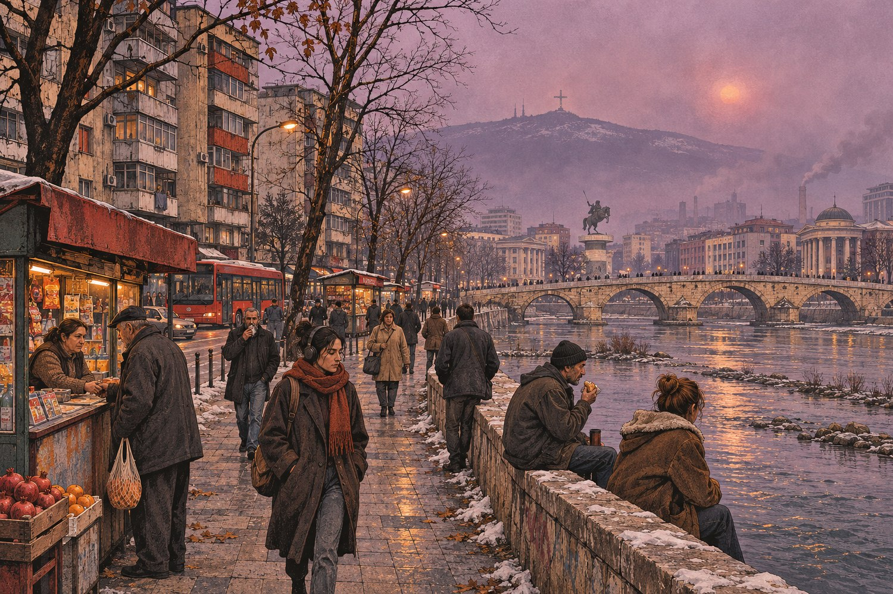

Во предложените мисии можеш да стигнеш со автобус, воз, тротинет, велосипед, такси, комбе или пеш. Секоја задача нуди најмалку две изводливи рути, меѓу нив и побавна, посигурна можност. Горивото и оштетувањето на возилото влијаат врз подготовката. Пумпите, пералните и сервисите се дел од градот; новата боја на колата не ја менува содржината на доказите.

Киосците и локалите се места за одмор и разговор. Графитите можат да означат место за средба. Кучињата се дел од маалото и не се цел на насилство. Семафорите, уличните работници, камионите за отпад, радиото и смогот го создаваат ритамот на градот. Пожарникарите и брзата помош отвораат можности за спасување. Вооружените пресметки, експлозиите и сцените со чувани комплекси, оклопни возила или хеликоптери се изборни; секоја има и мирна патека.

## 09 · Градот продолжува да живее

### Зачувување и заедничка игра

Во предложениот запис се чуваат тековната етапа, оригиналните документи, договорите, исплатите и последиците од твоите одлуки. Ликовите од кампањата се враќаат на договорените места; случајните минувачи не го заменуваат сведокот што си го изгубил. Повторувањето од архивата отвора друга лична патека, без да ги менува парите и одлуките во главната приказна. Првата верзија на кампањата е за еден играч. Подоцнежна заедничка верзија може да дозволи гостин да помогне со својот лик, додека домаќинот ја носи конечната одлука.

### Движечка мапа

Рекорд е место за преседнување и краток муабет. Во Дебар Маало се среќаваат музичари и келнери. Лептокарија е природно место за средба на возачи и дуќанџии. Кејот нуди пешачка рута и простор за тренинг на Теа. Во Чаршија има дуќани, стари познанства и место за тивок разговор. Јавниот прием се одржува во околината на ГТЦ. Фирмите и адресите поврзани со криминалните приказни се измислени.

### Ритам

Предложеното времетраење е 10–15 минути за лична мисија и 15–30 минути за заедничка. Меѓу нив останува време за возење, дружење и помали услуги. Важните информации се запишуваат, за да можеш да се вратиш на нив подоцна. Пред тешка итна етапа можеш да го провериш планот и да одлучиш дали си подготвен да почнеш.

## 10 · Од гласина до повторно отворање

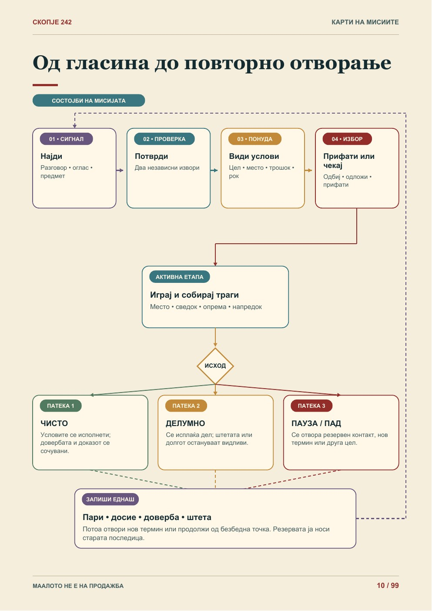

Текот на една мисија од првиот сигнал до проверката на изворите, изборот на понуда, активните етапи и запишувањето на исходот. Дијаграмот ги прикажува паузата, резервниот контакт и продолжувањето без двојна исплата.

## 11 · Потписот на починатиот станар

Виктор „Визија“ Петрески, лицето на „Нова ера груп“, ги претставува плановите за нови згради како да се веќе договорени. На рендерите има дрвја, но нема гаражи, старата пекара, училишниот простор ниту теренот што жителите ги користат. Раде „Печат“, човекот што ги организира состаноците, тврди дека станарите се согласиле. Еден од потписите е на човек што починал пред наводниот состанок.

Елена „Копија“ им носи документи на различни луѓе и чува дупликати. На почетокот изгледа како да продава иста тајна на двете страни. Нејзиниот брат му должи пари на Раде, а Елена се обидува да го заштити. Подоцна признава дека и самата пренела дел од папките. Колку ќе ѝ веруваш зависи од тоа дали прво ќе ја сослушаш и ќе ѝ понудиш безбедна средба.

### Редослед по твоја мера

По личната мисија, избери со што ќе почнеш: спорот околу зградата (стр. 13), испораките (стр. 14) или приемот (стр. 15). По кои било две од овие мисии се отвора архивата (стр. 16). Дополнителните проверки се на стр. 17–18, а собирот ги спојува доказите на стр. 19. На стр. 20 избираш еден од четирите главни исходи. Секоја патека има свои сведоци, трошоци и обврски.

> „На рендерот има дрвја. На теренот веќе стои багер.“

### Зошто Виктор сака фотографија

Виктор продава слика дека градот веќе се согласил. На првиот прием тој вели „сите се тука“ и покажува тројца луѓе што навистина дошле. Еден дојде за плата, друг за превоз, трет за да постави прашање. Подоцна истата слика може да се појави во договорот. Играчот што ја видел сцената има од каде да праша што значела.

Раде тврди дека со тивка спогодба може да спаси неколку работи што јавноста би ги изгубила. Понекогаш е во право за еден простор. Елена знае кој останува надвор, а секој што ја слуша има своја цена. Затоа конечниот избор може да биде јавна вистина, ограничена заштита, заеднички клуч или личен пазар. Ниеден херој не почнува со одговор на тоа кого треба да жртвува.

## 12 · Пролог • последната тура

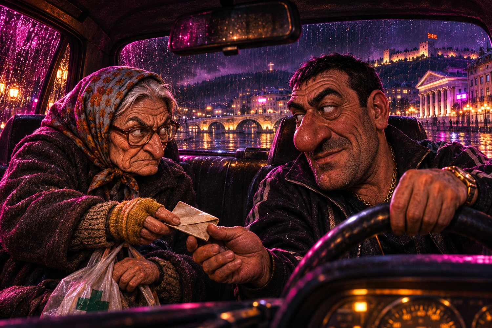

На задното седиште Елена ја гужва сметката во дланката. „До Рекорд, шефе. Плати кеш, те молам.“ Миле погледнува во огледалото. „Готовината не те крие. Диспечерот веќе ја има адресата.“ На радиото оди реклама за новиот кварт. На влезот што го бара Елена виси жолто известување за рушење.

Ако играш со Миле, ја возиш Елена. Со Велика, го гледаш истото известување на влезот од зградата, додека внукот ја чека. Со Маца, адресата стои на договорот за настап. Личната мисија на секој друг херој открива по еден детаљ од таа вечер. Првиот избор е кому ќе му ја покажеш адресата.

Ако го оставиш известувањето без проверка, утредента добиваш нови траги: келнерот спомнува прием, а станар бара помош да го разбере решението.

## 13 · Потписот за поправка на лифтот

### Влези во работата

На влезот од една зграда во Аеродром е залепено известување за рушење. Продавачот од спротивната продавница се сеќава дека станарите потпишувале само барање за поправка на лифтот. Разговарај со двајца станари, спореди ги датумите и најди го домарот кај киоскот или автобуската постојка. Тој го носи тефтерот со потписи под мишка и не сака да го остави без надзор.

> „Ми рекоа дека потпишувам за лифт. Сега во записникот пишува дека сум се согласил да ја урнат зградата.“

### Три врати

Весна го прашува претставникот пред станарите. Велика го споредува датумот со семејната имотна исправа. Славица препознава дека бројот на предметот се совпаѓа со друга жалба. Со кој било лик можеш да го споредиш јавниот оглас со тефтерот и, ако разговорот стане напнат, да го продолжиш на побезбедно место.

Ако јавно го покажеш тефтерот, добиваш внимание, но домарот може да се повлече од приемот. Прашај го дали сака да остане анонимен; ако се согласи, може да зборува како приватен сведок. Ако го продадеш тефтерот, купувачот го добива оригиналот; за нов доказ ќе ти треба јавен запис и потврда од двајца станари што присуствувале.

### Што носиш понатаму

Добиваш почетна трага за досието „Имот“, исплата за договорената работа и адреса на приемот. Ако тефтерот се изгуби, домарот составува нов список од сеќавање, а ти го проверуваш на шалтер. Ќе се сретнете повторно кај киоскот; од тоа како си постапил зависи дали ќе сака да ти помогне.

### Потпис за поправка

На листот стои: „Состанок во 18 часот.“ Домарот кажува дека книгата седела на масата цел ден. Една станарка ставила потпис на пладне. Друг сосед вели дека видел луѓе навечер, но не знае што читале. Не можеш од тие две изјави да потврдиш дека никогаш немало состанок. Можеш да потврдиш дека книгата била употребена и за друга работа. За големото тврдење треба втор извор со друг датум.

Ако брзаш со фотографија, бележникот те прашува дали имињата се видливи. Ако одбереш копија само од датумот, таа ја штити приватноста, но јавниот шалтер ќе побара потврда за оригиналот. Ако ја преземеш книгата, можеш да ја дадеш назад на домарот по проверка и да зачуваш заверена трага. Тој ја гледа разликата кога следниот ден ќе му дојдат да го прашуваат.

## 14 · Плата утре, рушење денес

Работник пред градилиште ја бара заостанатата плата. Таксист на Лептокарија чул дека добавувачот има две фактури со различни износи за истиот товар. Работникот и добавувачот ти нудат да присуствуваш на проверката; прифати една од нивните покани и следи го распоредот до јавното место за растовар. На патот избираш дали прво ќе му помогнеш на товарачот или ќе стигнеш на проверката.

> „Палетите се тука. Парите уште патуваат.“

Момчило ја познава работничката екипа. Владимир може да препознае легитимна медицинска пратка. Миле ги споредува времињата на двете тури. Ако ја играш етапата со друг херој, неговата вештина помага да ги провериш фактурата кај продавачот и приемот кај примачот. По смената, товарачот те чека на договорено место во близина.

Елена нуди да ти го даде целиот список ако предадеш плик што го поврзува нејзиниот брат со Раде. Ако прифатиш, побрзо добиваш трага, но преземаш обврска кон неа. Ако одбиеш, провери ги двете адреси одделно. Прашај ја дали е согласна да даде изјава; можеш да ѝ помогнеш да ја подготви, но тоа ќе го зголеми притисокот врз двајцата. Така откриваш дека дел од спорните пари биле исплатени за вистинска пратка.

Договорениот надомест е 3.000 денари. Потврдениот прием станува доказ за досието „Пари“. Ако комбето се расипе, можеш да го провериш дупликатот и да разговараш со примачот наместо повторно да ја возиш турата. Одлуката дали ќе им помогнеш на работниците влијае врз тоа кој ќе дојде на собирот.

### Некој таму стварно работел

Кај растоварот една палета има потпис и нема ознака. Втората има ознака и нема потпис. Работникот вели дека првата стигнала до примачот, а втората била вратена. За да ја одделиш вистинската исплата, провери го записот кај примачот. Ова е кратка делница низ жив сообраќај или две собрани изјави ако не возиш.

Можеш да ја вложиш платата од работата во повратен превоз за товарачот. Тогаш доаѓа како жив сведок. Ако ги задржиш парите, тој може да ти остави јавно проверлива сметка. Ако го продадеш записот на Елена без разговор, она што си го видел останува употреблива трага и бара друга потврда. Работната екипа ќе те праша кого си платил кога на собирот ќе се зборува за вистинските смени.

## 15 · Прием без гости

Кај ГТЦ, во средината на салата стои стаклена макета на новиот кварт. Виктор чека заедничка фотографија. Келнерот, кому не му е исплатена смената, бара да не му се гледа името на беџот. Можеш да влезеш со јавна покана, со препорака, како дел од настапувачката екипа или носејќи договорена испорака. Сите четири начини водат до истото прашање: кој ја измислил приказната дека станарите се согласиле?

Маца може да го задржи вниманието на салата со песна. Давид може да привлече публика. Сара може да организира тивок разговор на маса. Кики го носи колекционерот до макетата, а Снежана им дава ред на прашањата. Со друг херој, чекаш Виктор да се обрати и му го даваш зборот на келнерот кога ќе го прекинат.

На снимката Виктор звучи како да крие нешто, но ја нема последната минута. Ако ја објавиш веднаш, добиваш внимание и го зголемуваш притисокот, но можеби ќе обвиниш невин човек. Ако ја зачуваш, можеш да ја провериш со келнерот. Ако му ја предадеш на Виктор за услуга, ќе ти треба независен сведок. Ако гостите се разотидат по расправијата, продолжувате со помал состанок во блиска кафеана. Договорениот надомест е 3.500 денари.

## 16 · Пред да дојде камионот

По две завршени главни работи, Елена вели дека ја празнат архивата. Изборот „тргни сега“ отвора осум минути. Стигни до безбедна точка, спореди ознака на кутија со списокот и разговарај со човекот одговорен за товарот. Со возило стигнуваш побрзо, пеш го слушаш муабетот со екипата.

Еден станар се повредува. Сојузник може да ја задржи кутијата додека ослободиш простор за брза помош. Без помош избираш човек или најлесен пат до доказот. Ако кутијата замине, приемната евиденција кај добавувачот покажува кој ја презел. Повредениот што го остави може да одбие да зборува.

Елена признава дека веќе извадила една копија, а Раде знае за тоа. Договорените 4.000 денари се исплаќаат еднаш. Во зависност од исходот, бележникот го покажува регистарот, резервната сметка или заштитениот сведок.

## 17 · Снимката има уште една минута

### Разговор по затворање

Давид мисли дека го снимил Виктор како наредува цела измама. Келнерот ја памети реченицата потоа: дел од парите биле за вистинска испорака. Ако снимката веќе е јавна, на маса седи човек што поради неа останал без смена. Ако си ја зачувал, истиот човек може да ја доврши реченицата без публика.

### Поправка што се игра

Побарај ја целосната снимка од камерите на приемот, одлучи дали ќе го прашаш келнерот пред другите и спореди го целиот запис со изјавата на човек што бил таму. Со Маца можеш да закажеш мирна проба. Со Сара може да дојде стилистката. Со друг лик зборуваш со келнерот по смена. Ако не сака да се појави, земи дозволен запис и најди втор независен сведок.

Покажи исправка јавно за да ја вратиш можноста за разобличување. Исправката може да послужи во преговорите ако сведокот сака приватност. Пари и внимание од старата објава остануваат дел од приказната. Заштитата и исправката можат делумно да ја намалат штетата, но не можат да ја вратат изгубената согласност.

> „Кадарот ти е убав, брат. Само човекот внатре има утре.“

### Извинување што има публика

Келнерот може да ти каже дека сака снимката да се поправи, ама не сака повторно да стои во кадар. Ако имаш јавен канал, избери текстуална исправка, разговор со дозволен втор сведок или настап со оригиналот каде што луѓето се согласиле. Еден човек може да потврди време, друг може да потврди содржина. Ти одлучуваш дали ќе го прочиташ и износот што си го зел од спонзорот.

Текстуалната исправка е најбрза и може да ја видат помалку луѓе. Разговорот дава контекст и бара дополнителна средба. Оригиналот го брани случајот само кога се гледа целата реченица. Келнерот за нова смена може да побара контакт од Маца, не уште една објава. Решавањето на неговата работа и поправањето на твојата објава се две различни последици.

## 18 · На кој човек му веруваш?

### Елена ја отвора папката

Кај јавниот шалтер таа покажува два одделни документи: потврда за набавка што навистина стигнала и имотен документ за парцелата. На двата се појавува името на истиот посредник. Брат ѝ му должи на Раде и затоа таа е под притисок. Елена може да даде јавна изјава, да сведочи насамо или да се повлече. Не заборава што направи на приемот и во архивата.

### Три резервни проверки

За „Имот“ оди со придружба до јавниот имотен запис и спореди го датумот со исказот на станар. За „Пари“ однеси ја фактурата кај примателот и потврди која пратка навистина стигнала. За „Глас“ најди втор сведок и спореди го неговиот исказ со целата снимка. Секоја проверка мора да има независен извор; три посети кај ист човек не се три докази.

Помогни ѝ да избере безбедна средба и добиваш можен сведок. Притисни ја да говори и задржуваш само приватна трага. Прифати ја понудата на Раде за папката и мораш да ја обновиш со јавни извори. Од тука можеш да се вратиш на улица, да одбереш маалска работа или да го закажеш собирот.

### Братот не е дел од доказот

На средбата Елена бара брат ѝ да не се споменува. Неговото име го објаснува притисокот врз неа, но не ги заверува фактурите. Можеш да ја слушнеш приватно, да побараш да се запише само дека постоела обврска или да кажеш дека без целата верзија не можеш да ја ставиш пред публика. Ако одбие да зборува, оди кај примачот по втор извор.

Раде нуди да ја скине обврската ако папката остане кај него. Од тебе бара да ја предадеш пред да го видиш потврдениот договор. Елена може да сака да прифати, иако притисокот расте. Дозволи ѝ да реши за сопствената изјава; за документот решава неговиот чувар. Ако се договорите за различни работи, запиши кои. Губење на Елена не значи губење на целата истрага, а херој што го одржал зборот има човек што подоцна доброволно доаѓа.

## 19 · Сите си имаат маса

Во дворот има три маси: имотни записи, испораки и сведоштва. Одбери домаќин, превоз и лице што ќе ги чува оригиналите. Ако си ги изиграл сите пријатели, независниот чувар бара две дополнителни средби. Непотврденото досие добива посебна етапа; другите носат записи што веќе се проверени.

Раде ти приоѓа со понуда според ликот што го играш: за Кумплунг — гаража, за Маца — локал, за Велика — тивок имотен договор, а за Владимир — спонзорство. Ако си зел аванс, кажи што си ветил. Можеш да го вратиш или да запишеш нов рок; обврската останува.

Елена признава дека пренесувала копии. Трите маси откриваат дека потписи од различни листови и датуми биле споени за да изгледаат како една согласност. Снежана го прекинува викањето. „Сега кажи кој губи сѐ.“ Избери дали Елена ќе објасни, ќе даде доверлив запис или ќе си замине. Се исплаќаат 5.000 денари и претходно договорените заостанати плати. Ако собирот се прекине, продолжи со секоја маса одделно.

## 20 · Уште еден потпис

### Подготви ја својата последна работа

Бележникот ги покажува отворените исходи и што недостига за другите. Избери чувар, превоз, резервна средба и согласност на сведокот. Откако ќе тргнеш, имаш одделни точки за подготовка, испорака и потврда. Ако се повлечеш, повторно го гледаш списокот на услови.

### Целта зависи од изборот

Разобличување: однеси ги потврдените записи и доведи човек што сака да зборува. Спогодба: донеси услов за заштита на простор и одделна исплата на вистинската испорака. Преземање: собери луѓе и преземи еден простор со јасен запис за клучот. Продажба: предај оригинал и избери што точно купуваш за себе.

### Ако градот се запали

Ако некој подметне пожар на возило по заплашувањето, пристигнуваат пожарникари и полиција. Можеш да се повлечеш по безбедна рута, да го смениш местото на средбата или да почекаш службите да го расчистат просторот. Сцена со хеликоптер или оклопно возило е изборна и мора да има и обична рута до исходот. Избраниот лик користи една своја можност. Контактите помагаат само ако сакаат и можат да дојдат. Финалната исплата од 6.000 денари се запишува по потврда, заедно со договорот и записот за тоа чие име ќе стои на таблата над влезот.

### Што пишува пред да потврдиш

За разобличување стои кој сака да зборува и која верзија смее да се пушти. За спогодба стои точниот ограничен простор и што сѐ уште е спорно. За преземање стои што презема групата да плати и кој има клуч. За продажба стои што добиваш, кому оди оригиналот и дали имаш друга употреблива верзија.

Додека луѓето чекаат, можеш да отвориш разговор ако нешто е двосмислено. „Нови услови“ не е цела реченица додека не видиш кој се сменил. Ако те притискаат, одложи и понеси ги истите записи во друга средба. Ако си прифатил временски рок, одложувањето може да изгуби брза понуда; јавната патека со свои предуслови останува. Играчот што не сака да избере уште сега се враќа во градот со означени достапни работи.

## 21 · Книгата и шалтерот

Домарот ти ја покажува страницата, ама ја држи дланката преку имињата. „Кој тебе ти кажа дека сакам да се сликам?“ Рок нема. Можеш да ја видиш страницата без да ја земеш, да го прашаш за дозволена копија или да ја прифатиш книгата за да ја однесеш на шалтер. Ако е исплашен, неутралниот човек може да дојде кај него.

На шалтер Славица го споредува датумот со бројот на предметот. Во едната патека прво ја откриваш грешката кај домарот; во другата ја откриваш пред него. Тој различно реагира ако му ветиш приватност или ако веќе си ја покажал фотографијата. Службениот запис може да го потврди датумот без да ја открива целата книга.

Ако Раде побара да се тргне името на домарот, можеш да го прифатиш условот и сепак да бараш независна потврда. Ако побара да се тргне датумот, јавната патека бара резервниот запис. Играчот гледа што точно било отстрането.

## 22 · Автобус за човекот со кутијата

### Три начини да стигнеш до сведокот

Човекот со потврдата за прием работи двојна смена. Можеш да го земеш со договорено такси за време на паузата, да одиш со него со автобус по смена или да се сретнете пред продавницата ако не сака да го напушти маалото. Ако нема пари, не го тераш самиот да го плаќа превозот. Во бележникот се запишува кој ветил дека ќе го однесе.

### Што можеш да смениш по пат

Миле може да пренасочи кога гужвата се зголемува. Баба Велика може да побара внукот да застане кај втор човек. Стојан може да го заштеди превозот за вториот ден и да ја помине првата делница пеш. Неговата покуса маршрута не го обврзува сведокот да трча. Ако има прекин, избери да го дочекаш на следна станица или да се договориш со вториот човек да ја земе сметката.

### Колку чини итноста

Раде нуди автомобил за да се заврши работата „пред сите да разберат“. Ако прифатиш, штедиш време, но неговиот возач ќе ја дознае локацијата што си ветил дека ќе ја чуваш во тајност. Запиши ја промената пред да се качиш. Можеш и да го прашаш сведокот дали сака да ја смени локацијата. Тој може да одбие; тогаш одлучуваш дали ќе ја одложиш средбата или ќе продолжиш без него. Бележникот ја зачувува сметката и по пауза.

## 23 · Три маси и една за спорот

### Првиот распоред

Најди место за записи, исплати и сведоци. Направи простор за четврта маса ако некој ја оспорува поддршката. Човек што сака само приватен разговор седи настрана. Отворањето почнува дури кога ќе го потврдиш редот. Места, пристап и план за прекин се менуваат додека луѓето се собираат.

### Кога ќе се сретнат два договора

Виктор му понудил на Кумплунг гаража што дотогаш ја користел Горан. Ако си го прифатил клучот, можеш да го ставиш на маса и да ја кажеш вистината; да го задржиш, но да му понудиш на Горан распоред за заедничко користење; или да премолчиш и да го оставиш самиот да ја отвори темата. Отворениот разговор ја одложува личната мисија, но му дава на Горан причина да остане. Заедничкиот распоред важи само ако двајцата се согласат. Ако премолчиш, побрзо излегуваш од разговорот, но Горан нема да дојде како доброволен придружник.

### Кој ја слуша Елена

Елена може да зборува пред сите, насамо со лице на кое му верува или на следен термин. Некој што ја слушнал вечерва може да реши да застане до неа. Ако веднаш ја испратиш кај Раде, не ја дознаваш нејзината страна и продолжуваш со другите две маси. Собирот може да заврши без конечен договор; бележникот јасно покажува што недостига за да продолжиш.

## 24 · Понуда без цела вистина

### Сцена под скалите

Раде се појавува кога јавната работа е погодна за спогодба. Носи лист со една соба што „може да остане“. Нема список на други станари. Фразата е намерно двосмислена: ја слушаш понудата, а бележникот точно кажува дека таа се однесува на една соба и дека за останатите нема договор.

### Четири можни одговори

Земи ја собата веднаш за работилница: добиваш клуч, но веќе не можеш да бараш истиот простор во јавниот договор. Побарај список на станарите од соседниот влез: Раде може да побара да се откажеш од една лична корист. Одложи го потписот и прашај го човекот што ги чува документите; тој потврдува дека списокот сѐ уште не е составен. Одбиј ја понудата и закажи јавен собир: ќе дојдеш без клуч, но со поголема поддршка.

### Што се враќа подоцна

Ако ја прифатиш понудата, неколку дена подоцна слушаш како се менува бравата на соседниот простор. Можеш да ја задржиш работилницата и сепак да му помогнеш на човекот што ја изгубил својата. За да остане отворен и јавниот договор, кажи што си добил и кој останал без простор. Прашањето е кој друг ја плаќа цената на решението што ти било достапно. Дури откако независното лице ќе го прегледа договорот ќе знаеш дали Раде ќе го одржи зборот.

## 25 · Последниот метар до потпис

### Брза рута

Ако возилото е подготвено и возачот ти верува, брзата рута го носи сведокот пред почетокот на претставувањето. Ако на патот има застој, судир или запалено возило, службите и сообраќајот стануваат дел од етапата. Избери дали да свртиш кон јавно место или да чекаш договорен резервен термин. Со второ возило можеш да го испратиш оригиналот, но запиши кој ќе го чува.

### Тивка рута

Сведокот патува со јавен превоз и придружник, а на целта има пристапен влез. Можеш да побараш пауза пред да го потпишеш договорот. Ако претходно си го изложил, може да се согласи само на приватна проверка. Ако инсистираш да зборува јавно, ја губиш неговата согласност; за јавната патека ќе ти треба друг извор на следниот термин.

### Одложен потпис

Паузирај кога не ги прифаќаш тековните услови. Луѓето што дошле по смена може да побараат нова услуга или да изберат заменик. Пред договорот за лифтот, играта покажува колку станари го користат и кој ќе ја плати поправката. Изборот „Потпиши“ ги наведува клучот, исплатата и условот; изборот „Врати се“ ја зачувува историјата и отвора нов термин.

## 26 · Каде ќе остане клучот?

### Четири различни утра

По разобличувањето, новиот извештај стои на маса, а јавната проверка продолжува. Отвори мисија за да дадеш дополнителна изјава пред независно лице или да му најдеш безбедно место на сведокот. По спогодбата, врати се во сочуваниот простор и кај станарите од соседниот влез. Еден од нив бара конкретна помош за преселба. Ако веќе имаш доверлив возач, мисијата почнува со негова понуда.

По преземањето, маалото мора да ги уреди клучевите, сметките и пристапот. Избери дежурства, заедничко користење или платена смена; секоја можност остава друг човек на вратата. По продажбата, стариот сојузник може да понуди средба од другата страна на улицата. Може и да одбие да ти го прости договорот; сепак можеш да продолжиш со преостанатите докази.

### Што го памети секој херој

Приказната на Теа продолжува на теренот; онаа на Владимир — со следната испорака; на Миле — со празното седиште; а на Велика — со условот кој го чува оригиналот. За Благоја и Љупчо важно е кој навистина останал зад шанкот. Ако две одлуки си противречат, последната сцена ги покажува двете последици. Локалот може да биде сочуван, а пријателството изгубено.

## 27 · Пред сите, или за еден влез

### Јавно разобличување

Услови: три потврдени досиеја, проверено јавно тврдење и безбеден сведок со согласност. Пред макетата некој го прекинува Виктор. Маца може да го задржи микрофонот, Димче да го препознае потписникот, а Снежана да му даде збор на станарот што дотогаш никој не го сослушал. Записите излегуваат пред публика. Градежните работи се запираат додека трае независна проверка, а еден простор станува место за следни разговори.

> „Немаме уште пресуда. Ама имаме име, датум и човек што не се крие.“

### Приватна писмена спогодба

Услови: потврдени „Имот“ и „Пари“, поддршка најмалку 3. Избери еден простор и впиши која вистинска испорака мора да се плати одделно. Виктор го задржува своето лице на плакатот. Станарот чиј влез не е опфатен со договорот те чека надвор. Следната задача е да му најдеш превоз, место или нов термин за преселба.

> „Го спаси влезот. Твојот. Дојди да го видиш мојот.“

И двата исхода го оставаат градот отворен. Главниот запис стои во бележникот, а договорените услуги продолжуваат со свои луѓе и на свои места.

### Цената на преживеаниот договор

Во јавната завршница можеш да го прочиташ и својот аванс. Тоа може да затвори спонзорска работа и да зачува доверба кај луѓе што веќе знаеле за авансот. Ако премолчиш и Раде го покаже договорот, треба да одлучиш дали ќе го прекинеш настапот за да објасниш. Независните докази остануваат валидни. Се менува тоа кој сака да застане со тебе во следната сцена.

Во спогодбата можеш да ја намалиш сопствената корист за превоз или привремено чување алат на исклучениот сосед. Ако ја задржиш целосната корист, подоцна можеш да понудиш помош со своите пари и време. Соседот ќе ти каже што прифаќа, а што уште му е важно. Неговото прифаќање помош не е глас дека си постапил исправно.

## 28 · Клуч за сите, или клуч за тебе

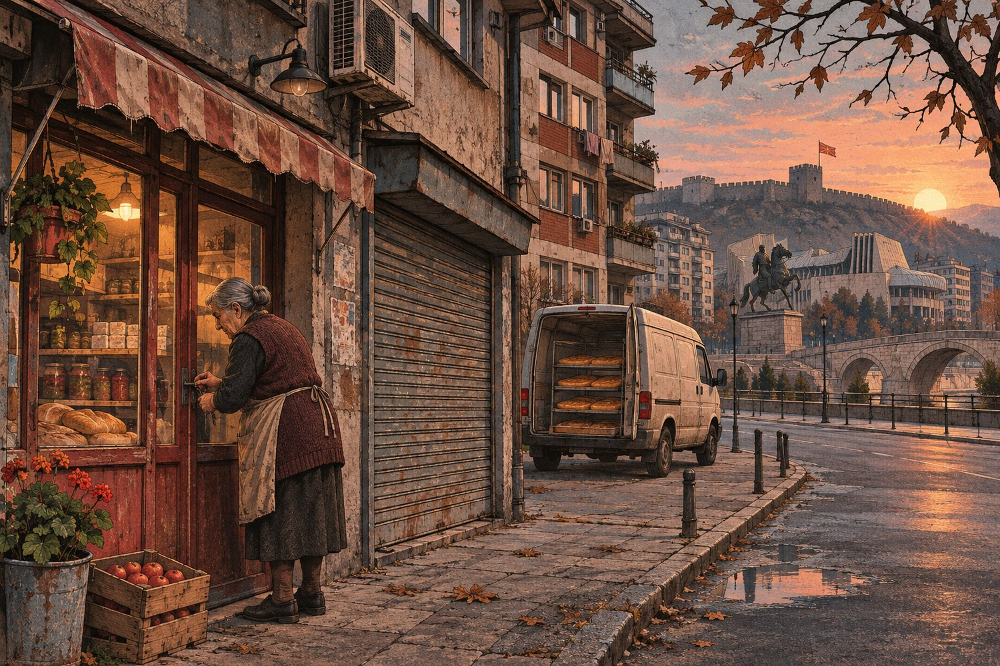

### Наши клучеви

Услови: поддршка 4, еден доброволен сојузник и јавна евиденција во која е запишано кој ги чува клучевите. Преземањето отвора простор за маалото. Ако „Имот“ и „Пари“ се потврдени, предавањето може да се направи без дополнителен спор; инаку следува задача за одбрана на записот. Дуле носи луѓе, Љупчо и Благоја трпеза, Теа отворен тренинг. Лицето што си го притискал може да одбие да дојде.

### Честито, газда

Услови: купувач и еден употреблив оригинал. Го даваш оригиналот и добиваш точно договорена лична исплата. Еден доверлив човек повеќе нема да доаѓа на твоите вообичаени места. Влегуваш во новиот дуќан додека соседниот излог се празни. Преостанатите луѓе и записи може да отворат подоцнежна пресметка.

### Утрото

Еден кадар за амбицијата на херојот, еден разговор за сменетиот однос, едно обично место во градот. Истата пекара мириса поинаку кога знаеш кој веќе не работи до неа.

## 29 · Три вечери со Миле

### Прва вечер • Подолга тура

Миле ја носи Елена по подолгиот пат и ѝ го чува името. Таа го препознава курирот. Миле оди прво на испораката и го слуша добавувачот. Два независни извори го потврдуваат досието „Пари“. На приемот избира да не ја пушти скратената снимка и добива употреблива трага за „Глас“.

### Втора вечер • Кутијата заминува

На влезот домарот му ја дава книгата со потписи, а имотниот запис ја потврдува трагата за „Имот“. Кај архивата Миле останува со повредениот. Кутијата заминува. Потврдата за прием открива кој ја чувал, а на собирот келнерот го потврдува досието „Глас“. Елена пристигнува со друг таксист како заштитен сведок. Патеката за јавно разобличување е отворена.

### Ако ја продадеш првата тура

Истата улица изгледа поинаку. Елена не доаѓа, добавувачот мора сам да ги поврзе сметките, а приемот почнува со непријатно прашање. Миле може да изгради доверба со повредениот и да добие друг сведок, да преговара за спогодба со доволна поддршка или да го заврши веќе започнатиот пазар со Раде. Раната продажба менува кој ти верува, а не го заклучува целиот град.

### Кога ќе снема гориво

На оваа патека Миле доцни кај камионот. Ако го има Кумплунг како доверлив контакт, тој ја носи Елена на новиот термин додека Миле го решава возилото. Ако му останал должен за претходна поправка, мајсторот бара да го врати позајменото комбе. Тогаш Миле може да ја одложи средбата или да ја праша Елена дали сака автобус со другиот таксист.

Со автобусот не го добиваш истиот разговор на задното седиште. На постојката го среќаваш примачот од испораката. Елена решава да чека на јавно место. Таа не оди со тебе по секоја цена. Патот до потврден „Глас“ продолжува поинаку и покажува кому мораш да му го одржиш ветувањето од првата вечер.

## 30 · Велика, Маца и истата врата

### Велика оди пеш

Велика го остава семејниот оригинал кај независно лице што се согласило да го чува. На влезот го проверува датумот со домарот. На проверката на испораката оди со внукот, го слуша примателот и пеш стигнува до вториот добавувач. Две досиеја се потврдени. За „Глас“ ја има снимката од јавниот прием, а потоа ја дополнува со приватен разговор со келнерот.

Велика избира спогодба наместо јавна објава откако ќе собере поддршка од станарите, превозниците и маалската трпеза. Семејството ѝ нуди поволен личен договор. Таа бара прво да ги прочитаат имињата на сите што остануваат надвор од спогодбата. Нејзиниот влез е сочуван; станарите од соседниот влез ќе треба да добијат помош за преселба.

### Маца ја држи салата

Маца земала бакшиш и ветила песна за Виктор. На приемот ја пее договорената песна, потоа му дава збор на келнерот. Ако го скршила ветувањето пред сите, настапот завршува, а келнерот ја чека на проба. Со музичари, трпеза, превоз и отворен собир ја гради поддршката за преземање.

На истата завршна локација Велика разговара за клаузула и сметка. Маца избира кој ќе седне до неа и кој конечно ќе го земе клучот. И двете гледаат исти луѓе, но тие луѓе имаат други барања.

## 31 · Работи што никој не ти ги наредил

### Шест договори за поддршка

Влез: организирај безбедна средба за станар кому му е тешко да се движи по скали. Екипа: најди потврда за веќе одработена смена и договори исплата. Превоз: одвези сведок до две безбедни места. Трпеза: договори три нарачки според потребите и еден разговор. Собир: одреди ред за зборување и води го разговорот до договорен крај. Спасување: ослободи пристап за итната служба пред да пристигне.

### Други ситни работи

Задоцнета испорака до бензинска пумпа, откажана проба, спор за паркинг, пакет паднат кај игралиштето и апарат што треба да се однесе на сервис. Овие услуги можат да донесат пари, нов контакт и познавање на патеката. Главните докази се добиваат во назначените мисии, не со повторување на ситни работи. Повторувањето на иста услуга не ја зголемува поддршката.

### Мали трикови со вистински ефект

Врати го позајменото возило пред рокот и возачот ќе ти го остави на располагање за уште една мисија. Подготви пристапна патека сега и при следната средба сведокот нема да бара втор превоз. Ако оригиналот се изгуби, доброволниот чувар ја има копијата: ќе треба да ја завериш, но истрагата продолжува. Прифати јавен настап и ќе добиеш публика, но ќе го изложиш сведокот.

## 32 · Што знаеш пред да кажеш „важи“

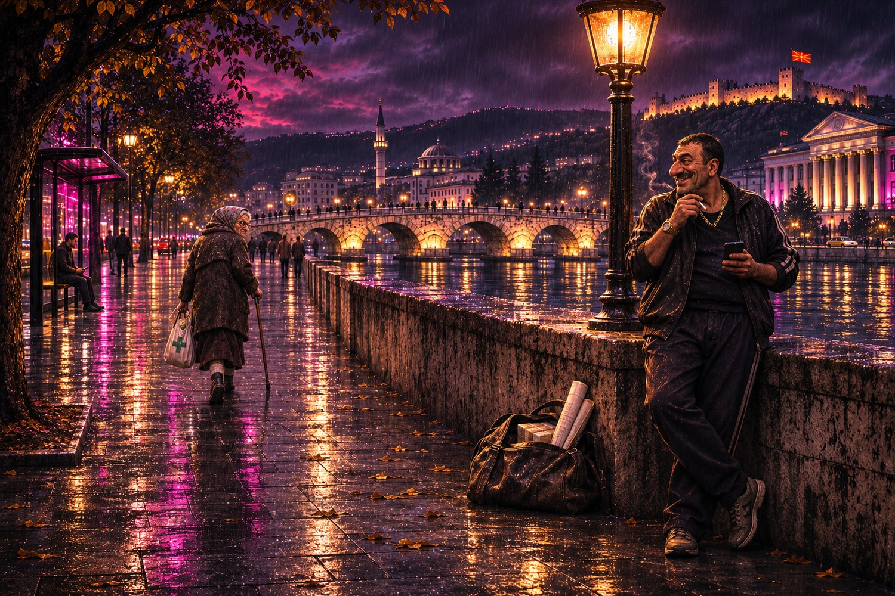

На Рекорд човек може да ти се заколне во мајка, а сепак да лаже за времето на турата. Изборот е фер кога однапред знаеш што ветуваш и што ризикуваш. Кој заслужува доверба го откриваш играјќи.

Пред да прифатиш, играта ти покажува кому се предава предметот, што точно предаваш, до кога важи договорот и колку чини. Ако ја предаваш папката, гледаш дали содржи оригинал, дали има резервна копија и дали сведокот се согласил записот да се објави. Нечија изјава е означена како тврдење, а не како потврден факт. „Раде вели дека домарот ќе си ја задржи работата“ остава простор за сомнеж. „Домарот сигурно ќе си ја задржи работата“ е ветување што играта мора да го исполни.

Понуда може да се постави настрана додека прашаш друг човек. Итен избор го кажува преостанатото време. Ако сакаш да си одиш, бележникот покажува што ќе остане нерешено и каде можеш да се вратиш. На следната средба гледаш кој го дознал изборот и од каде.

## 33 · Четири слоја на последици

### Вечерва

На влезот Весна пред сите кажува кој комшија му го дал кодот на Раде. Претставникот на инвеститорот веднаш ја напушта салата. Домарот сепак ја остава книгата со евиденцијата на маса. Доказот и сведокот се две различни работи; можеш да го имаш едното без другото.

### На следното возење

Весна бара возач за кутијата. Комшијата, навреден што го прозвала јавно, одбива да помогне. Се отвора подолга патека преку колега на Момчило. Ако претходно си му оставил самиот да објасни зошто го дал кодот, тој доаѓа без дополнителната услуга. Комшијата подоцна ја спомнува таа средба, па последицата е видлива.

### Кога ќе се собираат сите

Името изговорено во јавност го дознаваат само присутните и луѓето што ја виделе снимката. Другите контакти може и понатаму да ти веруваат. Ако комшијата потоа ти ја затвори вратата, можеш да собереш доказ во јавниот двор или на приватна средба со друг станар. Ако си направил тивок договор, на јавниот собир можеби ќе треба да објасниш зошто си го прифатил.

### Кога ќе се раздени

Кој работи, кој чека превоз, кој ја отворил вратата и кој ја враќа позајмената опрема даваат видлив одговор. По спогодба за лифтот, лифтот може да работи, а соседниот влез да остане без помош. По јавна објава, домарот може да изгуби смена дури и ако случајот напредува. Договор за негова нова смена се игра одделно. Довербата може да се подобри без да се избрише она што било.

## 34 · Една мисија, две можности за следење

### Избери што ти е при рака

Само една мисија може да биде активна во моментот, а уште две можеш да ги означиш за следење. Средбите се запишуваат со временски прозорец или со ознака „по договор“. Откажаната средба не се враќа автоматски во истиот час. Бележникот покажува јавен шалтер, телефонска порака или друго лице што води до следниот чекор.

### Три термини, една кола

Стојан има проверка кај сервисерот, разговор со примателот на пратката и автобус до јавниот шалтер. Ако прво оди кај примателот, дознава што треба да го праша сервисерот. Ако прво оди на шалтер, дознава дека сметката е заведена во друг предмет. Ако застане да помогне во маалото, пропушта брз термин, но добива нов контакт за превоз. Нема еден правилен редослед; секоја одлука отвора друг разговор.

### Како се спојуваат работите

Кога две мисии бараат ист човек, разговорот може да направи две различни проверки. Исплатата се врзува за секоја завршена обврска, а сметката се брои како еден доказ. Ако првата работа излезе во кавга, втората покажува ново место или друг човек. Системот чува што веќе ѝ е кажано на личноста; не ја тера да се претстави двапати.

> „Може два муабета. За исто кафе нема двапати да ти наплатам.“

## 35 · Правила за поволности и цена

### Секое движење ја менува само својата задача

Множителот за време важи само во означениот прозорец. Ако Миле има 20 секунди да ја процени состојбата на патот, позната рута и сопатник што ја знае трасата можат да му го продолжат рокот до 27 секунди. Множителот не ги менува сообраќајот и управувањето со возилото. Ако има стеснување, кратката рута важи само додека навистина е проодна.

### Подготовка што се стекнува со играње

Проба за Маца, разгледано место за Теа, резервен возач за Велика и проверено место за качување кај Палавко се одделни подготовки. Мора да се добијат пред етапата. Една применета подготовка се троши, а другите можат да чекаат. Опрема од контакт се враќа ако била позајмена. Поволност добиена од две реплики на истиот човек се брои еднаш.

### Две решенија со иста цена

При обичен рок, избираш дали да платиш брза копија или да вложиш време во јавна проверка. Ако случајот веќе има две независни извори, третата заверка може да отклучи поповолна спогодба, а не да биде задолжителна. Ако немаш пари, службена потврда и втора средба се практична алтернатива. Пристапот е поволен за ликот кога го менува распоредот, ризикот или обврската во негова корист и го остава изборот видлив.

## 36 · Кога нешто навистина е загубено

### Скршен предмет

На резервната етапа се гледа кој последен го чувал оригиналот. Копија кај доверлив човек овозможува нова заверка. Ако никој нема копија, се бараат два други извора. Скршениот оригинал не се појавува повторно во багажник. Физичката загуба останува во историјата дури и кога досието повторно е потврдено.

### Загубена доверба

Миле може да се извини откако ја продал турата. Елена може да го сослуша и сепак да не влезе во автомобилот. Ако прифати безбеден превоз, тоа е една услуга, а не автоматска јавна поддршка. Сведокот може да дозволи приватна потврда со нов чувар. Играчот може да избере да не го бара повторно и да ја следи линијата преку келнерот.

### Загубена шанса

Ако го пропуштиш рокот во „Пред да дојде камионот“, кутијата заминува, но приемната сметка носи нова работа. Ако пред тоа си ја платил смената на екипата, тие го покажуваат записот уште истата вечер. Ако си зел лична исплата, бараат прво да го признаш тоа пред нивниот претставник. Како што се менува распоредот, содржината се менува со него.

### Избор за рестарт

Рестартирањето ја враќа последната етапа во почетната состојба: парите, предметите и ликовите се враќаат на местото од кое почнала. Продолжувањето ги прифаќа последиците и ја води приказната напред. Изборот се појавува само кога се достапни двете можности; веќе платен трошок не се наплаќа повторно.

## 37 · Четири други лица на криминалот

### Ниво 1 · Свадба на три сметки • комедија на измами

Тројца организатори бараат исплата за истиот свадбен настап, а младенците имаат потпишано три договори за една сала. Маца ги памети нарачаните песни, Сара ги собира неплатените соработници, а Кумплунг ги вози музичарите од една погрешна адреса до друга. Кога ќе се открие дека дел од гостите однапред платиле за свадба што не била закажана со салата, избираш дали да им ги вратиш парите со јавна бламажа или да организираш вистинска веселба и да откриеш кој го пуштил првиот лажен договор.

### Ниво 2 · Град на награди • црна сатира

Измислен конкурс за „најкорисно маало“ дели награди за рушење на работите што жителите ги користат. Славица ја следи административната апсурдност, Дуле собира независна публика, а Теа организира отворен тренинг на терен што жирито го прогласило за празен. Во финалето ја преземаш приредбата, ја пренасочуваш наградата кон реален проект или победуваш според нивните правила и стануваш лице на кампањата што ја мразиш.

### Ниво 3 · Последниот автобус • тивка ноар-мистерија

Пред да исчезне, возач остава три билети од тури што никогаш не биле заведени. Миле ја реконструира вечерта со патниците, Димче препознава стара линија, а Бобан наоѓа втор извештај во друг предмет. Возачот се крие од луѓето чии долгови ги запишувал. Наместо исто финале за сите, го враќаш дома со заштитена изјава, објавуваш дел од записот или му помагаш да замине со целата приказна.

### Ниво 4 · Ноќ без адреса • градски трилер

Во една зимска ноќ евиденцијата на доставната фирма покажува три пратки заведени како доставени на иста празна парцела. Амбулантата чека лекови, Мали го препознава курирот, а Весна го знае поранешниот влез што го нема во новите списоци. Човекот што наплаќал за непостоечки достави сега ја префрла вината на возачите. До утрото избираш што прво ќе спасиш: пратката, обвинетиот возач или записот што ги поврзува трите случаи.

## 38 · Белешка од маалото

### Јазик и визуелен изглед

Дијалогот е оригинален, со скопски ритам и разлики меѓу генерации и професии. Текстот е на македонски со кирилица. За снимање гласови се предвидува читање со скопски говорители. Имињата на измислениот инвеститорски круг и сцените на криминал му припаѓаат на светот на играта.

Лицата на страниците за хероите се нивните оригинални портрети од играта. Новите сценски илустрации ги користат оригиналните портрети како водич за препознатливите лица, а го следат филмскиот ноќен изглед на почетните екрани: магента и виолетови светла, килибарни рефлексии на мокар асфалт и длабоки сенки. Скопските мостови, маала и автомобили ги врзуваат различните криминални приказни во една визуелна серија. Сцените се измислени и инспирирани од Скопје.

### Од каде тргна приказната

Користени се техничкиот преглед, профилите и биографиите на 24-те лика, нивните портрети, речникот на скопски сленг и изворите за зачувување, возење, интеракции и градски служби. Ценовните референци на стр. 92 се проверени во МАКСтат на Државниот завод за статистика и во одлуките на Регулаторната комисија за енергетика. Возила, жив сообраќај, храна, предмети, борба, чувани комплекси и службите го даваат постојниот песочник. Бележникот, активните способности, трајните договори и заедничкото решавање на кампањата се предложени дополнувања.

### Прва проба

Изиграј ја истата истрага со Миле и со Димче без пари. Намерно загуби оригинал, промаши тура, објави погрешна снимка и вчитај околу исплата. Секоја загуба треба да има разбирлива резервна патека, а повторен обид да не удвои пари, доказ или долг.

> „Маалото не е на продажба. Ама сметката некој мора да ја плати.“

## 39 · Што значи дека градот памети

### Како се проверува секоја патека

За секоја голема одлука запиши пет работи: што знаеше играчот пред да одлучи, што се смени веднаш, кој нов разговор се отвори, кој исход стана поскап или недостапен и која подоцнежна сцена ја покажува последицата. Ако две патеки пак се спојат на истото место, барем една од тие пет работи мора да биде различна. Ако нема разлика, играчот треба да знае дека избира само начин на играње.

### Задолжителните луѓе имаат резервни адреси

Клучни траги постојат во два независни извора. Граѓанин што исчезнал по прекин може да се врати преку друг контакт. Заклучена просторија има јавно место за средба. Небезбедна брза рута има побавна варијанта. Резервата има своја мала сцена, место и причина; бележникот ја покажува причината за промена.

### Деталот што останува на крај

Провери кој ги држи клучевите, дали си ја поправил штетата кај човекот на кого му должиш и кој го зачувал доброто име, а кој работното место. Дури потоа брои ги поените. Книгата предлага како постојните градски системи и различните херои можат да ја раскажат истата измама од своето маалско искуство.

> „Ај сега кажи ми кај ќе седиме утре.“

## 40 · Четири кампањи по растечка тежина

Препорачаниот ред е водич за учење, не заклучена патека. Сите четири кампањи се достапни во секое време; изборот и претходните врски одредуваат кои резервни контакти ги имаш. Тежината расте преку рокови, конфликтни извори, изложеност и мал број резерви, а не преку наметнато послушување.

### Ниво 1 · Свадба на три сметки

Почни со препознатлива јавна збрка и две јасни спорни сметки. Повеќе патеки се безбедни; цената е кој добива хонорар, а кој го губи настапот.

### Ниво 2 · Град на награди

Еден јавен рок и конкурс со пристрасно правило го креваат притисокот. Одлуката за приредбата остава последица за теренот и поддршката во маалото.

### Ниво 3 · Последниот автобус

Рутата ја составуваш од нецелосни записи, искази на патници и разговор со возачот. Играчот мора да одлучи што смее да се сподели и дали сведокот сака да остане или да замине.

### Ниво 4 · Ноќ без адреса

Една итна етапа, три пратки и еден оригинал ја ставаат екипата под најголем притисок. Не можеш да ги сочуваш сите предности; резервниот утрински контакт ја продолжува приказната, но со послаба позиција.

### Слободен избор и напредување

Можеш да влезеш директно во кое било ниво. Напредувањето по ред им дава повеќе контакти и информации; обратниот ред може да значи поскапи договори, пократок рок или поинаква поддршка. Ниедна кампања не е блокирана според лик, моралност или готовина.

## 41 · Кампањски патоказ

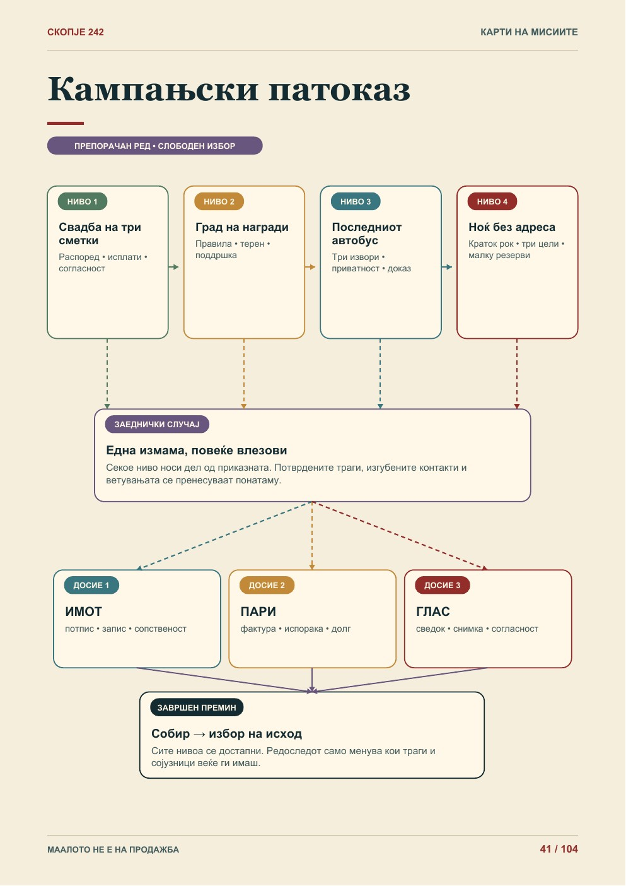

Схема на четирите кампањи по растечка тежина и нивните заеднички досиеја. Препорачаниот редослед им дава на играчите повеќе контакти и траги; секое ниво останува достапно за избор.

## 42 · Ниво 1 · Свадба на три сметки

Ниво 1 од 4 · Лесна тежина. Краток рок, јавен распоред и достапни резервни контакти; погрешната сметка ја намалува исплатата, но не ја затвора приказната.

Во Дебар Маало Маца треба да пее „уште еднаш за младоженецот“. Човекот што ѝ ја дал таа нарачка е организатор од друга свадба. Кумплунг носи тапанар на една адреса, а Сара добива три е-пораки со ист простор и различни имиња. На прв поглед е смешна збрка. Половина гости веќе уплатиле настан што никој не го договорил со сала.

### Три патеки до масата

Маца ги врзува песните со гостите. Сара ги собира работните сметки и ги чува имињата на луѓе што уште зависат од газдата. Кумплунг ги пренесува музичарите и наоѓа различни верзии на истата нарачка. Ако првата сала се испразни, јавниот распоред и потврда од екипата продолжуваат.

Со јавна бламажа се отвора поврат на пари и се губи барем еден платен настап. Со вистинска веселба се плаќа екипата, но погрешната исплата бара проверка другиот ден. Со тивка спогодба можеш да ги сочуваш двете ако тројцата газди јавно ги признаат износите и луѓето дадат согласност.

## 43 · Ниво 1 • Свадба на три сметки

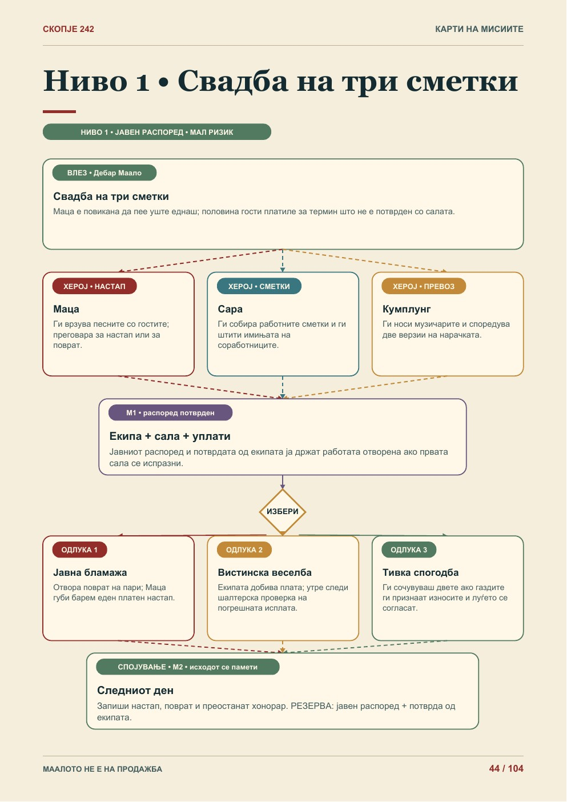

Маца, Сара и Кумплунг отвораат различни патеки низ распоредот, сметките и превозот. Патеките се спојуваат на следниот ден, но исходот ја менува исплатата и довербата на екипата.

## 44 · Свадба • Одлуки и продолжувања

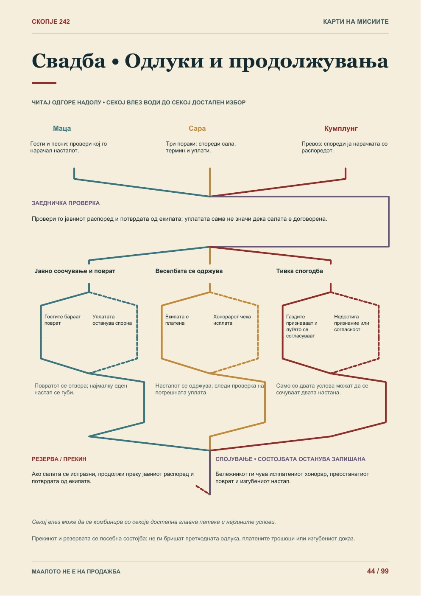

Вертикални патеки за настапот, сметките и превозот, со условите за спогодба, испразнета сала и проверка следниот ден.

## 45 · Ниво 2 · Град на награди

Ниво 2 од 4 · Умерена тежина. Еден јавен термин, спорни правила и последици за маалскиот терен ја креваат тежината; промашениот настап ја менува поддршката, но не ја затвора приказната.

Организаторот на измислената градска приредба прогласува победник за „најкорисно маало“ според тоа колку малку жители се појавуваат на фотографијата. Празниот терен добива награда затоа што анкетата ги броела само пријавените фирми, а не младите што таму тренираат. Следната награда е нова ограда.

### Сатирична кампања

Славица ги проверува старите правила на конкурсот, Дуле ги носи луѓето без спонзор, а Теа организира отворен тренинг на теренот со жители што можат да кажат како го користат.

Преземи ја приредбата со потврдени говорници и изгуби една договорена сцена. Пренасочи ја наградата и одреди кој ќе ја чува опремата. Победи според нивните правила, добиј закуп и одлучи дали ќе го тргнеш својот лик од плакатите. Ако говорот биде прекинат, жителите повторно се собираат на теренот и го поставуваат истото прашање.

## 46 · Ниво 2 • Град на награди

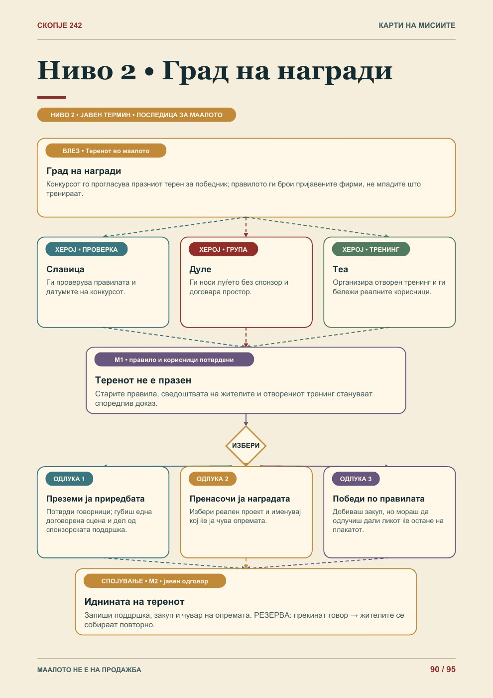

Славица ги проверува правилата, Дуле ги организира жителите, а Теа го води тренингот. Трите пристапи се спојуваат кај одлуката за приредбата и иднината на теренот.

## 47 · Терен • Одлуки и продолжувања

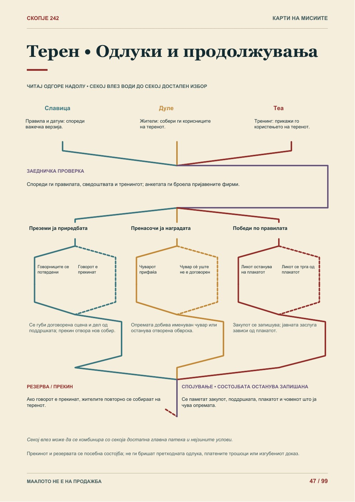

Вертикални патеки за правилата, жителите и тренингот, со одлуките за наградата, закупот и прекинатиот говор.

## 48 · Ниво 3 · Последниот автобус

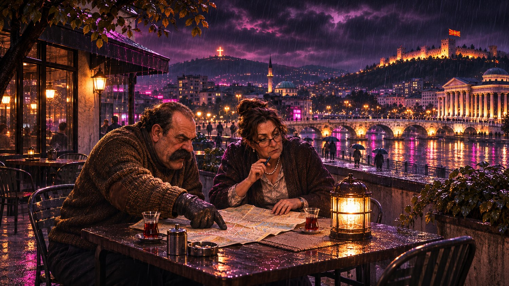

Ниво 3 од 4 · Тешка тежина. Ноќна рута, три извори што не се совпаѓаат и избор меѓу безбедност, приватност и доказ; ако го пропуштиш возачот, ќе мораш да најдеш нов контакт.

Возач остава три билети за тури што не постојат во распоредот. Димче мисли дека препознава стара линија. Бобан наоѓа два различни извештаи за истото возило. Миле ги бара патниците кај последните станици и дознава дека некој им наплатувал долгови што не биле нивни.

### Мрак меѓу две станици

Патниците наведуваат различни времиња. Разговор во автобус ја открива едната смена; записот од киоск ја потврдува другата. Ако го пропуштиш возачот, нова средба може да се договори кај негов роднина или преку билетарницата во текот на денот. Тој доброволно се крие и не сака да го враќаш само за да ја затвориш приказната.

Приватната изјава му дозволува да остане безбеден. Јавната објава го враќа прашањето кај работодавецот и го проширува случајот. Ако му помогнеш да замине со оригиналот, ја почитуваш неговата одлука, а жителите се потпираат на две независни копии. Последниот избор е кому ќе му помогнеш да стигне до последната станица.

## 49 · Ниво 3 • Последниот автобус

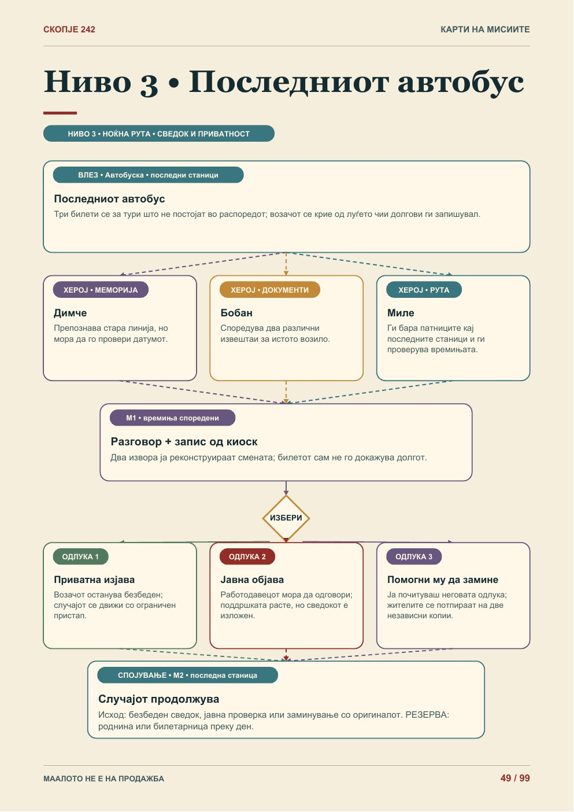

Димче, Бобан и Миле составуваат временска линија од билети, извештаи и искази на патници. Играчот избира приватна изјава, јавна проверка или заминување на возачот со оригиналот.

## 50 · Автобус • Одлуки и продолжувања

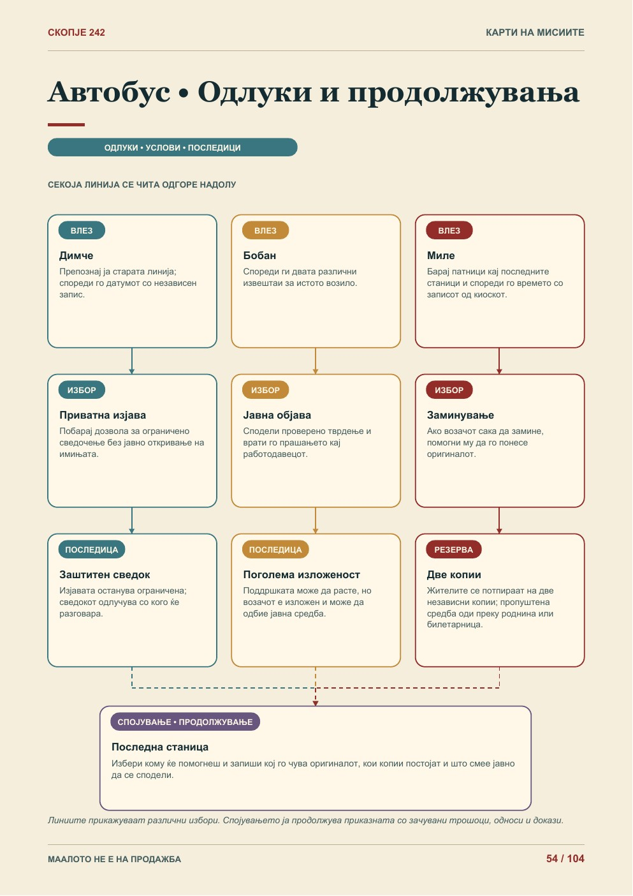

Вертикални патеки за приватноста, јавната објава и заминувањето на возачот, со резервните извори и средби.

## 51 · Ниво 4 · Ноќ без адреса

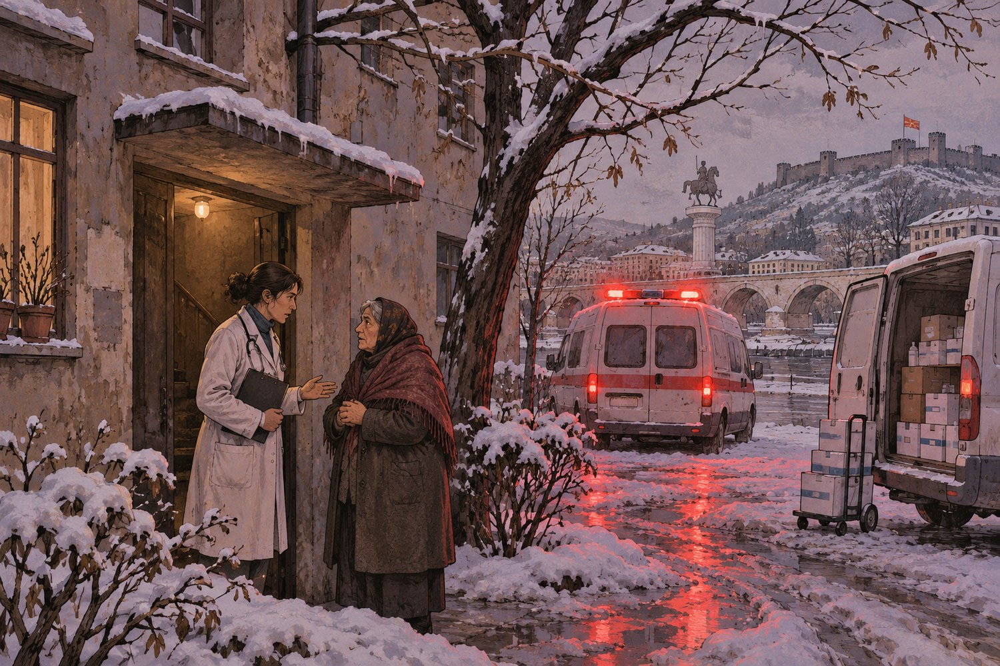

Ниво 4 од 4 · Многу тешка тежина. Краток зимски рок и три цели што не можат да се спасат во една етапа: товарот, возачот и единствениот оригинал.

Во евиденцијата на доставната фирма, три зимски пратки се означени како доставени на иста празна парцела. Владимир знае дека амбулантата чека пратка со лекови. Мали го препознава курирот по ознаката на возилото. Весна го знае поранешниот влез на амбулантата, кој не е означен во новите списоци. Некој цела година наплаќал за испораки што не се случиле, а сега вината ја префрла на возачите.

Можеш веднаш да решиш само еден од трите проблеми. Возачот носи список на приматели што чекаат; амбулантата потврдува дека пратката со лекови е нарачана и дека не може да се одложи. Со помошник можеш да ја спасиш пратката, да го однесеш возачот на безбедно место или да го зачуваш единствениот оригинал. Без подготвен сојузник, една цел ќе мора да почека до следниот термин.

Утринската проверка почнува поинаку зависно од тоа што си спасил: пратката, возачот или записот. Ако си избрал погрешна адреса, човекот што ја чекал вистинската пратка може да организира независна средба. Возачите бараат исплата за вистинските тури и точна евиденција. Сопственикот на доставната фирма нуди веднаш да плати ако не откриеш кој ги внел измислените испораки.

## 52 · Ниво 4 • Ноќ без адреса

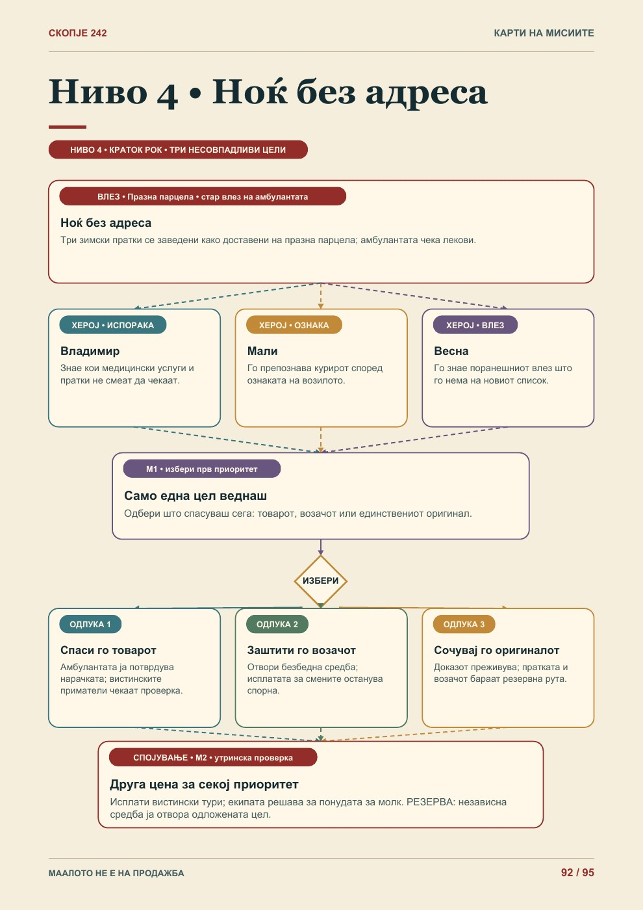

Владимир, Мали и Весна го поврзуваат товарот со возачот и со стариот влез на амбулантата. Под краткиот рок може веднаш да се спаси само еден приоритет; другите продолжуваат со послаба резервна позиција.

## 53 · Пратка • Одлуки и продолжувања

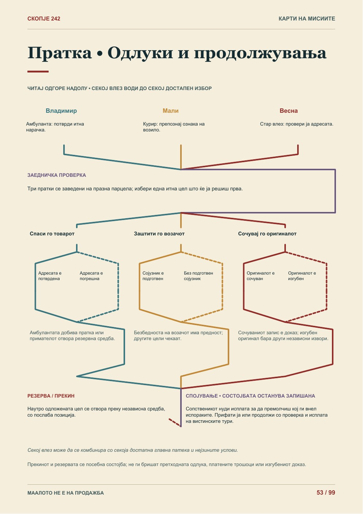

Вертикални патеки за товарот, возачот и оригиналот, со утринската проверка и понудата за молк.

## 54 · Три проверки со спротивни одлуки

### Брзаш, но прво му помагаш на човекот

Со Миле, по кратката тура не успеваш да го препознаеш курирот. Стигни на приемот, одбиј да ја објавиш снимката без контекст, па избери прво да му помогнеш на повредениот кај архивата. Потоа побарај потврда за прием и уште еден сведок што доброволно ќе зборува. Јавното финале е можно кога ќе ги потврдиш сите три досиеја; не мораш да ја возиш истата тура повторно.

### Се договараш со човек што ти должи

Со Велика, најди независно лице што ќе го чува оригиналот. Таа и внукот можат да го организираат превозот, но јасно кажуваат дека лицето што ја чува папката не зазема страна. Ако внукот одбие, автобусот и јавната средба ја продолжуваат приказната. Потврди ги досиејата „Имот“ и „Пари“, собери поддршка од три различни услуги и преговарај за еден простор. Во епилогот покажи кој останал надвор и каква помош си му понудил.

### Сам ја предизвика бељата

Со Давид, објави погрешно исечена снимка и изгуби го првиот сведок. Исправи ја објавата без да откриеш ничие име. Јавното внимание останува високо, но келнерот може да одбие да зборува пред публика. За јавното финале побарај друг сведок што доброволно ќе застане пред луѓето. Ако ја продадеш снимката наместо да ја исправиш, бележникот јасно покажува што губиш. По вчитувањето на зачувана игра, исплатената мисија не смее да се исплати повторно.

## 55 · Што се продава зад затворена врата

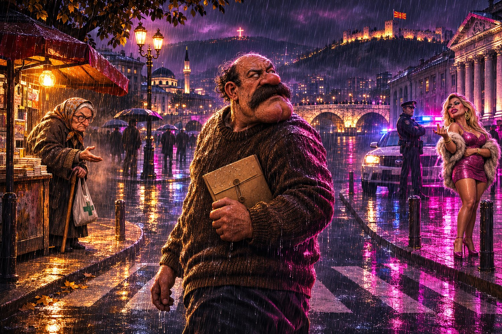

Една кутија во архивата ги поврзува трите линии: систематска кражба на возила во приказната, платен страв кај влезовите и измама со јавни набавки. Средната линија прераснува во изнуда, уцена и организирано насилство; последната во поткуп, фалсификувани записи и сокриени приходи. Секоја има луѓе што заработуваат и луѓе што плаќаат. На подоцнежните понуди се појавуваат и илегална трговија, договорени грабежи, уништување имот и нелегално обложување.

Под истиот настан можеш да земеш работа за фиксерот, да стоиш до луѓето што ги притиска или да се одвоиш со свој договор. Играта го памети кого си повредил, кој знае и кој е спремен да работи со тебе. Ако еден контакт умре или исчезне, неговата улога не оживува со истиот дијалог. Презема друг човек, пишан запис или делумен исход со траен трошок.

Измислената мрежа може да се појави и во шверц, трговија со дрога или киднапирање на возрасен сведок. Приказните се развиваат преку избори дали ќе учествуваш, ќе се откажеш, ќе спасуваш, ќе земеш пари или ќе сведочиш. Секоја линија остава други луѓе на твоја страна и друга цена кога ќе се распадне договорот.

## 56 · Три премини на истата ноќ

### Грабежот што ја отвора вратата

Магационерот нуди 85.000 денари ако прифатиш посебна мисија за преземање на спорниот товар. Можеш да учествуваш во пресметката, да договориш предавање со чуварот или да се откажеш и да одиш по евиденцијата. Во насилната варијанта помошник може да биде повреден, а комбето да не стигне до крај. По следната безбедна точка избираш плен, спасување или повлекување. Мирен договор може да чини половина удел и да го зачува сведокот.

### Уцена со точен документ

Посредник нуди 140.000 за право да го користи документот против управителот. Со истиот документ можеш да докажеш дека работниците ја одработиле смената и да ја побараш исплатата. Ако ја продадеш контролата, управителот губи функција, а работниците може да ја изгубат потврдата. Барање независен чувар ја одложува исплатата. Ако се откажеш од продажба, посредникот може да го објави сопствениот запис и да се отвори исправка.

### Цена на туѓото ќутење

Лик може да прифати пари и потоа да го предаде и партнерот. Следната сцена покажува дали договорот е раскинат и дали поранешниот партнер дознал дека си го предал. Нема општа морална скала. Криминалниот пазар цени готовина и моќ, додека возачот може едноставно да одбие да ти го даде клучот.

## 57 · По нападот

### Пресметка кај дворот

Раде праќа група да го растури собирот. Весна може да расчисти простор околу вратата, Сашо да придружи човек до излез, Дарко да застане меѓу двајца или да ја започне пресметката. Ако удриш прв, групата се повлекува побрзо во една варијанта, а поранешен сојузник може да побара помош за повредениот наместо да присуствува на потпишувањето. Ако ја оставиш салата да се растури за да го извлечеш сведокот, јавната сцена се сели на помали средби. Доказите и луѓето имаат одделни исходи.

### Насилство што останува во историјата

Нокаут, тешка повреда или смрт ја менуваат достапноста на ликовите, цената на завршницата и семејната сцена. Можеш да му надоместиш материјална штета. Семејството решава дали ќе ги прифати парите и дали ќе зборува. Друг сведок не може едноставно да го замени неговото сведоштво. Доказот оди кај друг извор или се губи можноста за конкретна верзија на финалето. Бележникот го запишува и ветувањето за помош: ако го прекршиш, секое следно барање за поддршка ќе ти чини повеќе. Последиците се гледаат во прекинат настап, построго обезбедување на влезот и нов контакт што е потешко да го добиеш.

## 58 · Кога ќе ја отвориш касата

### Цената во последниот кадар

Отвори го бележникот: таму се гледа што можеш да продадеш, колку должиш, кому му припаѓа спорниот товар и дали денешната понуда е потврдена. Прагот од 10 милиони можеш да го достигнеш со сочувано сведоштво, приватен договор или тешка криминална историја. Потоа можеш да го задржиш бизнисот и да им помагаш на луѓето што не стигнале до истиот праг, или да преземаш нови ризици.

### Проверка на затворањето

Земи заем од 2 милиони денари: нето-вредноста не расте за целиот износ, бидејќи заемот е и долг. Продај сопствен удел: вредноста се префрла од имот во готовина еднаш. Изгуби спорен оригинал: наследениот доказ не ја удвојува исплатата. Започни нова игра со друг лик: новиот буџет важи само за неа. При вчитување зачувана игра се враќа готовината запишана во тој зачуван запис. Во криминалната патека помини низ неуспешен договор и провери дека другата завршница сѐ уште има јасен услов. Провери посебно дали можеш да стигнеш до прагот без да повторуваш иста награда.

> „Десет милиони, брат. А сега кажи ми кој ти се јавува кога ќе ти заглави колата.“

## 59 · Црната смена

### Од што почнува

По спорната испорака избери дали да се сретнеш со работникот спомнат во вториот документ или со човекот што нуди 85.000 денари за товарот. Работникот вели дека списокот за работна смена е копиран од стар график. Покровителот тврди дека сите му се платени. За доказ ти треба човек што стварно бил таму и сметка што не потекнува од истиот лист.

### Кого ќе споиш, кого ќе изиграш

Можеш да прифатиш криминална работа во мисија што е дел од кампањата, да ја префрлиш исплатата на работниците со помал удел за себе или да ги предадеш двата записи кај јавен чувар. Првата патека доаѓа со можна пресметка и спорен плен. Втората ги задржува луѓето и прави јавниот случај зависен од друг доказ. Третата ја штити сметката, но ја губиш понудата за голем хонорар, дури и ако подоцна пак му се јавиш на посредникот.

### Ако смената се распадне

Момчило може да добие втора изјава од примателот. Сара може да го најде договорениот ангажман кај стилистката што работела на настанот. Сашо добива потврда за својот дел од смената; преостанатиот дел мора да го потврдат сведоци. Ако дојде до смрт, следи одделна семејна сцена, а никој друг не го повторува гласот на загинатиот. За остатокот од исплатата мора да одиш преку фактурата.

## 60 · Собир под кирија

### Понудата на маса

Еден купувач сака да преземе локал чиј газда веќе плаќа за „заштита“. Не знаеш дали купувачот ќе го задржи персоналот. Знаеш дека бара право на единствен пристап, чиста сметка за кирија и повлекување на еден јавен исказ. Сопственичката на локалот ти го покажува распоредот на смените, но не и целото досие што го има.

### Избори со различен ризик

Можеш да го купиш уделот со легален договор, да го искористиш како средство за притисок, да ја продадеш информацијата за сопственичката или да прифатиш да го растуриш собирот со насилство. Легалниот договор го одложува профитот; луѓето остануваат само ако самите потпишат. Со притисок добиваш пониска цена и губиш дел од подоцнежната мрежа. Продажбата ја остава сопственичката сама да одлучи дали ќе го затвори локалот. Со насилство можеш да ја добиеш договорената исплата веднаш, а подоцна да платиш за штетата и да го изгубиш пристапот до просторот во следните мисии.

### Излез после штета

Маца може да го закаже настапот на друга локација. Дуле добива помала група ако врати дел од парите. Весна отвора втора средба во двор и го прашува управителот кој дел од договорот важи. Ако никој не сака да се врати, можеш да ја затвориш работата со материјална загуба и да продолжиш со друг имот.

## 61 · Чичко Кумплунг

### Рикверц кон утре

На вратата од гаражата му лепат жолто известување. Познаник што му должи услуга за стара поправка му нуди нова работилница, ако го пренесе моторот од плацот. Можеш да почнеш кај гаражата или кај мајсторот во Лептокарија. Со товарното комбе стигнуваш до тесниот двор, ја проверуваш адресата и решаваш кому ќе му го предадеш моторот.

### Возачка предност

Способноста на Кумплунг му дава прецизна контрола врз комбето и при остар маневар. Така добива време безбедно да запре и да го прочита договорот. Пеш се движи бавно, па може да побара од соседот да ја провери адресата со него.

Ако ја прифати новата гаража, добива брза услуга, но соседот го губи пристапот до заедничкиот алат. Заеднички договор би ја потврдил сопственоста и би донел поскромна поправка. Соседот може да ја чува кутијата со документите во архивата. Ако комбето се расипе, мајсторот ја има товарната сметка. Договорената исплата е 2.500 денари. На крај, новата табла ќе гледа кон жив двор или кон гаража без луѓе.

> „Кола во рикверц знам. Животот не ми оди така.“

### Клучот во касетата

На празен плац заменската гаража веќе има приклучок за струја. Нова брава, стар клуч. Мајсторот ти дава пет минути да провериш дали соседот Горан е во списокот, додека превозникот бара да се потпише прием. Ако веднаш ја прифатиш гаражата, моторот е безбедно сместен и добиваш еднократна поправка на комбето. Горан го губи пристапот до алатот што го делевте.

Можеш да ја условиш својата согласност со двоен клуч. Надзорникот прифаќа, но додава две недели без струја. На следната работна смена мораш да избереш дали му го позајмуваш своето возило на Горан или го трошиш слободниот термин за архивата. Трета патека е да ги извадиш алатот и сметката пред да си заминеш. Го спасуваш доказот, ја губиш заменската гаража, а двајца мајстори на собирот ќе понудат делен простор.

> Горан: „Твој е моторот, чичко. Ама дигалката ја плативме двајца.“

## 62 · Таксист Миле

### Последната тура го знае твоето име

Патничката ти ја остава сметката за возењето и бара да не го спомнуваш нејзиното име. Ако ја пропуштиш првата средба, друг таксист ќе ти каже што слушнал на Рекорд. Возиш меѓу автобуска станица, спорна зграда и кафеана. На секое место некој ја памети истата испорака, но во различно време.

### Побрзо или подобро

„Миле знае пат“ ја покажува најбрзата моментална врска. Краткиот пат ја носи патничката дома навреме. Подолгиот ѝ дозволува да го препознае курирот. Ако бркаш луѓе пеш, ја оставаш сама и ја губиш таа можност.

Зачувај го нејзиното име во тајност и добиваш приватна трага за досието „Пари“, како и можност за подоцнежна средба за „Глас“. Ако ја продадеш информацијата, заработуваш повеќе, но доказите ќе мораш да ги побараш кај добавувачот. По судир, таа може да продолжи со друг возач ако претходно си ѝ ветил безбеден превоз. Исплатата е 2.000 денари плус договорениот кусур. На собирот доаѓа само ако самата се согласи.

> „Радиото има вести. Таксиво има сведоци.“

### Патничката што не сака да биде извор

Кај вториот семафор Елена те прашува дали ќе кажеш каде се качила. Знаеш дека во записот за турата нема име, но адресата лесно се поврзува со неа. Избери да ја однесеш дома, да запреш кај осветлен киоск или да предложиш друга кола. Дома стигнува брзо; ако веќе си ја продал адресата, таа влегува сама и не се јавува следниот ден. На киоск треба да го платиш чекањето со пропуштена тура, но можеш да чуеш кој ја барал.

Дозволено е таа да ја избере втората кола. Ќе изгубиш контрола врз распоредот, но ќе добиеш независна потврда од возачот ако го зачуваш нејзиното име. Ако веќе си го предал записот, првиот чекор за да ја поправиш штетата е да ѝ кажеш што точно си предал. Таа одлучува дали ќе ја прифати следната придружба. Тогаш улогата на сведок може да ја преземе келнерот со подготвена копија.

## 63 · Певаљка Маца

### Уште една песна за газдата

По приватната прослава исчезнува договорот за настап во локалот. Келнер или музичар ѝ нуди на Маца нов настап во Дебар Маало. Преговарај за бакшишот, одржи проба и одлучи кога да го задржиш вниманието на салата, а кога да им оставиш простор за тивок разговор на двајца гости.

### Микрофонот е прозорец

Со способноста „Микрофон на максимум“ Маца го задржува вниманието на публиката, па келнерот добива кратка можност да излезе. Ако почне кавга, музичарите можат да продолжат додека Маца го изведува гостинот од салата. Ако таа прва удри, собирот се растура, а преговорите се префрлаат на следната проба.

Ако му посвети песна на Виктор, Маца зема 3.000 денари и покана за прием, но му ветува заедничка фотографија. Ако одбие, зема 1.800 денари од музичарите, а келнерот ѝ дава независна трага за „Глас“. Ако вечерта пропадне, истите избори се повторуваат на помала проба. На собирот публиката може да ја поддржи верзијата на газдата или да ѝ помогне на Маца да го задржи микрофонот за келнерот да каже што се случило.

> „Песната е ваша, газда. Микрофонот уште е мој.“

### Кому оди последната песна

Организаторот ја крева раката кога Маца стигнува до песната што ја нарачал Виктор. Келнерот стои до вратата и стиска празен послужавник. Можеш да ја отпееш песната како што си ветила, да ја растегнеш инструменталната пауза за да излезе келнерот или на крај јавно да кажеш кој не е платен. Пред настапот тапанарот ти кажува дека неговата дневница зависи од исплатата на газдата.

Договорениот настап ги штити дневниците; келнерот бара да се видите утре, наместо да зборува вечерва. Ако ја продолжиш инструменталната пауза без објаснување, келнерот може да излезе незабележано, но газдата ја скратува последната песна и не ја обновува поканата. Јавната прозивка носи внимание, но двајца музичари бараат Маца да ја плати разликата. Ако го прифатиш тој долг, истите луѓе на собирот ќе продолжат да свират кога Раде ќе се обиде да го прекине разговорот.

## 64 · Студент Стојан

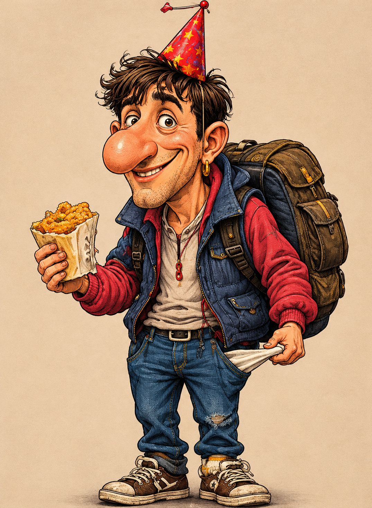

### Лаптоп поскап од школарина

Во сервисот е донесен стар лаптоп на кој се зачувани туѓи фактури. Сопственикот бара полнач што го заборавил кај студентската автобуска. Стојан, кој почнува со 3.300 денари, избира меѓу брз превоз, дозволена копија од документите или повеќе време за разговор. Може и бесплатно да се сретне со сопственикот и да оди со градски превоз.

### Студентски попуст

Избери една поволност: попуст за превоз, копирање или помош од сервисерот. Провери го датумот на документот, побарај согласност и стигни кај сопственикот на лаптопот. Попустот му помага на Стојан да го сочува буџетот; неговата вистинска предност е што умее да спореди две фактури.

Ако го вратиш лаптопот, сопственикот ќе ти помогне да провериш извор за „Пари“. Ако прво направиш копија, побрзо стигнуваш до добавувачот, но сопственикот бара објаснување и не сака јавно да ти помогне. Ако го пропуштиш автобусот, сервисерот закажува нов термин. Исплатата за услугата е 1.500 денари. На крај Стојан може да добие препорака за работа или да остане со папка докази, но без човек што ќе му одговори на утрешниот повик.

> „Брат, имам буџет за две грешки. Едната веќе ја платив.“

### Осумдесет денари за туѓо име

Во копирницата имаш три страници со различна важност: фактура, запис за прием и листа со имиња што не се поврзани со испораката. Сопственикот на лаптопот дал согласност да ги копираш првите две. Испитот на Стојан е утре, а брзиот превоз чини колку целонеделен буџет за храна. Избери дали ќе направиш една дозволена копија и јавна проверка, две копии со попуст или прво ќе го вратиш лаптопот.

Со една копија можеш да почнеш веднаш, но вториот извор бара следен термин. Со две копии и попуст го губиш брзиот превоз, а сопственикот останува сведок. Ако ја земеш и листата со имиња, ќе најдеш друг контакт побрзо, но ризикуваш да изложиш луѓе што немаат врска со испораката. Можеш да ја отстраниш листата од својот случај пред јавност. Кога ќе го признаеш пристапот, сопственикот сам решава дали оди на собир или ти го остава само документот.

## 65 · Инфлуенсер Давид

### Ова не е спонзорирано

Давид на снимката случајно фаќа средба што не ја планирал. Спонзорот го бара оригиналот, а келнерот на снимката бара да не му се гледа лицето. Почни со разговор со кој било од нив. Прегледај ја целата снимка, врати се на местото и избери каде ќе го сослушаш келнерот.

### Сними, па одлучи

Снимањето привлекува луѓе. На отворен плоштад има сведоци; во тесен ходник луѓето можат да ти го затворат излезот. Додека се собираат, можеш да му дадеш простор на келнерот или да го ставиш во центарот на кадарот. Брзо објавување носи 3.500 денари, две нивоа внимание и непроверено тврдење.

Почекај и завери ја целата снимка со втор извор. Добиваш „Глас“ и 1.800 денари за посебна работа. Ако објавиш прерано, извини му се на келнерот и сними исправка; така повторно се отвора јавното финале, а неговата доверба се враќа само ако тој прифати. Ако приемот пропадне, продолжи со разговор во блиската кафеана.

> „Брат, првпат ми треба помалку публика.“

### Публиката гледа погрешен човек

Спонзорот бара кадар со келнерот на средина, затоа што лицето ја прави снимката „лична“. Келнерот се согласува да каже кога бил таму, но само без име и лице. Избери оригинал за приватна проверка, јавен исечок со целосен контекст и согласност, или брз спонзориран исечок. Пред изборот гледаш кои луѓе се препознатливи и кому оди копијата.

Приватната верзија го одложува вниманието и ја задржува поканата за јавен настап. Потврдениот исечок носи само еден поен внимание додека не се потврди и вториот извор. Брзиот исечок носи пари и два поена, но келнерот ја губи смената и го откажува терминот. Во исправката избираш дали лично ќе го признаеш својот дел или ќе објавиш само нов контекст. Првото отвора средба со келнерот. Второто го поправа јавното тврдење и остава друг човек да го носи сведоштвото.

## 66 · Инфлуенсерка Сара

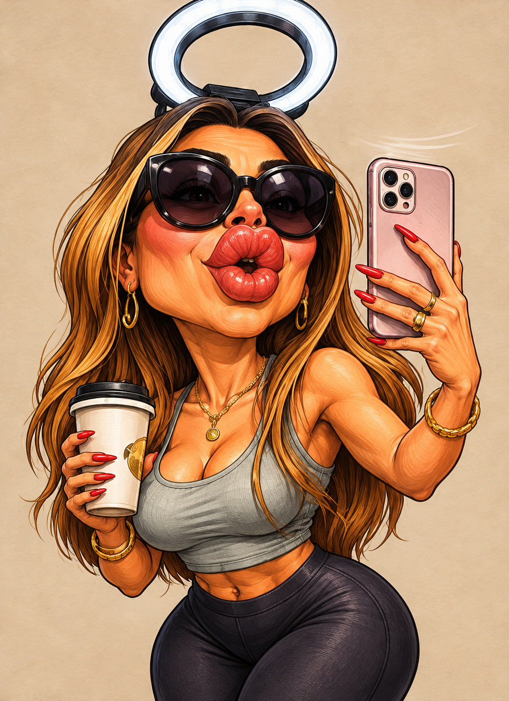

### Стори не плаќа фактура

Сара одбива да рекламира проект во кој нема доверба и останува без хонорар. Потоа ѝ пишува стилистката, на која не ѝ е исплатена работата, а на отворањето на новиот кварт се појавува спорна фактура. Најди го записот за нарачката и разговарај со уште двајца соработници што не си ги добиле парите.

### „Девојче, среди ми“

Со познанство избираш возач, приватна просторија или претставување кај спонзорот. За оваа етапа можеш да побараш само една услуга. Со правилен контакт, Сара може на приемот да договори разговор надвор од камерите.

Прифати ново појавување за 4.000 денари, или поврзи ги соработниците и потврди го досието „Пари“, со еден поен поддршка. Стилистката може да ти стане сојузничка ако јавно признаеш дека таа ја завршила работата. Ако спонзорот те тргне од списокот, оди на јавниот прием со нејзината фактура. На крај Сара може да добие независен договор или да се врати кај познат спонзор што и понатаму ѝ го диктира текстот.

> „Душо, фала за видливоста. Кај стои сумата?“

### Туѓа услуга на твоја сметка

Стилистката бара нејзиното име да остане на фактурата за да ѝ се плати. Вториот соработник сака да остане анонимен бидејќи уште работи за спонзорот. Можеш да преговараш за исплата на сите со приватен список, да земеш личен надомест веднаш или да предложиш заедничка изјава без имиња. Приватниот список е најбрз, но бара да најдеш неутрален човек да го чува.

Со личната исплата Сара добива ново појавување и губи придружба на следниот настан. Со заедничката изјава го чува вториот човек, но стилистката бара на крај јавно да ѝ ја признаеш работата. Сара може да обезбеди просторија или возач. Ако избереш просторија, одиш со јавен превоз и влегуваш од другата страна, па средбата останува приватна. Ако избереш возач, пристигнуваш полесно, но средбата е јавна; за приватноста одлучуваш пред да ја покажеш фактурата.

## 67 · Теткица Весна

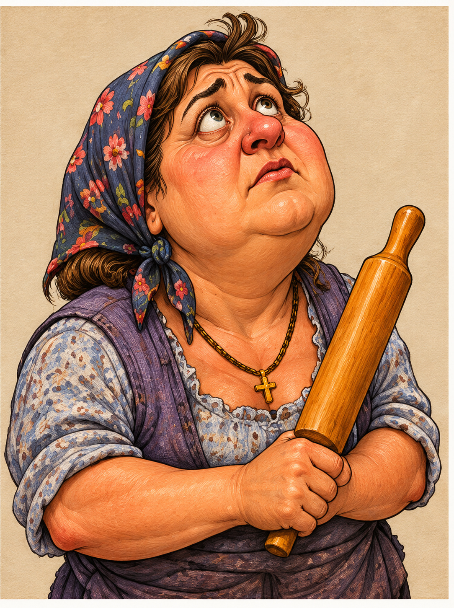

### Кој го остави влезот отворен?

Геометарот што ја проверувал зградата знае кога бил сменет кодот на вратата. Еден сосед го обвинува домарот, а друг веќе се пакува. Прочитај го известувањето или помогни му на станар да донесе намирници. На три ката ќе чуеш три различни верзии; потоа разговараш со станарите поединечно, без да го изложиш човекот што најмногу ризикува.

### Чанта и збор

Маалскиот авторитет ѝ помага да започне разговор. Во предложената сцена, чантата кратко го попречува напаѓачот за соседот да излезе. Весна не брка по скали; однапред избира каде ќе стои и кој ќе го придружува домарот.

Ако јавно го посочиш соседот, брзо добиваш трага за досието „Имот“, но ја губиш неговата помош при проверката во архивата. Ако разговараш насамо, дознаваш зошто го дал кодот и можеш да договориш нов пристап. По уште една проверка, тој може да стане сојузник. Ако собирот се растури, разговорот продолжува следното утро кај киоскот. Договорената исплата е 2.000 денари.

> „Не се мешам, синко. Само ти немаш клуч од мој влез.“

### Комшијата од трети

Претставникот нуди да им го поправи лифтот ако Весна престане да прашува кој ја дал шифрата. Комшијата од третиот кат навистина ја споделил, а некој му ветил дека лифтот ќе биде среден пред да му се врати мајка му. На состанокот можеш да го кажеш неговото име, да бараш поправка без да ја предадеш книгата или да предложиш нов код и распоред со двајца чувари.

Името носи брз сведок и го остава човекот без поддршка во влезот. Поправката без договорен рок ја зачувува фасадата на мир, но на следната средба можеш да најдеш повторно залепен оглас. Нов код бара една маалска услуга и остава сведок достапен. Ако претходно си го посрамила, поправката е да застанеш до него кога бара објаснување пред луѓето, без да го тераш да ја потврди твојата верзија.

## 68 · Баба Велика

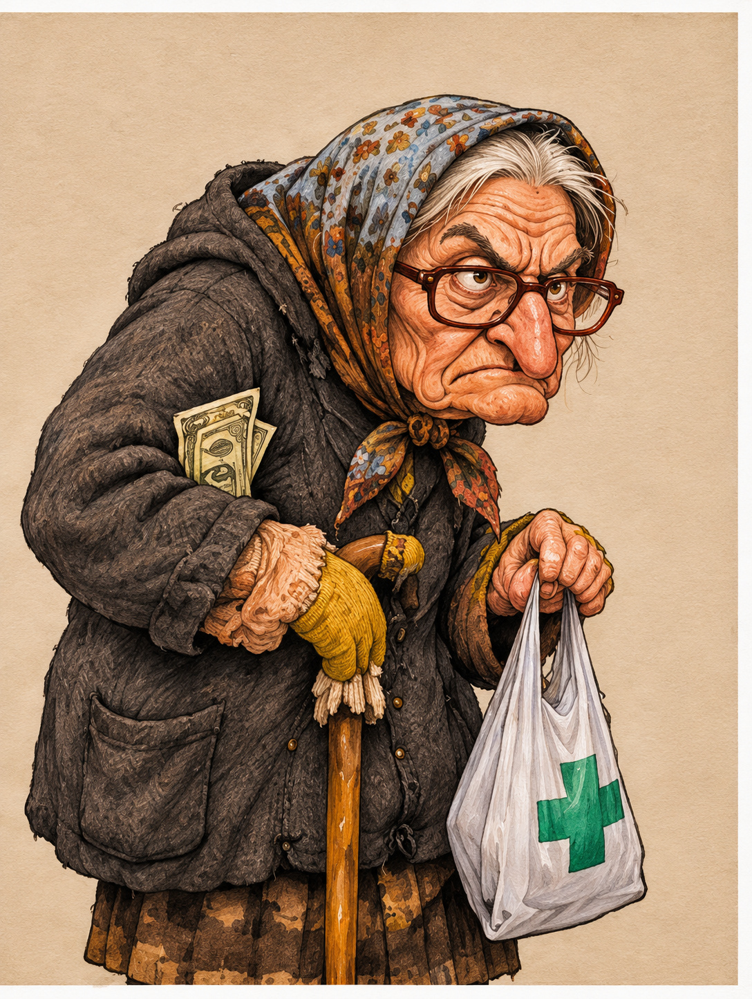

### Документите под перница

Роднина ѝ нуди на Велика да ѝ ги „чува“ имотните документи. На огласот таа го препознава описот на истата парцела. Почни со семејна посета или со разговор кај соседката. Најди ја старата папка, договори безбедна средба и избери кој ќе го чува оригиналот.

### Семејната резерва

Способноста „Под перница“ може да открие скриена заштеда, документ или член на семејството што ќе помогне. Велика почнува со 12.000 денари; бесплатниот превоз ѝ помага да не троши залудно. Ако внукот има друга обврска, може да оди со автобус на договорен термин.

Остави ја папката кај роднините и побрзо ќе добиеш трага за досието „Имот“, но тие ќе очекуваат приватна спогодба. Ако ја дадеш на независно лице да ја чува, добиваш посигурен пат кон јавна проверка, но следува тежок разговор дома. Ако шалтерот го откаже терминот, Славица закажува нов. Исплатата за проверката е 1.800 денари. Во епилогот семејниот клуч останува на масата; Велика одлучува кој смее да го земе.

> „Сине, подигни го тепихот. Знам кај ми е паметот.“

### Името на уште еден наследник

Во семејната папка Велика наоѓа запис за роднина што одамна живее надвор. Внукот предлага папката да остане дома додека не добијат приватна понуда. Славица може да закаже јавна заверка. Роднината сака да разговара по телефон и бара да не му ја објавуваат адресата.

Ако веднаш ја дадеш папката на семејството, внукот плаќа превоз и доаѓа со тебе на собир, но бара името да остане приватно. Ако ја дадеш кај неутрален чувар, добиваш заверка и губиш една бесплатна услуга додека не разговараш дома. Ако прво го сослушаш роднината, следната средба почнува подоцна. Отвораш можност за заеднички потпис и можеш да зачуваш уште еден станар во спогодбата. Ако го пропуштиш терминот, можеш да продолжиш од белешката што ја чува Славица или од копијата во семејниот албум.

## 69 · Дедо Димче

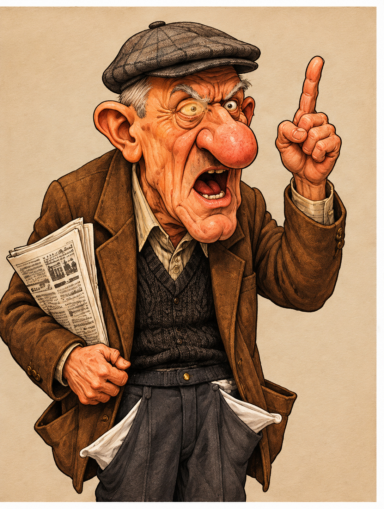

### Човекот од старата слика

Весникот на киоскот или стар пријател на автобуската му покажува познато лице под ново име на фирма. Димче ја наоѓа фотографијата, разговара со поранешен колега и ја проверува годината кај фотографот. Почнува со 3.000 денари. Секоја средба може да биде бесплатна, во парк или на автобуска постојка со клупи.

### Старо Скопје

Со способноста „Старо Скопје“ Димче може да повика еден стар контакт. Поранешниот колега го препознава лицето, но греши за годината и премолчува една услуга што му ја направил. Избери што ќе провериш прво. Брзата објава носи внимание, но и сомнителна трага за „Глас“; потврдениот датум носи веродостојно сведоштво.

Чувај го името на стариот другар во тајност или замоли го самиот да објасни што знае. По пропуштен термин, средбата се сели на клупата кај продавницата. За проверката добиваш 1.500 денари; фотографијата останува кај семејството. На последниот собир го гледаш пријателот до себе или празно столче кое двајцата го паметите.

> „Лицето го знам, синко. Годината ќе ја провериме.“

### Годината се брани со луѓе

Сликата покажува двајца пред ист дуќан. Стариот другар тврди дека е направена на денот на спорната испорака, но датумот на оригиналната фотографија покажува дека е од година подоцна. Фотографката сака прво да знае каде ќе ја користиш. Можеш да ја зачуваш приватно, да побараш уште еден независен сведок или веднаш да ја објавиш.

Првата патека го зачувува пријателството, но бара уште една потврда. Во втората, фотографката го потврдува датумот независно, но стариот другар мора да објасни каква услуга направил. Третата привлекува внимание и може погрешно да посочи виновник. Димче ја поправа грешката со нова средба кај фотографката и јавно го чита точниот датум. Ако ја почитуваш нејзината согласност, на крај таа носи уште една фотографија како резервен извор.

## 70 · Пандур Бобан

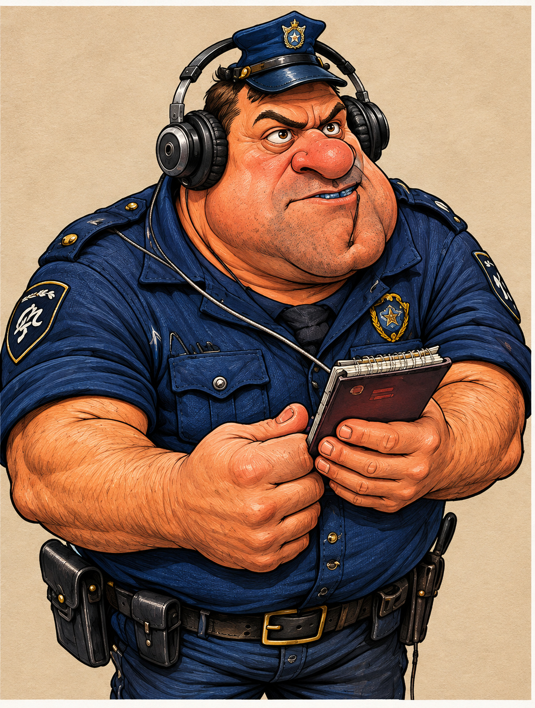

### Предметот е во погрешна фиока

Жртвата на кражбата и колегата што го задржал извештајот ја отвораат мисијата. Сослушај ја жртвата, провери дозволен службен запис и закажи средба на јавно место. Способноста „Легитимирање“ ти дава право да поставиш прашања, но соговорникот може да одбие да зборува. Воениот и полицискиот комплекс се забранети зони.

### Каде ќе го заведеш

Ако одиш по службениот пат, брзо добиваш доказ и ветување за унапредување, но оригиналот стигнува до човек на Раде. Ако заведеш копија и најдеш независен сведок, побавно ќе собереш доказ за „Глас“ или „Имот“. Ако ја продадеш информацијата, купувачот ќе те побара повторно на крајот, а жртвата ќе мора да побара помош од друг.

Ако ти го одземат службениот пристап, продолжи преку сведокот и јавниот шалтер. Исплатата за мисијата е 2.500 денари. Во архивата службениот пристап ти штеди време, а цивилен сојузник може да го чува оригиналот додека му помагаш на друг човек.

> „Редот е за сите ист. Само некои имаат друга врата.“

### Услуга од колега

Колегата на Бобан носи службен број и бара оригиналот да остане во фиока до понеделник. Жртвата сака потврда денес бидејќи утре ќе ѝ ја сменат бравата. Можеш да го заведеш преку колегата, да побараш независна потврда кај јавен шалтер или да ја придружиш жртвата да поднесе свое барање.

Службениот пат го задржува пристапот и брзо носи број, но во архивата дознаваш дека записот се префрлил кај истиот посредник. Независното заведување те чини дополнителна средба и една услуга, а ти остава проверена копија. Придружбата го прави човекот активен сведок, но колегата ќе те праша зошто си го прескокнал. Ако си ја продал информацијата, можеш да ѝ помогнеш со нов пристап без таа да ти го врати истото ниво доверба. На финалето јавниот запис и службениот потпис се две различни потврди.

## 71 · Доктор Владимир

### Испораката стигна, уплатата не

Фактурата на клиниката не се совпаѓа со нарачката. Добавувачот или пациент кому му била откажана услугата те упатува до курирот. Придружи го до безбедно место, провери што навистина пристигнало и спореди ги износите. Изборот е дали Владимир ќе остане со човекот или ќе ја следи документацијата; мисијата не симулира медицинска постапка.

### Време за човекот

Способноста „Докторе, помагај“ му ја враќа енергијата на Владимир или му помага на соиграч. Во предложената кампања, контакт може да ги однесе документите додека Владимир останува со курирот. Неговата предност е смиреното возење и грижата за луѓето, не тепачката.

Ако ја блокираш целата фактура, брзо ќе обвиниш некого, но вистинската испорака ќе остане неплатена. Ако ги разделиш сметките, ќе ти треба уште еден термин за да го потврдиш досието „Пари“. Спонзорот нуди да ја покрие загубата во замена за молк. Ако курирот се повлече, барај потврда од примачот. Исплатата е 3.000 денари. На крај одлучуваш дали амбулантата ќе продолжи да работи.

> „Прво човекот. Фактурата нема да ни избега.“

### Испорака за утре наутро

Добавувачот вели дека без одобрение нема да ја испрати следната пратка, а примачот знае дека првата пристигнала само делумно. На масата имаш потпис за прием, лист со недостиг и понуда за приватно покривање. Избери да одделиш испорака од спорна фактура, да стопираш сѐ до проверка или да прифатиш премостување со јавно запишан услов.

Одделувањето бара две посети и чува исплата за она што стварно стигнало. Стопирањето го забрзува јавниот случај, но следниот ден ќе те чекаат луѓето од откажаната испорака. Приватното покривање дава брз опстанок и ризик донаторот да бара тишина на собирот. Запишаниот услов му дава на Владимир право да го прозове долгот пред другите, но донаторот тогаш може да се повлече. Во сите патеки резервниот примач може да даде изјава без податоци за пациенти.

## 72 · Мали

### Сите одеднаш го бараат Мали

Другар му покажува етикета што паднала од пакет. На неа е адресата каде што Мали видел размена. Оди до местото, препознај го примателот и одлучи кому ќе му кажеш што си видел. До таму можеш со велосипед, тротинет или со договорен превоз; не мораш да земеш автомобил.

### Се пикнав, ме нема

Тесниот премин накратко го крие Мали од човекот што го следи. Ако се врати по истиот пат, следачот може да го чека на излезот. Другарот оди по подолгата рута и чека на безбедно место. Ако го оставиш сам, ја губиш неговата доверба.

Кажи му на Бобан што си видел за брзо да ја заштитиш трагата „Глас“, но името на другарот може да се открие. Ако ја замолиш Весна да посредува, разговорот трае подолго, но ја чуваш приватноста. Ако измислиш приказна, подоцна ќе мора да ја исправиш пред човекот што си го обвинил. Ако останеш без превоз, продолжи ја мисијата кај другарот. Исплатата за услугата е 1.500 денари.

> „Мал сум само кога треба јас да платам.“

### Другарот чека на погрешната клупа

Преку тесниот премин Мали може да стигне до домарот пред да го стигне човекот што го следи. Другарот, кој не може низ преминот, оди до другата клупа. Можеш да го испратиш сигналот за безбедна средба со Весна, да го сослушаш домарот веднаш или да се вратиш и да продолжите заедно по прометна улица.

Ако брзаш, ќе го добиеш описот на примачот, но другарот може подоцна да одбие да биде именуван. Со Весна се чува приватноста и се добива побавен запис. Ако се вратиш, го пропушташ првиот разговор и добиваш дупликат од етикетата кај киоскот. Кога Бобан ќе праша кој бил со тебе, можеш да дадеш точен опис без име. Сведоштвото останува употребливо за проверка, а на јавен собир наместо другарот треба втор сведок.

## 73 · Работник Момчило

### Крени го ова, потпиши го она

На градилиштето му нудат на Момчило заостаната плата во замена за потпис дека се согласува со рушењето. Колега го спомнува истото во бурекџилница. Помогни да се истовари палетата на договореното место, прочитај го листот и одлучи кој ќе зборува во име на екипата.

### Силата има друга работа

Способноста „Работнички шамар“ може да му отвори пат или да го прекине нападот. Раде сака снимка од тепачка со работник. Ако Момчило остане да му помогне на товарачот, ќе добие време да ја провери сметката и да го сослуша сведокот. Комбето го заменува долгото трчање.

Земи 2.500 денари за себе и остави ја екипата сама да преговара. Или поднеси заедничко побарување: добиваш трага за „Пари“, поддршка и 3.500 денари по собирот. Ако растоварувањето пропадне, провери го приемот со примачот на следната смена. Ако си потпишал сам, можеш да му помогнеш на колегата и да почнеш да ја враќаш неговата доверба; потписот сепак останува во записот.

> „Јас кревам бетон. Твојот потпис ти е твој товар.“

### Кој го пушта комбето

Надзорникот сака Момчило да го остави комбето да тргне пред екипата да добие копија од листот. Двајца работници бараат пари веднаш. Третиот вели дека во записот недостига цела смена. Избери лична исплата, одложена заедничка исплата или прием само за луѓето што писмено го прифаќаат.

Личната исплата го чува работното место, а третото лице не може да ја докаже смената без помош. Заедничкото барање носи поддршка, но некој пропушта дневница и сака да знае кога ќе му се врати. Делумниот прием плаќа двајца и го остава спорот јасно означен; надзорникот губи право да го нарече документот целосен. Ако комбето пропадне, копијата ја бараш кај примачот наместо преку караница на плац. На собирот различен човек ја претставува екипата според изборот.

## 74 · Бурек-мајстор Благоја

### Појадок пред багерот

Затворањето на пекарницата се најавува пред првата нарачка. Таксистот го прашува Благоја каде ќе купува бурек од утре. Испланирај рута со три постојки. Ако прво го нахраниш надзорникот, ќе ја чуеш приказната за спорната фактура. Ако прво ја дочекаш екипата, ја добиваш нивната доверба. Ако зачуваш порција за сведокот, тој ќе стигне на време.

### Топло од фурна

Бурекот му ја враќа енергијата за една етапа. На Благоја повеќе му одговара пешачка рута или договорен возач отколку потера со комбе. Пропуштената нарачка може да се подигне во дуќанот.

Прифати го спонзорскиот договор за „традиционална пекара“ за 4.000 денари и ветен настап во реклама; соседниот дуќан за боза останува исклучен. Или задржи го името и организирај маалска трпеза за 2.000 денари, со поддршка и трага за „Пари“. Љупчо ќе ти каже лично што значи твојот избор за неговиот дуќан.

> „Со сирење, со месо или со ситни букви?“

### Третата порција

Благоја има една тава бурек, три ветувања и комбе што пали од втор обид. Надзорникот бара цела нарачка за екипата на приемот. Екипата нема ситни пари. Човекот што треба да ја потврди сметката доаѓа со првиот автобус. Целата испорака носи готовина; делената тура ја чува довербата, но мајсторот може да го изгуби следниот клиент ако задоцни. Ако зачуваш порција за човекот, средбата останува приватна.

Можеш однапред да одиш пеш кај Љупчо и да договориш замена. За возврат, треба да му оставиш место на масата кога ќе се зборува за двата дуќана. Ако веќе си прифатил спонзорски договор, можеш да му понудиш место само ако јавно кажеш дека неговиот дуќан не е вклучен во договорот. Пропуштениот сведок ќе дојде по смена кај пекарницата, но ќе бара да се види оригиналната сметка.

## 75 · Боза-мајстор Љупчо

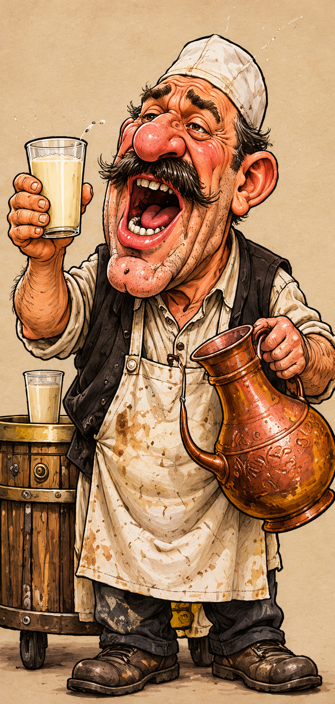

### Автентичност со членарина

Консултант му нуди на Љупчо да го претвори старото дуќанче во Чаршија во „нов концепт“. Понудата ја добива лично или на лист до касата. Испорачај една нарачка, разговарај со тројца редовни гости и спореди кои имиња се наведени во двата договора. Пред да тргнеш, можеш да го поздравиш маалското куче.

### Седни малку

Бозата му ја враќа енергијата и ја намалува исцрпеноста за една етапа. Љупчо може да ја достави со своето бавно возило или со помошник. Ако просторот е затворен, големата дегустација може да ја замени со помала средба.

Прифати 3.500 денари и контакт од спонзорот, но долгогодишната помошничка ќе ја изгуби работата. Одбиј и земи 1.800 денари за договорена нарачка, поддршка од маалото и трага за „Имот“. Третата можност е да го задржиш старото име и да побараш пред собирот да се открие ставката што била премолчена во договорот. На крај се гледа кој навистина останал зад шанкот.

> „Сакаш автентично? Седни да ти кажам кој ја мие чашата.“

### Ќе остане името, а човекот?

Новиот договор го задржува старото име на дуќанот за боза, но воведува нови услови за вработување. Помошничката чита дека нејзиниот стаж не е признаен. Консултантот нуди да ја врати ако тивко го затвориш другиот спор за кирија. Можеш да го прифатиш, да го вратиш со јасен услов за стаж или да отвориш јавна дегустација и да собереш две независни сеќавања за користењето на дуќанот.

Тивката спогодба ја чува работата и остава непотврден услов за киријата. Пишаниот услов доаѓа со ново чекање и можност консултантот да си замине. Јавната трпеза ја дава поддршката, но бара ново место ако просторот е затворен. Помошничката има право да прифати подобро работно место и да ја напушти приказната. Тогаш можеш да го зачуваш дуќанот за нова екипа, а последниот разговор останува со неа, пред да си замине.

## 76 · Фит-женска Теа

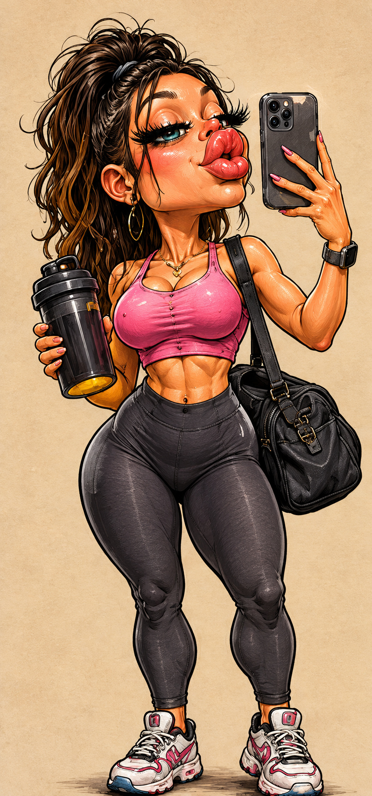

### Личен рекорд, јавен терен

Тренингот на кејот завршува пред оградата на теренот. Партнерката на Теа го отвора прашањето за иднината на теренот; истото го прави и новото известување за приватизација. Оди по обележаната пешачка патека, сретни го лицето што го чува теренот и однеси запис дека го користат жителите.

### Кардио за еден дел

Со „Кардио режим“ Теа брзо стигнува на закажаната средба, без да ги загрози пешаците. Може веднаш да го искористи налетот или да застане и да го сослуша чуварот пред да избере следен термин. Брзата рута отвора една сцена; целосниот разговор носи дополнителна трага.

Прифати 4.500 денари од спонзорот за приватно студио, но чуварот можеби нема да сака да помогне. Или организирај отворен тренинг за 2.200 денари, поддршка и трага за „Имот“. Ако го промашиш јавниот термин, можеш да се сретнеш со чуварот следниот ден. На собирот теренот или останува место за жителите, или станува само слика во презентација.

> „Ај уште еден круг. После ќе им го мериме пулсот на шалтер.“

### Кој трча со тебе

На Кеј спонзорот веќе донел банер за „јавен тренинг“. Со мал фонт пишува дека следната група мора да плаќа членарина. Чуварот на теренот носи стар список, но сака да остане надвор од рекламата. Теа може да ја води турата со банерот, да го скрати тренингот за да го стигне јавниот термин или да премести дел од луѓето на пристапна патека и да закаже следен термин.

Спонзорот ја плаќа опремата, но бара договор што го исклучува чуварот од теренот. Кратката тура ослободува време за доказ и остава дел од најбавните без завршен круг. Поделената група бара сојузник што ќе го води вториот дел, носи трајна поддршка и остава можност за независно студио. Ако го почнеш тренингот со брзо темпо пред разговорот, можеш да ја пропуштиш причината зошто списокот е важен.

## 77 · Билдер Дарко

### Договоров не кажува колку тежи

Член на теретаната или нова сметка открива понуда за „заштита“. Премести опрема на обележаното место и однеси го членот до средба со луѓе што може да ја потврдат киријата.

### Напумпан режим

Дарко има краток налет на сила и издржливост. Може да расчисти товар или да му отвори излез на човекот. Бидејќи сите го гледаат, секоја кавга станува снимка за Раде. Широката патека го заобиколува тесниот премин.

Земи 4.500 денари од обезбедувањето и зачувај ја теретаната привремено, со долг за нивниот настан. Одбиј и заштити го членот за „Глас“ и 2.500 денари за опремата. По кавга, членот преживува, но разговорот се враќа дури по посебна средба. На приемот си или поканет телохранител или човекот што му чува столче на сведокот.

> „Тегот го пушташ. Договорот те држи.“

### Младото момче не е обезбедување

Наплатувачот нуди на членот од теретаната прва платена смена ако Дарко го стави во списокот на обезбедување. Момчето сака работа и се плаши од човекот што треба да го надгледува. Прво избираш дали ќе разговараш со него без присуство на наплатувачот. Во јавност тој може да се согласи од срам и да побара да не биде сведок.

Дарко може да го прифати договорот, да го услови со друг надзорник или да му помогне на членот да најде смена кај мајсторите. Првата патека дава брз приход и го остава истиот конфликт. Втората бара нов контакт и остава непроверен запис за киријата. Третата бара договорена услуга за екипата и го зачувува „Глас“. Ако претходно си удрил некого, остави го членот сам да закаже средба. Можеш да платиш штета и да се појавиш, а тој решава дали повторно ти верува.

## 78 · Шмизла Кики

### Колекцијата има список на гости

На фотографија од прием Кики препознава семеен предмет од станот што бил испразнет пред рушењето. Покана од колекционер или повик од роднина го отвора случајот. Спореди ја фотографијата со семејната слика, прашај како предметот стигнал кај колекционерот и избери дали ќе зборуваш пред гостите или насамо.

### „Не ме познаваш мене?“

Привилегијата отвора една врата: колекционерот, архиварот или дискретен превоз. Оној кого ќе го прескокнеш може подоцна да одбие да те потврди. Јавната изложба останува достапна со дополнителна проверка кај организаторот.

Земи го предметот со тивок договор и 3.000 денари за процената. Или остави го кај независно лице што ќе го чува и потврди трага за „Имот“ преку пописот на испразнетиот стан и изјавата на роднината. Во тој случај семејството ќе се расправа за цената на вистината. Ако обвиниш погрешен човек, на следна средба ја признаваш грешката и пак имаш пристап до архиварот. Крајната сцена покажува предмет дома или доказ пред цела маса.

> „Не сум скапа, душо. Само не ти ја давам приказната гратис.“

### Две потврди за ист предмет

Колекционерот признава дека предметот е од семејството на Кики, но вели дека го купил од друг наследник. Организаторот нуди да го врати пред изложбата ако на каталогот не се спомене неговата улога. Кики може да го прими веднаш, да побара двата записа да останат кај независен човек или да побара јавен разговор за потеклото.

Брзото враќање ја радува фамилијата, но губиш доказ за продажниот круг. Независниот запис остава спор околу сопственоста, а ти дава уште еден учесник за собирот. Јавниот разговор носи внимание и го тера наследникот да објасни зошто продал. Може да испадне дека платил нечие лекување; изборот е дали последниот дел ќе стане јавен или ќе остане потребна тивка проверка. Ако си упаднала со погрешно име, организаторот повторно слуша по исправка пред истите луѓе.

## 79 · Палавко

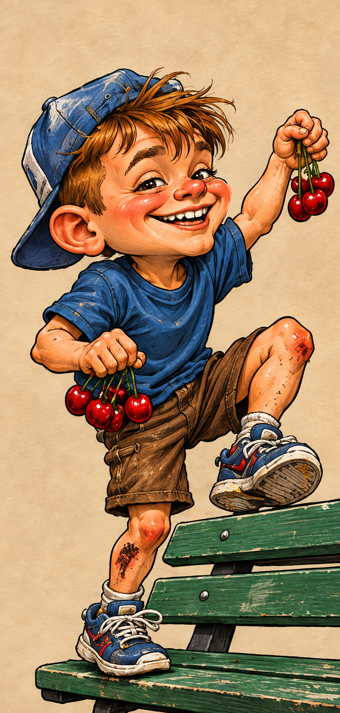

### Доскокот не беше на снимката

Клип од паркур фаќа средба кај спорната зграда. Другар го забележува кадарот или те бараат да го избришеш. Врати се до две видливи точки, најди го човекот од кадар и реши кој ќе ја добие целата снимка.

### Не ме фаќаш

Две ниски пречки и еден безбеден премин прават кратка патека. Можеш да стигнеш прв со снимката или да одиш по улица со сведокот. Другиот човек има свој пат и не мора да скока со тебе. Падот ја враќа етапата; оштетен уред води до копијата кај другарот.

Продади го клипот за 3.000 денари и изложи го сведокот. Земи 1.800 денари за договорен ангажман за снимање, побарај согласност и потврди трага за „Глас“ преку независен човек што ќе ја чува копијата. Кај архивата познаваш уште еден пешачки пристап, а довербата во тебе зависи од тоа кој се гледа во објавениот клип.

> „Скокот беше лесен. Кажи им после зошто сум бил таму.“

### Клипот има звук

Другарот ти покажува дека оригиналната снимка има глас што во исечокот не се слуша. Човекот од позадина се согласува да биде сведок само ако го прашаш пред објавување. До првиот термин можеш да стигнеш преку пречките, а тој доаѓа пеш. Брзото пристигнување му ја дава снимката на чуварот пред човекот да објасни што кажал.

Ако тргнете заедно, тој ја објаснува реченицата и дава согласност, но ви треба резервен термин. Третиот избор е чуварот да добие само потврда дека снимката постои, па сведокот сам подоцна да го одобри пристапот. Тоа го чува клипот приватен и остава еден дополнителен чекор пред јавност. Ако уредот се оштети, другарот ја носи резервната копија. Таа ја зачувува содржината, но звукот сѐ уште треба да се провери.

## 80 · Средношколец Михаил

### Екскурзија до истата приказна

Екскурзијата е откажана, а две сметки имаат различна сума. Почни кај соучениците или преку термин кај наставник. Спореди три записи, прашај кој сака да зборува и договори безбеден јавен разговор.

### Профе, имам оправдување

Еднаш можеш да разјасниш ситно недоразбирање или да поминеш низ безопасен застој со групата. Ако те прекинат, стигни со точак, автобус или родител. Напредокот зависи од разговор и проверка.

Објави имиња за да привлечеш внимание, но изгуби ја довербата на срамежлив соученик. Или поднеси анонимни збирови заедно со наставникот; по уште една проверка, тие можат да го потврдат досието „Пари“. Прифати заменска екскурзија и сметките остануваат спорни. За договорената помош на настан добиваш 1.500 денари. На собирот можеш да ги прочиташ вкупните суми без да посочиш ниедно дете.

> „Профе, прво да видиме зошто бројките бегаат од час.“

### Детето што не сака да оди никаде

Еден ученик сакал да ја откаже екскурзијата затоа што дома нема пари. Училишното здружение ја користи неговата изјава како да се откажале сите. Михаил може да ги прочита поединечните износи, да понуди само вкупна сума или да прифати нова екскурзија со јасен поврат на парите.

Поединечните износи откриваат разлика и можат да го изложат детето. Вкупната сума бара наставник да потврди дека ги видел оригиналите и го чува името. Заменската екскурзија е вистинска корист за класот, но ако нема поврат некој останува исклучен. Кога наставникот е недостапен, средбата се сели кај родителски претставник со договорен термин. Доколку си објавил имиња, исправи ја објавата и дај им на соучениците сами да одберат кој сака да го прочита новиот запис.

## 81 · Војник Сашо

### Наредба од човек без униформа

Приватното обезбедување го праќа кај зграда со станари. Почни на брифинг или преку нивна поплака. Провери што е договорено, придружи овластен посетител и одлучи што ќе запишеш во сменскиот извештај.

### Војничка дисциплина

Кратката издржливост и отпорност му помагаат на Сашо да го придружува посетителот по посебно поставена надворешна рута. Планирана пауза и јавна капија помагаат кога Сашо тешко импровизира. Ако посетителот е повреден, продолжението е неговиот запис и следна средба.

Прифати 4.500 денари од фирмата и станарите ќе те паметат по присилното иселување. Земи 2.000 денари за дозволената придружба, одбиј да ги бркаш и добиј „Глас“ со цена на работното место. Побарај писмена наредба: ризикуваш веднаш да добиеш отказ, но дознаваш кој стои зад неа. Кај архивата те чека шефот или станарите што си ги оставил да зборуваат.

> „Наредба слушам. Прво кажи кој ја потпишал.“

### Смената што ја продолжуваш сам

Шефот му нуди на Сашо редовно вработување ако пред станарите тврди дека зградата е празна. Посетителот бара придружба до јавната капија, а станарите бараат да ги сослушаш. Можеш да останеш на смена со јавно запишана задача, да се повлечеш од работата и да го однесеш човекот, или да ја прифатиш целосната наредба.

Ако побараш да ја запишат наредбата, шефот може да те остави надвор од следната смена. Записот носи „Глас“ и на собирот станарите знаат кому му се јавиле. Повлекувањето го чува посетителот, а доказот бара подоцнежен термин кај друг вработен. Целосната наредба носи работа и го губи мирниот прием кај дел од луѓето. Ако подоцна сакаш да помогнеш, прво дај им безбедна придружба по нивен избор. Претходното иселување и нивното барање остануваат во записот.

## 82 · Навивач Дуле

### Браќа до првата фактура

Просторот за собирање е загрозен, а спонзор нуди автобус за наместена фотографија. Оглас или другар со список за превоз го отвора договорот. Собери ги луѓето кај терен, распредели превоз и кажи за што навистина сте дошле.

### Ајмо сите

Повикај мала група за една улога: придружба, носење маси или ред за јавен збор. На тесен влез премногу луѓе ја блокираат задачата, а на поширок простор носат поддршка. Ако почне караница, другарот договара помало собирање подоцна.

Земи 4.000 денари и превоз со туѓ транспарент. Луѓето се делат. Организирај независен собир за 2.000 денари, поддршка и сојузник за завршницата. Договорот за фотографија може да го обелодениш, со цена на прекината услуга. На крај неговите луѓе носат маси или држат знак за кој никогаш не гласале.

> „Кога е за дерби, сите сме браќа. Кога е за сметка, никој не е дома.“

### Кој платил за вториот автобус

Спонзорот покрил еден автобус, а другарот на Дуле ставил свои пари за вториот. На списокот за фотографија се впишани и луѓе што дошле само за спорт. Можеш да ја откажеш целата слика, да дозволиш да се фотографираат само тие што сакаат или да прифатиш групна слика со јасно наведено кој ја финансирал.

Откажување го губи првиот автобус и бара повторно да се договориш со возачите. Одделна фотографија ја чува слободата за луѓето и ја намалува исплатата. Целосната група добива превоз, а подоцна треба да објасниш зошто сите биле претставени како поддржувачи. Долгот што не си му го вратил на другарот влијае врз тоа колку волонтери ќе дојдат на собирот. Ако се расчисти, тој може да дојде и без спонзорот, а ако остане, помалата група ја презема задачата по подолг пат.

## 83 · Административка Славица

### Еден печат до багерот

Жалбата била заведена откако веќе била одбиена. Мисијата може да почне со јавно прашање или кога колешка ќе изгуби предмет. Поврзи три дозволени шалтерски термини и побарај копија со потврден прием. Курир или договорен возач го заменува трчањето.

### Фали уште еден печат

Способноста ѝ дава дозволен пристап до еден релевантен запис или термин. Ти избираш дали пристапот до записот или до терминот ќе ти заштеди етапа. Ако службата го смени терминот, можеш да продолжиш со јавно поднесено барање и службена потврда за прием.

Можеш да ја исправиш грешката без јавен скандал: добиваш употреблива трага за досието „Имот“ и го зачувуваш напредувањето. Можеш и да го пријавиш целиот синџир: го губиш покровителот, но добиваш потврден извор преку колега што е подготвен да соработува. Ако му продадеш на Раде пристап до спорниот предмет, ќе го сретнеш станарот чие барање си го одложила. Исплатата за договорената работа е 2.500 денари. Подоцна, колегата може да седне пред камера само ако му оставиш избор.

> „Не фали печат. Фали човек што ќе признае дека го видел.“

### Кој ќе остане на шалтер

Колешката на Славица вели дека го завела предметот на погрешен датум откако ѝ било наредено. Ѝ нуди точен запис, под услов името да се види само кај независниот чувар. Покровителот може да ја префрли жалбата во друг предмет за еден ден. Ако прифатиш тивка исправка, станарот добива нов термин, а жалбата останува отворена за понатамошна проверка.

Можеш да побараш колешката да сведочи доброволно, да предадеш заверен запис со ограничен пристап или да ја откриеш наредбата пред сите. Првата патека бара придружба; втората помага за спогодба; третата може да ја отвори јавната завршница со друг сведок и да ја остави колешката без смена. Ако претходно си продала пристап, донеси му на станарот потврда за новиот термин пред да бараш услуга. На финалето бројот на предметот може да се провери без разлика кој ја носи копијата.

## 84 · Наставничка Снежана

### Секој добива по една минута

Школскиот простор е загрозен, а родителите добиваат спротивни ветувања. Почни со оглас или од откажан час. Собери прашања од три групи, намести пристапен ред и остави време за човек што не сака да стане пред сите.

### Тишина во училница

Способноста „Тишина во училница“ накратко ги смирува разговорите кога повеќе луѓе зборуваат одеднаш. Избираш кому го даваш зборот и кому дозволуваш да излезе на мирно. Еден родител веќе добил термин за приватен разговор, а на друг му е срам да каже дека нема пари за превоз.

Прочитај ги најчестите прашања за да собереш поддршка. Зачувај го тешкото прашање за следната, помала средба: одговорот носи посилна трага за „Глас“ и нов сојузник. Можеш да прифатиш приватна промоција за 4.000 денари или да држиш дополнителни часови за 2.200 денари. На главниот собир можеш да го повториш истиот ред и да го спасиш разговорот кога сите сакаат да зборуваат одеднаш.

> „Тишина. Тој што молчеше досега, прв ќе зборува.“

### Тивкиот родител има прашање

Во салата повеќето родители зборуваат за терминот на часовите. Еден прашува кој ќе ги плати патувањата до приватната замена. Организаторот вели дека тоа не е на дневен ред. Снежана може да го префрли прашањето на следна средба, да остави минута за него сега или да го претвори во анонимно прашање со согласност.

Првата патека го завршува собирот брзо и остава родителот да бара втор термин. Втората може да ја испразни салата кога спонзорот ќе ја прекине понудата, но исказот на родителот станува трага во досието „Глас“. Третата чува мир и приватност, но бара двајца независни родители да ја потврдат цената на превозот. Ако веќе си земала промотивна исплата, можеш да кажеш колку и по кој договор. Дел од луѓето сепак ќе заминат, а тие што остануваат знаат каква обврска имаш.

## 85 · Волан, микрофон, буџет

Сите суми на страниците 85–90 се во денари.

### Кумплунг и Миле

Кумплунг може да наплати 42.000 денари за поправка и подготовка на автомобил или да прифати 95.000 денари од фиксерот за мисија со украдено возило. Ако ја прифати брзата понуда, го губи Горан како чувар на оригиналот. Миле може да заработи 12.000 денари од серија уредни превози или 70.000 денари ако го продаде записот од една опасна ноќ. Ако го продаде, и понатаму му остануваат рутите и возачите, но ја губи довербата на Елена и мора да плати за дополнителна проверка.

### Маца и Стојан

Маца договара хонорар од 36.000 за цела вечер со музичарите или зема 120.000 за јавно да го промовира настанот, со ризик сведоците да ѝ ја бојкотираат пробата. Стојан може да земе 18.000 за проверка на сметки или 80.000 за да му ја предаде на Раде листата со имиња што не се поврзани со испораката. Точноста отвора следни платени проверки; ако ја продаде листата, Раде може да го уценува, а сопственикот да му го прекине пристапот. Понискиот трошок за превоз му остава поголем дел од заработката.

## 86 · Камера, услуги, влез

### Давид и Сара

Давид добива 25.000 за серија проверени приказни или 110.000 за спонзориран исечок со спорно тврдење. Поправка ја менува идната публика и може да го раскине договорот. Сара добива 40.000 за работа по договор со повеќе соработници или 130.000 за да покрие измислено спонзорство. Стилистката може да ѝ остави втор клиент ако договорот е фер.

### Весна и Велика

Весна може да води договор за одржување на влезови со 18.000 за етапа или да земе 90.000 за селективен пристап до клучеви во приказната. Во вториот случај има пари за лифт и човек што ја обвинува за продажба на туѓа безбедност. Велика заработува преку делен закуп или добива 180.000 аванс за приватен имотен договор со спорен потпис. Ако не го именува другиот наследник во договорот, потврдениот имотен удел останува блокиран.

## 87 · Меморија, значка, грижа

### Димче и Бобан

Димче добива 8.000 за вечерно снимање усни градски спомени или 55.000 за да премолчи при една идентификација. Платеното молчење му го менува човекот што го посетува на клупата. Бобан може да одржи дозволени задачи и да продолжи законски или да земе 160.000 за префрлање на спорен предмет во приказната. Колега станува доверлив партнер или главен сведок против него.

### Владимир и Мали

Владимир избира 65.000 за проверка на платени медицински услуги или 200.000 за донаторски договор што ја покрива целата спорна испорака. Разликата во сметката станува видлива при следната смена ако донаторот побара молчење. Мали заработува 8.000 од кратки достави, а фиксерот нуди 25.000 за молчење за виденото. Можеш да го земеш авансот и да го вратиш подоцна. Тогаш другарот останува човек со свој избор за сведочење, а друго лице ќе сака да си ја наплати услугата.

## 88 · Смена, фурна, терен

### Момчило и Благоја

Момчило добива 34.000 нето од легална работа со екипата или 145.000 за потпис што ја покрива спорната смена. Луѓето подоцна ќе ја одбијат неговата понуда за работа или ќе побараат вистинска исплата. Благоја може да собира 28.000 од тура на нарачки или 105.000 од договор со фиктивни приеми. Љупчо ја гледа таа верзија на сметката кога бара заеднички простор.

### Љупчо и Теа

Љупчо добива 26.000 за серија испораки или 95.000 со лиценца што тивко ја исклучува помошничката. Може да си го отвори својот простор и да остане без човек што го знае работењето. Теа зема 32.000 од тренинг-часови и поддршка или 150.000 за реклама што го претставува јавниот терен како приватен. Ако избере пари, придружничката може да направи независна група и да му го наруши договорот на спонзорот.

## 89 · Сила, статус, кадар

### Дарко и Кики

Дарко може да собере 35.000 од групни тренинзи или 170.000 за насилно обезбедување во измислената мисија. Работодавецот плаќа по завршена етапа; ако членот е повреден, завршницата има болничка средба и изгубена понуда за локал. Кики наплаќа 42.000 за дозволена процена на потеклото на предметот или добива 220.000 за да молчи за тоа од каде потекнува. Ако подоцна сака да го врати, купувачот поставува нов услов и фамилијата може да одбие да ја брани.

### Палавко и Михаил

Палавко може да земе 14.000 за снимање на настан и движење по обележана паркур-патека или 55.000 за објава што го изложува сведокот. Наутро друга група го откажува настапот. Михаил може да помогне на настан за 6.000 или да прифати наставни материјали за класот вредни 40.000 како услов да ја повлече жалбата. Пакетот не е негов имот и не оди во личните милиони. Неговата патека гради мрежа за подоцнежни законски работи и организирање, со приватност на соучениците.

## 90 · Ред, трибина, печат, училница

### Сашо и Дуле

Сашо добива 48.000 за етапи на придружба или 185.000 за насилно обезбедување за приватна фирма во приказната. Прифаќањето отвора поголем договор и го губи станарското сведоштво. Дуле избира 38.000 за организација или 135.000 за платено заплашување на собир. Групата не станува едногласна. По конфликтот, еден возач одбива да го пренесе товарот додека не му се врати долгот.

### Славица и Снежана

Славица добива 28.000 за завршени договорени проверки или 180.000 од посредник за спорна приватна услуга. Колешката што ја изложила може да го оспори подоцнежниот удел. Снежана добива 30.000 за група часови или 120.000 од приватен спонзор за изборно исклучување на една група. Ако го прифати договорот, може да отвори свое училиште порано. Родителите што останале без превоз подоцна бараат седиште во новиот договор или прават своја група.

## 91 · Десет милиони денари

Предложениот бележник ја пресметува нето-вредноста: готовина плус износот што навистина можеш да го добиеш за својот имот и удел, минус долгови и договорени трошоци. Пленот во скривалиште останува блокиран во пресметката додека не се утврди кому му припаѓа. Исплатите на други луѓе, целиот приход на фирма и парите што си ветил да ги вратиш се водат одделно.

Нов лик почнува со 3.000 денари плус десетпати од стариот профилен буџет. Димче има 3.000, Стојан 3.300, Кумплунг 5.500, Велика 12.000 и Владимир 18.000. Почетниот буџет не значи дека секој лик ќе почне со автомобил. Рутите пеш и со јавен превоз остануваат корисни и ако си ги потрошил парите.

Во играта бројачот ја покажува целта од 10 милиони во готовина. Нето-вредноста, уделите и работите на следните страници се предлог за кампањата. Ако кампањата се додаде, бележникот ќе има посебни редови за готовина и нето-вредност.

## 92 · Што купува еден денар

### Секојдневни цени

Во играта (цени во денари): бурек со јогурт 120, тулумба 45, ќебапи 220, сендвич со ајвар 110, градски превоз 40, тротинет 60, миење на автомобил 300. Полнење на празен резервоар од 45 литри чини 3.690. Дополна од 20% чини 738. Префарбување за 24.000 денари е заокружена игровна цена. Постапките на улица, казните и дел од исплатите во песочникот се игровни правила.

### Од услуга до имот

Предложени исплати: мала работа 1.500–6.000; групен настап или цела работна тура 12.000–45.000 по договор; серија испораки или сезонски договор 70.000–250.000 нето, по исплатата на екипата. Работен автомобил на секундарниот пазар 180.000–420.000; мал деловен имот 600.000–2.500.000 според состојба; удел во бизнис со реални договори се проценува од исполнети работи и потврдена куповна понуда. Ова се предложени распони за исплатите, со простор за проверка на нивната примена во играта.

### Мерка за скалата

Просечната нето-плата се проверува во најновата месечна табела на Државниот завод за статистика; таа е референца за скалата, не износ од играта. На 23 ноември 2026 година, Регулаторната комисија за енергетика ја утврди највисоката малопродажна цена на бензинот Еуросупер БС-95 на 82 денари за литар. Цените се менуваат; платите, хонорарите и вредноста на имотот во кампањата се дизајнерски проценки.

## 93 · Четири степени до големата маса

### Први 100.000 • Име и смена

Почетните задачи ти отвораат два контакта и еден договор што може да се обновува. Секоја следна различна нарачка носи пари; истата сметка се плаќа еднаш. Можеш да земеш аванс за пократок пат, со конкретна обврска што подоцна може да дојде на наплата.

### Прв милион • Средство и партнер

По најмалку два успешно затворени договора добиваш две понуди: купување на деловно средство или удел со партнер. Избираш меѓу стабилен приход и поголема, поризична исплата. Ако го загубиш автомобилот, можеш да склучиш привремен договор за превоз и да ја задржиш мрежата.

### Пет милиони • Мрежа и изложеност

Договорите почнуваат да си пречат. Ако еден купувач сака исклучиво право, другиот контакт може да си замине. Реинвестирањето носи втор извор на доход. Грабежот и предавството носат брза готовина, но заработката може нагло да падне ако ги изгубиш купувачот и доказот.

### Десет милиони • Наплати или задржи

Последното парче може да биде продажба на удел, куповна понуда за работилница, исплата од голема работа или неколку затворени договори. Напредокот се мери според вредноста што навистина ти припаѓа. Крајот на заговорот и финансискиот праг се две независни цели: можеш да ја затвориш приказната и да продолжиш да градиш имот.

## 94 · Множителот има газда

### Множители на исплатата

Почни од ×1,00 на основниот хонорар. Доказ дека работата е целосно испорачана +0,15. Испорака до втор договорен примател со посебен резултат: +0,25. Завршена испорака во тежок, доброволно прифатен рок +0,20. Ако земеш аванс без завршена работа со која да го покриеш: −0,15. Загуба на дел од товарот −0,30. Множителот има долна граница ×0,60 и горна ×1,60. Трошоци, партнерски удел и долг се одземаат по множителот. Ако две ставки користат иста проверка, сметај ја еднаш. Овој множител за исплата е одделен од предложените множители за време и напор на стр. 6.

### Како изгледа сметката

Договор од 180.000, цела испорака и втор примател даваат ×1,40, односно 252.000. Минус 62.000 за луѓе, гориво и поправка, чисто 190.000. Ако партнерот зема 30%, твојот дел е 133.000. „Побрза“ понуда од 250.000 со 100.000 исплата на луѓе и 100.000 стар долг придонесува 50.000. Износите се на понудата пред потпис.

### Финти што може да ги откриеш

Спои два различни приматели на една тура со нивна согласност; доцнењето кај првиот го менува вториот термин. Плати со договорен удел наместо аванс; партнерот носи дел од ризикот и зема дел од добивката. Сочувај доказ дека си го исполнил договорот: ако првиот купувач се повлече, можеш да ја понудиш работата на друг. Сите три финти се правила во играта со видливи услови.

## 95 · Три сметки што стигаат до целта

### Кумплунг • Двор со две врати

Од превозот и работилницата, секоја од 16-те завршени серии му носи на Кумплунг по 240.000 денари чиста заработка за неговиот удел. Така задржува 3.840.000 денари во готовина. Има и работилница со потврдена куповна понуда од 2.360.000 денари, удел во друг бизнис вреден 4.200.000 и долг од 400.000. Нето-вредноста му е 10.000.000 денари. Работилницата е стекната со дополнителни вложувања и партнерски капитал, па заработката од сериите сама по себе не ја покрива куповната цена. Брзата криминална понуда за кражба на возило може да му го скрати патот, а да ја урне вредноста на работилницата ако купувачот се повлече.

### Маца • Настап што останува

По серија настапи и продажба на права, Маца има 4.750.000 денари во готовина. За нејзиниот удел во локалот има потврдена куповна понуда од 6.100.000 денари. Неплатените хонорари и долгот изнесуваат вкупно 850.000 денари. Нето-вредност: 10.000.000. Ако Маца ги исплати музичарите порано, ќе има помалку готовина, но и помал долг. Ако прифати да биде лице на измама, добива поголем аванс и ризикува неисполнети настапи.

### Славица • Договор без потпис под маса

По патека со платени проверки, формална работа и удел, Славица има 2.100.000 денари во готовина, потврдена куповна понуда од 8.700.000 денари за својот удел и долг од 800.000 денари. За брзи пари може да му продаде на посредникот пристап до спорниот службен предмет. Така добива непосредна исплата, но фирмата може да ја оспори документацијата, а купувачот да ја повлече понудата за нејзиниот удел. Во книгата ова се модели за доцна игра, со постепени прагови и реализација низ повеќе сезони.

## 96 · Прагови, множители и десет милиони

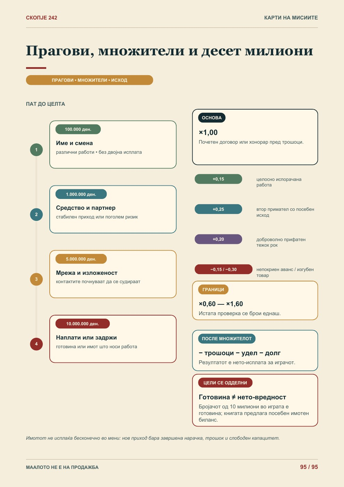

Финансиски патоказ од првите сто илјади до десет милиони, со предложен множител за исплата и јасно одвоени трошоци, удели и долгови. Бројачот во играта и предложениот биланс на нето-вредноста се одделни цели.

## 97 · Капитал што продолжува да работи

### Три вида приход

Готовина од завршена задача, оперативен приход од веќе договорени работи и капитална добивка од реализиран удел се одделни. Имотот не прави бескрајна исплата додека играчот чека во мени. Нов циклус бара исполнети нарачки, трошок за луѓе и слободен договорен капацитет. Ако ја затвориш фирмата, останува пазарна понуда минус долговите и трошок за излез.

### Нелегалната заработка има свој исход

Спорен товар може да има висока понуда и ниска реална вредност ако купувачот си замине. Долг од неисплатена смена се плаќа дури и ако екипата ти е лута. Лажна фактура може да донесе готовина и да создаде долг откако другиот човек ќе ја оспори. Поправката е одделна мисија со избор дали да платиш, да признаеш или да го оставиш спорот нерешен. Спорот го чувствуваш во понудите што пристигнуваат, не само во еден црвен број.

### Кога прагот е надминат

Одбери дали ќе продадеш за да го видиш целиот износ во готовина, ќе задржиш имот што носи работа или ќе подариш дел и ќе продолжиш под прагот. Актуелната готовина се гледа во бројачот. Највисоката нето-вредност може да се запише во историјата на кампањата. Записите се различни: нето-вредноста што си ја достигнал и онаа што ја имаш сега.

## 98 · Мрежа на места и маркери

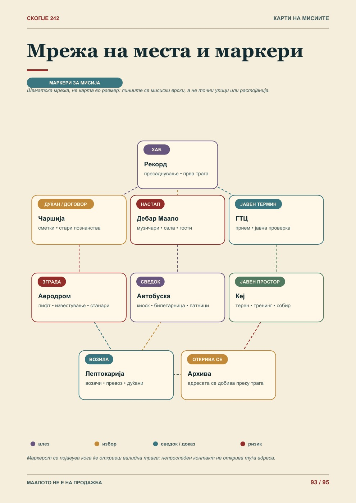

Ориентациска мрежа на локациите што се појавуваат во кампањите. Линиите означуваат мисиски врски, не реални улици или растојанија; точниот маркер се открива само преку валидна трага.

## 99 · Од луѓе до проверени досиеја

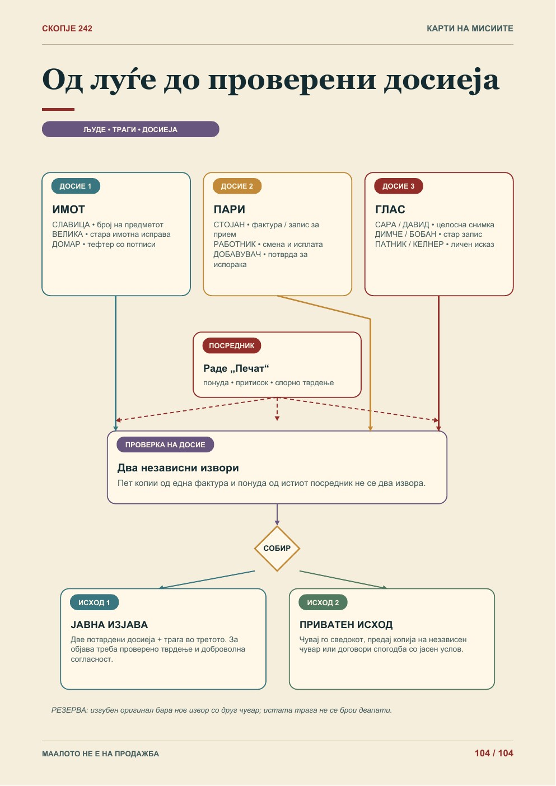

Мрежа на независни траги за досиејата „Имот“, „Пари“ и „Глас“. Понудата или притисокот од посредникот не се брои како независен доказ; финалниот собир бара проверка и согласност.
