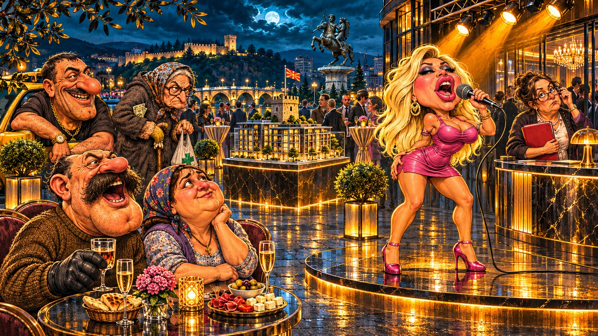
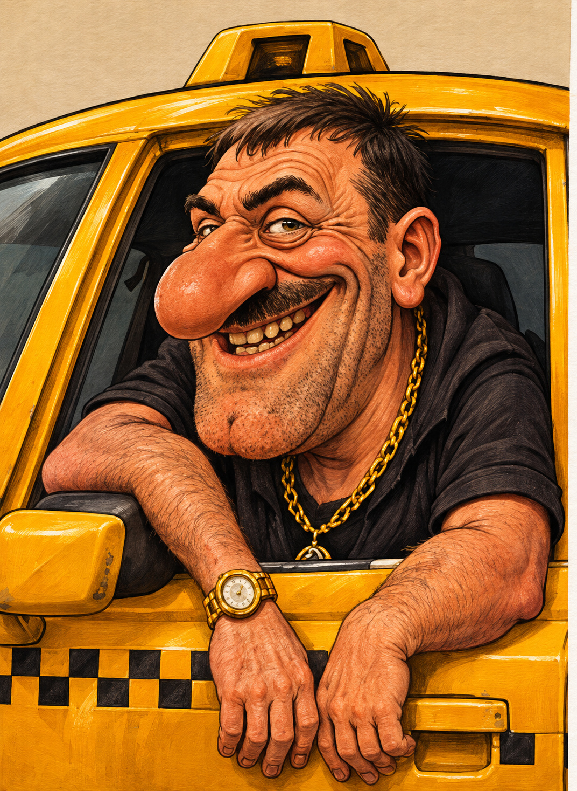
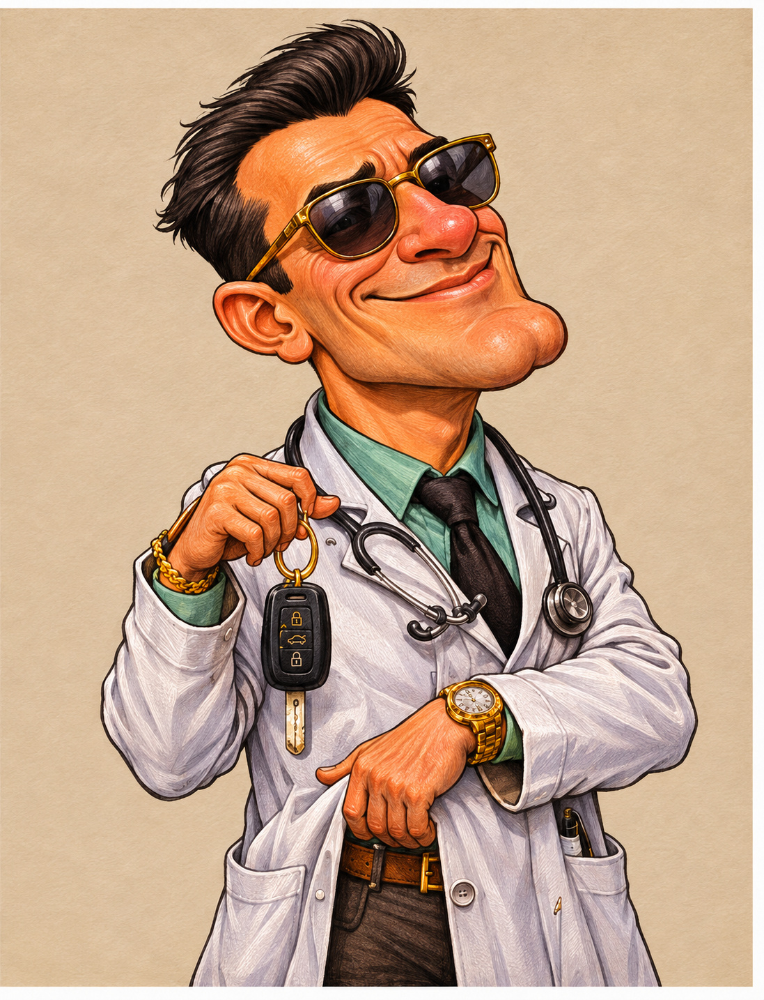
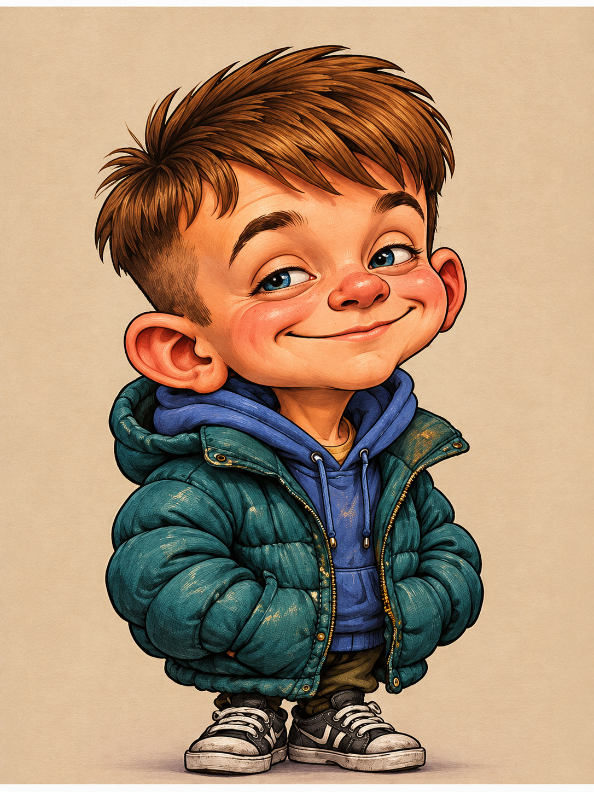
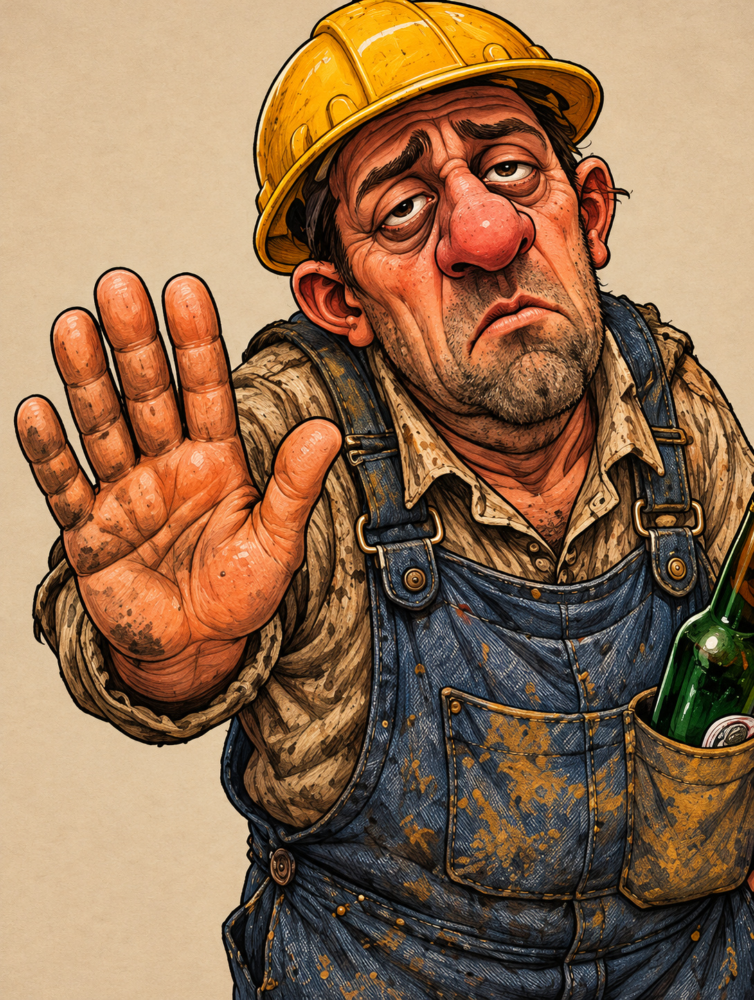
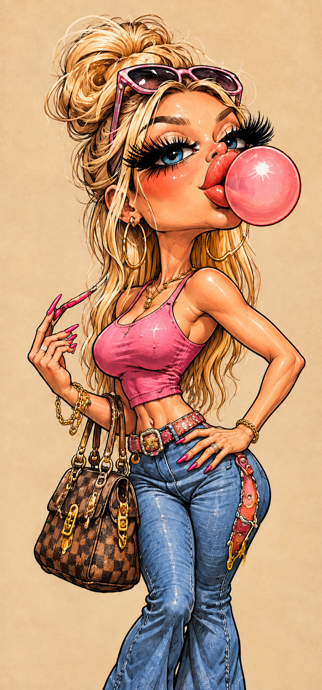
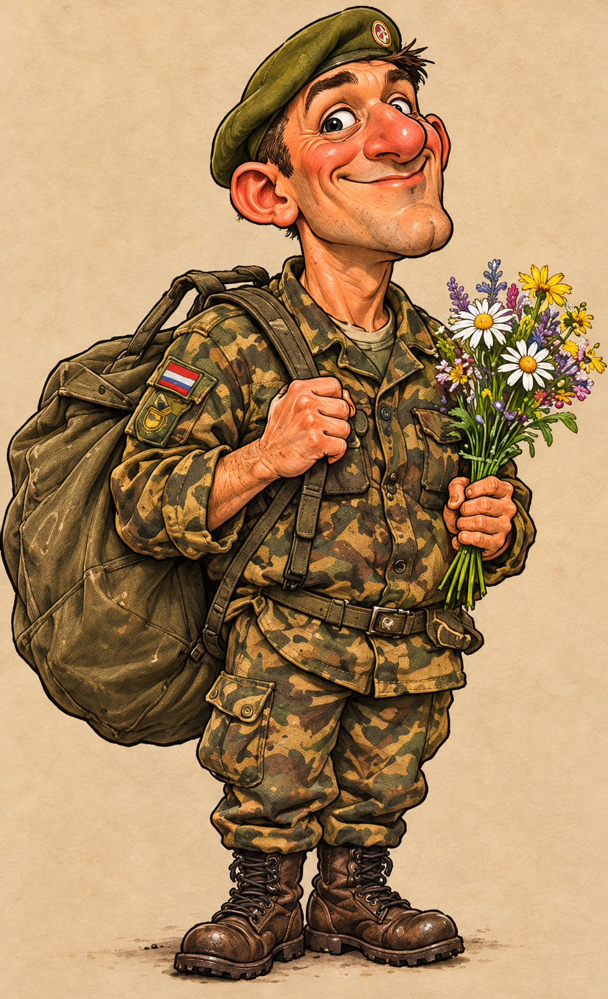
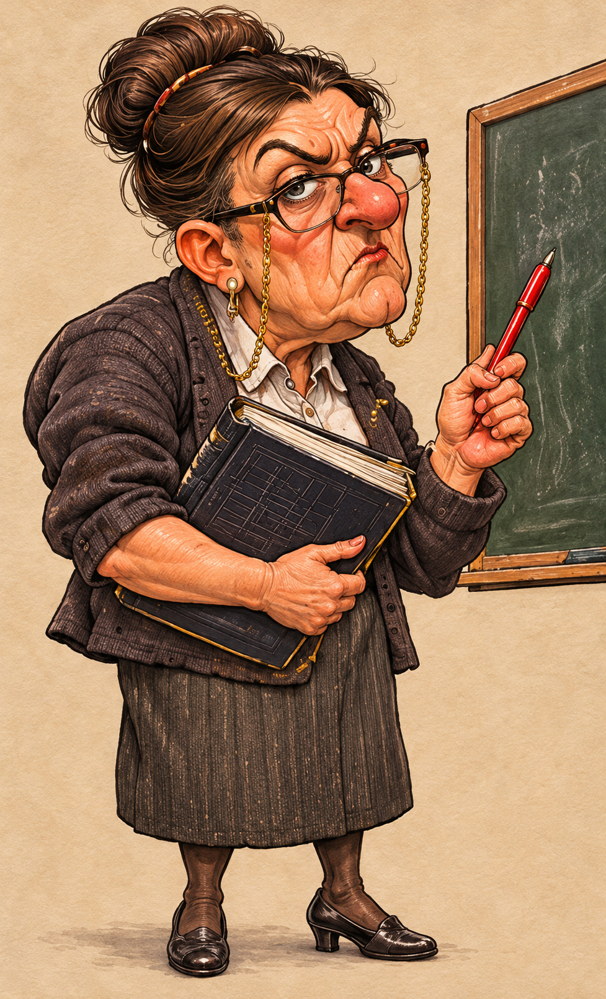
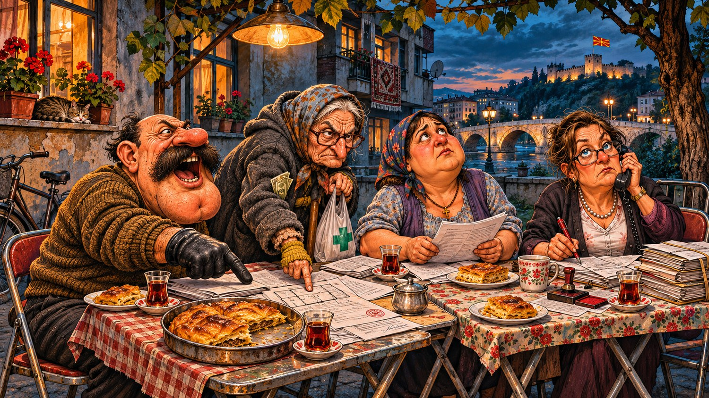

# Маалото не е на продажба

Придружна книга за Скопје 242. Предлог за кампања, ноември 2026.

## 02 · Кај те наоѓа мисијата

Не ти се јавува шеф од ведро небо. Чекаш на Рекорд, а човекот до тебе се колне дека му го продале влезот додека бил на работа. Купуваш бурек и добиваш сметка со туѓ број на предмет. Некој те вика да свириш на отворање на зграда што уште не постои.

### Од муабет до работа

Секоја клучна трага се појавува барем на две места: преку човек и преку предмет, оглас или друга работа. Бележникот прво ја запишува како гласина. Кога ќе прашаш, добиваш понуда со задача, место, превоз, влог и рок ако го има. Можеш да прифатиш, да одложиш или да ја одбиеш. Одбивањето остава резервен контакт.

### Првата вечер

Избираш еден главен лик. Другите можат да станат сојузници, соперници или сведоци според тоа како си постапил со нив. Секој почеток е изводлив пеш или со договорен бесплатен превоз. Личните приказни се на стр. 15–38; главната приказна започнува на стр. 10, а исходите се на стр. 47–48.

> „Абе, не ти продавам приказна. Влезот ни го продаваат.“

## 03 · Што значи да завршиш

### Пред да дадеш збор

Гласина → понуда → прифатена работа → активна етапа → исход → исплата. Работата може да мирува меѓу етапите. Секогаш гледаш една следна задача и до две можности што веќе си ги открил. Можеш да излезеш од активна работа на безбедна точка и да прифатиш друга. Градот не чека на мени.

### Муабетот и потписот се две работи

Да го донесеш пликот и да му дозволиш на некого да го објави се одделни дејства. Пред второто, бележникот кажува кој ќе го добие, дали сведокот се согласил и што ќе изгубиш. Ако исходот е чист, ги задржуваш луѓето и предметите што си ги ветил. Ако е компромитиран, продолжуваш со точно наведена цена, како оштетена кола, загубен контакт или следна проверка.

### Нема двојна наплата

Исплатата и последицата се запишуваат заедно, еднаш по задача. Пропуштен термин обично значи второ место за средба. Рокот тече само кога играчот свесно ќе прифати итна етапа. Вистинската цена на изборот се гледа и на улица: затворена врата, друг возач, човек што повеќе не крева телефон.

## 04 · Пак ти? Од кај продолжуваме?

### Враќање по прекин

По прифаќање, пристигнување, обезбедување човек или доказ и пред неповратен избор има точки за продолжување. По пауза бележникот кажува: што направи, што се смени, кој те чека. Се враќаш кај истиот контакт, кај назначена замена или со одредиштето „Продолжи“.

### Кога се распаѓа планот

Промашен автобус: подоцнежен термин или пешачка врска. Уништена кола: договорен возач, работилница или превоз. Изгубен оригинал: копија со независна проверка. Повреден сведок: закрепнување или друг извор. Тековната етапа или целосно се враќа со својот трошок и плен, или ја прифаќаш загубата и продолжуваш по резервната патека. Претходно потпишаните избори остануваат.

### Прераскажување

Завршена задача може да се прераскаже од архивата со отклучен лик. Ќе видиш друг пристап и ќе добиеш запис за умешност. Пари, оригинали и долгови остануваат во својата приказна. Повторливите маалски работи, пак, се нови настани во истиот град: нова нарачка, нов разговор, ограничена добивка.

## 05 · Три досиеја, една превара

### Земја, пари и глас

„Земја“ ги врзува имотот, согласноста и рушењето. „Пари“ ги поврзува школските средства, набавките и исплатата. „Глас“ ги спојува набљудувањата со она што некој е спремен да го каже. Секој запис носи извор, сопственик, состојба, согласност и ниво: гласина, употреблива трага или проверен доказ.

### Како се собира случај

Два проверени независни извори потврдуваат досие. Пет слики од една фактура се еден извор. Противречност отвора споредба, не брише сѐ. Пример: Славица наоѓа приемен број, а Велика има постара имотна исправа. Заедно го рушат датумот на спорната согласност.

### Отворени врати

За собирот требаат две потврдени досиеја и употреблива трага во третото. Таму може да се потврди и третото. Ако недостига и првичната трага, јавниот шалтер, добавувачот и келнерот нудат по една проверлива резервна работа. Објавувањето има дополнителен услов: безбеден сведок што сака да зборува и проверено јавно тврдење.

> „Копија од копија не се два докази, мајсторе.“

## 06 · Множители што го менуваат пристапот

### Предложени вредности за проба

Обичен пристап почнува на ×1,00. Соодветна вештина дава +0,25, подготвеност или проверена трага +0,15, а посветен сојузник +0,10. Видлива гужва или лошо подготвен терен одзема 0,20. Збирот е ограничен од ×0,70 до ×1,50. За секој обид се менува само едно мерило: траење на можноста, напор или трошок. За трошок делиш со множителот. Ниту еден множител не ја купува согласноста на сведок.

### Два примера

Маца има 12 секунди да го задржи вниманието. Вештина и проба даваат ×1,40, односно 17 секунди по заокружување. Ако влезот е преполн, ×1,20 дава 14 секунди. Стојан со студентска услуга добива ×1,25 на предложена такса од 100 денари и плаќа 80. Јавната алтернатива без такса бара уште една средба.

### Комбинации

Подготвеност се троши по етапа. Помошникот дава една услуга по работа. Физичката способност трае 6–10 секунди, а социјалната важи за една јасна можност. Заедничкиот бонус не се множи повторно со истиот ефект од профилот. Играта веќе има разлики во движење, борба и возење. Новите активни способности и множители се предлог за кампањата.

## 07 · Кој ти должи, кој те гледа

Доверба 0–3: недоверлив, достапен, посветен, спремен да застане јавно. Ветување е конкретна обврска со име и рок. Пари не значат доверба. Прекршен збор влијае на човекот што си го изиграл и на неговите блиски. Извинувањето отвора работа за поправка, а постапката останува во историјата.

### Поддршка, внимание и притисок

Поддршка 0–6 се гради со шест различни услуги: помош на станари, чесна исплата на екипа, безбеден превоз, маалска трпеза, јавен собир и спасување. Секоја група вреди најмногу еден поен. Јавно внимание 0–3 носи публика и ризик за сведоците. Притисок 0–3 носи понуда, приватен разговор, заплашување, па обид за јавно оцрнување. Исправка или заштита може еднаш да спушти притисок.

### Слободата бара читливи последици

Снимање му дава публика на Давид; кај Сара истата средба може да помине со три доверливи луѓе. И двете патеки стигнуваат до приемот. Давид ќе мора да ја брани снимката, Сара ќе мора да ѝ се оддолжи на стилистката. Во бележникот стои кој го чува оригиналот, кој е безбеден и кој добил ветување.

## 08 · Градот е алатка

Автобус, воз, тротинет, точак, такси, комбе или пеш: секоја задача предвидува барем две практични насоки, меѓу нив и бавна. Горивото и штетата ја менуваат подготовката. Пумпа, перална и префарбување се градски услуги; бојата на колата не ја менува вистината во досието.

Киосците, храната и пијалаците даваат здив и разговор. Графит може да означи место за средба. Кучињата се маалски познаници и остануваат безбедни. Семафорите, работниците, камионите за отпад, радио, музика и смог го одредуваат ритамот. Пожарникари и брза помош отвораат сцени за спасување. Опасниот пристап со оружје, експлозии, обезбедувани комплекси, оклопно возило или хеликоптер останува изборен и има мирна замена.

## 09 · Твојот град продолжува

### Зачувување и заедничка игра

Предложениот запис ја памети етапата, оригиналите, договорите, исплатата и личната последица. Ликовите од приказната се враќаат на безбедно место, независно од случајните минувачи. Стар запис почнува со нова локална понуда. Првата верзија на кампањата е за еден играч. Заедничката верзија подоцна му дозволува на гостин да придонесе со својот лик; домаќинот ја потврдува одлуката на својата приказна.

### Движечка мапа

Рекорд е јазол за превоз и муабет. Дебар Маало ги спојува музичарите и келнерите. Лептокарија служи за средба на возачи и дуќанџии. Кејот е бавна пешачка врска или патека за Теа. Чаршија е место за дуќани, спомени и тивко договарање. Околината на ГТЦ го носи јавниот прием. Измислените фирми и места за криминал се сценографија во градот.

### Ритам

Лична работа трае околу 10–15 минути, заедничка 15–30. Меѓу нив има простор за возење, дружење и ситни услуги. Клучната информација има текстуален запис. Тешка итна етапа нуди план со повеќе време пред почеток.

## 10 · Потписот на човек што не дошол

Виктор „Визија“ Петрески, лицето на „Нова ера груп“, продава убави цртежи од ново Скопје. На нив нема гаража, стара пекара, школски простор или терен. Раде „Печат“, човекот што ги средува состаноците, тврди дека станарите доброволно потпишале. Еден потпис е од човек што починал пред состанокот.

Елена „Копија“, курирка за предмети, има дупликати. Таа на почеток изгледа како да продава иста тајна на две страни. Брат ѝ му должи на Раде, а таа се обидува да го извлече. Подоцна признава дека дел од папките ги пренела и самата. Признанието е најсилно кога играчот претходно ја сослушал и ја заштитил.

### Редослед по твоја мера

По личниот почеток, избери влезот, испораката или приемот на стр. 12–14. По кои било две од тие работи се отвора расчистувањето на архивата на стр. 39. Дополнителните проверки се на стр. 40–41. Штом досиејата се доволно потврдени, собирот ги спојува на стр. 42. Последната работа на стр. 43 има четири различни цели. Секоја патека го задржува својот сведок, трошок и долг.

> „На цртежот има дрвја. Пред зграда има багер.“

## 11 · Пролог • последната тура

На задното седиште Елена ја тутка сметката во дланката. „До Рекорд, шефе. И ако прашаат, ја не сум се возела.“ Миле гледа во огледалото. „Ќе ти биде потешко да докажеш дека си платила.“ Од радиото доаѓа реклама за идниот кварт. Од тротоарот, истата адреса се гледа на жолтиот лист за рушење.

Ако играш со Миле, ја возиш турата. Со Велика, истиот лист е залепен на влезот додека внукот ја чека. Со Маца, адресата е напишана зад договорот за настап. Со секој друг херој, неговата лична задача открива еден дел од таа вечер. Првиот вистински избор е кому ќе ја покажеш адресата.

Ако ја игнорираш, утрото ја носи втората покана: келнер споменува прием, а станар бара некој да му ја прочита одлуката.

## 12 · Влезот што сам се продал

### Влези во работата

Во влезот во Аеродром виси известување. Во продавницата карши, продавачот се сеќава дека луѓето потпишувале за поправка на лифтот. Избери двајца станари, спореди датуми и најди го домарот кај киоск или автобуска. Го држи тефтерот под мишка како да е туѓо дете.

> „Ми рекоа за лифт. Абе, кој потпишува рушење на стоење?“

### Три врати

Весна го прашува претставникот пред луѓе што го познаваат. Велика го споредува датумот со својата исправа. Славица го препознава бројот на друг предмет. Секој друг може да го спореди јавниот оглас со книгата и да го премести разговорот на безбедно место.

Изнеси го тефтерот јавно и добиваш внимание, но домарот се повлекува од приемот. Зачувај му го името и добиваш тивок сведок. Врати го за пари и купувачот ја добива книгата. Тогаш резервата е јавен запис и двајца станари што биле присутни.

### Што носиш понатаму

Еден извор за „Земја“, 200 денари за договорената работа и адреса на приемот. Ако тефтерот пропадне, домарот прави список од сеќавање. Подоцна го проверуваш на шалтер. Повторно се среќавате кај киоскот, со истата последица на доверба.

## 13 · Плата утре, рушење денес

Работник пред градилиште ја бара платата. Таксист на Лептокарија чул дека истиот добавувач вози по две различни сметки. Земи една од двете покани. Следи го дневниот распоред до јавно место за растовар и избери дали прво ќе му помогнеш на товарачот или ќе го стигнеш терминот за проверка.

> „Палетите се тука. Парите уште патуваат.“

Момчило работи со екипата. Владимир препознава вистинска медицинска испорака. Миле ги споредува времињата на две тури. Секој друг добива сметка од продавачот и потврда од примачот. По работно време, товарачот седи на договорено место во близина.

Елена нуди цел список ако пренесеш плик што ѝ го врзува братот со Раде. Прифати за побрза трага и долг. Одбиј и провери две адреси. Прашај ја за согласност и можеш да ѝ помогнеш да подготви изјава, со повисок притисок врз вас двајцата. Откриваш дека дел од сомнителните пари платиле вистинска испорака.

Договорениот надомест е 300 денари. Верификувана испорака дава извор за „Пари“. Ако комбето се расипе, дупликат и разговор кај примачот ја заменуваат турата. Одлуката за работниците го менува собирот.

## 14 · Прием без гости

Кај ГТЦ, макета од стакло стои среде приемот. Виктор ја чека „заедничката“ фотографија, а келнерот моли некој да му го тргне беџот од кадар. Влегуваш со јавна покана, како изведувач, со препорака или со нарачка. Сите четири влеза водат до истото прашање: кој ја нарачал приказната за согласноста?

Маца ја држи салата со песна. Давид вика публика. Сара наоѓа мирна маса. Кики го носи колекционерот до макетата. Снежана им дава ред на прашањата. Со друг лик чекаш јавно обраќање и му го враќаш зборот на келнерот кога ќе го прекинат.

На снимката Виктор звучи виновно. Последната минута недостига. Објави сега и ќе добиеш внимание и притисок. Чувај ја и провери со келнерот. Врати му ја на Виктор за услуга, па барај независен сведок. Ако салата се испразни во паника, резервната средба е во кафеана. Исплата за договорената работа: 350 денари.

## 15 · Чичко Кумплунг

### Рикверц во утре

На гаража му ставаат жолт лист. Познаникот што му должи поправка нуди нова работилница ако пренесе мотор од плацот. Почетокот е кај гаражата или кај мајсторот во Лептокарија. Со натоварено комбе стигнуваш до тесен простор, застануваш да ја провериш адресата и решаваш кому ќе му го предадеш товарот.

### Возачка привилегија

Совршената контрола накратко ја смирува реакцијата на комбето при маневар. Точноста ти купува време да излезеш и да го видиш договорот. Кумплунг е слаб пеш; проверката може да ја препушти на соседот што навистина го слушал.

Нова гаража значи брза услуга и сосед што останува надвор. Заедничкиот договор носи доказ за „Земја“ и поскромна поправка. Соседот подоцна може да ја задржи кутијата во архивата. Ако комбето пропадне, мајсторот ја носи товарната сметка. Договорената работа плаќа 250 денари. На крај, новата табла гледа или кон жив двор или кон празна гаража.

> „Кола во рикверц знам. Животот не ми оди така.“

## 16 · Таксист Миле

### Последната тура ти го знае името

Патничката остава сметка и бара да ја заборавиш. Ако ја промашиш првата тура, друг таксист ќе ти го раскаже муабетот кај Рекорд. Возиш меѓу станица, спорен блок и кафеана. На секоја станица некој ја памети истата испорака во друго време.

### Побрзо или подобро

„Миле знае пат“ ја покажува најбрзата моментална врска. Краткиот пат ја носи патничката дома навреме. Подолгиот ѝ дозволува да го препознае курирот. Ако бркаш луѓе пеш, ја оставаш сама и ја губиш таа можност.

Зачувај ѝ го името и ќе имаш приватен извор за „Пари“ и подоцнежна средба за „Глас“. Продади ја турата и земаш повисоки пари, а за доказ мора да одиш кај добавувачот. По судир, таа може да продолжи со друг возач ако претходно си ѝ ветил превоз. Исплата: 200 денари и договорениот кусур. На собирот нејзиното столче е пополнето само ако сака да дојде.

> „Радиото има вести. Таксиво има сведоци.“

## 17 · Певаљка Маца

### Уште една за газдата

Договорот за локал исчезнува по приватна прослава. Келнер или музичар нуди настап во Дебар Маало. Договори бакшиш, направи проба, избери кога ќе ја задржиш салата и на кои двајца ќе им дадеш простор за тивок разговор.

### Микрофонот е прозорец

Со „Микрофон на максимум“ толпата го следи настапот, а келнерот добива кратка можност да се тргне. Ако некој почне кавга, музичарите можат да продолжат за Маца да го изведе човекот. Ако прва удри, собирот се растура и преговорите се селат на проба.

Посвети песна на Виктор и земаш 300 денари плус покана за прием, со долг за фотографија. Одбиј и земаш 180 од музичарите, а келнерот дава независен „Глас“. Ако вечерта пропадне, истиот избор се појавува на следна проба со помала публика. На собирот публиката или чека пофалба за газдата или ѝ верува да го прекине.

> „Песната е ваша, газда. Микрофонот уште е мој.“

## 18 · Студент Стојан

### Лаптоп поскап од школарина

Кај сервисер се појавува стар лаптоп со туѓи сметки. Сопственикот го бара полначот кај студентската автобуска. Со 30 денари на почеток, Стојан мора да избере меѓу брз превоз, копија и време за разговор. Бесплатна средба и автобус со договорен билет секогаш остануваат.

### Студентски попуст

Избери една поволност: превоз, копирање или средба со сервисер. Провери датум, побарај согласност и стигни кај сопственикот. Поволноста е алатка за буџет. Споредбата на две фактури е неговата умешност.

Врати го лаптопот и заедно ќе проверите извор за „Пари“. Копирај пред да прашаш и ќе стигнеш порано до добавувачот, а сопственикот бара објаснување и не сака јавно да ти помогне. За пропуштен автобус, сервисерот закажува нов термин. Исплата за услуга: 150 денари. На крај Стојан или има препорака за работа, или има папка со докази и никој да му крене.

> „Брат, имам буџет за две грешки. Едната веќе ја платив.“

## 19 · Инфлуенсер Давид

### Ова не е спонзорирано

Во кадарот забележува средба што не ја планирал. Спонзорот бара оригинал, а келнерот што се гледа на снимката бара да го тргне. Започни преку кој било од нив. Прегледај го кадарот, врати се на местото и избери каде да го слушнеш човекот.

### Сними, па одлучи

Снимањето привлекува луѓе. На отворен плоштад се сведоци; во тесен ходник ти го затвораат излезот. Додека се собираат, можеш да му дадеш на келнерот простор или да го ставиш во центар. Брзо објавување носи 350 денари, две нивоа внимание и непроверено тврдење.

Почекај и завери ја целата снимка со втор извор. Добиваш „Глас“ и 180 денари за посебна работа. Ако објавиш прерано, извини му се на келнерот и сними исправка; така повторно се отвора јавното финале, а неговата доверба се враќа само ако прифати. Кафеаната го заменува пропаднатиот прием.

> „Брат, првпат ми треба помалку публика.“

## 20 · Инфлуенсерка Сара

### Стори не плаќа фактура

Сара одбива реклама за проектот и останува без хонорар. Стилистката ѝ пишува, или на отворање се појавува спорната сметка. Побарај го записот за нарачката и собери уште двајца неплатени соработници.

### „Девојче, среди ми“

Со познанство избираш возач, приватна просторија или претставување кај спонзорот. Само една услуга останува за етапата. На приемот Сара може да го одвои разговорот од камерите со правилен контакт.

Земи 400 денари и прифати ново појавување, или поврзи ги соработниците и завери „Пари“ со еден поен поддршка. Стилистката станува твој човек ако јавно признаеш кој ја завршил работата. Ако спонзорот те тргне од список, оди на јавниот прием со нејзината сметка. На крај Сара може да добие независна соработка или договор со познато лице што пак ѝ го пишува текстот.

> „Душо, фала за видливоста. Кај стои сумата?“

## 21 · Теткица Весна

### Кој го остави влезот отворен?

Геометар го знае кодот на вратата. Еден комшија го обвинува домарот, друг пакува. Прочитај оглас или помогни со пазарење. На три ката слушаш три верзии, а потоа ги собираш станарите без да го изложиш човекот што најмногу ризикува.

### Чанта и збор

Маалскиот авторитет ѝ отвора разговор. Чантата во предложената сцена кратко прекинува напад за соседот да излезе. Весна не брка по скали; однапред избира каде ќе стои и кој ќе го придружува домарот.

Посрами го комшијата јавно за брз „Земја“ извор и загуби помош кај архивата. Зборувај насамо, дознај за заканата и смени го договорот за пристап. Добиваш сојузник по уште една проверка. Ако собирот се растури, следното сабајле продолжува кај киоск. Договорена исплата: 200 денари.

> „Не се мешам, синко. Само ти немаш клуч од мој влез.“

## 22 · Баба Велика

### Под перница, под план

Роднина нуди да ѝ ги „чува“ имотните документи. На огласот Велика го чита истиот опис на парцела. Почни на семејна посета или кај комшивката. Најди стара папка, оди на дозволена средба и избери кај кого ќе остане оригиналот.

### Семејната резерва

„Под перница“ отвора една семејна услуга: превоз, придружник или контакт од старото маало. Таа почнува со 900 денари, а бесплатниот превоз ја штити од непотребен трошок. Ако внукот има друга работа, термин има и со договорен автобус.

Остави ја папката во фамилија за брз извор „Земја“ и очекување за приватна спогодба. Избери неутрален чувар и добиј посилен јавен пат со тежок разговор дома. Ако се откаже првиот шалтер, Славица закажува јавна замена. Исплата: 180 денари за документарна услуга. Во епилогот на масата стојат семејниот клуч и изборот кој смее да го земе.

> „Сине, подигни го тепихот. Знам кај ми е паметот.“

## 23 · Дедо Димче

### Човекот од старата слика

Весник на киоск или пријател на автобуска му покажува познато лице под нова фирма. Најди ја фотографијата, седи со стариот колега и провери ја годината кај човекот што ја снимил. Димче нема почетни пари. Секоја средба има бесплатна, пристапна патека и место за седење.

### Старо Скопје

Може да отклучи еден подготвен контакт од минатото. Колегата го памети лицето, ја греши годината и прикрива сопствена услуга. Избери што ќе провериш прво. Брзо објавување носи внимание и спорен „Глас“; потврден датум носи сведоштво.

Сочувај ја улогата на стариот другар приватно или побарај да си ја каже сам. По пропуштен термин, средбата се сели на клупата кај продавница. Исплата: 150 денари за семејна фотографија. На последниот собир го гледаш пријателот до себе или празно столче кое двајцата го паметите.

> „Лицето го знам, синко. Годината ќе ја провериме.“

## 24 · Пандур Бобан

### Предметот е во погрешна фиока

Жртва на кражба и колега со задржан извештај ја отвораат работата. Сослушај го човекот, провери дозволен запис и договори средба на јавно место. Легитимирањето дава можност да прашаш, додека другата страна може да одбие да зборува. Воениот и полицискиот комплекс остануваат чувани.

### Каде ќе го заведеш

Преку службениот синџир добиваш брз доказ и ветено напредување, а оригиналот стигнува кај човек на Раде. Со заведена копија и независен сведок имаш побавен „Глас“ или „Земја“. Продади ја информацијата и купувачот ќе те чека на крајот, а жртвата ќе побара друго лице за помош.

Ако ти го тргнат пристапот, продолжи преку сведокот и јавниот шалтер. Надомест за договорената работа: 250 денари. На архивата службен пристап штеди време, а цивилен сојузник може да го задржи оригиналот додека помагаш на друг човек.

> „Редот е за сите ист. Само некои имаат друга врата.“

## 25 · Доктор Владимир

### Испораката стигна, уплатата не

Фактурата на клиниката не се совпаѓа со нарачката. Добавувач или човек со откажана услуга те упатува до курирот. Оди со него до безбедно место, провери што пристигнало и спореди ја сумата. Играта го прикажува изборот да останеш со човек, без симулација на медицинска постапка.

### Време за човекот

„Докторе, помагај“ ја обновува енергијата за придружба или му дава поддршка на соиграч. Во кампањата контакт може да ги земе хартиите додека Владимир останува со курирот. На терен неговото возење помага повеќе од тепачка.

Блокирај ја целата фактура за брзо обвинување и вистинската испорака останува неплатена. Оддели ги сметките со дополнителен термин за проверени „Пари“. Донатор нуди тишина за покривање на загубата. Ако курирот се повлече, договори потврда кај примачот. Исплата: 300 денари. Во завршницата прашањето е дали амбулантата продолжува да работи.

> „Прво човекот. Фактурата нема да ни избега.“

## 26 · Мали

### Сите одеднаш го знаат Мали

Другар или испуштена етикета го враќа до маалското игралиште каде видел размена. Помини по блиската улица, препознај примач и реши на кого му кажуваш. Точак, тротинет и договорено совозачко седиште ја заменуваат колата.

### Се пикнав, ме нема

Тесниот авторски премин кратко го трга од видик на следачот. Ако се вратиш на истиот излез, следачот може да те дочека. Другарот има побавна рута и чека на безбедно место. Оставањето сам ја менува довербата.

Кажи му на Бобан за брз заштитен „Глас“ со грижа за име на другарот. Побарај Весна да посредува, додади разговор и зачувај ја приватноста. Продај измислица и подоцна мораш да ја исправиш пред човекот што си го посочил. Ако останеш без превоз, договорот се сели кај другарот. Заработка за посебна услуга: 150 денари.

> „Мал сум само кога треба ја да платам.“

## 27 · Работник Момчило

### Крени го ова, потпиши го она

На градилиште нудат заостаната плата за потпис на рушење. Колега го спомнува истото кај бурекџилница. Помогни со натоварениот предмет на авторска точка, прочитај го листот и договори кој ќе зборува за екипата.

### Силата има друга работа

Предложената работничка способност кратко ослободува пат или прекинува напад. Раде сака снимка од тепачка со работник. Ако Момчило остане да му помогне на товарачот, добива време за сметката и сведоштвото. Комбето го заменува долгото трчање.

Земи 250 денари лична исплата и екипата преговара сама. Држи заедничко побарување за доказ „Пари“, поддршка и 350 денари по собирот. Пропаднато растоварање се проверува со примачот на следната смена. Ако си потпишал сам, можеш да ја вратеш довербата на колега со помош, а потписот останува.

> „Јас кревам бетон. Твојот потпис ти е твој товар.“

## 28 · Бурек-мајстор Благоја

### Појадок пред багерот

Затворање на пекарницата се најавува пред првата нарачка. Таксист го прашува кај да доаѓа од утре. Спреми круг од три станици. Ако прво го нахраниш надзорникот, ќе ја чуеш приказната за фактурата. Ако прво ја дочекаш екипата, добиваш доверба. Ако зачуваш порција, сведокот доаѓа на време.

### Топло од фурна

Топлиот бурек го враќа напорот за една етапа. Пешачка тура или договорен возач му одговараат на Благоја подобро од бркање со комбе. Пропуштена нарачка може да се подигне во дуќанот.

Потпиши „традиционална пекара“ под нивен знак за 400 денари и ветено појавување. Соседниот дуќан за боза останува надвор. Задржи го името, собери маалска трпеза за 200 денари, поддршка и трага „Пари“. Љупчо ќе ти каже во лице како си го решил неговиот утрешен ден.

> „Со сирење, со месо или со ситни букви?“

## 29 · Боза-мајстор Љупчо

### Автентично со членарина

Консултант нуди старото дуќанче во Чаршија да стане „нов концепт“. Понудата ја добиваш лично или на лист кај каса. Испорачај нарачка, запознај тројца редовни гости и спореди кој е впишан во двата договора. Маалското куче може да го погалиш пред да тргнеш.

### Седни малку

Ладната боза го намалува напорот за една етапа. Љупчо пристигнува со бавно доставно возило или со помошник. Може да ја замени големата дегустација со помала средба ако просторот е затворен.

Земи 350 денари и спонзорски контакт, а долгогодишната помошничка ја губи улогата. Одбиј за 180 денари по договорена нарачка, „Земја“ и поддршка од отворена трпеза. Трет пат го чува името и бара да ја покажеш премолчената ставка пред собирот. На крај, кој стои зад шанкот е резултат што се гледа.

> „Сакаш автентично? Седни да ти кажам кој ја мие чашата.“

## 30 · Фит-женска Теа

### Личен рекорд, јавен терен

Тренингот по Кеј завршува кај ограда. Партнерка или известување го отвора прашањето за теренот. Избери обележана пешачка врска, сретни го чуварот и однеси запис за користење на јавен термин.

### Кардио за еден дел

Со кардио режим, Теа стига до брз термин без да ја прескокне безбедноста на пешаците. Може да го потроши налетот веднаш или да застане да го слушне чуварот, па да избере следен термин. Брзината носи различна сцена, а целосниот разговор носи дополнителен извор.

Земи 450 денари од спонзор за приватно студио и чуварот губи интерес да помогне. Отвори тренинг за сите, земи 220 денари за часовите, поддршка и извор „Земја“. Ако јавниот термин е промашен, замена е средба со чуварот на другиот ден. На собирот теренот или е место за луѓе, или е слика во презентација.

> „Ај уште еден круг. После ќе им го мериме пулсот на шалтер.“

## 31 · Билдер Дарко

### Договоров не кажува колку тежи

Член на теретаната или нова сметка открива понуда за „заштита“. Премести опрема на обележаното место и однеси го членот до средба со луѓе што може да ја потврдат киријата.

### Напумпан режим

Дарко има краток налет на сила и издржливост. Може да расчисти товар или да му отвори излез на човекот. Бидејќи сите го гледаат, секоја кавга станува снимка за Раде. Широката патека го заобиколува тесниот премин.

Земи 450 денари од обезбедувањето и зачувај ја теретаната привремено, со долг за нивниот настан. Одбиј и заштити го членот за „Глас“ и 250 денари за опремата. По кавга, членот преживува, но разговорот се враќа дури по посебна средба. На приемот си или поканет телохранител или човекот што му чува столче на сведокот.

> „Тегот го пушташ. Договорот те држи.“

## 32 · Шмизла Кики

### Колекцијата има список на гости

На фотографија од прием Кики препознава семеен предмет. Покана од колекционер или повик од роднина го отвора случајот. Спореди со семејна слика, прашај за потекло и избери дали ќе зборуваш пред гостите или насамо.

### „Не ме познаваш мене?“

Привилегијата отвора една врата: колекционерот, архиварот или дискретен превоз. Оној кого ќе го прескокнеш може подоцна да одбие да те потврди. Јавната изложба останува достапна со дополнителна проверка кај организаторот.

Земи го предметот со тивок договор и 300 денари за процената. Остави го кај неутрален чувар и потврди „Земја“, со семејна кавга за цената на вистината. Ако обвиниш погрешен човек, на следна средба ја признаваш грешката и пак имаш пристап до архиварот. Крајната сцена покажува предмет дома или доказ пред цела маса.

> „Не сум скапа, душо. Само не ти ја давам приказната гратис.“

## 33 · Палавко

### Доскокот не беше на снимката

Клип од паркур фаќа средба кај спорната зграда. Другар го забележува кадарот или те бараат да го избришеш. Врати се до две видливи точки, најди го човекот од кадар и реши кој ќе ја добие целата снимка.

### Не ме фаќаш

Две ниски пречки и еден потврден премин прават кратка патека. Можеш да стигнеш прв со снимката или да одиш по улица со сведокот. Другиот човек има свој пат и не мора да скока со тебе. Падот ја враќа етапата; оштетен уред води до копијата кај другарот.

Продади го клипот за 300 денари и изложи го сведокот. Земи 180 за договорена снимателска работа, побарај согласност и завери „Глас“ преку чувар на копијата. Кај архивата познаваш уште еден пешачки пристап, а довербата во тебе зависи од тоа кој се гледа во објавениот клип.

> „Скокот беше лесен. Кажи им после зошто сум бил таму.“

## 34 · Средношколец Михаил

### Екскурзија до истата приказна

Екскурзијата е откажана, а две сметки имаат различна сума. Почни кај соучениците или преку термин кај наставник. Спореди три записи, прашај кој сака да зборува и договори безбеден јавен разговор.

### Профе, имам оправдување

Еднаш можеш да разјасниш ситно недоразбирање или да поминеш низ безопасен застој со групата. Ако те прекинат, стигни со точак, автобус или родител. Напредокот зависи од разговор и проверка.

Објави имиња за внимание и изгуби еден срамежлив соученик. Поднеси анонимни збирови со наставник за потврдени „Пари“ по уште една проверка. Прифати заменска екскурзија и сметките остануваат спорни. За договорената помош на настан добиваш 150 денари. На собирот можеш да ги прочиташ вкупните суми без да посочиш ниедно дете.

> „Профе, прво да видиме зошто бројките бегаат од час.“

## 35 · Војник Сашо

### Наредба од човек без униформа

Приватното обезбедување го праќа кај зграда со станари. Почни на брифинг или преку нивна поплака. Провери што е договорено, придружи овластен посетител и одлучи што ќе запишеш во сменскиот извештај.

### Војничка дисциплина

Кратка издржливост и отпорност помагаат да го сочуваш придружуваниот човек на авторска надворешна патека. Планирана пауза и јавна капија помагаат кога Сашо тешко импровизира. Ако посетителот е повреден, продолжението е неговиот запис и следна средба.

Прифати 450 денари од фирмата и станарите ќе те паметат по присилното иселување. Земи 200 за дозволената придружба, одбиј да ги бркаш и добиј „Глас“ со цена на работното место. Побарај писмена наредба: ризикуваш отказ веднаш, но потврдуваш кој стои зад неа. Кај архивата те чека шефот или станарите што си ги оставил да зборуваат.

> „Наредба слушам. Прво кажи кој ја потпишал.“

## 36 · Навивач Дуле

### Браќа до првата фактура

Просторот за собирање е загрозен, а спонзор нуди автобус за наместена фотографија. Оглас или другар со список за превоз го отвора договорот. Собери ги луѓето кај терен, распредели превоз и кажи за што навистина сте дошле.

### Ајмо сите

Повикај мала група за една улога: придружба, носење маси или ред за јавен збор. На тесен влез премногу луѓе ја блокираат задачата, а на поширок простор носат поддршка. Ако почне караница, другарот договара помало собирање подоцна.

Земи 400 денари и превоз со туѓ транспарент. Луѓето се делат. Организирај независен собир за 200 денари, поддршка и сојузник за завршницата. Договорот за фотографија може да го обелодениш, со цена на прекината услуга. На крај неговите луѓе носат маси или држат знак за кој никогаш не гласале.

> „Кога е за дерби, сите сме браќа. Кога е за сметка, никој не е дома.“

## 37 · Административка Славица

### Еден печат до багерот

Жалба е заведена откако веќе била одбиена. Јавно прашање или колега со изгубен предмет ѝ даваат почеток. Поврзи три дозволени шалтерски термини и побарај копија со потврден прием. Курир или договорен возач го заменува трчањето.

### Фали уште еден печат

Способноста ѝ дава дозволен пристап до еден релевантен запис или термин. Играчот избира кое од двете му штеди етапа. Ако службата го смени терминот, јавното барање и службената потврда се замена.

Исправи го предметот тивко за употреблива „Земја“ и сочувано напредување. Запиши го целиот синџир, изгуби го покровителот и добиј потврден извор со посветен колега. Продади пристап на Раде и ќе го сретнеш станарот чиј предмет си го одложила. Надоместот за договорената работа е 250 денари. Доцна, колегата може да седне пред камера само ако му оставиш избор.

> „Не фали печат. Фали човек што ќе признае дека го видел.“

## 38 · Наставничка Снежана

### Секој добива по една минута

Школскиот простор е загрозен, а родителите добиваат спротивни ветувања. Почни со оглас или од откажан час. Собери прашања од три групи, намести пристапен ред и остави време за човек што не сака да стане пред сите.

### Тишина во училница

Накратко ги смирува преклопените разговори. Избираш кому го даваш зборот и кому дозволуваш да излезе на мирно. Еден родител веќе добил приватно место, а на друг му е срам да каже дека нема пари за превоз.

Читај ги популарните прашања за брза поддршка. Задржи го тешкото прашање за посилен „Глас“ и сојузник по помала резервна средба. Прифати приватна промоција за 400 денари или 220 за независни часови. На главниот собир можеш да го повториш истиот ред и да го спасиш разговорот кога сите сакаат да зборуваат одеднаш.

> „Тишина. Тој што молчеше досега, прв ќе зборува.“

## 39 · Пред да дојде камионот

По две завршени главни работи, Елена вели дека ја празнат архивата. Изборот „тргни сега“ отвора осум минути. Стигни до безбедна точка, спореди ознака на кутија со списокот и разговарај со човекот одговорен за товарот. Со возило стигнуваш побрзо, пеш го слушаш муабетот со екипата.

Еден станар се повредува. Сојузник може да ја задржи кутијата додека ослободиш простор за брза помош. Без помош избираш човек или најлесен пат до доказот. Кутијата што заминала отвора приемна сметка кај добавувачот; повредениот што го остави може да одбие да зборува.

Елена признава дека една копија веќе ја извадила. Раде знае. Договорените 400 денари се исплаќаат еднаш, со регистар, резервна сметка или заштитен сведок според исходот.

## 40 · Снимката има уште една минута

### Разговор по затворање

Давид мисли дека го фатил Виктор како наредува цела превара. Келнерот ја памети реченицата потоа: дел од парите биле за вистинска испорака. Ако снимката веќе е јавна, на маса седи човек што поради неа останал без смена. Ако си ја зачувал, истиот човек може да ја доврши реченицата без публика.

### Поправка што се игра

Оди до келнерот од приемот, одбери дали да го прашаш пред другите и спореди го целиот запис со лице присутно таму. Со Маца можеш да закажеш мирна проба. Со Сара може да дојде стилистката. Со друг лик зборуваш со келнерот по смена. Ако не сака да се појави, земи дозволен запис и најди втор независен сведок.

Покажи исправка јавно за да ја вратиш можноста за разобличување. Зачувај ја исправката за договор ако сведокот сака приватност. Пари и внимание од старата објава остануваат дел од приказната. Недозволеното изложување може да се поправи делумно со заштита, со јасна согласност.

> „Кадарот ти е убав, брат. Само човекот внатре има утре.“

## 41 · На кој човек му веруваш?

### Елена ја отвора папката

Кај јавен киоск таа покажува две копии: едната е набавка што стигнала, другата е земјиште со истото име на посредник. Брат ѝ е долговно врзан со Раде. Таа може да сведочи, да даде приватна изјава или да се повлече. Го гледа однесувањето од приемот и архивата.

### Три резервни проверки

За „Земја“ оди со придружба до јавен запис и спореди датум со станар. За „Пари“ однеси ја сметката кај примачот и оддели ја реалната испорака. За „Глас“ најди втор човек и спои го кажаното со целата снимка. Секоја проверка дава конкретен извор со своја адреса и замена; три посети на истиот човек не важат.

Помогни ѝ да избере безбедна средба и добиваш можен сведок. Притисни ја да говори и задржуваш само приватна трага. Прифати ја понудата на Раде за папката и мораш да ја обновиш со јавни извори. Од тука можеш да се вратиш на улица, да одбереш маалска работа или да го закажеш собирот.

## 42 · Сите си имаат маса

Во дворот има три маси: записи, испораки, сведоци. Одбери домаќин, превоз и чувар на оригиналите. Ако ги изигра сите пријатели, неутралниот чувар бара две дополнителни средби. Непотврденото досие добива посебна етапа; другите само носат што веќе е заверено.

Раде шета со различни понуди. За Кумплунг гаража. За Маца локал. За Велика тивок имотен договор. За Владимир спонзор. Ако си зел аванс, кажи што си ветил, врати го или договори чување на зборот.

Елена признава дека пренесувала копии. Трите маси покажуваат дека согласноста е составена од несродни потписи. Снежана го прекинува викањето. „Сега кажи кој губи сѐ.“ Избери дали Елена ќе објасни, ќе даде доверлив запис или ќе си замине. Се исплаќаат 500 денари и претходно договорените заостанати плати. По прекин, масите продолжуваат одделно.

## 43 · Уште еден потпис

### Подготви ја својата последна работа

Бележникот ги покажува отворените исходи и што недостига за другите. Избери чувар, превоз, резервна средба и согласност на сведокот. Откако ќе тргнеш, имаш одделни точки за подготовка, испорака и потврда. Ако се повлечеш, повторно го гледаш списокот на услови.

### Целта зависи од изборот

Разобличување: однеси ги потврдените записи и доведи човек што сака да зборува. Спогодба: донеси услов за заштита на простор и одделна исплата на вистинската испорака. Преземање: собери луѓе и преземи еден простор со јасен запис за клучот. Продажба: предај оригинал и избери што точно купуваш за себе.

### Ако градот се запали

Заплашување може да донесе запалено возило и служби. Безбедно пренасочување, чекање или друг термин се цели патеки. Опционална сцена со хеликоптер или оклопно возило бара проверено игралиште и никогаш не е услов за исход. Избраниот лик користи една своја можност. Контактите помагаат само ако се расположени и на лице место. Финалната исплата од 600 денари се запишува по потврда, заедно со договорот и чие име останало над вратата.

## 44 · Три вечери со Миле

### Прва вечер • Подолга тура

Миле ја носи Елена по подолгиот пат и ѝ го чува името. Таа го препознава курирот. Миле оди прво на испораката и го слуша добавувачот. Два независни извори го потврдуваат досието „Пари“. На приемот избира да не ја пушти скратената снимка и добива употреблива трага за „Глас“.

### Втора вечер • Кутијата заминува

На влезот домарот му ја дава книгата, а јавниот запис ја потврдува „Земја“. Кај архивата Миле останува со повредениот. Кутијата заминува. Од приемната сметка дознава кој ја чувал, а на собирот келнерот го потврдува „Глас“. Елена пристигнува со другиот таксист како заштитен сведок. Разобличувањето е отворено.

### Ако ја продадеш првата тура

Истата улица изгледа поинаку. Елена не доаѓа, добавувачот мора сам да ги поврзе сметките, а приемот почнува со непријатно прашање. Миле може да изгради доверба со повредениот и да добие друг сведок, да преговара за спогодба со доволна поддршка или да го заврши веќе започнатиот пазар со Раде. Раната продажба менува кој ти верува, а не го заклучува целиот град.

## 45 · Велика, Маца и истата врата

### Велика оди пеш

Го зачувува семејниот оригинал кај неутрален чувар. На влезот го проверува датумот со домарот. На испораката оди со внукот, го слуша примачот и оди пеш до вториот добавувач. Две досиеја се потврдени. Во „Глас“ ја има снимката од јавниот прием, а тивката средба со келнерот ја дополнува.

Наместо јавност, Велика избира спогодба откако ќе собере три различни поддршки: станари, превоз и маалска трпеза. Семејството ѝ нуди лесен личен договор. Таа бара прво да го прочитаат името на секој што останува надвор. Просторот е сочуван; друг влез ќе бара помош за преселба.

### Маца ја држи салата

Маца земала бакшиш и ветила песна за Виктор. На приемот ја пее договорената песна, потоа му дава збор на келнерот. Ако го скршила ветувањето пред сите, настапот завршува, а келнерот ја чека на проба. Со музичари, трпеза, превоз и отворен собир ја гради поддршката за преземање.

На истата завршна локација Велика разговара за клаузула и сметка. Маца бира кој ќе седне до неа и кој конечно ќе го земе клучот. И двете гледаат исти луѓе, но тие луѓе имаат други барања.

## 46 · Работи што никој не ти ги наредил

### Шест договори за поддршка

Влез: среди безбедна средба за станар што не може по скали. Екипа: најди потврда за веќе одработена смена и договори исплата. Превоз: одвези сведок на две безбедни точки. Трпеза: договори три достапни нарачки и еден разговор. Собир: состави ред на зборување и приведи го кон крај. Спасување: помогни да се ослободи пристап за служба во авторска сцена.

### Други ситни работи

Пумпа со доцна нарачка, откажана проба, спор за паркинг, испуштен пакет кај игралиште, однесување апарат на сервис. Тие можат да донесат пари, нов контакт и познавање патека. Единствените докази се добиваат само во назначена работа. Повторувањето на иста услуга не ја зголемува поддршката.

### Мали трикови со вистински ефект

Врати позајмено возило пред рок и возачот го остава достапно за уште една мисија. Подготви пристапна патека сега и подоцна истата вечер сведокот нема да бара втор превоз. Зачувај копија кај доброволен чувар и губењето на физичкиот предмет станува проверка, а не крај. Прифати јавен настап и добиваш публика, со цена на изложеност.

## 47 · Пред сите, или за еден влез

### Јавно разобличување

Услови: три потврдени досиеја, проверено јавно тврдење и безбеден сведок со согласност. Пред макетата некој го прекинува Виктор. Маца може да го задржи микрофонот, Димче да го препознае потписникот, а Снежана да му даде збор на човекот што никој не го гледал. Записите излегуваат пред публика. Проектот паузира, започнува независна проверка и еден простор станува место за следни разговори.

> „Немаме уште пресуда. Ама имаме име, датум и човек што не се крие.“

### Спогодба во четири очи и на хартија

Услови: потврдени „Земја“ и „Пари“, поддршка најмалку 3. Избери еден простор и впиши која вистинска испорака мора да се плати одделно. Виктор го задржува своето лице на плакатот. Човекот што не влегол во договорот те чека надвор. Следната задача е да му најдеш превоз, место или нов термин за преселба.

> „Го спаси влезот. Твојот. Дојди да го видиш мојот.“

И двата исхода го оставаат градот отворен. Главниот запис стои во бележникот, а договорените услуги продолжуваат со свои луѓе и на свои места.

## 48 · Клуч за сите, или клуч за тебе

### Наши клучеви

Услови: поддршка 4, еден доброволен сојузник, јавен запис кој го чува клучот. Преземањето отвора простор за маалото. Ако „Земја“ и „Пари“ се потврдени, предавањето е стабилно; инаку следува задача за одбрана на записот. Дуле носи луѓе, Љупчо и Благоја трпеза, Теа отворен тренинг. Оној што си го присилил може да не дојде.

### Честито, газда

Услови: купувач и еден употреблив оригинал. Го даваш оригиналот, добиваш точно договорена лична корист. Еден доверлив човек исчезнува од твоите редовни места. Влегуваш во новиот дуќан додека соседниот излог се празни. Преостанатите луѓе и записи може да отворат подоцнежна пресметка.

### Утрото

Еден кадар за амбицијата на херојот, еден разговор за сменетиот однос, едно обично место во градот. Истата пекара мириса поинаку кога знаеш кој веќе не работи до неа.

## 49 · Четири други лица на криминалот

### Свадба на три сметки • комедија на измами

Тројца газди го бараат истиот свадбен хонорар, а младенците имаат три договори за иста сала. Маца ги памети нарачаните песни, Сара ги собира неплатените соработници, а Кумплунг ги вози музичарите од една погрешна адреса до друга. Кога ќе се открие дека дел од гостите однапред платиле за измислена свадба, избираш дали да им ги вратиш парите со јавна бламажа или да организираш вистинска веселба и да откриеш кој го пуштил првиот лажен договор.

### Последниот автобус • тивка ноар-мистерија

Пред да исчезне, возач остава три билети од тури што никогаш не биле заведени. Миле ја реконструира вечерта со патниците, Димче препознава стара линија, а Бобан наоѓа втор извештај во друг предмет. Возачот се крие од луѓето чии долгови ги запишувал. Наместо исто финале за сите, го враќаш дома со заштитена изјава, објавуваш дел од записот или му помагаш да замине со целата приказна.

### Град на награди • црна сатира

Измислен конкурс за „најкорисно маало“ дели награди за рушење на работите што жителите ги користат. Славица ја следи административната апсурдност, Дуле собира независна публика, а Теа организира отворен тренинг на терен што жирито го прогласило за празен. Во финалето ја преземаш приредбата, ја пренасочуваш наградата кон стварен проект или победуваш според нивните правила и стануваш лице на кампањата што ја мразиш.

### Ноќ без адреса • градски трилер

Во една зимска ноќ три итни испораки завршуваат на иста празна адреса. Владимир сака да стигнат до вистинските примачи, Мали го препознава курирот, а Весна ја знае зградата под старото име. Криминалната нишка е човек што наплаќал за непостоечки достави и сега ги обвинува возачите. До сабајле избираш што прво спасуваш: испораката, човекот обвинет за неа или записот што ги врзува сите три.

## 50 · Белешка од маалото

### Јазик и визуелен изглед

Дијалогот е оригинален, со скопски ритам и разлики меѓу генерации и професии. Текстот е на македонски со кирилица. За снимање гласови се предвидува читање со скопски говорители. Имињата на измислениот инвеститорски круг и сцените на криминал му припаѓаат на светот на играта.

Лицата на страниците за хероите се нивните оригинални портрети од играта. Новите сценски илустрации на насловната, приемот и собирот ги користат како референца. Градските илустрации прикажуваат измислени сцени инспирирани од Скопје.

### Од каде тргна приказната

Користени се техничкиот преглед, профилите и обновените биографии на 24-те лика, сликите од изборот на лик, речникот на скопски сленг и изворните модули за зачувување, возење, интеракции и градски служби. Возила, жив сообраќај, храна, предмети, борба, чувани комплекси и службите го даваат постојниот песочник. Бележникот, активните способности, трајните договори и заедничкото решавање на кампањата се предложени дополнувања.

### Прва проба

Изиграј ја истата истрага со Миле и со Димче без пари. Намерно загуби оригинал, промаши тура, објави погрешна снимка и вчитај околу исплата. Секоја загуба треба да има разбирлива резервна патека, а повторен обид да не удвои пари, доказ или долг.

> „Маалото не е на продажба. Ама сметката некој мора да ја плати.“
