# Маалото не е на продажба

Придружна книга за Скопје 242. Издание „Десет милиони“, ноември 2026.

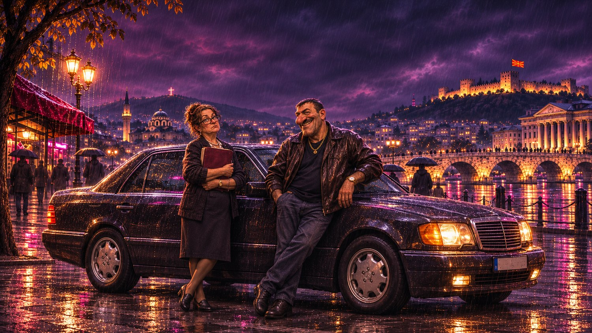

## 02 · Кај те наоѓа мисијата

Не ти се јавува шеф од ведро небо. Чекаш на Рекорд, а човекот до тебе се колне дека му го продале влезот додека бил на работа. Купуваш бурек и добиваш сметка со туѓ број на предмет. Некој те вика да свириш на отворање на зграда што уште не постои.

### Од муабет до работа

Секоја клучна трага се појавува барем на две места: преку човек и преку предмет, оглас или друга работа. Бележникот прво ја запишува како гласина. Кога ќе прашаш, добиваш понуда со задача, место, превоз, влог и рок ако го има. Можеш да прифатиш, да одложиш или да ја одбиеш. Одбивањето остава резервен контакт.

### Првата вечер

Избираш еден главен лик. Другите можат да станат сојузници, соперници или сведоци според тоа како си постапил со нив. Сите почетни буџети и целта од 10 милиони се на стр. 69–73. Секој почеток е изводлив пеш или со договорен бесплатен превоз. Личните приказни се на стр. 15–38; главната приказна започнува на стр. 10, а исходите се на стр. 47–48.

> „Абе, не ти продавам приказна. Влезот ни го продаваат.“

### Три зборови пред мапата

Ако минеш низ Чаршија наутро, мајсторот се жали на киријата. Навечер неговиот помошник го знае името на човекот што му го сменил договорот. Двајцата отвораат иста работа, со различен прв чекор. Во едниот случај го гледаш договорот пред да ветиш помош. Во другиот прво ветуваш разговор и подоцна бараш дозвола да го видиш.

Бележникот не ти дава туѓа адреса само затоа што си чул име. Записот прво вели „прашај кај дуќанот“. Ако ти кажат име и време, додава термин. Ако одбиеш да му помогнеш на човекот, можеш да се вратиш преку јавен оглас, но личната понуда не мора да ги задржи истите пари и услови. Играчот гледа која врата ја отворил самиот, а која останала во градот.

## 03 · Што значи да завршиш

### Пред да дадеш збор

Гласина → понуда → прифатена работа → активна етапа → исход → исплата. Работата може да мирува меѓу етапите. Секогаш гледаш една следна задача и до две можности што веќе си ги открил. Можеш да излезеш од активна работа на безбедна точка и да прифатиш друга. Градот не чека на мени.

### Муабетот и потписот се две работи

Да го донесеш пликот и да му дозволиш на некого да го објави се одделни дејства. Пред второто, бележникот кажува кој ќе го добие, дали сведокот се согласил и што ќе изгубиш. Ако исходот е чист, ги задржуваш луѓето и предметите што си ги ветил. Ако е компромитиран, продолжуваш со точно наведена цена, како оштетена кола, загубен контакт или следна проверка.

### Нема двојна наплата

Исплатата и последицата се запишуваат заедно, еднаш по задача. Пропуштен термин обично значи второ место за средба. Рокот тече само кога играчот свесно ќе прифати итна етапа. Вистинската цена на изборот се гледа и на улица: затворена врата, друг возач, човек што повеќе не крева телефон.

### Лист со исход, не само „успех“

„Предаде копија. Оригиналот остана кај Славица. Исплатени 2.000 денари. Домарот не дозволи објава.“ Ова е доволно за да знаеш што можеш утре. Ако е непотврдена трага, до неа стои кој може да ја потврди. Ако е заштитен сведок, стои дали зборува насамо, со чувар или јавно. Операторот на задачата не го менува тоа затоа што во последен миг ти недостига еден поен.

По исплатата следува краток одговор од светот. Се трга еден оглас, се појавува поправен запис или работникот ти испраќа порака. Можеш да ја одложиш следната понуда и да ја најдеш подоцна. Кога две работи делат опрема, враќањето на опремата е посебно ветување и го гледаш на истиот лист.

## 04 · Пак ти? Од кај продолжуваме?

### Враќање по прекин

По прифаќање, пристигнување, обезбедување човек или доказ и пред неповратен избор има точки за продолжување. По пауза бележникот кажува: што направи, што се смени, кој те чека. Се враќаш кај истиот контакт, кај назначена замена или со одредиштето „Продолжи“.

### Кога се распаѓа планот

Промашен автобус: подоцнежен термин или пешачка врска. Уништена кола: договорен возач, работилница или превоз. Изгубен оригинал: копија со независна проверка. Повреден сведок: закрепнување или друг извор. Тековната етапа или целосно се враќа со својот трошок и плен, или ја прифаќаш загубата и продолжуваш по резервната патека. Претходно потпишаните избори остануваат.

### Прераскажување

Завршена задача може да се прераскаже од архивата со отклучен лик. Ќе видиш друг пристап и ќе добиеш запис за умешност. Пари, оригинали и долгови остануваат во својата приказна. Повторливите маалски работи, пак, се нови настани во истиот град: нова нарачка, нов разговор, ограничена добивка.

### Преминот е затворен, а денот продолжува

Ако си прифатил да ја однесеш Елена до киоск и ја оставиш задачата на безбедна точка, таа не стои со часови на тротоар. Следната можност покажува каде е префрлена и кој ѝ помогнал. Ако си ја оставил насред активен проблем, прво избираш враќање на етапата или продолжување со последицата. Нема слепо броење минути додека гледаш мени.

По четири други завршени работи, некои контакти го менуваат распоредот: Благоја е во пекара, Маца на проба, а Славица на дозволен јавен термин. Бележникот го покажува следното место и последната обврска. Почетокот на работата е уште запаметен. Ако првпат си слушнал за платата од колега, тој и подоцна ќе реагира на тоа што си му ветил.

## 05 · Три досиеја, една превара

### Земја, пари и глас

„Земја“ ги врзува имотот, согласноста и рушењето. „Пари“ ги поврзува школските средства, набавките и исплатата. „Глас“ ги спојува набљудувањата со она што некој е спремен да го каже. Секој запис носи извор, сопственик, состојба, согласност и ниво: гласина, употреблива трага или проверен доказ.

### Како се собира случај

Два проверени независни извори потврдуваат досие. Пет слики од една фактура се еден извор. Противречност отвора споредба, не брише сѐ. Пример: Славица наоѓа приемен број, а Велика има постара имотна исправа. Заедно го рушат датумот на спорната согласност.

### Отворени врати

За собирот требаат две потврдени досиеја и употреблива трага во третото. Таму може да се потврди и третото. Ако недостига и првичната трага, јавниот шалтер, добавувачот и келнерот нудат по една проверлива резервна работа. Објавувањето има дополнителен услов: безбеден сведок што сака да зборува и проверено јавно тврдење.

> „Копија од копија не се два докази, мајсторе.“

### Сите копии имаат потекло

Ако две лица ја покажат истата фотографија, поделени сведоштва се можни само ако објаснат што виделе сами. Портирот може да потврди кога ја отворил вратата. Фотографката може независно да ја потврди годината. Спонзорот што само ја препратил фотографијата останува посредник. На екранот линијата оди до истиот извор, па нема да талкаш по копии.

Приватно проверен документ може да отвори договор, дури и кога сопственикот не дозволува јавно објавување. За јавната завршница треба дозволен јавен извор со истата проверлива содржина или доброволно сведоштво. Загубата на дозвола никогаш не го претвора точниот датум во неточен. Се менува каде и пред кого смееш да го користиш. На следните маси играчот гледа посебни ознаки за точност, чување и согласност.

## 06 · Множители што го менуваат пристапот

### Предложени вредности за проба

Обичен пристап почнува на ×1,00. Соодветна вештина дава +0,25, подготвеност или проверена трага +0,15, а посветен сојузник +0,10. Видлива гужва или лошо подготвен терен одзема 0,20. Збирот е ограничен од ×0,70 до ×1,50. За секој обид се менува само едно мерило: траење на можноста, напор или трошок. За трошок делиш со множителот. Ниту еден множител не ја купува согласноста на сведок.

### Два примера

Маца има 12 секунди да го задржи вниманието. Вештина и проба даваат ×1,40, односно 17 секунди по заокружување. Ако влезот е преполн, ×1,20 дава 14 секунди. Стојан со студентска услуга добива ×1,25 на предложена такса од 100 денари и плаќа 80. Јавната алтернатива без такса бара уште една средба.

### Комбинации

Подготвеност се троши по етапа. Помошникот дава една услуга по работа. Физичката способност трае 6–10 секунди, а социјалната важи за една јасна можност. Заедничкиот бонус не се множи повторно со истиот ефект од профилот. Играта веќе има разлики во движење, борба и возење. Новите активни способности и множители се предлог за кампањата.

## 07 · Кој ти должи, кој те гледа

Доверба 0–3: недоверлив, достапен, посветен, спремен да застане јавно. Ветување е конкретна обврска со име и рок. Пари не значат доверба. Прекршен збор влијае на човекот што си го изиграл и на неговите блиски. Извинувањето отвора работа за поправка, а постапката останува во историјата.

### Поддршка, внимание и притисок

Поддршка 0–6 се гради со шест различни услуги: помош на станари, чесна исплата на екипа, безбеден превоз, маалска трпеза, јавен собир и спасување. Секоја група вреди најмногу еден поен. Јавно внимание 0–3 носи публика и ризик за сведоците. Притисок 0–3 носи понуда, приватен разговор, заплашување, па обид за јавно оцрнување. Исправка или заштита може еднаш да спушти притисок.

### Слободата бара читливи последици

Снимање му дава публика на Давид; кај Сара истата средба може да помине со три доверливи луѓе. И двете патеки стигнуваат до приемот. Давид ќе мора да ја брани снимката, Сара ќе мора да ѝ се оддолжи на стилистката. Во бележникот стои кој го чува оригиналот, кој е безбеден и кој добил ветување.

### Ветувањето има рамка

Кога нудиш превоз, прашај кого возиш, до каде и дали местото останува приватно. Истиот автомобил може да заврши две задачи ако луѓето се согласни. Ако едниот побара независно да стигне, мора да го смениш распоредот или да ја прекинеш понудата. Ниту највисока доверба не му ја одзема таа одлука.

Раде може да дознае за објава и без да те видел. Најпрво одговара преку човек што имал пристап до снимката. Ако по мала приватна средба целиот град те напаѓа, потеклото на реакцијата е нејасно. Притисок се крева со конкретна причина. Добра заштита може да повлече еден проблем; работници што ти го паметат неисполнетиот збор остануваат причина да платиш лично.

## 08 · Градот е алатка

Автобус, воз, тротинет, точак, такси, комбе или пеш: секоја задача предвидува барем две практични насоки, меѓу нив и бавна. Горивото и штетата ја менуваат подготовката. Пумпа, перална и префарбување се градски услуги; бојата на колата не ја менува вистината во досието.

Киосците, храната и пијалаците даваат здив и разговор. Графит може да означи место за средба. Кучињата се маалски познаници и остануваат безбедни. Семафорите, работниците, камионите за отпад, радио, музика и смог го одредуваат ритамот. Пожарникари и брза помош отвораат сцени за спасување. Опасниот пристап со оружје, експлозии, обезбедувани комплекси, оклопно возило или хеликоптер останува изборен и има мирна замена.

## 09 · Твојот град продолжува

### Зачувување и заедничка игра

Предложениот запис ја памети етапата, оригиналите, договорите, исплатата и личната последица. Ликовите од приказната се враќаат на безбедно место, независно од случајните минувачи. Стар запис почнува со нова локална понуда. Првата верзија на кампањата е за еден играч. Заедничката верзија подоцна му дозволува на гостин да придонесе со својот лик; домаќинот ја потврдува одлуката на својата приказна.

### Движечка мапа

Рекорд е јазол за превоз и муабет. Дебар Маало ги спојува музичарите и келнерите. Лептокарија служи за средба на возачи и дуќанџии. Кејот е бавна пешачка врска или патека за Теа. Чаршија е место за дуќани, спомени и тивко договарање. Околината на ГТЦ го носи јавниот прием. Измислените фирми и места за криминал се сценографија во градот.

### Ритам

Лична работа трае околу 10–15 минути, заедничка 15–30. Меѓу нив има простор за возење, дружење и ситни услуги. Клучната информација има текстуален запис. Тешка итна етапа нуди план со повеќе време пред почеток.

## 10 · Потписот на човек што не дошол

Виктор „Визија“ Петрески, лицето на „Нова ера груп“, продава убави цртежи од ново Скопје. На нив нема гаража, стара пекара, школски простор или терен. Раде „Печат“, човекот што ги средува состаноците, тврди дека станарите доброволно потпишале. Еден потпис е од човек што починал пред состанокот.

Елена „Копија“, курирка за предмети, има дупликати. Таа на почеток изгледа како да продава иста тајна на две страни. Брат ѝ му должи на Раде, а таа се обидува да го извлече. Подоцна признава дека дел од папките ги пренела и самата. Признанието е најсилно кога играчот претходно ја сослушал и ја заштитил.

### Редослед по твоја мера

По личниот почеток, избери влезот, испораката или приемот на стр. 12–14. По кои било две од тие работи се отвора расчистувањето на архивата на стр. 39. Дополнителните проверки се на стр. 40–41. Штом досиејата се доволно потврдени, собирот ги спојува на стр. 42. Последната работа на стр. 43 има четири различни цели. Секоја патека го задржува својот сведок, трошок и долг.

> „На цртежот има дрвја. Пред зграда има багер.“

### Зошто Виктор сака фотографија

Виктор продава слика дека градот веќе се согласил. На првиот прием тој вели „сите се тука“ и покажува тројца луѓе што навистина дошле. Еден дојде за плата, друг за превоз, трет за да постави прашање. Подоцна истата слика може да се појави во договорот. Играчот што ја видел сцената има од каде да праша што значела.

Раде тврди дека со тивка спогодба може да спаси неколку работи што јавноста би ги изгубила. Понекогаш е во право за еден простор. Елена знае кој останува надвор, а секој што ја слуша има своја цена. Затоа конечниот избор може да биде јавна вистина, ограничена заштита, заеднички клуч или личен пазар. Ниеден херој не почнува со одговор на тоа кого треба да жртвува.

## 11 · Пролог • последната тура

На задното седиште Елена ја тутка сметката во дланката. „До Рекорд, шефе. И ако прашаат, ја не сум се возела.“ Миле гледа во огледалото. „Ќе ти биде потешко да докажеш дека си платила.“ Од радиото доаѓа реклама за идниот кварт. Од тротоарот, истата адреса се гледа на жолтиот лист за рушење.

Ако играш со Миле, ја возиш турата. Со Велика, истиот лист е залепен на влезот додека внукот ја чека. Со Маца, адресата е напишана зад договорот за настап. Со секој друг херој, неговата лична задача открива еден дел од таа вечер. Првиот вистински избор е кому ќе ја покажеш адресата.

Ако ја игнорираш, утрото ја носи втората покана: келнер споменува прием, а станар бара некој да му ја прочита одлуката.

## 12 · Влезот што сам се продал

### Влези во работата

Во влезот во Аеродром виси известување. Во продавницата карши, продавачот се сеќава дека луѓето потпишувале за поправка на лифтот. Избери двајца станари, спореди датуми и најди го домарот кај киоск или автобуска. Го држи тефтерот под мишка како да е туѓо дете.

> „Ми рекоа за лифт. Абе, кој потпишува рушење на стоење?“

### Три врати

Весна го прашува претставникот пред луѓе што го познаваат. Велика го споредува датумот со својата исправа. Славица го препознава бројот на друг предмет. Секој друг може да го спореди јавниот оглас со книгата и да го премести разговорот на безбедно место.

Изнеси го тефтерот јавно и добиваш внимание, но домарот се повлекува од приемот. Зачувај му го името и добиваш тивок сведок. Врати го за пари и купувачот ја добива книгата. Тогаш резервата е јавен запис и двајца станари што биле присутни.

### Што носиш понатаму

Еден извор за „Земја“, 2.000 денари за договорената работа и адреса на приемот. Ако тефтерот пропадне, домарот прави список од сеќавање. Подоцна го проверуваш на шалтер. Повторно се среќавате кај киоскот, со истата последица на доверба.

### Потпис за поправка

На листот стои: „Состанок во 18 часот.“ Домарот кажува дека книгата седела на масата цел ден. Една станарка ставила потпис на пладне. Друг сосед вели дека видел луѓе навечер, но не знае што читале. Не можеш од тие две изјави да потврдиш дека никогаш немало состанок. Можеш да потврдиш дека книгата била употребена и за друга работа. За големото тврдење треба втор извор со друг датум.

Ако брзаш со фотографија, бележникот те прашува дали имињата се видливи. Ако одбереш копија само од датумот, таа ја штити приватноста, но јавниот шалтер ќе побара потврда за оригиналот. Ако ја преземеш книгата, можеш да ја дадеш назад на домарот по проверка и да зачуваш заверена трага. Тој ја гледа разликата кога следниот ден ќе му дојдат да го прашуваат.

## 13 · Плата утре, рушење денес

Работник пред градилиште ја бара платата. Таксист на Лептокарија чул дека истиот добавувач вози по две различни сметки. Земи една од двете покани. Следи го дневниот распоред до јавно место за растовар и избери дали прво ќе му помогнеш на товарачот или ќе го стигнеш терминот за проверка.

> „Палетите се тука. Парите уште патуваат.“

Момчило работи со екипата. Владимир препознава вистинска медицинска испорака. Миле ги споредува времињата на две тури. Секој друг добива сметка од продавачот и потврда од примачот. По работно време, товарачот седи на договорено место во близина.

Елена нуди цел список ако пренесеш плик што ѝ го врзува братот со Раде. Прифати за побрза трага и долг. Одбиј и провери две адреси. Прашај ја за согласност и можеш да ѝ помогнеш да подготви изјава, со повисок притисок врз вас двајцата. Откриваш дека дел од сомнителните пари платиле вистинска испорака.

Договорениот надомест е 3.000 денари. Верификувана испорака дава извор за „Пари“. Ако комбето се расипе, дупликат и разговор кај примачот ја заменуваат турата. Одлуката за работниците го менува собирот.

### Некој таму стварно работел

Кај растоварот една палета има потпис и нема ознака. Втората има ознака и нема потпис. Работникот вели дека првата стигнала до примачот, а втората била вратена. За да ја одделиш вистинската исплата, провери го записот кај примачот. Ова е кратка делница низ жив сообраќај или две собрани изјави ако не возиш.

Можеш да ја вложиш платата од работата во повратен превоз за товарачот. Тогаш доаѓа како жив сведок. Ако ги задржиш парите, тој може да ти остави јавно проверлива сметка. Ако го продадеш записот на Елена без разговор, она што си го видел останува употреблива трага и бара друга потврда. Работната екипа ќе те праша кого си платил кога на собирот ќе се зборува за вистинските смени.

## 14 · Прием без гости

Кај ГТЦ, макета од стакло стои среде приемот. Виктор ја чека „заедничката“ фотографија, а келнерот моли некој да му го тргне беџот од кадар. Влегуваш со јавна покана, како изведувач, со препорака или со нарачка. Сите четири влеза водат до истото прашање: кој ја нарачал приказната за согласноста?

Маца ја држи салата со песна. Давид вика публика. Сара наоѓа мирна маса. Кики го носи колекционерот до макетата. Снежана им дава ред на прашањата. Со друг лик чекаш јавно обраќање и му го враќаш зборот на келнерот кога ќе го прекинат.

На снимката Виктор звучи виновно. Последната минута недостига. Објави сега и ќе добиеш внимание и притисок. Чувај ја и провери со келнерот. Врати му ја на Виктор за услуга, па барај независен сведок. Ако салата се испразни во паника, резервната средба е во кафеана. Исплата за договорената работа: 3.500 денари.

## 15 · Чичко Кумплунг

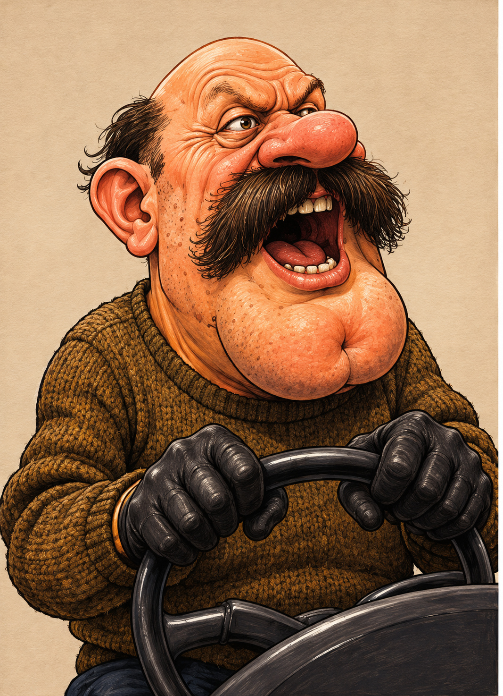

### Рикверц во утре

На гаража му ставаат жолт лист. Познаникот што му должи поправка нуди нова работилница ако пренесе мотор од плацот. Почетокот е кај гаражата или кај мајсторот во Лептокарија. Со натоварено комбе стигнуваш до тесен простор, застануваш да ја провериш адресата и решаваш кому ќе му го предадеш товарот.

### Возачка привилегија

Совршената контрола накратко ја смирува реакцијата на комбето при маневар. Точноста ти купува време да излезеш и да го видиш договорот. Кумплунг е слаб пеш; проверката може да ја препушти на соседот што навистина го слушал.

Нова гаража значи брза услуга и сосед што останува надвор. Заедничкиот договор носи доказ за „Земја“ и поскромна поправка. Соседот подоцна може да ја задржи кутијата во архивата. Ако комбето пропадне, мајсторот ја носи товарната сметка. Договорената работа плаќа 2.500 денари. На крај, новата табла гледа или кон жив двор или кон празна гаража.

> „Кола во рикверц знам. Животот не ми оди така.“

### Клучот во касетата

На празен плац заменската гаража веќе има приклучок за струја. Нова брава, стар клуч. Мајсторот ти дава пет минути да провериш дали соседот Горан е во списокот, додека превозникот бара да се потпише прием. Ако веднаш ја прифатиш гаражата, моторот е безбедно сместен и добиваш еднократна поправка на комбето. Горан го губи пристапот до алатот што го делевте.

Можеш да ја условиш својата согласност со двоен клуч. Надзорникот прифаќа, но додава две недели без струја. На следната работна смена мораш да избереш дали му го позајмуваш своето возило на Горан или го трошиш слободниот термин за архивата. Трета патека е да ги извадиш алатот и сметката пред да си заминеш. Го спасуваш доказот, ја губиш заменската гаража, а двајца мајстори на собирот ќе понудат делен простор.

> Горан: „Твој е моторот, чичко. Ама дигалката ја плативме двајца.“

## 16 · Таксист Миле

### Последната тура ти го знае името

Патничката остава сметка и бара да ја заборавиш. Ако ја промашиш првата тура, друг таксист ќе ти го раскаже муабетот кај Рекорд. Возиш меѓу станица, спорен блок и кафеана. На секоја станица некој ја памети истата испорака во друго време.

### Побрзо или подобро

„Миле знае пат“ ја покажува најбрзата моментална врска. Краткиот пат ја носи патничката дома навреме. Подолгиот ѝ дозволува да го препознае курирот. Ако бркаш луѓе пеш, ја оставаш сама и ја губиш таа можност.

Зачувај ѝ го името и ќе имаш приватен извор за „Пари“ и подоцнежна средба за „Глас“. Продади ја турата и земаш повисоки пари, а за доказ мора да одиш кај добавувачот. По судир, таа може да продолжи со друг возач ако претходно си ѝ ветил превоз. Исплата: 2.000 денари и договорениот кусур. На собирот нејзиното столче е пополнето само ако сака да дојде.

> „Радиото има вести. Таксиво има сведоци.“

### Патничката што не сака да биде извор

Кај вториот семафор Елена те прашува дали ќе кажеш каде се качила. Знаеш дека во записот за турата нема име, но адресата лесно се поврзува со неа. Избери да ја однесеш дома, да запреш кај осветлен киоск или да предложиш друга кола. Дома стигнува брзо; ако веќе си ја продал адресата, таа влегува сама и не се јавува следниот ден. На киоск треба да го платиш чекањето со пропуштена тура, но можеш да чуеш кој ја барал.

Дозволено е таа да ја избере втората кола. Ќе изгубиш контрола врз распоредот, но ќе добиеш независна потврда од возачот ако го зачуваш нејзиното име. Ако веќе си го предал записот, првата поправка е да ѝ кажеш што точно си предал. Таа одлучува дали ќе ја прифати следната придружба. Тогаш улогата на сведок може да ја преземе келнерот со подготвена копија.

## 17 · Певаљка Маца

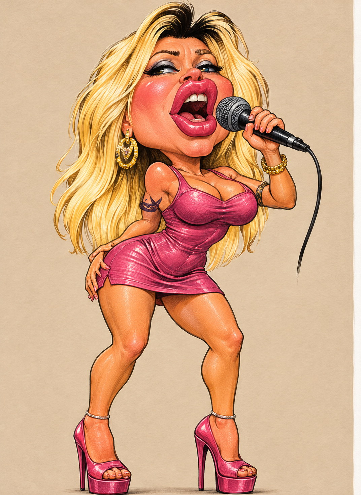

### Уште една за газдата

Договорот за локал исчезнува по приватна прослава. Келнер или музичар нуди настап во Дебар Маало. Договори бакшиш, направи проба, избери кога ќе ја задржиш салата и на кои двајца ќе им дадеш простор за тивок разговор.

### Микрофонот е прозорец

Со „Микрофон на максимум“ толпата го следи настапот, а келнерот добива кратка можност да се тргне. Ако некој почне кавга, музичарите можат да продолжат за Маца да го изведе човекот. Ако прва удри, собирот се растура и преговорите се селат на проба.

Посвети песна на Виктор и земаш 3.000 денари плус покана за прием, со долг за фотографија. Одбиј и земаш 1.800 денари од музичарите, а келнерот дава независен „Глас“. Ако вечерта пропадне, истиот избор се појавува на следна проба со помала публика. На собирот публиката или чека пофалба за газдата или ѝ верува да го прекине.

> „Песната е ваша, газда. Микрофонот уште е мој.“

### Кому оди последната песна

Организаторот ја крева раката кога Маца стигнува до песната што ја нарачал Виктор. Келнерот стои до вратата и стиска празен послужавник. Можеш да ја отпееш песната како што си ветила, да ја растегнеш инструменталната пауза за да излезе келнерот или на крај јавно да кажеш кој не е платен. Пред настапот тапанарот ти кажува дека неговата дневница зависи од исплатата на газдата.

Договорениот настап ги штити дневниците; келнерот бара утрешен термин наместо вечерва. Пауза без објаснување го покрива излегувањето, а газдата ја скратува последната песна и следната покана. Јавна прозивка носи внимание, но двајца музичари бараат Маца да ја плати разликата. Ако го прифатиш тој долг, истите луѓе на собирот ќе продолжат да свират кога Раде ќе се обиде да го прекине разговорот.

## 18 · Студент Стојан

### Лаптоп поскап од школарина

Кај сервисер се појавува стар лаптоп со туѓи сметки. Сопственикот го бара полначот кај студентската автобуска. Со 3.300 денари на почеток, Стојан мора да избере меѓу брз превоз, копија и време за разговор. Бесплатна средба и автобус со договорен билет секогаш остануваат.

### Студентски попуст

Избери една поволност: превоз, копирање или средба со сервисер. Провери датум, побарај согласност и стигни кај сопственикот. Поволноста е алатка за буџет. Споредбата на две фактури е неговата умешност.

Врати го лаптопот и заедно ќе проверите извор за „Пари“. Копирај пред да прашаш и ќе стигнеш порано до добавувачот, а сопственикот бара објаснување и не сака јавно да ти помогне. За пропуштен автобус, сервисерот закажува нов термин. Исплата за услуга: 1.500 денари. На крај Стојан или има препорака за работа, или има папка со докази и никој да му крене.

> „Брат, имам буџет за две грешки. Едната веќе ја платив.“

### Осумдесет денари за туѓо име

На копирница имаш три страници со различна вредност: фактура, запис за прием и несродна листа со имиња. Сопственикот на лаптопот се согласил на првите две. Полагањето на Стојан е утре, а брзиот превоз чини колку неделната храна за еден ден. Избери една дозволена копија и јавна проверка, две копии со попуст или враќање на лаптопот пред да се обврзеш.

Со една копија можеш да почнеш веднаш, но вториот извор бара следен термин. Со две копии и попуст го губиш брзиот превоз, а сопственикот останува сведок. Ако ја земеш и листата со имиња, ќе најдеш друг контакт побрзо, но ризикуваш да изложиш луѓе што немаат врска со испораката. Можеш да ја отстраниш листата од својот случај пред јавност. Кога ќе го признаеш пристапот, сопственикот сам решава дали оди на собир или ти го остава само документот.

## 19 · Инфлуенсер Давид

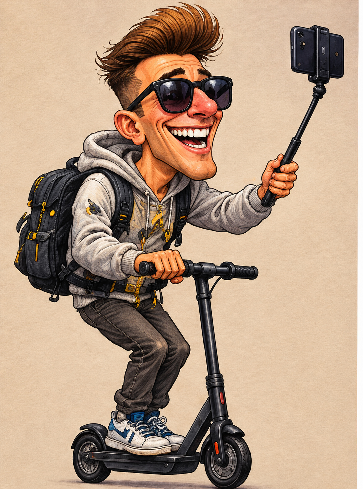

### Ова не е спонзорирано

Во кадарот забележува средба што не ја планирал. Спонзорот бара оригинал, а келнерот што се гледа на снимката бара да го тргне. Започни преку кој било од нив. Прегледај го кадарот, врати се на местото и избери каде да го слушнеш човекот.

### Сними, па одлучи

Снимањето привлекува луѓе. На отворен плоштад се сведоци; во тесен ходник ти го затвораат излезот. Додека се собираат, можеш да му дадеш на келнерот простор или да го ставиш во центар. Брзо објавување носи 3.500 денари, две нивоа внимание и непроверено тврдење.

Почекај и завери ја целата снимка со втор извор. Добиваш „Глас“ и 1.800 денари за посебна работа. Ако објавиш прерано, извини му се на келнерот и сними исправка; така повторно се отвора јавното финале, а неговата доверба се враќа само ако прифати. Кафеаната го заменува пропаднатиот прием.

> „Брат, првпат ми треба помалку публика.“

### Публиката гледа погрешен човек

Спонзорот бара кадар со келнерот на средина, затоа што лицето ја прави снимката „лична“. Келнерот се согласува да каже кога бил таму, но само без име и лице. Избери оригинал за приватна проверка, јавен исечок со целосен контекст и согласност, или брз спонзориран исечок. Пред изборот гледаш кои луѓе се препознатливи и кому оди копијата.

Приватната верзија го одложува вниманието и ја задржува поканата за јавен настап. Потврдениот исечок носи само еден поен внимание додека не се потврди и вториот извор. Брзиот исечок носи пари и два поена, но келнерот ја губи смената и го откажува терминот. Во исправката избираш дали лично ќе го признаеш својот дел или ќе објавиш само нов контекст. Првото отвора средба со келнерот. Второто го поправа јавното тврдење и остава друг човек да го носи сведоштвото.

## 20 · Инфлуенсерка Сара

### Стори не плаќа фактура

Сара одбива реклама за проектот и останува без хонорар. Стилистката ѝ пишува, или на отворање се појавува спорната сметка. Побарај го записот за нарачката и собери уште двајца неплатени соработници.

### „Девојче, среди ми“

Со познанство избираш возач, приватна просторија или претставување кај спонзорот. Само една услуга останува за етапата. На приемот Сара може да го одвои разговорот од камерите со правилен контакт.

Земи 4.000 денари и прифати ново појавување, или поврзи ги соработниците и завери „Пари“ со еден поен поддршка. Стилистката станува твој човек ако јавно признаеш кој ја завршил работата. Ако спонзорот те тргне од список, оди на јавниот прием со нејзината сметка. На крај Сара може да добие независна соработка или договор со познато лице што пак ѝ го пишува текстот.

> „Душо, фала за видливоста. Кај стои сумата?“

### Туѓа услуга на твоја сметка

Стилистката бара нејзиното име да остане на фактурата за да ѝ се плати. Вториот соработник сака да остане анонимен бидејќи уште работи за спонзорот. Можеш да преговараш за исплата на сите со приватен список, да земеш личен надомест веднаш или да предложиш заедничка изјава без имиња. Приватниот список е најбрз, но бара да најдеш неутрален човек да го чува.

Со личната исплата Сара добива ново појавување и губи придружба на следниот настан. Со заедничката изјава го чува вториот човек, но стилистката бара на крај јавно да ѝ ја признаеш работата. Ако ја користиш услугата за просторија, патуваш со јавен превоз и пристигнуваш преку друг влез. Ако ја користиш за возач, средбата е отворена и изборот за приватност го правиш во разговорот, пред да ја покажеш фактурата.

## 21 · Теткица Весна

### Кој го остави влезот отворен?

Геометар го знае кодот на вратата. Еден комшија го обвинува домарот, друг пакува. Прочитај оглас или помогни со пазарење. На три ката слушаш три верзии, а потоа ги собираш станарите без да го изложиш човекот што најмногу ризикува.

### Чанта и збор

Маалскиот авторитет ѝ отвора разговор. Чантата во предложената сцена кратко прекинува напад за соседот да излезе. Весна не брка по скали; однапред избира каде ќе стои и кој ќе го придружува домарот.

Посрами го комшијата јавно за брз „Земја“ извор и загуби помош кај архивата. Зборувај насамо, дознај за заканата и смени го договорот за пристап. Добиваш сојузник по уште една проверка. Ако собирот се растури, следното сабајле продолжува кај киоск. Договорена исплата: 2.000 денари.

> „Не се мешам, синко. Само ти немаш клуч од мој влез.“

### Комшијата од трети

Претставникот нуди да им го поправи лифтот ако Весна престане да прашува кој ја дал шифрата. Комшијата од третиот кат навистина ја споделил, а некој му ветил дека лифтот ќе биде среден пред да му се врати мајка му. На состанокот можеш да го кажеш неговото име, да бараш поправка без да ја предадеш книгата или да предложиш нов код и распоред со двајца чувари.

Името носи брз сведок и го остава човекот без поддршка во влезот. Поправката без договорен рок ја зачувува фасадата на мир, но на следната средба можеш да најдеш повторно залепен оглас. Нов код бара една маалска услуга и остава сведок достапен. Ако претходно си го посрамила, поправката е да застанеш до него кога бара објаснување пред луѓето, без да го тераш да ја потврди твојата верзија.

## 22 · Баба Велика

### Под перница, под план

Роднина нуди да ѝ ги „чува“ имотните документи. На огласот Велика го чита истиот опис на парцела. Почни на семејна посета или кај комшивката. Најди стара папка, оди на дозволена средба и избери кај кого ќе остане оригиналот.

### Семејната резерва

„Под перница“ отвора една семејна услуга: превоз, придружник или контакт од старото маало. Таа почнува со 12.000 денари, а бесплатниот превоз ја штити од непотребен трошок. Ако внукот има друга работа, термин има и со договорен автобус.

Остави ја папката во фамилија за брз извор „Земја“ и очекување за приватна спогодба. Избери неутрален чувар и добиј посилен јавен пат со тежок разговор дома. Ако се откаже првиот шалтер, Славица закажува јавна замена. Исплата: 1.800 денари за документарна услуга. Во епилогот на масата стојат семејниот клуч и изборот кој смее да го земе.

> „Сине, подигни го тепихот. Знам кај ми е паметот.“

### Името на уште еден наследник

Во семејната папка Велика наоѓа запис за роднина што одамна живее надвор. Внукот предлага да се чува папката дома додека не добијат приватна понуда. Славица може да закаже јавна заверка. Роднината сака да разговара по телефон и бара да не му ја објавуваат адресата.

Ако веднаш ја дадеш во фамилијата, внукот плаќа превоз и доаѓа со тебе на собир, но бара името да остане приватно. Ако ја дадеш кај неутрален чувар, добиваш заверка и губиш една бесплатна услуга додека не разговараш дома. Ако прво го сослушаш роднината, следната средба почнува подоцна. Отвораш право на заеднички потпис и можеш да зачуваш уште еден станар во спогодбата. При пропуштен термин, нотата кај Славица и копијата од семејниот албум се две други точки за почеток.

## 23 · Дедо Димче

### Човекот од старата слика

Весник на киоск или пријател на автобуска му покажува познато лице под нова фирма. Најди ја фотографијата, седи со стариот колега и провери ја годината кај човекот што ја снимил. Димче почнува со 3.000 денари. Секоја средба има бесплатна, пристапна патека и место за седење.

### Старо Скопје

Може да отклучи еден подготвен контакт од минатото. Колегата го памети лицето, ја греши годината и прикрива сопствена услуга. Избери што ќе провериш прво. Брзо објавување носи внимание и спорен „Глас“; потврден датум носи сведоштво.

Сочувај ја улогата на стариот другар приватно или побарај да си ја каже сам. По пропуштен термин, средбата се сели на клупата кај продавница. Исплата: 1.500 денари за семејна фотографија. На последниот собир го гледаш пријателот до себе или празно столче кое двајцата го паметите.

> „Лицето го знам, синко. Годината ќе ја провериме.“

### Годината се брани со луѓе

Сликата покажува двајца пред ист дуќан, но на работ стои реклама за настан што се одржал година подоцна. Стариот другар бара да се држиш до неговото сеќавање. Фотографката има датум и сака прво да знае каде ќе ја користиш сликата. Можеш да ја зачуваш приватно, да прашаш пред уште еден сведок или да го кажеш старото име во јавност.

Првата патека остава пријател и бара уште една потврда. Втората го прави изворот самостојно проверлив, но го изложува стариот другар на прашање за неговата услуга. Третата привлекува внимание и може да посочи погрешен човек. Димче ја поправа грешката со повратна посета кај фотографката и јавно читање на исправниот датум. Доколку ја запази нејзината согласност, таа на крај носи уште една фотографија како резервен извор.

## 24 · Пандур Бобан

### Предметот е во погрешна фиока

Жртва на кражба и колега со задржан извештај ја отвораат работата. Сослушај го човекот, провери дозволен запис и договори средба на јавно место. Легитимирањето дава можност да прашаш, додека другата страна може да одбие да зборува. Воениот и полицискиот комплекс остануваат чувани.

### Каде ќе го заведеш

Преку службениот синџир добиваш брз доказ и ветено напредување, а оригиналот стигнува кај човек на Раде. Со заведена копија и независен сведок имаш побавен „Глас“ или „Земја“. Продади ја информацијата и купувачот ќе те чека на крајот, а жртвата ќе побара друго лице за помош.

Ако ти го тргнат пристапот, продолжи преку сведокот и јавниот шалтер. Надомест за договорената работа: 2.500 денари. На архивата службен пристап штеди време, а цивилен сојузник може да го задржи оригиналот додека помагаш на друг човек.

> „Редот е за сите ист. Само некои имаат друга врата.“

### Услуга од колега

Колегата на Бобан носи службен број и бара оригиналот да остане во фиока до понеделник. Жртвата сака потврда денес бидејќи утре ќе ѝ ја сменат бравата. Можеш да го заведеш преку колегата, да побараш независна потврда кај јавен шалтер или да ја придружиш жртвата да поднесе свое барање.

Службениот пат го задржува пристапот и брзо носи број, но во архивата дознаваш дека записот се префрлил кај истиот посредник. Независното заведување те чини дополнителна средба и една услуга, а ти остава проверена копија. Придружбата го прави човекот активен сведок, но колегата ќе те праша зошто си го прескокнал. Ако си ја продал информацијата, можеш да ѝ помогнеш со нов пристап без таа да ти го врати истото ниво доверба. На финалето јавниот запис и службениот потпис се две различни потврди.

## 25 · Доктор Владимир

### Испораката стигна, уплатата не

Фактурата на клиниката не се совпаѓа со нарачката. Добавувач или човек со откажана услуга те упатува до курирот. Оди со него до безбедно место, провери што пристигнало и спореди ја сумата. Играта го прикажува изборот да останеш со човек, без симулација на медицинска постапка.

### Време за човекот

„Докторе, помагај“ ја обновува енергијата за придружба или му дава поддршка на соиграч. Во кампањата контакт може да ги земе хартиите додека Владимир останува со курирот. На терен неговото возење помага повеќе од тепачка.

Блокирај ја целата фактура за брзо обвинување и вистинската испорака останува неплатена. Оддели ги сметките со дополнителен термин за проверени „Пари“. Донатор нуди тишина за покривање на загубата. Ако курирот се повлече, договори потврда кај примачот. Исплата: 3.000 денари. Во завршницата прашањето е дали амбулантата продолжува да работи.

> „Прво човекот. Фактурата нема да ни избега.“

### Испорака за утре наутро

Добавувачот вели дека без одобрение нема да ја испрати следната пратка, а примачот знае дека првата пристигнала само делумно. На масата имаш потпис за прием, лист со недостиг и понуда за приватно покривање. Избери да одделиш испорака од спорна фактура, да стопираш сѐ до проверка или да прифатиш премостување со јавно запишан услов.

Одделувањето бара две посети и чува исплата за она што стварно стигнало. Стопирањето го забрзува јавниот случај, но следниот ден ќе те чекаат луѓето од откажаната испорака. Приватното покривање дава брз опстанок и ризик донаторот да бара тишина на собирот. Запишаниот услов му дава на Владимир право да го прозове долгот пред другите, но донаторот тогаш може да се повлече. Во сите патеки резервниот примач може да даде изјава без податоци за пациенти.

## 26 · Мали

### Сите одеднаш го знаат Мали

Другар или испуштена етикета го враќа до маалското игралиште каде видел размена. Помини по блиската улица, препознај примач и реши на кого му кажуваш. Точак, тротинет и договорено совозачко седиште ја заменуваат колата.

### Се пикнав, ме нема

Тесниот авторски премин кратко го трга од видик на следачот. Ако се вратиш на истиот излез, следачот може да те дочека. Другарот има побавна рута и чека на безбедно место. Оставањето сам ја менува довербата.

Кажи му на Бобан за брз заштитен „Глас“ со грижа за име на другарот. Побарај Весна да посредува, додади разговор и зачувај ја приватноста. Продај измислица и подоцна мораш да ја исправиш пред човекот што си го посочил. Ако останеш без превоз, договорот се сели кај другарот. Заработка за посебна услуга: 1.500 денари.

> „Мал сум само кога треба ја да платам.“

### Другарот чека на погрешната клупа

Преку тесниот премин Мали може да стигне до домарот пред оној што го следи. Другарот, кој не може низ преминот, оди до другата клупа. Можеш да го испратиш сигналот за безбедна средба со Весна, да го сослушаш домарот веднаш или да се вратиш и да продолжите заедно по прометна улица.

Ако брзаш, ќе го добиеш описот на примачот, но другарот може подоцна да одбие да биде именуван. Со Весна се чува приватноста и се добива побавен запис. Ако се вратиш, го пропушташ првиот разговор и добиваш дупликат од етикетата кај киоскот. Кога Бобан ќе праша кој бил со тебе, можеш да дадеш точен опис без име. Сведоштвото останува употребливо за проверка, а на јавен собир наместо другарот треба втор сведок.

## 27 · Работник Момчило

### Крени го ова, потпиши го она

На градилиште нудат заостаната плата за потпис на рушење. Колега го спомнува истото кај бурекџилница. Помогни со натоварениот предмет на авторска точка, прочитај го листот и договори кој ќе зборува за екипата.

### Силата има друга работа

Предложената работничка способност кратко ослободува пат или прекинува напад. Раде сака снимка од тепачка со работник. Ако Момчило остане да му помогне на товарачот, добива време за сметката и сведоштвото. Комбето го заменува долгото трчање.

Земи 2.500 денари лична исплата и екипата преговара сама. Држи заедничко побарување за доказ „Пари“, поддршка и 3.500 денари по собирот. Пропаднато растоварање се проверува со примачот на следната смена. Ако си потпишал сам, можеш да ја вратеш довербата на колега со помош, а потписот останува.

> „Јас кревам бетон. Твојот потпис ти е твој товар.“

### Кој го пушта комбето

Надзорникот сака Момчило да го остави комбето да тргне пред екипата да добие копија од листот. Двајца работници бараат пари веднаш. Третиот вели дека во записот недостига цела смена. Избери лична исплата, одложена заедничка исплата или прием само за луѓето што писмено го прифаќаат.

Личната исплата го чува работното место, а третото лице не може да ја докаже смената без помош. Заедничкото барање носи поддршка, но некој пропушта дневница и сака да знае кога ќе му се врати. Делумниот прием плаќа двајца и го остава спорот јасно означен; надзорникот губи право да го нарече документот целосен. Ако комбето пропадне, копијата ја бараш кај примачот наместо преку караница на плац. На собирот различен човек ја претставува екипата според изборот.

## 28 · Бурек-мајстор Благоја

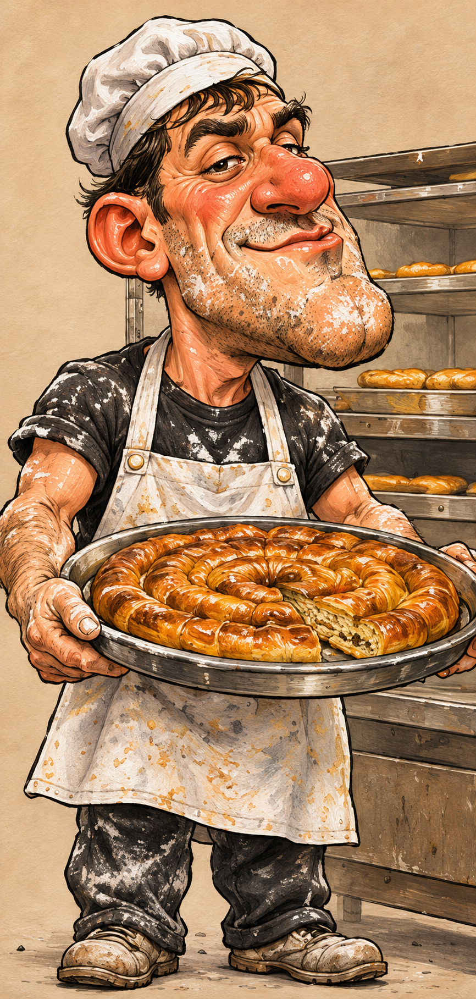

### Појадок пред багерот

Затворање на пекарницата се најавува пред првата нарачка. Таксист го прашува кај да доаѓа од утре. Спреми круг од три станици. Ако прво го нахраниш надзорникот, ќе ја чуеш приказната за фактурата. Ако прво ја дочекаш екипата, добиваш доверба. Ако зачуваш порција, сведокот доаѓа на време.

### Топло од фурна

Топлиот бурек го враќа напорот за една етапа. Пешачка тура или договорен возач му одговараат на Благоја подобро од бркање со комбе. Пропуштена нарачка може да се подигне во дуќанот.

Потпиши „традиционална пекара“ под нивен знак за 4.000 денари и ветено појавување. Соседниот дуќан за боза останува надвор. Задржи го името, собери маалска трпеза за 2.000 денари, поддршка и трага „Пари“. Љупчо ќе ти каже во лице како си го решил неговиот утрешен ден.

> „Со сирење, со месо или со ситни букви?“

### Третата порција

Благоја има една тава, три ветувања и комбе што пали од второ. Надзорникот бара цела нарачка за луѓето на приемот. Екипата нема ситно. Човекот што треба да ја потврди сметката доаѓа со првиот автобус. Испорака по договор носи готовина. Делена тура носи доверба со ризик мајсторот да го изгуби следниот заказ. Чување порција за човекот ја држи средбата приватна.

Може однапред да притрчаш пеш до Љупчо и да договориш една замена. Тоа бара да му оставиш место на својата маса кога ќе се зборува за двата дуќана. Ако веќе си зел брендиран договор, можеш повторно да му понудиш место со услов да го објавиш исклучувањето на неговиот дуќан. Пропуштениот сведок ќе дојде по смена кај пекарницата, но ќе бара да се види оригиналната сметка.

## 29 · Боза-мајстор Љупчо

### Автентично со членарина

Консултант нуди старото дуќанче во Чаршија да стане „нов концепт“. Понудата ја добиваш лично или на лист кај каса. Испорачај нарачка, запознај тројца редовни гости и спореди кој е впишан во двата договора. Маалското куче може да го погалиш пред да тргнеш.

### Седни малку

Ладната боза го намалува напорот за една етапа. Љупчо пристигнува со бавно доставно возило или со помошник. Може да ја замени големата дегустација со помала средба ако просторот е затворен.

Земи 3.500 денари и спонзорски контакт, а долгогодишната помошничка ја губи улогата. Одбиј за 1.800 денари по договорена нарачка, „Земја“ и поддршка од отворена трпеза. Трет пат го чува името и бара да ја покажеш премолчената ставка пред собирот. На крај, кој стои зад шанкот е резултат што се гледа.

> „Сакаш автентично? Седни да ти кажам кој ја мие чашата.“

### Ќе остане името, а човекот?

Новиот договор ѝ остава на бозата старо име, со нова постапка за вработување. Помошничката чита дека нејзиниот стаж не е признаен. Консултантот нуди да ја врати ако тивко го затвориш другиот спор за кирија. Можеш да го прифатиш, да го вратиш со јасен услов за стаж или да отвориш јавна дегустација и да собереш две независни сеќавања за користењето на дуќанот.

Тивката спогодба ја чува работата и остава непотврден услов за киријата. Пишаниот услов доаѓа со ново чекање и можност консултантот да си замине. Јавната трпеза ја дава поддршката, но бара ново место ако просторот е затворен. Помошничката има право да прифати подобро работно место и да ја напушти приказната. Тогаш можеш да го зачуваш дуќанот за нова екипа, а последниот разговор останува со неа, пред да си замине.

## 30 · Фит-женска Теа

### Личен рекорд, јавен терен

Тренингот по Кеј завршува кај ограда. Партнерка или известување го отвора прашањето за теренот. Избери обележана пешачка врска, сретни го чуварот и однеси запис за користење на јавен термин.

### Кардио за еден дел

Со кардио режим, Теа стига до брз термин без да ја прескокне безбедноста на пешаците. Може да го потроши налетот веднаш или да застане да го слушне чуварот, па да избере следен термин. Брзината носи различна сцена, а целосниот разговор носи дополнителен извор.

Земи 4.500 денари од спонзор за приватно студио и чуварот губи интерес да помогне. Отвори тренинг за сите, земи 2.200 денари за часовите, поддршка и извор „Земја“. Ако јавниот термин е промашен, замена е средба со чуварот на другиот ден. На собирот теренот или е место за луѓе, или е слика во презентација.

> „Ај уште еден круг. После ќе им го мериме пулсот на шалтер.“

### Кој трча со тебе

На Кеј спонзорот веќе донел банер за „јавен тренинг“. Со мал фонт пишува дека следната група мора да плаќа членарина. Чуварот на теренот носи стар список, но сака да остане надвор од рекламата. Теа може да ја води турата со банерот, да го скрати тренингот за да го стигне јавниот термин или да премести дел од луѓето на пристапна патека и да закаже следен термин.

Спонзорираната тура плаќа опрема и носи договор што го губи чуварот. Кратката тура ослободува време за доказ и остава дел од најбавните без завршен круг. Поделената група бара сојузник што ќе го води вториот дел, дава одржлива поддршка и остава можност за независно студио. Ако го започнеш брзиот режим пред разговорот, можеш да го пропуштиш целиот смисол на списокот.

## 31 · Билдер Дарко

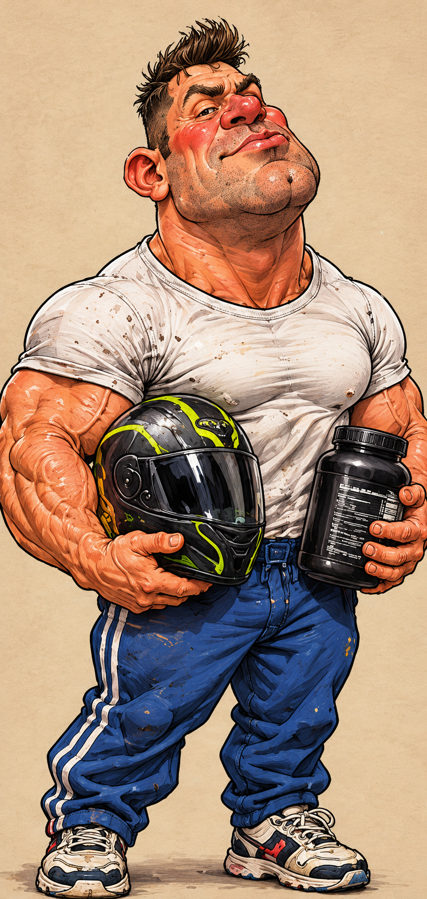

### Договоров не кажува колку тежи

Член на теретаната или нова сметка открива понуда за „заштита“. Премести опрема на обележаното место и однеси го членот до средба со луѓе што може да ја потврдат киријата.

### Напумпан режим

Дарко има краток налет на сила и издржливост. Може да расчисти товар или да му отвори излез на човекот. Бидејќи сите го гледаат, секоја кавга станува снимка за Раде. Широката патека го заобиколува тесниот премин.

Земи 4.500 денари од обезбедувањето и зачувај ја теретаната привремено, со долг за нивниот настан. Одбиј и заштити го членот за „Глас“ и 2.500 денари за опремата. По кавга, членот преживува, но разговорот се враќа дури по посебна средба. На приемот си или поканет телохранител или човекот што му чува столче на сведокот.

> „Тегот го пушташ. Договорот те држи.“

### Младото момче не е обезбедување

Наплатувачот нуди на членот од теретаната прва платена смена ако Дарко го стави во списокот на обезбедување. Момчето сака работа и се плаши од човекот што треба да го надгледува. Прво избираш дали ќе разговараш со него без присуство на наплатувачот. Во јавност тој може да се согласи од срам и да побара да не биде сведок.

Дарко може да го прифати договорот, да го услови со друг надзорник или да му помогне на членот да најде смена кај мајсторите. Првата патека дава брз приход и го остава истиот конфликт. Втората бара нов контакт и остава непроверен запис за киријата. Третата бара договорена услуга за екипата и го зачувува „Глас“. Ако претходно си удрил некого, остави го членот сам да закаже средба. Можеш да платиш штета и да се појавиш, а тој решава дали повторно ти верува.

## 32 · Шмизла Кики

### Колекцијата има список на гости

На фотографија од прием Кики препознава семеен предмет. Покана од колекционер или повик од роднина го отвора случајот. Спореди со семејна слика, прашај за потекло и избери дали ќе зборуваш пред гостите или насамо.

### „Не ме познаваш мене?“

Привилегијата отвора една врата: колекционерот, архиварот или дискретен превоз. Оној кого ќе го прескокнеш може подоцна да одбие да те потврди. Јавната изложба останува достапна со дополнителна проверка кај организаторот.

Земи го предметот со тивок договор и 3.000 денари за процената. Остави го кај неутрален чувар и потврди „Земја“, со семејна кавга за цената на вистината. Ако обвиниш погрешен човек, на следна средба ја признаваш грешката и пак имаш пристап до архиварот. Крајната сцена покажува предмет дома или доказ пред цела маса.

> „Не сум скапа, душо. Само не ти ја давам приказната гратис.“

### Две потврди за ист предмет

Колекционерот признава дека предметот е од семејството на Кики, но вели дека го купил од друг наследник. Организаторот нуди да го врати пред изложбата ако на каталогот не се спомене неговата улога. Кики може да го прими веднаш, да побара двата записа да останат кај независен човек или да побара јавен разговор за потеклото.

Брзото враќање ја радува фамилијата, но губиш доказ за продажниот круг. Независниот запис остава спор околу сопственоста, а ти дава уште еден учесник за собирот. Јавниот разговор носи внимание и го тера наследникот да објасни зошто продал. Може да испадне дека платил нечие лекување; изборот е дали последниот дел ќе стане јавен или ќе остане потребна тивка проверка. Ако си упаднала со погрешно име, организаторот повторно слуша по исправка пред истите луѓе.

## 33 · Палавко

### Доскокот не беше на снимката

Клип од паркур фаќа средба кај спорната зграда. Другар го забележува кадарот или те бараат да го избришеш. Врати се до две видливи точки, најди го човекот од кадар и реши кој ќе ја добие целата снимка.

### Не ме фаќаш

Две ниски пречки и еден потврден премин прават кратка патека. Можеш да стигнеш прв со снимката или да одиш по улица со сведокот. Другиот човек има свој пат и не мора да скока со тебе. Падот ја враќа етапата; оштетен уред води до копијата кај другарот.

Продади го клипот за 3.000 денари и изложи го сведокот. Земи 1.800 денари за договорена снимателска работа, побарај согласност и завери „Глас“ преку чувар на копијата. Кај архивата познаваш уште еден пешачки пристап, а довербата во тебе зависи од тоа кој се гледа во објавениот клип.

> „Скокот беше лесен. Кажи им после зошто сум бил таму.“

### Клипот има звук

Другарот ти покажува дека оригиналната снимка има глас што во исечокот не се слуша. Човекот од позадина се согласува да биде сведок само ако го прашаш пред објавување. До првиот термин можеш да стигнеш преку пречките, а тој доаѓа пеш. Брзото пристигнување му ја дава снимката на чуварот пред човекот да објасни што кажал.

Ако тргнете заедно, тој ја објаснува реченицата и дава согласност, но ви треба резервен термин. Третиот избор е чуварот да добие само потврда дека снимката постои, па сведокот сам подоцна да го одобри пристапот. Тоа го чува клипот приватен и остава еден дополнителен чекор пред јавност. По пад или оштетен уред, другарот ја носи копијата; таа го заменува предметот, а проверката на звукот останува.

## 34 · Средношколец Михаил

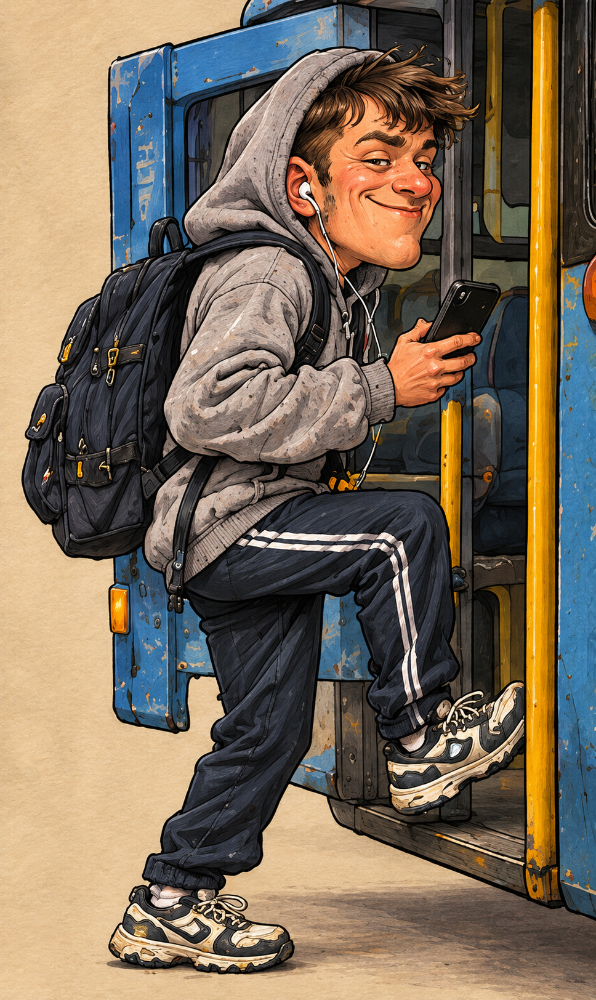

### Екскурзија до истата приказна

Екскурзијата е откажана, а две сметки имаат различна сума. Почни кај соучениците или преку термин кај наставник. Спореди три записи, прашај кој сака да зборува и договори безбеден јавен разговор.

### Профе, имам оправдување

Еднаш можеш да разјасниш ситно недоразбирање или да поминеш низ безопасен застој со групата. Ако те прекинат, стигни со точак, автобус или родител. Напредокот зависи од разговор и проверка.

Објави имиња за внимание и изгуби еден срамежлив соученик. Поднеси анонимни збирови со наставник за потврдени „Пари“ по уште една проверка. Прифати заменска екскурзија и сметките остануваат спорни. За договорената помош на настан добиваш 1.500 денари. На собирот можеш да ги прочиташ вкупните суми без да посочиш ниедно дете.

> „Профе, прво да видиме зошто бројките бегаат од час.“

### Детето што не сака да оди никаде

Еден ученик сакал да ја откаже екскурзијата затоа што дома нема пари. Училишното здружение ја користи неговата изјава како да се откажале сите. Михаил може да ги прочита поединечните износи, да понуди само вкупна сума или да прифати нова екскурзија со јасен поврат на парите.

Поединечните износи откриваат разлика и можат да го изложат детето. Вкупната сума бара наставник да потврди дека ги видел оригиналите и го чува името. Заменската екскурзија е вистинска корист за класот, но ако нема поврат некој останува исклучен. Кога наставникот е недостапен, средбата се сели кај родителски претставник со договорен термин. Доколку си објавил имиња, исправи ја објавата и дај им на соучениците сами да одберат кој сака да го прочита новиот запис.

## 35 · Војник Сашо

### Наредба од човек без униформа

Приватното обезбедување го праќа кај зграда со станари. Почни на брифинг или преку нивна поплака. Провери што е договорено, придружи овластен посетител и одлучи што ќе запишеш во сменскиот извештај.

### Војничка дисциплина

Кратка издржливост и отпорност помагаат да го сочуваш придружуваниот човек на авторска надворешна патека. Планирана пауза и јавна капија помагаат кога Сашо тешко импровизира. Ако посетителот е повреден, продолжението е неговиот запис и следна средба.

Прифати 4.500 денари од фирмата и станарите ќе те паметат по присилното иселување. Земи 2.000 денари за дозволената придружба, одбиј да ги бркаш и добиј „Глас“ со цена на работното место. Побарај писмена наредба: ризикуваш отказ веднаш, но потврдуваш кој стои зад неа. Кај архивата те чека шефот или станарите што си ги оставил да зборуваат.

> „Наредба слушам. Прво кажи кој ја потпишал.“

### Смената што ја продолжуваш сам

Шефот му нуди на Сашо редовно вработување ако пред станарите тврди дека зградата е празна. Посетителот бара придружба до јавната капија, а станарите бараат да ги сослушаш. Можеш да останеш на смена со јавно запишана задача, да се повлечеш од работата и да го однесеш човекот, или да ја прифатиш целосната наредба.

Ако побараш да ја запишат наредбата, шефот може да те остави надвор од следната смена. Записот носи „Глас“ и на собирот станарите знаат кому му се јавиле. Повлекувањето го чува посетителот, а доказот бара подоцнежен термин кај друг вработен. Целосната наредба носи работа и го губи мирниот прием кај дел од луѓето. Ако подоцна сакаш да помогнеш, прво дај им безбедна придружба по нивен избор. Претходното иселување и нивното барање остануваат во записот.

## 36 · Навивач Дуле

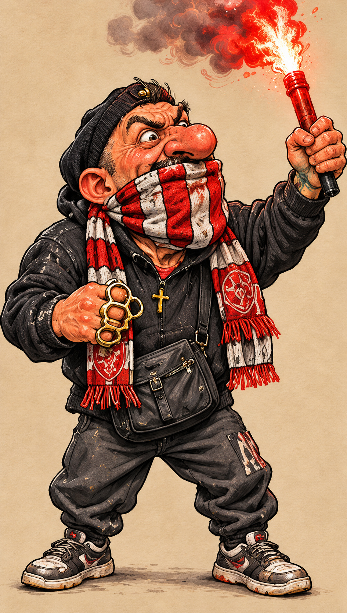

### Браќа до првата фактура

Просторот за собирање е загрозен, а спонзор нуди автобус за наместена фотографија. Оглас или другар со список за превоз го отвора договорот. Собери ги луѓето кај терен, распредели превоз и кажи за што навистина сте дошле.

### Ајмо сите

Повикај мала група за една улога: придружба, носење маси или ред за јавен збор. На тесен влез премногу луѓе ја блокираат задачата, а на поширок простор носат поддршка. Ако почне караница, другарот договара помало собирање подоцна.

Земи 4.000 денари и превоз со туѓ транспарент. Луѓето се делат. Организирај независен собир за 2.000 денари, поддршка и сојузник за завршницата. Договорот за фотографија може да го обелодениш, со цена на прекината услуга. На крај неговите луѓе носат маси или држат знак за кој никогаш не гласале.

> „Кога е за дерби, сите сме браќа. Кога е за сметка, никој не е дома.“

### Кој платил за вториот автобус

Спонзорот покрил еден автобус, а другарот на Дуле ставил свои пари за вториот. На списокот за фотографија се впишани и луѓе што дошле само за спорт. Можеш да ја откажеш целата слика, да дозволиш да се фотографираат само тие што сакаат или да прифатиш групна слика со јасно наведено кој ја финансирал.

Откажување го губи првиот автобус и бара повторно да се договориш со возачите. Одделна фотографија ја чува слободата за луѓето и ја намалува исплатата. Целосната група добива превоз, а подоцна треба да објасниш зошто сите биле претставени како поддржувачи. Невратениот долг на другарот го одредува бројот на волонтери кај собирот. Ако се расчисти, тој може да дојде и без спонзорот, а ако остане, помалата група ја презема задачата по подолг пат.

## 37 · Административка Славица

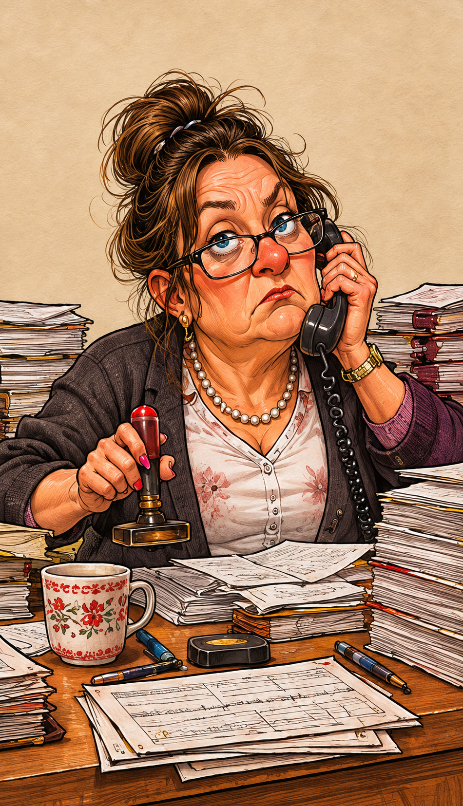

### Еден печат до багерот

Жалба е заведена откако веќе била одбиена. Јавно прашање или колега со изгубен предмет ѝ даваат почеток. Поврзи три дозволени шалтерски термини и побарај копија со потврден прием. Курир или договорен возач го заменува трчањето.

### Фали уште еден печат

Способноста ѝ дава дозволен пристап до еден релевантен запис или термин. Играчот избира кое од двете му штеди етапа. Ако службата го смени терминот, јавното барање и службената потврда се замена.

Исправи го предметот тивко за употреблива „Земја“ и сочувано напредување. Запиши го целиот синџир, изгуби го покровителот и добиј потврден извор со посветен колега. Продади пристап на Раде и ќе го сретнеш станарот чиј предмет си го одложила. Надоместот за договорената работа е 2.500 денари. Доцна, колегата може да седне пред камера само ако му оставиш избор.

> „Не фали печат. Фали човек што ќе признае дека го видел.“

### Кој ќе остане на шалтер

Колешката на Славица вели дека го завела предметот на погрешен датум откако ѝ било наредено. Ѝ нуди точен запис, под услов името да се види само кај независниот чувар. Покровителот може да ја префрли жалбата во друг предмет за еден ден. Ако прифатиш тивка исправка, станарот добива нов термин, а постапката за задржување жалби останува жива.

Можеш да побараш колешката да сведочи доброволно, да предадеш заверен запис со ограничен пристап или да ја откриеш наредбата пред сите. Првата патека бара придружба; втората помага за спогодба; третата може да ја отвори јавната завршница со друг сведок и да ја остави колешката без смена. Ако претходно си продала пристап, донеси му на станарот потврда за новиот термин пред да бараш услуга. На финале бројот на предметот останува проверлив кој било да го носи.

## 38 · Наставничка Снежана

### Секој добива по една минута

Школскиот простор е загрозен, а родителите добиваат спротивни ветувања. Почни со оглас или од откажан час. Собери прашања од три групи, намести пристапен ред и остави време за човек што не сака да стане пред сите.

### Тишина во училница

Накратко ги смирува преклопените разговори. Избираш кому го даваш зборот и кому дозволуваш да излезе на мирно. Еден родител веќе добил приватно место, а на друг му е срам да каже дека нема пари за превоз.

Читај ги популарните прашања за брза поддршка. Задржи го тешкото прашање за посилен „Глас“ и сојузник по помала резервна средба. Прифати приватна промоција за 4.000 денари или 2.200 денари за независни часови. На главниот собир можеш да го повториш истиот ред и да го спасиш разговорот кога сите сакаат да зборуваат одеднаш.

> „Тишина. Тој што молчеше досега, прв ќе зборува.“

### Тивкиот родител има прашање

Во салата повеќето родители зборуваат за терминот на часовите. Еден прашува кој ќе ги плати патувањата до приватната замена. Организаторот вели дека тоа не е на дневен ред. Снежана може да го префрли прашањето на следна средба, да остави минута за него сега или да го претвори во анонимно прашање со согласност.

Првата патека го завршува собирот брзо и остава родителот да бара втор термин. Втората може да ја испразни салата кога спонзорот ќе ја прекине понудата, а отвора јасен „Глас“ од човекот. Третата чува мир и приватност, но бара двајца независни родители да ја потврдат цената на превозот. Ако веќе си земала промотивна исплата, можеш да кажеш колку и по кој договор. Дел од луѓето сепак ќе заминат, а тие што остануваат знаат каква обврска имаш.

## 39 · Пред да дојде камионот

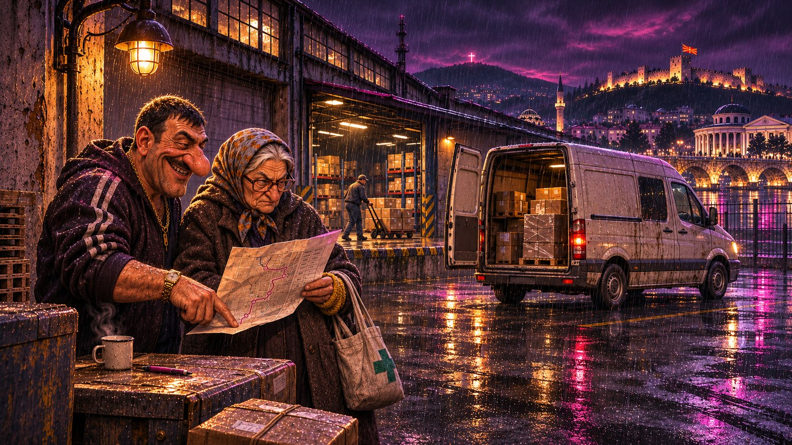

По две завршени главни работи, Елена вели дека ја празнат архивата. Изборот „тргни сега“ отвора осум минути. Стигни до безбедна точка, спореди ознака на кутија со списокот и разговарај со човекот одговорен за товарот. Со возило стигнуваш побрзо, пеш го слушаш муабетот со екипата.

Еден станар се повредува. Сојузник може да ја задржи кутијата додека ослободиш простор за брза помош. Без помош избираш човек или најлесен пат до доказот. Кутијата што заминала отвора приемна сметка кај добавувачот; повредениот што го остави може да одбие да зборува.

Елена признава дека една копија веќе ја извадила. Раде знае. Договорените 4.000 денари се исплаќаат еднаш, со регистар, резервна сметка или заштитен сведок според исходот.

## 40 · Снимката има уште една минута

### Разговор по затворање

Давид мисли дека го фатил Виктор како наредува цела превара. Келнерот ја памети реченицата потоа: дел од парите биле за вистинска испорака. Ако снимката веќе е јавна, на маса седи човек што поради неа останал без смена. Ако си ја зачувал, истиот човек може да ја доврши реченицата без публика.

### Поправка што се игра

Оди до келнерот од приемот, одбери дали да го прашаш пред другите и спореди го целиот запис со лице присутно таму. Со Маца можеш да закажеш мирна проба. Со Сара може да дојде стилистката. Со друг лик зборуваш со келнерот по смена. Ако не сака да се појави, земи дозволен запис и најди втор независен сведок.

Покажи исправка јавно за да ја вратиш можноста за разобличување. Зачувај ја исправката за договор ако сведокот сака приватност. Пари и внимание од старата објава остануваат дел од приказната. Недозволеното изложување може да се поправи делумно со заштита, со јасна согласност.

> „Кадарот ти е убав, брат. Само човекот внатре има утре.“

### Извинување што има публика

Келнерот може да ти каже дека сака снимката да се поправи, ама не сака повторно да стои во кадар. Ако имаш јавен канал, избери текстуална исправка, разговор со дозволен втор сведок или настап со оригиналот каде што луѓето се согласиле. Еден човек може да потврди време, друг може да потврди содржина. Ти одлучуваш дали ќе го прочиташ и износот што си го зел од спонзорот.

Текстуалната исправка е најбрза и може да ја видат помалку луѓе. Разговорот дава контекст и бара дополнителна средба. Оригиналот го брани случајот само кога се гледа целата реченица. Келнерот за нова смена може да побара контакт од Маца, не уште една објава. Решавањето на неговата работа и поправањето на твојата објава се две различни последици.

## 41 · На кој човек му веруваш?

### Елена ја отвора папката

Кај јавен киоск таа покажува две копии: едната е набавка што стигнала, другата е земјиште со истото име на посредник. Брат ѝ е долговно врзан со Раде. Таа може да сведочи, да даде приватна изјава или да се повлече. Го гледа однесувањето од приемот и архивата.

### Три резервни проверки

За „Земја“ оди со придружба до јавен запис и спореди датум со станар. За „Пари“ однеси ја сметката кај примачот и оддели ја реалната испорака. За „Глас“ најди втор човек и спои го кажаното со целата снимка. Секоја проверка дава конкретен извор со своја адреса и замена; три посети на истиот човек не важат.

Помогни ѝ да избере безбедна средба и добиваш можен сведок. Притисни ја да говори и задржуваш само приватна трага. Прифати ја понудата на Раде за папката и мораш да ја обновиш со јавни извори. Од тука можеш да се вратиш на улица, да одбереш маалска работа или да го закажеш собирот.

### Братот не е дел од доказот

На средбата Елена бара брат ѝ да не се споменува. Неговото име го објаснува притисокот врз неа, но не ги заверува фактурите. Можеш да ја слушнеш приватно, да побараш да се запише само дека постоела обврска или да кажеш дека без целата верзија не можеш да ја ставиш пред публика. Ако одбие да зборува, оди кај примачот по втор извор.

Раде нуди да ја скине обврската ако папката остане кај него. Од тебе бара да ја предадеш пред да го видиш потврдениот договор. Елена може да сака да прифати, иако притисокот расте. Дозволи ѝ да реши за сопствената изјава; за документот решава неговиот чувар. Ако се договорите за различни работи, запиши кои. Губење на Елена не значи губење на целата истрага, а херој што го одржал зборот има човек што подоцна доброволно доаѓа.

## 42 · Сите си имаат маса

Во дворот има три маси: записи, испораки, сведоци. Одбери домаќин, превоз и чувар на оригиналите. Ако ги изигра сите пријатели, неутралниот чувар бара две дополнителни средби. Непотврденото досие добива посебна етапа; другите само носат што веќе е заверено.

Раде шета со различни понуди. За Кумплунг гаража. За Маца локал. За Велика тивок имотен договор. За Владимир спонзор. Ако си зел аванс, кажи што си ветил, врати го или договори чување на зборот.

Елена признава дека пренесувала копии. Трите маси покажуваат дека согласноста е составена од несродни потписи. Снежана го прекинува викањето. „Сега кажи кој губи сѐ.“ Избери дали Елена ќе објасни, ќе даде доверлив запис или ќе си замине. Се исплаќаат 5.000 денари и претходно договорените заостанати плати. По прекин, масите продолжуваат одделно.

## 43 · Уште еден потпис

### Подготви ја својата последна работа

Бележникот ги покажува отворените исходи и што недостига за другите. Избери чувар, превоз, резервна средба и согласност на сведокот. Откако ќе тргнеш, имаш одделни точки за подготовка, испорака и потврда. Ако се повлечеш, повторно го гледаш списокот на услови.

### Целта зависи од изборот

Разобличување: однеси ги потврдените записи и доведи човек што сака да зборува. Спогодба: донеси услов за заштита на простор и одделна исплата на вистинската испорака. Преземање: собери луѓе и преземи еден простор со јасен запис за клучот. Продажба: предај оригинал и избери што точно купуваш за себе.

### Ако градот се запали

Заплашување може да донесе запалено возило и служби. Безбедно пренасочување, чекање или друг термин се цели патеки. Опционална сцена со хеликоптер или оклопно возило бара проверено игралиште и никогаш не е услов за исход. Избраниот лик користи една своја можност. Контактите помагаат само ако се расположени и на лице место. Финалната исплата од 6.000 денари се запишува по потврда, заедно со договорот и чие име останало над вратата.

### Што пишува пред да потврдиш

За разобличување стои кој сака да зборува и која верзија смее да се пушти. За спогодба стои точниот ограничен простор и што сѐ уште е спорно. За преземање стои што презема групата да плати и кој има клуч. За продажба стои што добиваш, кому оди оригиналот и дали имаш друга употреблива верзија.

Додека луѓето чекаат, можеш да отвориш разговор ако нешто е двосмислено. „Нови услови“ не е цела реченица додека не видиш кој се сменил. Ако те притискаат, одложи и понеси ги истите записи во друга средба. Ако си прифатил временски рок, одложувањето може да изгуби брза понуда; јавната патека со свои предуслови останува. Играчот што не сака да избере уште сега се враќа во градот со означени достапни работи.

## 44 · Три вечери со Миле

### Прва вечер • Подолга тура

Миле ја носи Елена по подолгиот пат и ѝ го чува името. Таа го препознава курирот. Миле оди прво на испораката и го слуша добавувачот. Два независни извори го потврдуваат досието „Пари“. На приемот избира да не ја пушти скратената снимка и добива употреблива трага за „Глас“.

### Втора вечер • Кутијата заминува

На влезот домарот му ја дава книгата, а јавниот запис ја потврдува „Земја“. Кај архивата Миле останува со повредениот. Кутијата заминува. Од приемната сметка дознава кој ја чувал, а на собирот келнерот го потврдува „Глас“. Елена пристигнува со другиот таксист како заштитен сведок. Разобличувањето е отворено.

### Ако ја продадеш првата тура

Истата улица изгледа поинаку. Елена не доаѓа, добавувачот мора сам да ги поврзе сметките, а приемот почнува со непријатно прашање. Миле може да изгради доверба со повредениот и да добие друг сведок, да преговара за спогодба со доволна поддршка или да го заврши веќе започнатиот пазар со Раде. Раната продажба менува кој ти верува, а не го заклучува целиот град.

### Кога ќе снема гориво

На оваа патека Миле доцни кај камионот. Ако го има Кумплунг како доверлив контакт, тој ја носи Елена на новиот термин додека Миле го решава возилото. Ако му останал должен за претходна поправка, мајсторот бара да го врати позајменото комбе. Тогаш Миле може да ја одложи средбата или да ја праша Елена дали сака автобус со другиот таксист.

Со автобусот не го добиваш истиот разговор на задното седиште. На постојката го среќаваш примачот од испораката. Елена решава да чека на јавно место. Таа не оди со тебе по секоја цена. Патот до потврден „Глас“ продолжува поинаку и покажува кому мораш да му го одржиш ветувањето од првата вечер.

## 45 · Велика, Маца и истата врата

### Велика оди пеш

Го зачувува семејниот оригинал кај неутрален чувар. На влезот го проверува датумот со домарот. На испораката оди со внукот, го слуша примачот и оди пеш до вториот добавувач. Две досиеја се потврдени. Во „Глас“ ја има снимката од јавниот прием, а тивката средба со келнерот ја дополнува.

Наместо јавност, Велика избира спогодба откако ќе собере три различни поддршки: станари, превоз и маалска трпеза. Семејството ѝ нуди лесен личен договор. Таа бара прво да го прочитаат името на секој што останува надвор. Просторот е сочуван; друг влез ќе бара помош за преселба.

### Маца ја држи салата

Маца земала бакшиш и ветила песна за Виктор. На приемот ја пее договорената песна, потоа му дава збор на келнерот. Ако го скршила ветувањето пред сите, настапот завршува, а келнерот ја чека на проба. Со музичари, трпеза, превоз и отворен собир ја гради поддршката за преземање.

На истата завршна локација Велика разговара за клаузула и сметка. Маца бира кој ќе седне до неа и кој конечно ќе го земе клучот. И двете гледаат исти луѓе, но тие луѓе имаат други барања.

## 46 · Работи што никој не ти ги наредил

### Шест договори за поддршка

Влез: среди безбедна средба за станар што не може по скали. Екипа: најди потврда за веќе одработена смена и договори исплата. Превоз: одвези сведок на две безбедни точки. Трпеза: договори три достапни нарачки и еден разговор. Собир: состави ред на зборување и приведи го кон крај. Спасување: помогни да се ослободи пристап за служба во авторска сцена.

### Други ситни работи

Пумпа со доцна нарачка, откажана проба, спор за паркинг, испуштен пакет кај игралиште, однесување апарат на сервис. Тие можат да донесат пари, нов контакт и познавање патека. Единствените докази се добиваат само во назначена работа. Повторувањето на иста услуга не ја зголемува поддршката.

### Мали трикови со вистински ефект

Врати позајмено возило пред рок и возачот го остава достапно за уште една мисија. Подготви пристапна патека сега и подоцна истата вечер сведокот нема да бара втор превоз. Зачувај копија кај доброволен чувар и губењето на физичкиот предмет станува проверка, а не крај. Прифати јавен настап и добиваш публика, со цена на изложеност.

## 47 · Пред сите, или за еден влез

### Јавно разобличување

Услови: три потврдени досиеја, проверено јавно тврдење и безбеден сведок со согласност. Пред макетата некој го прекинува Виктор. Маца може да го задржи микрофонот, Димче да го препознае потписникот, а Снежана да му даде збор на човекот што никој не го гледал. Записите излегуваат пред публика. Проектот паузира, започнува независна проверка и еден простор станува место за следни разговори.

> „Немаме уште пресуда. Ама имаме име, датум и човек што не се крие.“

### Спогодба во четири очи и на хартија

Услови: потврдени „Земја“ и „Пари“, поддршка најмалку 3. Избери еден простор и впиши која вистинска испорака мора да се плати одделно. Виктор го задржува своето лице на плакатот. Човекот што не влегол во договорот те чека надвор. Следната задача е да му најдеш превоз, место или нов термин за преселба.

> „Го спаси влезот. Твојот. Дојди да го видиш мојот.“

И двата исхода го оставаат градот отворен. Главниот запис стои во бележникот, а договорените услуги продолжуваат со свои луѓе и на свои места.

### Цената на преживеаниот договор

Во јавната завршница можеш да го прочиташ и својот аванс. Тоа може да затвори спонзорска работа и да зачува доверба кај луѓе што веќе знаеле за авансот. Ако премолчиш и Раде го покаже договорот, треба да одлучиш дали ќе го прекинеш настапот за да објасниш. Независните докази остануваат валидни. Се менува тоа кој сака да застане со тебе во следната сцена.

Во спогодбата можеш да ја намалиш сопствената корист за превоз или привремено чување алат на исклучениот сосед. Ако ја задржиш целосната корист, подоцна можеш да понудиш помош со своите пари и време. Соседот ќе ти каже што прифаќа, а што уште му е важно. Неговото прифаќање помош не е глас дека си постапил исправно.

## 48 · Клуч за сите, или клуч за тебе

### Наши клучеви

Услови: поддршка 4, еден доброволен сојузник, јавен запис кој го чува клучот. Преземањето отвора простор за маалото. Ако „Земја“ и „Пари“ се потврдени, предавањето е стабилно; инаку следува задача за одбрана на записот. Дуле носи луѓе, Љупчо и Благоја трпеза, Теа отворен тренинг. Оној што си го присилил може да не дојде.

### Честито, газда

Услови: купувач и еден употреблив оригинал. Го даваш оригиналот, добиваш точно договорена лична корист. Еден доверлив човек исчезнува од твоите редовни места. Влегуваш во новиот дуќан додека соседниот излог се празни. Преостанатите луѓе и записи може да отворат подоцнежна пресметка.

### Утрото

Еден кадар за амбицијата на херојот, еден разговор за сменетиот однос, едно обично место во градот. Истата пекара мириса поинаку кога знаеш кој веќе не работи до неа.

## 49 · Четири други лица на криминалот

### Ниво 1 · Свадба на три сметки • комедија на измами

Тројца газди го бараат истиот свадбен хонорар, а младенците имаат три договори за иста сала. Маца ги памети нарачаните песни, Сара ги собира неплатените соработници, а Кумплунг ги вози музичарите од една погрешна адреса до друга. Кога ќе се открие дека дел од гостите однапред платиле за измислена свадба, избираш дали да им ги вратиш парите со јавна бламажа или да организираш вистинска веселба и да откриеш кој го пуштил првиот лажен договор.

### Ниво 2 · Град на награди • црна сатира

Измислен конкурс за „најкорисно маало“ дели награди за рушење на работите што жителите ги користат. Славица ја следи административната апсурдност, Дуле собира независна публика, а Теа организира отворен тренинг на терен што жирито го прогласило за празен. Во финалето ја преземаш приредбата, ја пренасочуваш наградата кон стварен проект или победуваш според нивните правила и стануваш лице на кампањата што ја мразиш.

### Ниво 3 · Последниот автобус • тивка ноар-мистерија

Пред да исчезне, возач остава три билети од тури што никогаш не биле заведени. Миле ја реконструира вечерта со патниците, Димче препознава стара линија, а Бобан наоѓа втор извештај во друг предмет. Возачот се крие од луѓето чии долгови ги запишувал. Наместо исто финале за сите, го враќаш дома со заштитена изјава, објавуваш дел од записот или му помагаш да замине со целата приказна.

### Ниво 4 · Ноќ без адреса • градски трилер

Во една зимска ноќ три итни испораки завршуваат на иста празна адреса. Владимир сака да стигнат до вистинските примачи, Мали го препознава курирот, а Весна ја знае зградата под старото име. Криминалната нишка е човек што наплаќал за непостоечки достави и сега ги обвинува возачите. До сабајле избираш што прво спасуваш: испораката, човекот обвинет за неа или записот што ги врзува сите три.

## 50 · Белешка од маалото

### Јазик и визуелен изглед

Дијалогот е оригинален, со скопски ритам и разлики меѓу генерации и професии. Текстот е на македонски со кирилица. За снимање гласови се предвидува читање со скопски говорители. Имињата на измислениот инвеститорски круг и сцените на криминал му припаѓаат на светот на играта.

Лицата на страниците за хероите се нивните оригинални портрети од играта. Новите сценски илустрации ги користат оригиналните портрети како водич за препознатливите лица, а го следат филмскиот ноќен изглед на почетните екрани: магента и виолетови светла, килибарни рефлексии на мокар асфалт и длабоки сенки. Скопските мостови, маала и автомобили ги врзуваат различните криминални приказни во една визуелна серија. Сцените се измислени и инспирирани од Скопје.

### Од каде тргна приказната

Користени се техничкиот преглед, профилите и обновените биографии на 24-те лика, сликите од изборот на лик, речникот на скопски сленг и изворните модули за зачувување, возење, интеракции и градски служби. Возила, жив сообраќај, храна, предмети, борба, чувани комплекси и службите го даваат постојниот песочник. Бележникот, активните способности, трајните договори и заедничкото решавање на кампањата се предложени дополнувања.

### Прва проба

Изиграј ја истата истрага со Миле и со Димче без пари. Намерно загуби оригинал, промаши тура, објави погрешна снимка и вчитај околу исплата. Секоја загуба треба да има разбирлива резервна патека, а повторен обид да не удвои пари, доказ или долг.

> „Маалото не е на продажба. Ама сметката некој мора да ја плати.“

## 51 · Што знаеш пред да кажеш „важи“

На Рекорд човек може да ти се заколне во мајка, а сепак да лаже за времето на турата. Изборот е фер кога е јасно што ветуваш. Кој заслужува доверба можеш да го откриваш играјќи.

Пред потврда стојат примач, предмет, рок и видлива цена. Ако ја предаваш папката, го гледаш името на човекот, дали е оригинал, дали има резервна копија и дали некој забранил јавност. Тврдењата на учесниците се означени како тврдења. „Раде вели дека домарот ќе си ја задржи работата“ остава простор за сомнеж. „Домарот сигурно ќе си ја задржи работата“ е ветување што играта мора да го исполни.

Понуда може да се постави настрана додека прашаш друг човек. Итен избор го кажува преостанатото време. Ако сакаш да си одиш, бележникот покажува што ќе остане нерешено и каде можеш да се вратиш. На следната средба гледаш кој го дознал изборот и од каде.

## 52 · Четири слоја на последици

### Вечерва

На влезот Весна му го кажува името на комшијата. Некој веднаш излегува од сала. Домарот сепак ја остава книгата на маса. Доказот и сведокот се две различни добивки; можеш да ја имаш едната без другата.

### На следното возење

Весна бара возач за кутијата. Посрамениот комшија одбива. Се појавува подолга, употреблива патека преку колега на Момчило. Ако му дала право самиот да го објасни кодот, тој доаѓа без таа дополнителна работа. Играчот ја разбира врската кога комшијата ќе ја спомене средбата.

### Кога ќе се собираат сите

Името изговорено во јавност оди само кај оние што биле таму или што добиле снимка. Друг контакт може уште да ти верува. Ако поради тоа е затворен влез, јавниот двор и малата средба остануваат различни начини да се собере доказ. Ако си направил тивок договор, јавната маса може да побара да кажеш зошто си го прифатил.

### Кога ќе се раздени

Кој работи, кој чека превоз, кој ја отворил вратата и кој ја враќа позајмената опрема даваат видлив одговор. По спогодба за лифтот, лифтот може да работи, а соседниот влез да остане без помош. По јавна објава, домарот може да изгуби смена дури и ако случајот напредува. Договор за негова нова смена се игра одделно. Довербата може да се подобри без да се избрише она што било.

## 53 · Три работи можеш да ги држиш

### Избери што ти е при рака

Само една работа истовремено има активни дејства, а до три можеш да ги прибележиш за следење. Средбите се запишуваат со временски прозорец или со ознака „по договор“. Откажаната средба не се враќа автоматски во истиот час. Бележникот покажува јавен шалтер, телефонска порака или второ лице што води до следниот чекор.

### Три термини, една кола

Стојан има проверка кај сервисер, разговор кај примач и автобус до јавниот шалтер. Ако прво оди кај примачот, добива ново прашање за сервисерот. Ако прво оди на шалтер, дознава дека сметката е во друг предмет. Ако застане на маалска помош, пропушта еден брз термин и добива нов контакт за превоз. Во градот нема еден скриен правилен редослед.

### Како се спојуваат работите

Кога две мисии бараат ист човек, разговорот може да направи две различни проверки. Исплатата се врзува за секоја завршена обврска, а сметката се брои како еден доказ. Ако првата работа излезе во кавга, втората покажува ново место или друг човек. Системот чува што веќе ѝ е кажано на личноста; не ја тера да се претстави двапати.

> „Може два муабета. За исто кафе нема двапати да ти наплатам.“

## 54 · Правила за поволности и цена

### Секое движење ја менува само својата задача

Множителот за време важи само на означениот прозорец. Ако Миле има 20 секунди да ја согледа состојбата на патот, позната рута и седнат сопатник можат да го кренат прозорецот до 27 секунди. Семафорот и физиката на колата работат нормално. Ако има стеснување, предлогот покажува дека рутата останува побрза само под услов навистина да е проодна.

### Подготовка што се стекнува со играње

Проба за Маца, разгледано место за Теа, резервен возач за Велика и проверено место за качување кај Палавко се одделни подготовки. Мора да се добијат пред етапата. Една применета подготовка се троши, а другите можат да чекаат. Опрема од контакт се враќа ако била позајмена. Поволност добиена од две реплики на истиот човек се брои еднаш.

### Две решенија со иста цена

При обичен рок, избираш дали да платиш брза копија или да вложиш време во јавна проверка. Ако случајот веќе има две независни извори, третата заверка може да отклучи поповолна спогодба, а не да биде задолжителна. Ако немаш пари, службена потврда и втора средба се практична алтернатива. Пристапот е поволен за ликот кога го менува распоредот, ризикот или обврската во негова корист и го остава изборот видлив.

## 55 · Кога нешто навистина е загубено

### Скршен предмет

На резервната етапа се гледа кој последен го чувал оригиналот. Копија кај доверлив човек овозможува нова заверка. Ако никој нема копија, се бараат два други извора. Скршениот оригинал не се појавува повторно во багажник. Физичката загуба останува во историјата дури и кога досието повторно е потврдено.

### Загубена доверба

Миле може да се извини откако ја продал турата. Елена може да го сослуша и сепак да не влезе во автомобилот. Ако прифати безбеден превоз, тоа е една услуга, а не автоматска јавна поддршка. Сведокот може да дозволи приватна потврда со нов чувар. Играчот може да избере да не го бара повторно и да ја следи линијата преку келнерот.

### Загубена шанса

Ако го пропуштиш рокот во „Пред да дојде камионот“, кутијата заминува, но приемната сметка носи нова работа. Ако пред тоа си ја платил смената на екипата, тие го покажуваат записот уште истата вечер. Ако си зел лична исплата, бараат прво да го признаш тоа пред нивниот претставник. Како што се менува распоредот, содржината се менува со него.

### Избор за рестарт

Враќање на последната етапа ги враќа парите, предметите и луѓето во состојбата од таа етапа. Продолжување ја прифаќа промената. Играта прашува само кога двете патеки се достапни и не наплатува ист трошок двапати.

## 56 · Книгата и шалтерот

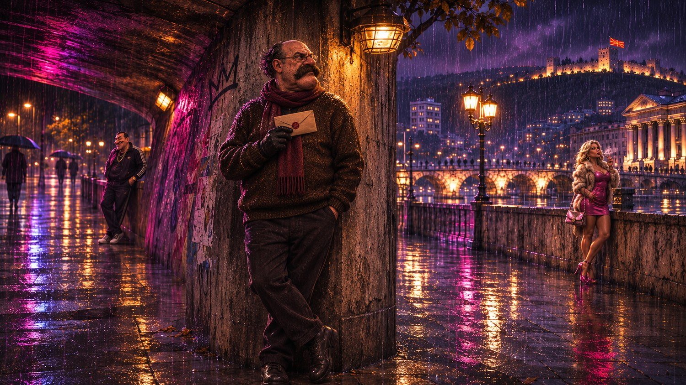

Домарот ти ја покажува страницата, ама ја држи дланката преку имињата. „Кој тебе ти кажа дека сакам да се сликам?“ Рок нема. Можеш да ја видиш страницата без да ја земеш, да го прашаш за дозволена копија или да ја прифатиш книгата за да ја однесеш на шалтер. Ако е исплашен, неутралниот човек може да дојде кај него.

На шалтер Славица ја споредува датата со бројот на предметот. Во едната верзија прво си ја открил грешката кај домарот, во другата ја откриваш пред него. Тој поинаку реагира ако му ветиш приватност и ако веќе си ја покажал сликата. Службениот запис може да ја потврди датата без да ја изнесе целата книга.

Ако Раде побара да се тргне името на домарот, можеш да го прифатиш условот и сепак да бараш независна потврда. Ако побара да се тргне датумот, јавната патека бара резервниот запис. Играчот гледа што точно било отстрането.

## 57 · Автобус за човекот со кутијата

### Една адреса, три потреби

Човекот со приемната сметка има двојна смена. Можеш да го качиш во договорено такси на пауза, да одиш со него со автобус по смена или да се сретнете пред продавница ако не сака да ја напушти улицата. Ако нема ниту денар, сведокот не го плаќа превозот од свој џеб. Кој ветил превоз останува запишан во бележникот.

### Што можеш да смениш по пат

Миле може да пренасочи кога гужвата се зголемува. Баба Велика може да побара внукот да застане кај втор човек. Стојан може да го заштеди превозот за вториот ден и да ја помине првата делница пеш. Неговата покуса маршрута не го обврзува сведокот да трча. Ако има прекин, избери да го дочекаш на следна станица или да се договориш со вториот човек да ја земе сметката.

### Колку чини итноста

Раде нуди автомобил за да се затвори работата „пред сите да разберат“. Прифати и заштедуваш време, но неговиот возач го дознава местото на средба што си ветил да го чуваш. Запиши ја промената пред да се качиш. Алтернатива е да го прашаш човекот дали сака да ја смени локацијата. Може да каже дека ќе остане, а ти решаваш дали да го оставиш или да ја одложиш работата. Сметката останува проверлива по пауза.

## 58 · Три маси и една за спорот

### Првиот распоред

Најди место за записи, исплати и сведоци. Направи простор за четврта маса ако има спорна поддршка. Човек што сака само приватен разговор седи настрана. Отворањето почнува дури кога ќе го потврдиш редот. Места, пристап и план за прекин се менуваат додека луѓето се собираат.

### Кога ќе се сретнат два договора

Виктор му ја дал заменската гаража на Кумплунг, а истиот план му ја одзел работилницата на Горан. Ако си го прифатил клучот, можеш да го ставиш на маса, да го задржиш и да понудиш користење по распоред, или да премолчиш и да го оставиш Горан да го отвори прашањето. Клучот на маса ја забавува личната работа и му дава на Горан причина да остане. Распоредот дава делен простор само ако и двајцата потпишат. Премолчувањето остава брз излез и губи доброволец за вистинската придружба.

### Кој го слуша признанието

Елена може да биде сослушана пред сите, пред чувар или на следен термин. Некој што ја слуша вечерва може да сака да застане до неа. Ако веднаш ја пратиш кај Раде, не го добиваш нејзиниот дел од приказната и се враќаш на другите две маси. Собирот може да заврши со отворен спор. Чекорот до финале тогаш е указан, а не скриен зад празно столче.

## 59 · Понуда без цела вистина

### Сцена под скалите

Раде се појавува кога јавната работа е погодна за спогодба. Носи лист со една соба што „може да остане“. Нема список на други станари. Фразата е намерно двосмислена: ја слушаш понудата, а бележникот точно кажува дека таа се однесува на една соба и дека за останатите нема договор.

### Четири одговори

Земи ја собата веднаш за работилница; добиваш клуч и губиш право да бараш ист простор во јавниот договор. Побарај и име на станарот од соседниот влез; Раде може да побара да се откажеш од една приватна корист. Одложи потпис и прашај го чуварот; чуварот потврдува дека уште нема список. Одбиј и договори јавна маса; на неа доаѓаш без клуч и со повеќе јавен притисок.

### Што се враќа подоцна

Ако си ја земал понудата, некој ден потоа го слушаш звукот на нова брава од соседниот простор. Можеш да ја задржиш работилницата и сепак да му помогнеш на човекот што ја изгубил својата. За да го одржиш и јавниот договор, мора да кажеш што си зел и кој останал надвор. Прашањето е кој друг го плаќа решението што ти било достапно. Играчот нема да знае дали Раде ќе го одржи зборот додека не го провери договорот со чувар кој има пристап.

## 60 · Последниот метар до потпис

### Брза рута

Доколку возилото е подготвено и возачот има доверба, брзата рута го носи сведокот пред почетокот на претставувањето. Ако на патот има реакција на сообраќај или запален автомобил, служби и жив сообраќај се видлив дел од етапата. Избери да свртиш до јавно одредиште или да чекаш означен резервен термин. Со втора кола можеш да го испратиш оригиналот, но мораш да ја потврдиш промената на чуварот.

### Тивка рута

Сведокот со јавен превоз има придружник и пристапен влез. Можеш да побараш да почека пред да го потпишеш договорот. Ако си го изложил претходно, тој може да дојде само на приватна проверка. Ако се обидеш да форсираш јавен настап, ја губиш оваа согласност. Друг извор треба да дојде на вториот термин.

### Одложен потпис

Остави ја работата на безбедна точка кога не ги прифаќаш тековните услови. Луѓето што дошле со своја смена можат да побараат нова услуга или да одберат заменик. За договор што треба да го зачува лифтот, играчот гледа колку луѓе го користат и кој ќе ја преземе сметката. Изборот „потпиши“ ги именува клучот, исплатата и условот. Изборот „врати се“ ја чува историјата и ја отвора следната средба.

## 61 · Каде ќе остане клучот?

### Четири различни утра

По разобличувањето, новиот извештај стои на маса, а јавниот случај е сѐ уште отворен. Отвори задача да ја повториш изјавата пред независен чувар или да му најдеш безбедно место на сведокот. По спогодбата, врати се во сочуваниот простор и на другиот влез. Таму човек со кутии бара реална помош за преселба. Ако веќе имаш доверлив возач, работата почнува со неговата понуда.

По преземањето, маалото има обврска за клучевите, сметките и пристапот. Избери дежурства, заедничко користење или платена смена. Секоја варијанта остава различен работник на вратата. По продажбата, стариот сојузник може да отвори нова средба на другата страна на улицата. Може да избере да не ти го прости договорот; сепак можеш да одиш на работа околу преостанатиот доказ.

### Враќаат едно нешто што го паметат

Приказната за Теа се гледа на терен, онаа за Владимир во следната испорака, за Миле во празното седиште, за Велика во условот кој го чува оригиналот. За Благоја и Љупчо важно е кој навистина работи зад шанкот. Ако две одлуки си противречат, последната сцена ги покажува двете. Сочуван локал и изгубен пријател се можни истовремено.

## 62 · Ниво 1 · Свадба на три сметки

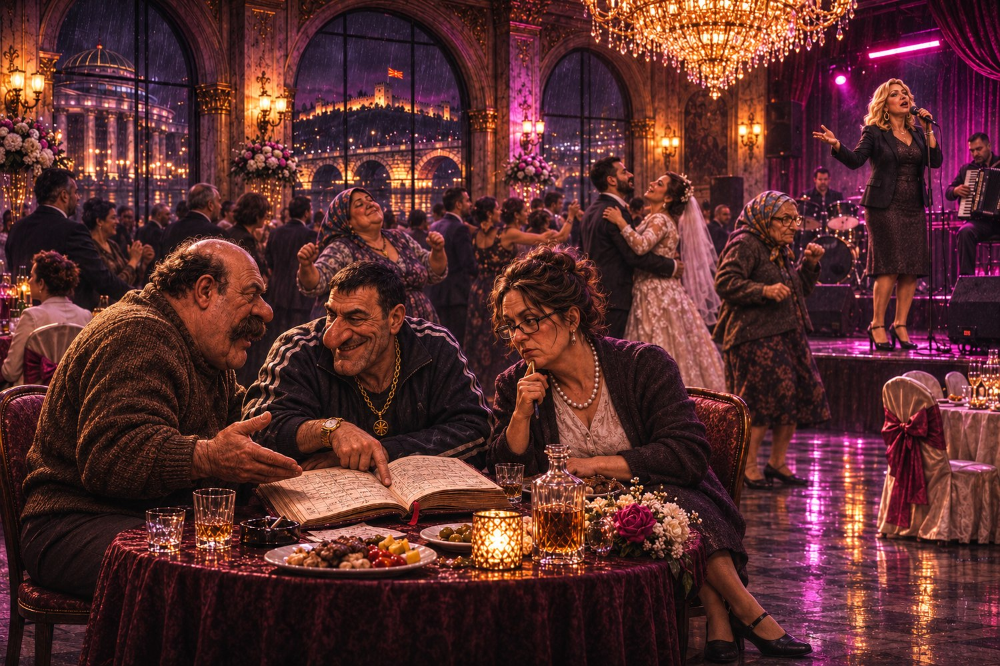

Ниво 1 од 4 · Лесна тежина. Мал рок, јавен распоред и разбирливи резервни контакти; погрешната сметка губи исплата, но не ја затвора приказната.

Во Дебар Маало Маца треба да пее „уште еднаш за младоженецот“. Човекот што ѝ ја дал таа нарачка е организатор од друга свадба. Кумплунг носи тапанар на една адреса, а Сара добива три е-пораки со ист простор и различни имиња. На прв поглед е смешна збрка. Половина гости веќе уплатиле настан што никој не го договорил со сала.

### Три патеки до масата

Маца ги врзува песните со гостите. Сара ги собира работните сметки и ги чува имињата на луѓе што уште зависат од газдата. Кумплунг ги пренесува музичарите и наоѓа различни верзии на истата нарачка. Ако првата сала се испразни, јавниот распоред и потврда од екипата продолжуваат.

Со јавна бламажа се отвора поврат на пари и се губи барем еден платен настап. Со вистинска веселба се плаќа екипата, но погрешната исплата бара проверка другиот ден. Со тивка спогодба можеш да ги сочуваш двете ако тројцата газди јавно ги признаат износите и луѓето дадат согласност.

## 63 · Ниво 2 · Град на награди

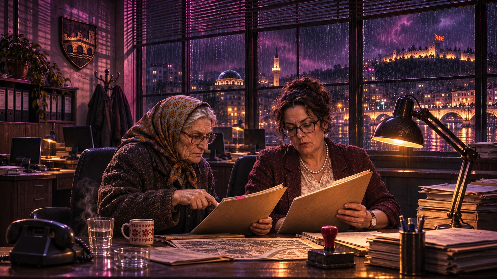

Ниво 2 од 4 · Умерена тежина. Еден јавен термин, спорни правила и последици врз маалски терен; промашен настап ја менува поддршката, не ја затвора приказната.

Министер на измислена градска приредба го објавува најкорисното маало со најмалку луѓе на сликата. Празен терен добива награда токму затоа што никој не ги броел младите што таму тренираат. Анкетата ги броела само пријавените фирми. Следната награда е нова ограда.

### Сатирична кампања

Славица бара стари правила на конкурс, Дуле ги носи луѓето без спонзор, а Теа прави обиколка на теренот со гости што можат сами да кажат за што го користат. Наместо препрека на секој чекор, има смешни но последични услови: фотографијата мора да има празна позадина, а говорот да трае една минута.

Преземи ја приредбата со потврдени говорници и изгуби една договорена сцена. Пренасочи ја наградата и договори кој навистина ќе ја чува опремата. Победи според нивните правила, добиј закуп и одлучи дали ќе го тргнеш својот лик од плакатите. Ако говорот се прекине, жителите повторно се собираат на терен со истите прашања.

## 64 · Ниво 3 · Последниот автобус

Ниво 3 од 4 · Тешка тежина. Ноќна рута, три извори што се разидуваат и избор меѓу безбедност, приватност и доказ; пропуштен возач бара нов контакт.

Возач остава три билети од тури што не се во распоредот. Димче мисли дека е стара линија. Бобан гледа два различни извештаи за истото возило. Миле бара луѓе кај последните станици и дознава дека автобусот се користел за превоз на луѓе на кои некој им наплатил туѓ долг.

### Мрак меѓу две станици

Патниците даваат несогласни времиња. Разговор во автобус ја открива една смена. Запис од киоск ја потврдува другата. Пропуштен возач отвора нова средба кај роднина или дневен термин кај билетарница. Исчезнатиот човек доброволно се крие и не сака да го враќаш само за да имаш крај.

Приватната изјава му дозволува да остане безбеден. Јавната објава го враќа прашањето кај работодавецот и случајот станува поширок. Ако му помогнеш да замине со оригиналот, ја задржуваш неговата согласност, а жителите се потпираат на две независни копии. Изборот останува тих: кого ќе дочекаш на последната станица?

## 65 · Ниво 4 · Ноќ без адреса

Ниво 4 од 4 · Многу тешка тежина. Краток зимски рок и три цели што не можат сите да се спасат во една етапа: товарот, возачот и единствениот оригинал.

Три зимски испораки се пријавени како завршени на една празна адреса. Владимир знае дека една пратка се чека. Мали препознава човек со ознака од возилото, а Весна ја знае зградата под име што повеќе го нема на таблата. Некој цела година наплаќал достави и сега се обидува да ја стави сметката кај возачите.

### Прв снег, последна смена

Прифаќаш само една итна етапа. Возачот има список со луѓе што чекаат; примачот ти кажува дека една испорака е стварна и дека не сака одложување. Можно е да го спасиш товарот со помошник, да однесеш возач на безбедно место или да го зачуваш единствениот оригинал. Без подготвен сојузник, нешто оди на втор термин.

Утринската проверка има различен почеток: спасен товар, доброволен возач или зачуван запис. Ако избрал погрешна адреса, човекот што останал буден може да отвори независна средба. Возачите сакаат исплата за вистинските тури и чиста евиденција. Сопственикот нуди да плати веднаш ако не кажеш кој ги впишувал измислените.

## 66 · Четири кампањи по растечка тежина

Препорачаниот ред е водич за учење, не заклучена патека. Сите четири кампањи се достапни во секое време; изборот и претходните врски одредуваат кои резервни контакти ги имаш. Тежината расте преку рокови, конфликтни извори, изложеност и мал број резерви, а не преку наметнато послушување.

### Ниво 1 · Свадба на три сметки

Почни со препознатлива јавна збрка и две јасни спорни сметки. Повеќе патеки се безбедни; цената е кој добива хонорар, а кој го губи настапот.

### Ниво 2 · Град на награди

Еден јавен рок и конкурс со пристрасно правило го креваат притисокот. Одлуката за приредбата остава последица за теренот и поддршката во маалото.

### Ниво 3 · Последниот автобус

Рутата се реконструира од несовршени записи, патници и изјава на возач. Играчот мора да одлучи што смее да се сподели и дали сведокот сака да остане или да замине.

### Ниво 4 · Ноќ без адреса

Една итна етапа, три испораки и еден оригинал ја ставаат екипата под најголем притисок. Не можеш да ги сочуваш сите предности; резервниот утрински контакт ја продолжува приказната, но со послаба позиција.

### Слободен избор и напредување

Можеш да влезеш директно во кое било ниво. Напредувањето по ред им дава повеќе контакти и информации; обратниот ред може да значи поскапи договори, пократок рок или поинаква поддршка. Ниедна кампања не е блокирана според лик, моралност или готовина.

## 67 · Три проверки со спротивни одлуки

### Се брзаш и го чуваш човекот

Со Миле, по кратката тура нема препознат курир. Стигни на приемот, одбиј да публикуваш без контекст, па избери прво да спасиш човек кај архивата. Треба да стигнеш до приемна сметка и до доброволен втор сведок. Јавната завршница е можна по исправна потврда на сите три досиеја. Нема задолжително враќање на истата тура.

### Се договараш со човек што ти должи

Со Велика, одреди неутрален чувар. Земете превоз од фамилијата и јасно кажете дека чувањето на папката останува независно. Ако внукот одбие, автобус и јавна средба ја задржуваат работата. Договори „Земја“ и „Пари“, три различни услуги и спогодба за еден простор. Во епилогот покажи и кој останал надвор и кому си понудил помош.

### Си ја барал бељата

Со Давид, пушти погрешна снимка и загуби сведок. Исправи ја изјавата без да објавиш нечие име. Провери повторно дека вниманието не исчезнува, другиот човек може да одбие јавност и дека втор сведок може да застане пред луѓето. Ако избираш продажба наместо исправка, бележникот јасно го кажува што губиш. Повторно вчитување после потписот не смее да исплати уште еднаш.

## 68 · Што значи дека градот памети

### Како се проверува секоја патека

За секоја голема одлука запиши пет работи: што виде играчот пред потпис, што се смени веднаш, кој нов разговор се отвори, кој исход стана поскап или недостапен и која сцена го покажува тоа подоцна. Ако две патеки одново се спојат на исто место, барем една од тие пет работи се разликува. Ако не се разликува ниедна, играчот треба да знае дека избира начин на играње.

### Задолжителните луѓе имаат резервни адреси

Клучни траги постојат во два независни извора. Граѓанин што исчезнал по прекин може да се врати преку друг контакт. Заклучена просторија има јавно место за средба. Небезбедна брза рута има побавна варијанта. Резервата има своја мала сцена, место и причина; бележникот ја покажува причината за промена.

### Деталот што останува на крај

Провери го клучот во раката на вистинската личност, одбивноста на човекот на кој му должиш и разликата меѓу сочувано име и сочувано работно место. Дури потоа проверувај колку поени има. Книгата е предлог за тоа како постојните градски системи, ликовите и новите мисионски реакции можат да раскажат една иста измама од навистина различни улици.

> „Ај сега кажи ми кај ќе седиме утре.“

## 69 · Десет милиони денари

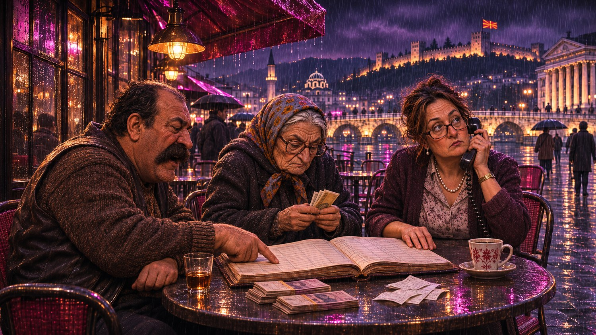

Десет милиони во бележникот значат нето-вредност: готовина плус износот што навистина можеш да го добиеш за својот имот и удел, минус долгови и договорени трошоци. Скривалиште со спорен плен е блокирана ставка додека не се реши кој го поседува. Пари од туѓи исплати, целосен приход на фирма и пари што си ветил да ги вратиш имаат свои редови.

Нов лик почнува со 3.000 денари плус десетпати од стариот профилен буџет. Димче има 3.000, Стојан 3.300, Кумплунг 5.500, Велика 12.000 и Владимир 18.000. Безбедната стартна сума не го прави секој сопственик на кола. Бесплатните патеки остануваат корисни ако си ги потрошил парите.

Во играта бројачот ја покажува целта од 10 милиони во готовина. Нето-вредноста, уделите и работите на следните страници се предлог за кампањата. Ако кампањата се додаде, бележникот ќе има посебни редови за готовина и нето-вредност.

## 70 · Што купува еден денар

### Секојдневни цени

Во играта: бурек со јогурт 120, тулумба 45, ќебапи 220, сендвич со ајвар 110, градско возење 40, тротинет 60, миење 300. Полнење од празно 3.690 за претпоставен резервоар од 45 литри. Дополна од 20% чини 738. Префарбување 24.000 е заокружена цена за играта. Постапките на улица, казните и дел од исплатите во песочникот се игровни правила.

### Од услуга до имот

Предложени исплати: мала работа 1.500–6.000; групен настап или цела работна тура 12.000–45.000 по договор; серија испораки или сезонски договор 70.000–250.000 чисто откако ќе се платат луѓето. Работен автомобил на втор пазар 180.000–420.000; мало деловно средство 600.000–2.500.000 според состојба; удел во работа со стварни договори се проценува од исполнети работи и потврдена куповна понуда. Овие се авторски распони за задачите, со простор за проверка на поставеноста во играта.

### Мерка за скалата

Државниот завод за статистика објави 49.141 денар просечна месечна нето-плата за септември 2026. Регулаторната комисија за енергетика на 23 ноември 2026 утврди 82 денари за литар од бензинот со ознака 95. Тоа се две проверени референци. Хонорарите и имотот на измислените ликови се проценки за игривост.

## 71 · Четири степени до големата маса

### Први 100.000 • Име и смена

Основни работи отвораат двајца контакти и еден повторлив договор. Секоја следна различна нарачка носи пари; истата сметка се плаќа еднаш. Можеш да земеш аванс за пократок пат, со конкретна обврска што подоцна може да дојде на наплата.

### Прв милион • Средство и партнер

По најмалку два успешно затворени договора добиваш две понуди: купување на деловно средство или удел со партнер. Играчот бира меѓу стабилен приход и поголема, поризична исплата. Ако го загубиш автомобилот, можеш да склучиш привремен договор за превоз и да ја задржиш мрежата.

### Пет милиони • Мрежа и изложеност

Договорите почнуваат да си пречат. Ако еден купувач сака исклучиво право, другиот контакт може да си замине. Реинвестирањето носи втор извор на доход. Грабеж или предавство што брка брза готовина може да даде голем скок, а загубата на купувач и доказ го стопира следниот круг.

### Десет милиони • Наплати или задржи

Последното парче може да биде продажба на удел, куповна понуда за работилница, исплата од голема работа или неколку затворени договори. Скала се мери по навистина припишаната вредност. Крајот на заговорот и финансискиот праг се две независни оски: можете да ја затворите приказната и да продолжите да градите имот.

## 72 · Множителот има газда

### Множители на исплатата

Почни од ×1,00 на основниот хонорар. Доказ дека работата е целосно испорачана +0,15. Втор договорен примач со посебен резултат +0,25. Учинок во тежок, доброволно прифатен рок +0,20. Авансната зависност −0,15. Загуба на дел од товарот −0,30. Ограничување ×0,60 до ×1,60. Трошоци, партнерски удел и долг се одземаат по множителот. Ако две ставки користат иста проверка, сметај ја еднаш. Овие множители се одделни од оние за време и напор на стр. 6.

### Како изгледа сметката

Договор од 180.000, цела испорака и втор примач даваат ×1,40, односно 252.000. Минус 62.000 за луѓе, гориво и поправка, чисто 190.000. Ако партнерот зема 30%, твојот дел е 133.000. „Побрза“ понуда од 250.000 со 100.000 исплата на луѓе и 100.000 стар долг придонесува 50.000. Износите се на понудата пред потпис.

### Финти што може да ги откриеш

Спои два различни примачи на една тура со нивна согласност; доцнењето кај првиот го менува вториот термин. Плати со договорен удел наместо аванс; партнерот носи дел од ризикот и зема дел од добивката. Сочувај доказ за решена повреда на договорот; отвора друг купувач ако првиот се повлече. Сите три финти се правила во играта со видливи услови.

## 73 · Три сметки што стигаат до целта

### Кумплунг • Двор со две врати

Зацврстува превоз и работилница со 16 затворени серии по 240.000 чисто за неговиот удел. Задржува 3.840.000 во готовина, плус свое деловно средство со потврдена понуда од 2.360.000 и удел во друга работа од 4.200.000, минус 400.000 долг. Нето-вредност: 10.000.000. Имотот е стекнат преку дополнителни вложувања и партнерски капитал, па сериите се остаток по тие уплати. Брзата криминална понуда за кражба на возило може да му го скрати патот, а да ја урне вредноста на работилницата ако купувачот се повлече.

### Маца • Настап што останува

Серија настапи и продажба на права даваат 4.750.000 задржани пари; понуда за удел во локал 6.100.000; неплатени хонорари и долг 850.000. Нето-вредност: 10.000.000. Да ги исплати музичарите порано го намалува кесето и обврската истовремено. Ако прифати да биде лице на измама, добива поголем аванс и ризикува неисполнети настапи.

### Славица • Договор без потпис под маса

Патека со платени проверки, формална работа и премин во удел: 2.100.000 во готовина, 8.700.000 потврдена куповна понуда, 800.000 долг. Таа може и да продаде пристап на посредник за брзи пари. Со тоа добива непосреден приход, а фирмата ризикува спор и губење на понудата. Во книгата ова се модели за доцна игра, со постепени прагови и реализација низ повеќе сезони.

## 74 · Што се продава зад затворена врата

Една кутија на архивата ги поврзува три линии: систематска кражба на возила во приказната, платен страв кај влезовите и измама со јавни набавки. Средната линија прераснува во изнуда, уцена и организирано насилство; последната во поткуп, фалсификувани записи и сокриени приходи. Секоја има луѓе што заработуваат и луѓе што плаќаат. На подоцнежните понуди се појавуваат и илегална трговија, договорени грабежи, уништување имот и нелегално обложување.

Под истиот настан можеш да земеш работа за фиксерот, да стоиш до луѓето што ги притиска или да се одвоиш со свој договор. Играта го памети кого си повредил, кој знае и кој е спремен да работи со тебе. Ако еден контакт умре или исчезне, неговата улога не оживува со истиот дијалог. Презема друг човек, пишан запис или делумен исход со траен трошок.

Измислената мрежа може да се појави и во шверц, трговија со дрога или киднапирање на возрасен сведок. Тука задачите се сценски одлуки за учество, откажување, спасување, пари и сведочење. Секоја линија остава други луѓе на твоја страна и друга цена кога ќе се распадне договорот.

## 75 · Три премини на истата ноќ

### Грабежот што ја отвора вратата

Магационер бара дел од 85.000 ако прифатиш авторска задача да се земе спорен товар. Можеш да учествуваш во пресметката, да договориш предавање со чуварот или да се откажеш и да одиш по евиденцијата. Во насилната варијанта помошник може да биде повреден, а комбето да не стигне до крај. По следната безбедна точка избираш плен, спасување или повлекување. Мирен договор може да чини половина удел и да го зачува сведокот.

### Уцена со точен документ

Посредник нуди 140.000 за право да го користи документот против управителот. Истиот документ би можел да ја плати смената на работниците преку потврда. Ако ја продадеш контролата, управителот губи функција, а работниците може да ја изгубат потврдата. Барање независен чувар ја одложува исплатата. Ако се откажеш од продажба, посредникот може да го објави сопствениот запис и да се отвори исправка.

### Цена на туѓото ќутење

Лик може да прифати пари и потоа да го предаде и партнерот. Следната сцена го покажува отпаднатиот договор и дали поранешниот партнер го дознал тоа. Нема општа морална скала. Криминалниот пазар цени готовина и моќ, додека возачот може едноставно да одбие да ти го даде клучот.

## 76 · После ударот

### Пресметка кај дворот

Раде праќа група да го растури собирот. Весна може да расчисти простор околу вратата, Сашо да придружи човек до излез, Дарко да застане меѓу двајца или да ја започне пресметката. Ако удриш прв, групата се повлекува побрзо во една варијанта, а поранешен сојузник може да побара поддршка за повредениот наместо да дојде на потпис. Ако ја оставиш салата да се растури за да го извлечеш сведокот, јавната сцена се сели на помали средби. Доказите и луѓето имаат одделни исходи.

### Насилство што останува во историјата

Нокаут, тешка повреда или смрт ја менуваат достапноста на ликовите, трошокот за завршување и семејната сцена. Играчот може да префрли пари за штета. Семејството решава дали ќе ги земе и дали ќе зборува. Тоа не создава уште еден ист сведок. Доказот оди кај друг извор или се губи можноста за конкретна верзија на финалето. Вклучи и ветување за помош што може да се прекрши, со истиот запис како повторен трошок. Јавната последица е видлива преку прекинат настап, позатворен влез и заменски контакт.

## 77 · Волан, микрофон, буџет

### Кумплунг и Миле

Кумплунг преговара за 42.000 за обновена кола или зема 95.000 од фиксерот за авторска работа со украдено возило. Брзите пари му го тргаат Горан како чувар на оригинал. Миле има 12.000 за серија чисти тури или 70.000 за записот од една опасна ноќ. Ако го продаде и понатаму има рути и возачи, но ја губи Елена и плаќа со нова проверка.

### Маца и Стојан

Маца договара 36.000 за цела вечер со музичари или 120.000 за јавно покривање на настанот, со ризик сведоците да ѝ ја бојкотираат пробата. Стојан може да земе 18.000 за проверени сметки или 80.000 за приватната листа. Постигнатата точност отвора следни платени проверки; продадената листа отвора уцена и можност сопственикот да го прекине пристапот. Буџетскиот попуст му ја чува заработката на пешачки пат.

## 78 · Камера, услуги, влез

### Давид и Сара

Давид добива 25.000 за серија проверени приказни или 110.000 за спонзориран исечок со спорно тврдење. Поправка ја менува идната публика и може да го раскине договорот. Сара добива 40.000 за договорена работа со повеќе соработници или 130.000 за прифаќање да покрие измислено спонзорство. Стилистката може да ѝ остави втор клиент ако договорот е фер.

### Весна и Велика

Весна може да води договор за одржување на влезови со 18.000 за етапа или да земе 90.000 за селективен пристап до клучеви во приказната. Во вториот случај има пари за лифт и човек што ја обвинува за продажба на туѓа безбедност. Велика заработува преку делен закуп или добива 180.000 аванс за приватен имотен договор со спорен потпис. Ако не го именува другиот наследник во договорот, потврдениот имотен удел останува блокиран.

## 79 · Меморија, значка, грижа

### Димче и Бобан

Димче добива 8.000 за вечер на културни записи или 55.000 за премолчување на една идентификација. Платеното молчење му го менува човекот што го посетува на клупата. Бобан може да одржи дозволени задачи и да продолжи законски или да земе 160.000 за префрлање на спорен предмет во приказната. Колега станува доверлив партнер или главен сведок против него.

### Владимир и Мали

Владимир избира 65.000 за проверени платени услуги или 200.000 за донаторски договор што ја покрива целата спорна испорака. Сметката се гледа по наредната смена ако донаторот побара молчење. Мали заработува 8.000 од кратки достави, а фиксерот нуди 25.000 за молчење за виденото. Можеш да го земеш авансот и да го вратиш подоцна. Тогаш другарот останува човек со свој избор за сведочење, а друго лице ќе сака да си ја наплати услугата.

## 80 · Смена, фурна, терен

### Момчило и Благоја

Момчило добива 34.000 од чиста екипна работа по трошоци или 145.000 за потпис што ја покрива спорната смена. Луѓето подоцна ќе ја одбијат неговата понуда за работа или ќе побараат вистинска исплата. Благоја може да собира 28.000 од тура на нарачки или 105.000 од договор со фиктивни приеми. Љупчо ја гледа таа верзија на сметката кога бара заеднички простор.

### Љупчо и Теа

Љупчо добива 26.000 за серија испораки или 95.000 со лиценца што тивко ја исклучува помошничката. Може да си го отвори својот простор и да остане без човек што го знае работењето. Теа зема 32.000 од часови и поддршка или 150.000 за реклама што го претставува јавниот терен како приватен. Ако избере пари, придружничката може да направи независна група и да му го наруши договорот на спонзорот.

## 81 · Сила, статус, кадар

### Дарко и Кики

Дарко може да собере 35.000 од групни тренинзи или 170.000 за насилно обезбедување во измислената мисија. Работодавецот плаќа по завршена етапа; ако членот е повреден, завршницата има болничка средба и изгубена понуда за локал. Кики наплаќа 42.000 за дозволена процена или добива 220.000 за молчење околу потеклото на предметот. Ако подоцна сака да го врати, купувачот поставува нов услов и фамилијата може да одбие да ја брани.

### Палавко и Михаил

Палавко може да земе 14.000 од снимање и движење по авторски патеки или 55.000 за објава што го изложува сведокот. Наутро друга група го откажува настапот. Михаил може да помогне на настан за 6.000 или да прифати пакет за класот вреден 40.000 како услов да ја повлече жалбата. Пакетот не е негов имот и не оди во личните милиони. Неговата патека гради мрежа за подоцнежни законски работи и организирање, со приватност на соучениците.

## 82 · Ред, трибина, печат, училница

### Сашо и Дуле

Сашо добива 48.000 за етапи на придружба или 185.000 за присилна работа на приватно обезбедување во приказната. Прифаќањето отвора поголем договор и го губи станарското сведоштво. Дуле избира 38.000 за организација или 135.000 за платено заплашување на собир. Групата не станува едногласна. По конфликтот еден возач одбива да го пренесе товарот ако не му се врати долг.

### Славица и Снежана

Славица добива 28.000 за завршени договорени проверки или 180.000 од посредник за спорна приватна услуга. Колешката што ја изложила може да го оспори подоцнежниот удел. Снежана добива 30.000 за група часови или 120.000 од приватен спонзор за изборно исклучување на една група. Ако го прифати договорот, може да отвори свое училиште порано. Родителите што останале без превоз подоцна бараат седиште во новиот договор или прават своја група.

## 83 · Кога ќе ја отвориш касата

### Цената во последниот кадар

Отвори бележник: се гледа што можеш да продадеш, колку си должен, чиј е спорниот товар и дали денешната понуда е потврдена. Твојот праг од 10 милиони може да биде достигнат со сочувано сведоштво, приватен договор или тешка криминална историја. Потоа можеш да ја задржиш работата и да играш за луѓе што не стигнале до истата сума, или да продолжиш да преземаш нов ризик.

### Проверка на затворањето

Земи заем од 2 милиони: нето-вредноста не расте за цел заем. Продај сопствен удел: вредноста се префрла од имот во готовина еднаш. Изгуби спорен оригинал: наследениот доказ не ја удвојува исплатата. Смени лик со нов почеток: новиот буџет е својство на нова игра, зачуваната готовина останува при вчитување. Во криминалната патека помини низ пропадната пресметка и провери дека другата завршница сѐ уште има јасен услов. Провери посебно дали можеш да стигнеш до прагот без да повторуваш иста награда.

> „Десет милиони, брат. А сега кажи ми кој ти се јавува кога ќе ти заглави колата.“

## 84 · Црната смена

### Од што почнува

По спорната испорака избери дали да се сретнеш со работникот од вториот документ или со човекот што нуди 85.000 за товарот. Работникот вели дека списокот за работна смена е копиран од стар график. Покровителот тврди дека сите му се платени. За доказ ти треба човек што стварно бил таму и сметка што не потекнува од истиот лист.

### Кого ќе споиш, кого ќе изиграш

Можеш да прифатиш криминална работа во авторската сцена, да ја префрлиш исплатата на работниците со помал удел за себе или да ги предадеш двата записи кај јавен чувар. Првата патека доаѓа со можна пресметка и спорен плен. Втората ги задржува луѓето и прави јавниот случај зависен од друг доказ. Третата ја штити сметката, но ја губиш понудата за голем хонорар, дури и ако подоцна пак му се јавиш на посредникот.

### Ако смената се распадне

Момчило може да добие втора изјава од примачот. Сара може да го најде договорениот ангажман кај стилистката што работела на настанот. Сашо добива потврда за својот дел од смената и мора да ја остави останатата работа на сведоците. Ако дојде до смрт, следи одделна семејна сцена, а никој друг не го повторува гласот на загинатиот. За остатокот од исплатата мора да одиш преку фактурата.

## 85 · Собир под кирија

### Понудата на маса

Еден купувач сака да преземе локал чиј газда веќе плаќа за „заштита“. Не знаеш дали купувачот ќе го задржи персоналот. Знаеш дека бара право на единствен пристап, чиста сметка за кирија и повлекување на еден јавен исказ. Сопственичката на локалот ти ја покажува договорената смена на луѓето, а не целото досие што го има.

### Избори со различен ризик

Може да го купиш уделот со легален договор, да го користиш како услов за притисок, да ја продадеш информацијата за сопственичката или да прифатиш да го спречиш собирот со насилство. Легалниот договор го одложува профитот и ги задржува луѓето само ако сами потпишат. Со притисок добиваш пониска цена и губиш дел од подоцнежната мрежа. Продажбата ја остава сопственичката сама да одлучи дали ќе го затвори локалот. Со насилство можеш да ја добиеш брзата договорена исплата, а подоцна да платиш за лично предизвикани загуби и да изгубиш јава употреба на просторот.

### Излез после штета

Маца може да го закаже настапот на друга локација. Дуле добива помала група ако врати дел од парите. Весна отвора втора средба во двор и го прашува управителот кој дел од договорот важи. Ако никој не сака да се врати, можеш да ја затвориш работата со материјална загуба и да продолжиш со друг имот.

## 86 · Капитал што продолжува да работи

### Три вида приход

Готовина од завршена задача, оперативен приход од веќе договорени работи и капитална добивка од реализиран удел се одделни. Имотот не прави бескрајна исплата додека играчот чека во мени. Нов циклус бара исполнети нарачки, трошок за луѓе и слободен договорен капацитет. Ако ја затвориш фирмата, останува пазарна понуда минус долговите и трошок за излез.

### Нелегалната заработка има свој исход

Спорен товар може да има висока понуда и ниска реална вредност ако купувачот си замине. Долг од неисплатена смена се плаќа дури и ако екипата ти е лута. Лажна фактура може да донесе готовина и да створи долг откако другиот човек ќе ја оспори. Поправката е одделна мисија со избор дали да платиш, да признаеш или да го оставиш спорот нерешен. Спорот го чувствуваш во понудите што пристигнуваат, не само во еден црвен број.

### Кога прагот е надминат

Одбери дали ќе продадеш за да го видиш целиот износ во готовина, ќе задржиш имот што носи работа или ќе подариш дел и ќе продолжиш под прагот. Актуелната состојба се гледа во бројачот. Постигнатиот врв може да се запише во историјата на кампањата. Двата записи се различни: што си имал еден ден и што имаш сега.
